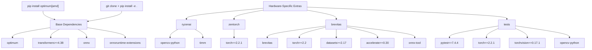
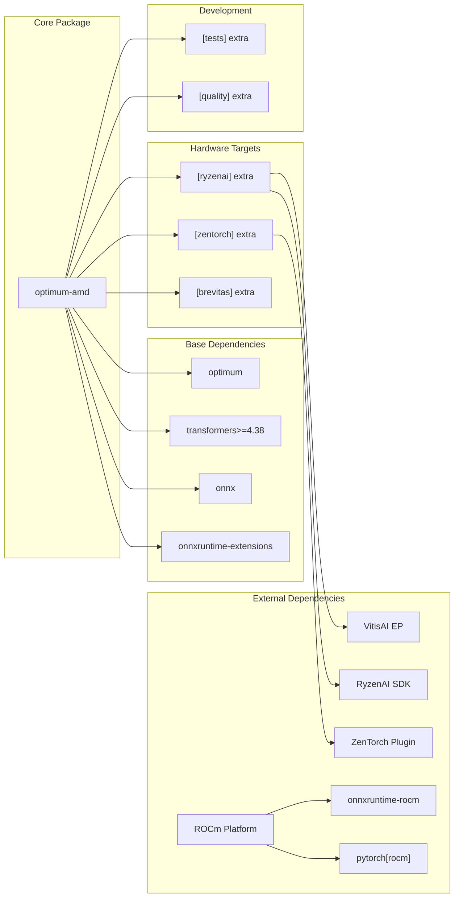

<!-- source: DeepWiki mcp.deepwiki.com · repo huggingface/optimum-amd · page 1.1 Installation and Setup · fetched 2026-10-26 -->

# Installation and Setup

<details>
<summary>Relevant source files</summary>

The following files were used as context for generating this wiki page:

- [.github/workflows/test_ryzenai_quantization_timm.yaml](.github/workflows/test_ryzenai_quantization_timm.yaml)
- [README.md](README.md)
- [pyproject.toml](pyproject.toml)
- [setup.py](setup.py)

</details>


This document covers the installation and configuration of optimum-amd, including its hardware-specific dependencies for AMD CPUs, GPUs, and NPUs. For detailed usage of specific hardware targets, see [RyzenAI System](#2) for NPU usage, [ROCm GPU Support](#4) for GPU acceleration, [ZenTorch CPU Optimization](#5) for CPU optimization, and [Brevitas Quantization](#3) for LLM quantization workflows.

## Installation Methods

### Standard Installation

The simplest installation method uses pip to install optimum-amd with its core dependencies:

```bash
pip install --upgrade-strategy eager optimum[amd]
```

This installs the base package with dependencies defined in [setup.py:17](), including `optimum`, `transformers>=4.38`, `onnx`, and `onnxruntime-extensions`.

### Development Installation

For development or to get the latest features, install from source:

```bash
git clone https://github.com/huggingface/optimum-amd.git
cd optimum-amd
pip install -e .
```

### Installation Flow



*Installation dependency structure showing base requirements and optional hardware-specific extras*

Sources: [setup.py:17-51](), [README.md:7-19]()

## Hardware-Specific Installation

### RyzenAI NPU Setup

For AMD Ryzen AI NPU support, install the RyzenAI extras:

```bash
pip install optimum[amd,ryzenai]
```

This includes additional dependencies like `opencv-python` and `timm` as defined in [setup.py:39](). However, the core RyzenAI runtime environment requires separate installation following [AMD's RyzenAI documentation](https://ryzenai.docs.amd.com/en/latest/inst.html).

**Required External Setup:**
1. Install RyzenAI Software from AMD
2. Configure the runtime environment per [RyzenAI Runtime Setup](https://ryzenai.docs.amd.com/en/latest/runtime_setup.html)
3. Verify `VitisAIExecutionProvider` is available in ONNX Runtime

### ROCm GPU Support

For AMD GPU acceleration with ROCm:

```bash
# Install PyTorch for ROCm first
pip install torch torchvision --index-url https://download.pytorch.org/whl/rocm5.7

# Then install optimum-amd
pip install optimum[amd]
```

**Required External Setup:**
1. Install [ROCm 5.7](https://rocm.docs.amd.com/en/latest/deploy/linux/index.html) on the host system
2. For ONNX Runtime support, build `onnxruntime-rocm` from source (pip wheels not available)
3. Use the provided [Docker environment](docker/onnx-runtime-amd-gpu/Dockerfile) for containerized deployment

### ZenTorch CPU Optimization

For AMD CPU optimization with ZenTorch:

```bash
pip install optimum[amd,zentorch]
```

This installs the specific PyTorch version required for ZenTorch integration as specified in [setup.py:40]().

### Brevitas Quantization

For LLM quantization with Brevitas:

```bash
pip install optimum[amd,brevitas]
```

This installs the comprehensive quantization stack including `brevitas`, `datasets>=2.17`, `accelerate>=0.30`, and related tools as defined in [setup.py:41-50]().

## Dependency Structure



*Package dependency architecture showing internal and external requirements*

Sources: [setup.py:17-51](), [README.md:21-28](), [README.md:82-84]()

## Development Environment Setup

### Testing Installation

For running the test suite, install test dependencies:

```bash
pip install .[tests]
```

This installs testing tools including `pytest<=7.4.4`, `parameterized`, `timm`, and other dependencies defined in [setup.py:20-32]().

### Code Quality Tools

For development with code formatting and linting:

```bash
pip install .[quality]
```

This installs `black~=23.1` and `ruff>=0.0.241,<=0.0.259` as specified in [setup.py:34]().

### Configuration Files

The development environment uses several configuration files:

| File | Purpose | Key Settings |
|------|---------|-------------|
| `pyproject.toml` | Code quality configuration | Black line length: 119, Ruff rules, pytest markers |
| `setup.py` | Package definition | Entry points, dependencies, extras |

Sources: [pyproject.toml:1-23](), [setup.py:53-86]()

## Installation Verification

### Basic Verification

Verify the core installation:

```python
import optimum.amd
from optimum.amd import __version__
print(f"Optimum-AMD version: {__version__}")
```

### Hardware-Specific Verification

#### RyzenAI Verification

```python
from optimum.amd.ryzenai import RyzenAIModel
# Should import without errors if RyzenAI SDK is properly installed
```

#### ROCm Verification

```python
import torch
print(f"ROCm available: {torch.cuda.is_available()}")
print(f"ROCm device count: {torch.cuda.device_count()}")
```

#### Command Line Interface

The package installs the `amdrun` CLI tool defined in [setup.py:80]():

```bash
amdrun --help
```

For detailed CLI usage, see [Command Line Interface](#6).

## Environment Variables and Runtime Configuration

### RyzenAI Configuration

RyzenAI models use configuration files located in `optimum/amd/ryzenai/configs/*.json` as specified in [setup.py:83](). The runtime can be configured through `vaip_config.json` files for detailed performance tuning.

### Testing Environment Variables

Several environment variables control test behavior as shown in [README.md:134-147]():

| Variable | Purpose | Example |
|----------|---------|---------|
| `RUN_SLOW` | Enable slow tests that download large models | `RUN_SLOW=1 pytest` |

Sources: [README.md:114-151](), [setup.py:80-84]()

## Docker Environments

For consistent development and deployment, several Docker environments are available:

- `docker/onnx-runtime-amd-gpu/Dockerfile` - ROCm + ONNX Runtime environment
- `docker/transformers-pytorch-amd-gpu-flash/Dockerfile` - ROCm + Flash Attention
- `docker/optimum-amd-zentorch/Dockerfile` - AMD CPU + ZenTorch optimization

For detailed Docker setup, see [Docker Environments](#7.3).

Sources: [README.md:56](), [.github/workflows/test_ryzenai_quantization_timm.yaml:24-31]()

---

