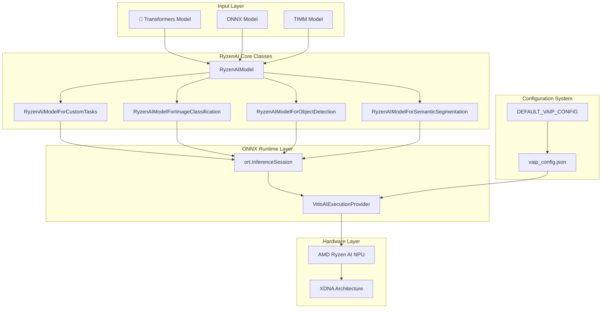
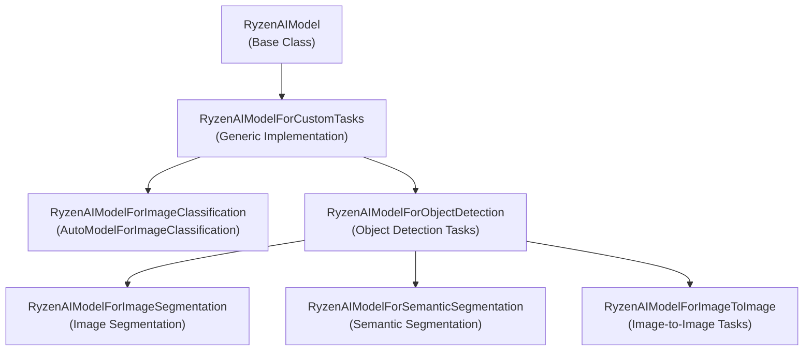
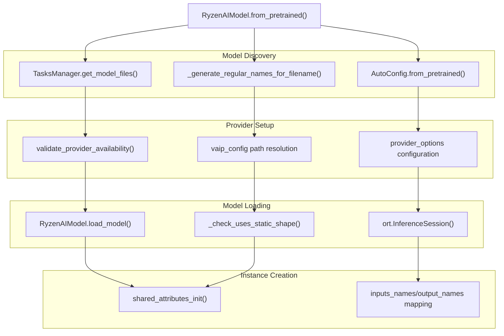
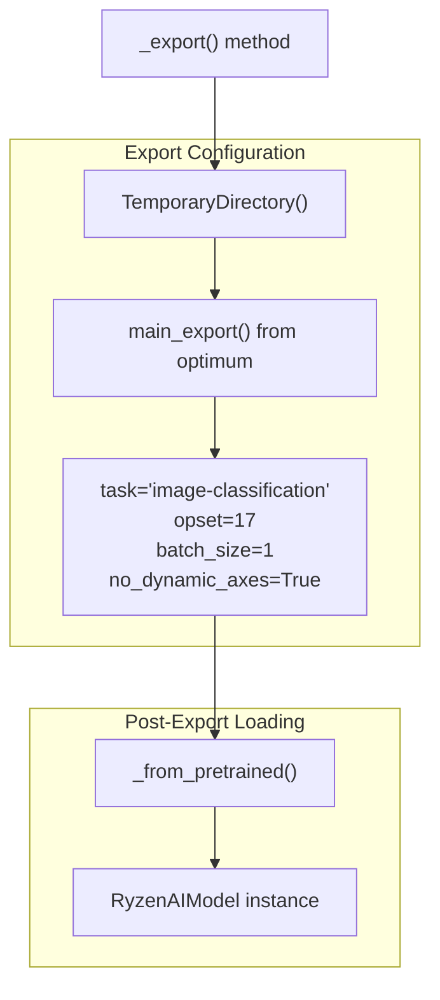

<!-- source: DeepWiki mcp.deepwiki.com · repo huggingface/optimum-amd · page 2 RyzenAI System · fetched 2026-10-26 -->

# RyzenAI System

Relevant source files

The following files were used as context for generating this wiki page:

- [docs/source/ryzenai/overview.mdx](docs/source/ryzenai/overview.mdx)
- [optimum/amd/ryzenai/__init__.py](optimum/amd/ryzenai/__init__.py)
- [optimum/amd/ryzenai/modeling.py](optimum/amd/ryzenai/modeling.py)
- [optimum/amd/ryzenai/utils.py](optimum/amd/ryzenai/utils.py)

The RyzenAI System provides optimized inference for Hugging Face models on AMD Ryzen AI NPU hardware using the VitisAI execution provider within ONNX Runtime. This system handles the complete workflow from ONNX model loading to hardware-accelerated inference for computer vision tasks.

For details on model quantization specific to RyzenAI, see [Quantization](#2.2). For high-level pipeline interfaces, see [Pipelines](#2.3). For runtime configuration options, see [Configuration](#2.4). For detailed model implementation and inference mechanics, see [Models and Inference](#2.1).

## System Architecture

The RyzenAI system bridges Hugging Face models with AMD NPU hardware through a layered architecture:

Sources: [optimum/amd/ryzenai/modeling.py:47-70](), [optimum/amd/ryzenai/modeling.py:568-701](), [optimum/amd/ryzenai/utils.py:13]()

## Core Components

### RyzenAIModel Base Class

The `RyzenAIModel` class serves as the foundation for all RyzenAI model implementations:

| Component | Code Entity | Purpose |
|-----------|-------------|---------|
| Base Model | `RyzenAIModel` | Abstract base class with common functionality |
| ONNX Session | `ort.InferenceSession` | ONNX Runtime inference session |
| Provider | `VitisAIExecutionProvider` | AMD NPU execution provider |
| Configuration | `vaip_config` | Runtime configuration for VitisAI |

The class hierarchy establishes shared attributes and methods for model loading, configuration management, and hardware integration.

Sources: [optimum/amd/ryzenai/modeling.py:47-135]()

### Task-Specific Model Classes

Each task-specific class implements the `forward()` method optimized for its particular use case while inheriting common functionality from the base classes.

Sources: [optimum/amd/ryzenai/modeling.py:568-701]()

## Model Loading and Initialization

### Loading Workflow

The loading process validates provider availability, resolves configuration paths, performs static shape checking, and initializes the ONNX Runtime session with VitisAI provider.

Sources: [optimum/amd/ryzenai/modeling.py:227-508](), [optimum/amd/ryzenai/modeling.py:144-189]()

### Key Loading Parameters

| Parameter | Default | Purpose |
|-----------|---------|---------|
| `provider` | `"VitisAIExecutionProvider"` | ONNX Runtime execution provider |
| `vaip_config` | `DEFAULT_VAIP_CONFIG` | VitisAI runtime configuration |
| `file_name` | Auto-detected | ONNX model filename |
| `provider_options` | `None` | Provider-specific options |

Sources: [optimum/amd/ryzenai/modeling.py:240-297](), [optimum/amd/ryzenai/utils.py:13]()

## Execution Flow

### Inference Pipeline

The inference execution follows a standardized pattern across all task-specific models:

```mermaid
graph LR
    input["Input Tensors"]
    
    subgraph "Preprocessing"
        torch_check["isinstance(input, torch.Tensor)"]
        numpy_convert["tensor.cpu().detach().numpy()"]
        onnx_inputs["onnx_inputs dict preparation"]
    end
    
    subgraph "Inference"
        session_run["model.run(None, onnx_inputs)"]
        ort_execution["ONNX Runtime + VitisAI"]
    end
    
    subgraph "Postprocessing"
        output_mapping["output_names index mapping"]
        torch_convert["torch.from_numpy()"]
        model_output["ModelOutput/ImageClassifierOutput"]
    end
    
    input --> torch_check
    torch_check --> numpy_convert
    numpy_convert --> onnx_inputs
    onnx_inputs --> session_run
    session_run --> ort_execution
    ort_execution --> output_mapping
    output_mapping --> torch_convert
    torch_convert --> model_output
```

Sources: [optimum/amd/ryzenai/modeling.py:569-601](), [optimum/amd/ryzenai/modeling.py:607-619]()

### Static Shape Requirements

The system enforces static input/output shapes for VitisAI compatibility:

- Dynamic axes detection via `_check_uses_static_shape()`
- Shape validation during model loading
- Runtime error for models with dynamic dimensions
- Shape reshaping support via `reshape()` method

Sources: [optimum/amd/ryzenai/modeling.py:511-565]()

## Model Export and Compatibility

### Export Capabilities

The system provides export functionality for select model types:

Export is currently supported for `RyzenAIModelForImageClassification` with specific constraints for NPU compatibility.

Sources: [optimum/amd/ryzenai/modeling.py:622-673]()

---

