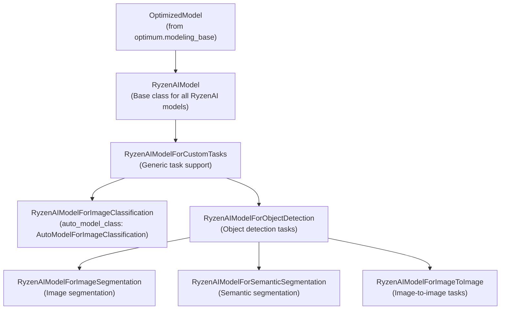
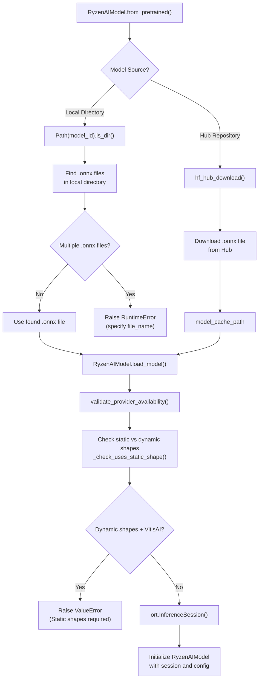
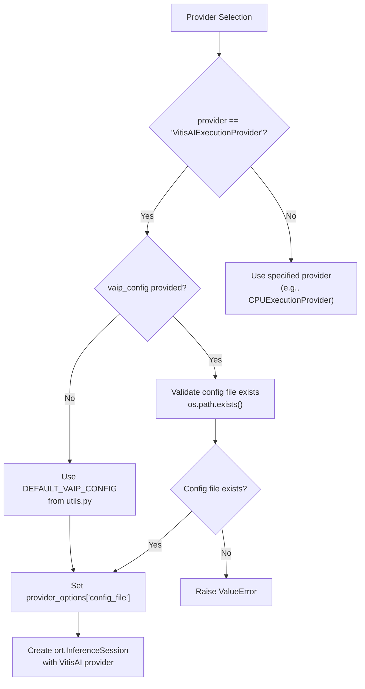
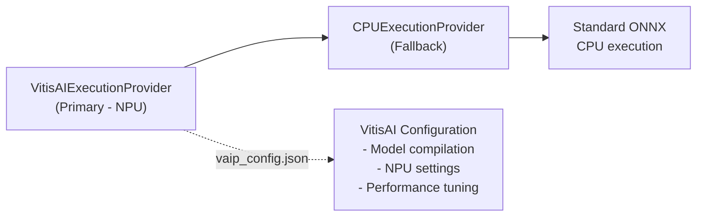
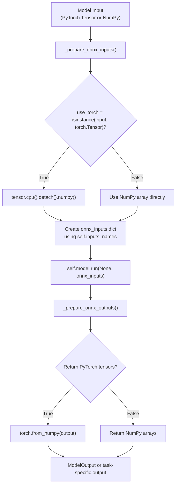
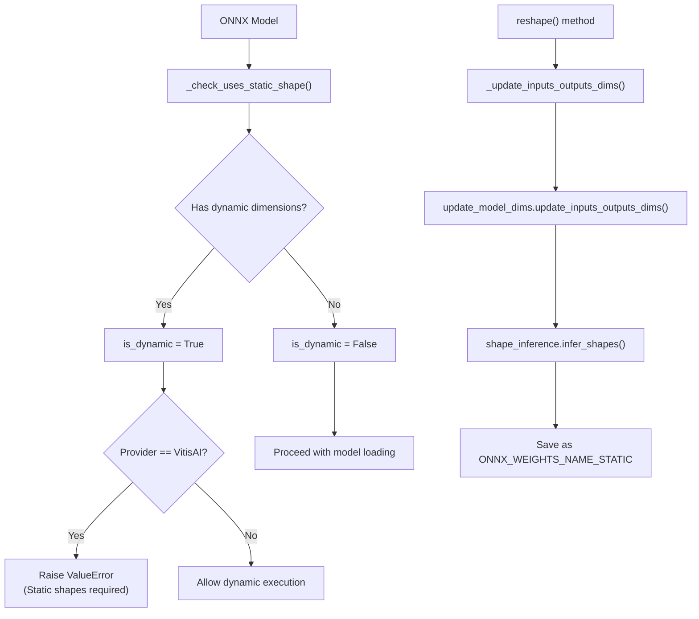
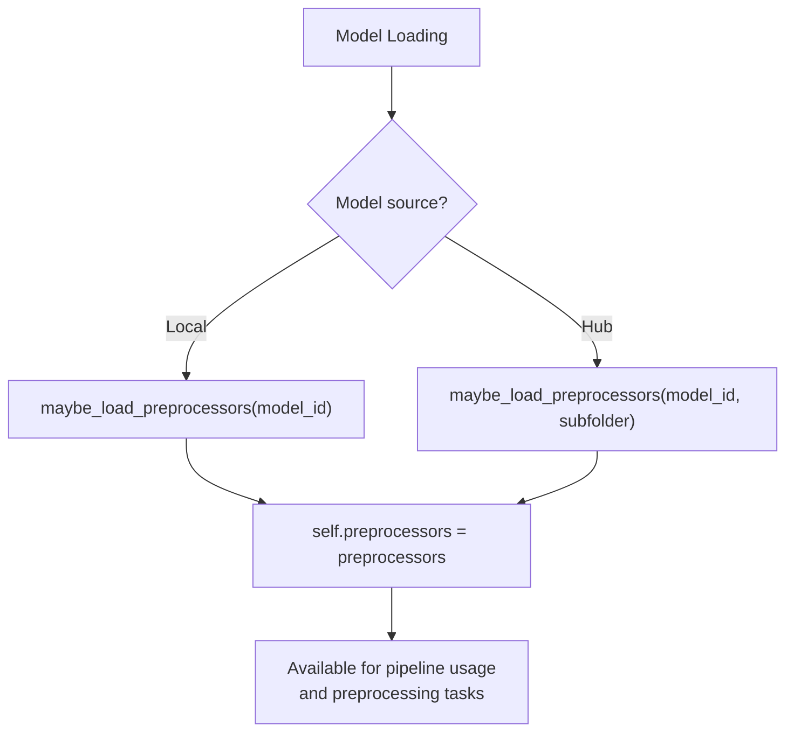

<!-- source: DeepWiki mcp.deepwiki.com · repo huggingface/optimum-amd · page 2.1 Models and Inference · fetched 2026-10-26 -->

# Models and Inference

Relevant source files

The following files were used as context for generating this wiki page:

- [docs/source/ryzenai/package_reference/modeling.mdx](docs/source/ryzenai/package_reference/modeling.mdx)
- [optimum/amd/ryzenai/modeling.py](optimum/amd/ryzenai/modeling.py)
- [optimum/amd/ryzenai/models/hrnet/__init__.py](optimum/amd/ryzenai/models/hrnet/__init__.py)
- [optimum/amd/ryzenai/models/hrnet/image_processing_hrnet.py](optimum/amd/ryzenai/models/hrnet/image_processing_hrnet.py)
- [optimum/amd/ryzenai/models/semanticfpn/__init__.py](optimum/amd/ryzenai/models/semanticfpn/__init__.py)
- [optimum/amd/ryzenai/models/semanticfpn/image_processing_semantic_fpn.py](optimum/amd/ryzenai/models/semanticfpn/image_processing_semantic_fpn.py)
- [optimum/amd/ryzenai/pipelines/image_segmentation.py](optimum/amd/ryzenai/pipelines/image_segmentation.py)
- [optimum/amd/ryzenai/utils.py](optimum/amd/ryzenai/utils.py)
- [tests/ryzenai/test_modeling.py](tests/ryzenai/test_modeling.py)

This document covers the core RyzenAI model classes and inference system that enables running ONNX models on AMD Ryzen AI NPUs through the VitisAI execution provider. This includes the `RyzenAIModel` base class, task-specific model implementations, ONNX Runtime integration, and the complete inference workflow from model loading to output processing.

For information about quantizing models for RyzenAI deployment, see [Quantization](#2.2). For high-level pipeline interfaces, see [Pipelines](#2.3). For runtime configuration options, see [Configuration](#2.4).

## Core Model Classes

The RyzenAI system implements a hierarchy of model classes that provide a unified interface for running ONNX models on AMD hardware. All model classes inherit from the base `RyzenAIModel` class and follow the Hugging Face `OptimizedModel` pattern.

### Class Hierarchy

**Sources:** [optimum/amd/ryzenai/modeling.py:47-701]()

### Base RyzenAIModel Class

The `RyzenAIModel` class serves as the foundation for all RyzenAI model implementations. It provides core functionality for model loading, ONNX Runtime session management, and Hugging Face Hub integration.

| Attribute | Type | Description |
|-----------|------|-------------|
| `model` | `ort.InferenceSession` | The ONNX Runtime inference session |
| `config` | `PretrainedConfig` | The model configuration |
| `model_save_dir` | `Path` | Directory containing the ONNX model files |
| `providers` | `List[str]` | Available ONNX Runtime execution providers |
| `vaip_config` | `Path` | Path to VitisAI configuration file |

**Sources:** [optimum/amd/ryzenai/modeling.py:47-132]()

## Model Loading and Initialization

The RyzenAI system provides a comprehensive model loading workflow that handles both local and Hub-based models, with automatic configuration management and provider setup.

### Loading Workflow

**Sources:** [optimum/amd/ryzenai/modeling.py:228-357](), [optimum/amd/ryzenai/modeling.py:143-189]()

### Provider Configuration

The system automatically configures the VitisAI execution provider with appropriate settings:

**Sources:** [optimum/amd/ryzenai/modeling.py:277-298](), [optimum/amd/ryzenai/utils.py:13]()

## ONNX Runtime Integration

The RyzenAI system integrates deeply with ONNX Runtime, providing specialized handling for the VitisAI execution provider and AMD NPU hardware.

### Session Management

| Method | Purpose | Key Features |
|--------|---------|--------------|
| `load_model()` | Creates ONNX Runtime session | Provider validation, static shape checking |
| `_check_uses_static_shape()` | Validates model shapes | Ensures NPU compatibility |
| `reshape()` | Converts dynamic to static shapes | Uses `update_model_dims.update_inputs_outputs_dims()` |

### Execution Provider Chain

**Sources:** [optimum/amd/ryzenai/modeling.py:165-189](), [optimum/amd/ryzenai/utils.py:16-27]()

## Task-Specific Model Classes

Each task-specific model class provides specialized input/output handling and integrates with the broader Hugging Face ecosystem through auto-registration.

### Input/Output Processing

**Sources:** [optimum/amd/ryzenai/modeling.py:581-601]()

### Task-Specific Implementations

| Class | Auto Model Class | Output Format | Specialization |
|-------|------------------|---------------|----------------|
| `RyzenAIModelForImageClassification` | `AutoModelForImageClassification` | `ImageClassifierOutput` | Single input handling, logits extraction |
| `RyzenAIModelForObjectDetection` | None | `ModelOutput` | Multiple outputs for bounding boxes |
| `RyzenAIModelForSemanticSegmentation` | None | `ModelOutput` | Segmentation mask outputs |
| `RyzenAIModelForCustomTasks` | None | `ModelOutput` | Generic input/output mapping |

**Sources:** [optimum/amd/ryzenai/modeling.py:604-701]()

## Model Shape Management

RyzenAI requires static input shapes for NPU execution. The system provides utilities to detect and convert dynamic models to static shapes.

### Shape Detection and Conversion

**Sources:** [optimum/amd/ryzenai/modeling.py:510-565](), [optimum/amd/ryzenai/utils.py:10-11]()

## Preprocessor Integration

The system automatically loads and manages preprocessors (image processors, tokenizers) from the Hugging Face Hub, ensuring compatibility with the broader ecosystem.

### Preprocessor Loading

**Sources:** [optimum/amd/ryzenai/modeling.py:308](), [optimum/amd/ryzenai/modeling.py:344]()

---

