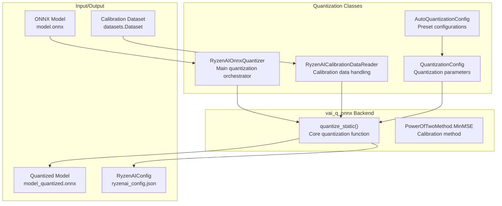
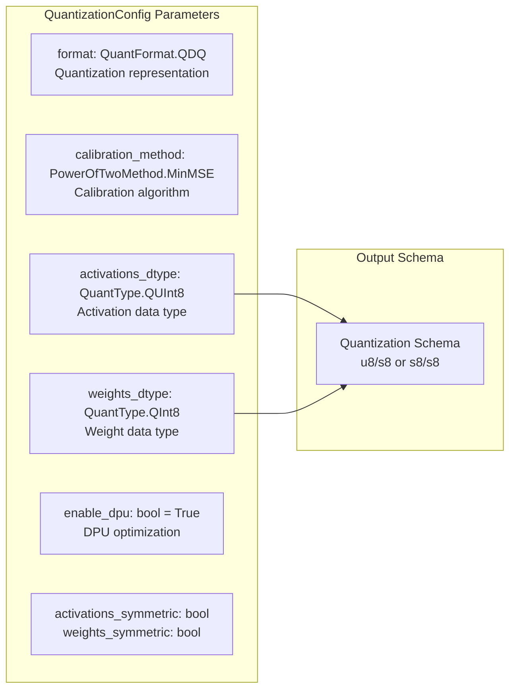
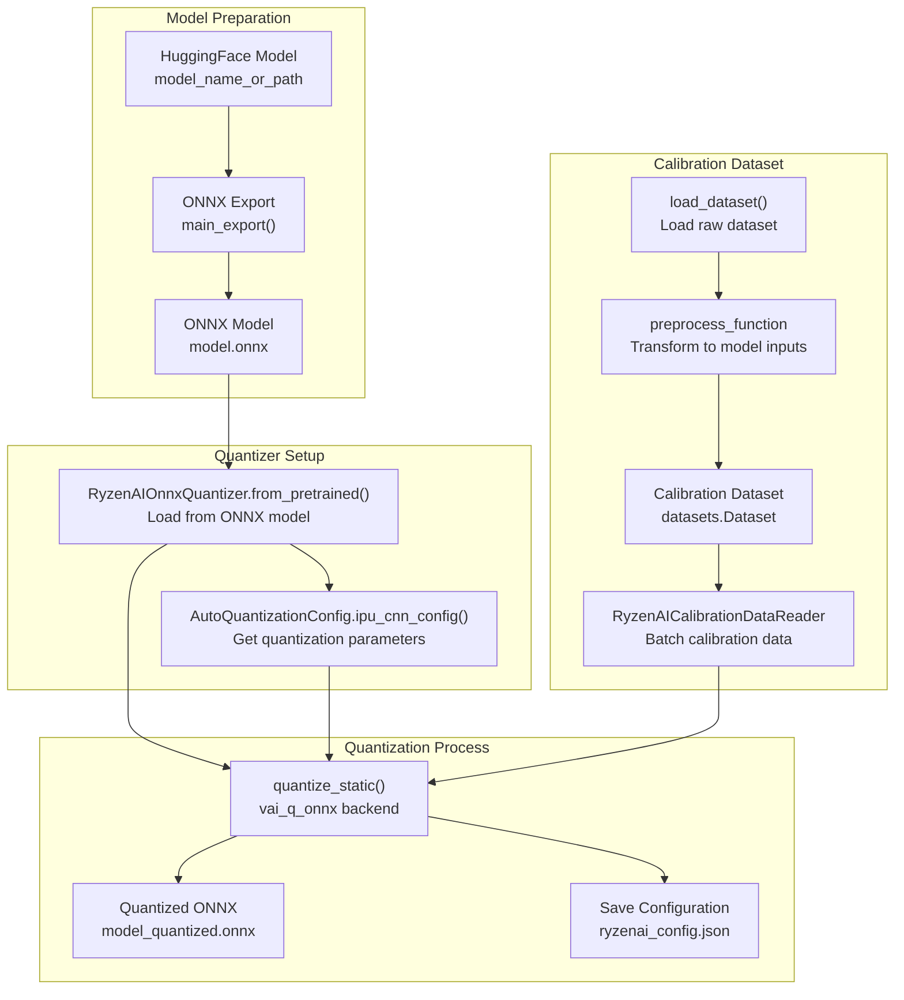
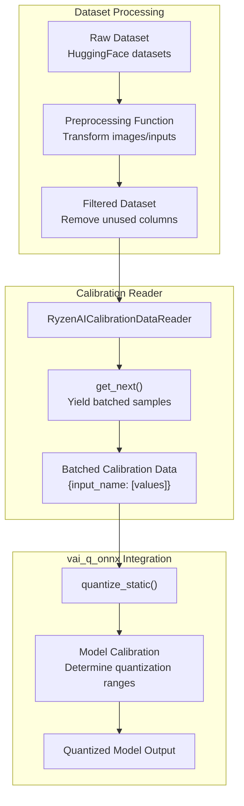
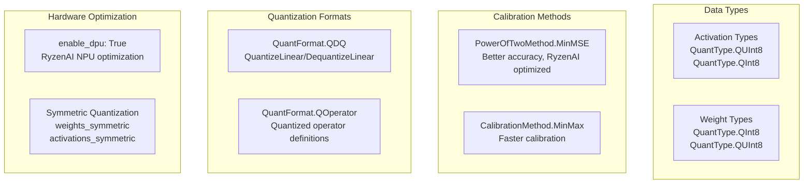
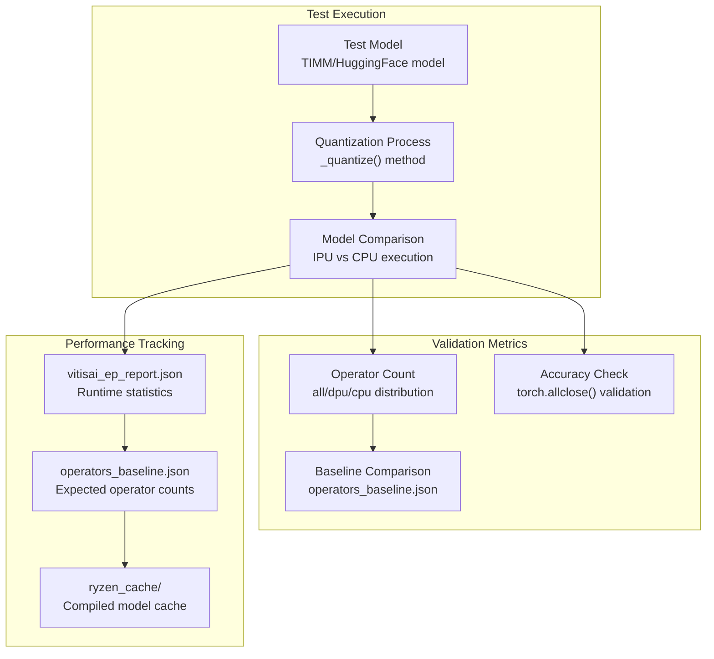

<!-- source: DeepWiki mcp.deepwiki.com · repo huggingface/optimum-amd · page 2.2 Quantization · fetched 2026-10-26 -->

# Quantization

Relevant source files

The following files were used as context for generating this wiki page:

- [examples/quantization/ryzenai/README.md](examples/quantization/ryzenai/README.md)
- [examples/quantization/ryzenai/quantize_image_classification_model.py](examples/quantization/ryzenai/quantize_image_classification_model.py)
- [notebooks/image-classification/vaip_config.json](notebooks/image-classification/vaip_config.json)
- [optimum/amd/ryzenai/configuration.py](optimum/amd/ryzenai/configuration.py)
- [optimum/amd/ryzenai/quantization.py](optimum/amd/ryzenai/quantization.py)
- [tests/ryzenai/operators_baseline.json](tests/ryzenai/operators_baseline.json)
- [tests/ryzenai/test_quantization.py](tests/ryzenai/test_quantization.py)
- [tests/ryzenai/testing_utils.py](tests/ryzenai/testing_utils.py)
- [utils/ryzenai/README.md](utils/ryzenai/README.md)
- [utils/ryzenai/generate_operators_baseline.py](utils/ryzenai/generate_operators_baseline.py)

This document covers the RyzenAI quantization system for converting ONNX models to quantized formats optimized for AMD RyzenAI NPU hardware. The quantization process uses static calibration with the `vai_q_onnx` backend to produce models suitable for efficient inference on RyzenAI NPUs.

For information about Brevitas-based quantization for LLMs, see [Brevitas Quantization](#3). For general RyzenAI model inference, see [Models and Inference](#2.1).

## Core Quantization Components

The RyzenAI quantization system is built around three main classes that work together to provide a complete quantization workflow:

**Sources:** [optimum/amd/ryzenai/quantization.py:63-259](), [optimum/amd/ryzenai/configuration.py:15-142]()

### RyzenAIOnnxQuantizer

The `RyzenAIOnnxQuantizer` class serves as the main entry point for quantization operations. It extends `OptimumQuantizer` and provides methods for loading ONNX models, generating calibration datasets, and performing static quantization:

| Method | Purpose |
|--------|---------|
| `from_pretrained()` | Load quantizer from ONNX model path |
| `quantize()` | Perform static quantization with calibration dataset |
| `get_calibration_dataset()` | Generate calibration dataset from HuggingFace datasets |
| `identify_unused_columns()` | Filter dataset columns to match model inputs |

**Sources:** [optimum/amd/ryzenai/quantization.py:63-131](), [optimum/amd/ryzenai/quantization.py:133-191]()

### QuantizationConfig

The `QuantizationConfig` dataclass defines all quantization parameters using ONNX Runtime quantization types:

**Sources:** [optimum/amd/ryzenai/configuration.py:15-70]()

### AutoQuantizationConfig

The `AutoQuantizationConfig` class provides factory methods for common quantization configurations:

| Configuration | Target | Parameters |
|---------------|--------|------------|
| `ipu_cnn_config()` | RyzenAI NPU | QDQ format, MinMSE calibration, u8/s8 schema, DPU enabled |
| `cpu_cnn_config()` | CPU inference | QDQ format, MinMax calibration, configurable symmetry |

**Sources:** [optimum/amd/ryzenai/configuration.py:72-100]()

## Quantization Workflow

The complete quantization workflow involves model export, calibration dataset preparation, and static quantization:

**Sources:** [tests/ryzenai/test_quantization.py:60-132](), [examples/quantization/ryzenai/quantize_image_classification_model.py:25-59]()

## Static Quantization Process

RyzenAI quantization uses post-training static quantization, which requires a calibration dataset to determine optimal quantization parameters for activations:

### Calibration Data Reader

The `RyzenAICalibrationDataReader` implements the ONNX Runtime `CalibrationDataReader` interface to provide calibration samples during quantization:

**Sources:** [optimum/amd/ryzenai/quantization.py:27-61](), [optimum/amd/ryzenai/quantization.py:192-253]()

### vai_q_onnx Integration

The quantization process integrates with AMD's `vai_q_onnx` library through the `quantize_static()` function call:

| Parameter | Source | Purpose |
|-----------|--------|---------|
| `model_input` | `onnx_model_path` | Path to input ONNX model |
| `model_output` | `quantized_model_path` | Path for quantized output model |
| `calibration_data_reader` | `RyzenAICalibrationDataReader` | Calibration data provider |
| `quant_format` | `QuantizationConfig.format` | QDQ or QOperator format |
| `calibrate_method` | `QuantizationConfig.calibration_method` | MinMSE or MinMax |
| `weight_type` | `QuantizationConfig.weights_dtype` | Weight quantization type |
| `activation_type` | `QuantizationConfig.activations_dtype` | Activation quantization type |
| `enable_dpu` | `QuantizationConfig.enable_dpu` | DPU optimization flag |

**Sources:** [optimum/amd/ryzenai/quantization.py:166-179]()

## Configuration System

The RyzenAI quantization system provides flexible configuration through multiple layers:

### Quantization Parameters

**Sources:** [optimum/amd/ryzenai/configuration.py:44-51]()

### Configuration Persistence

The quantization configuration is saved alongside the quantized model for reproducibility:

| File | Content | Purpose |
|------|---------|---------|
| `ryzenai_config.json` | `RyzenAIConfig` serialization | Complete quantization metadata |
| `config.json` | Original model configuration | Model architecture parameters |
| `model_quantized.onnx` | Quantized ONNX model | Inference-ready model |

**Sources:** [optimum/amd/ryzenai/quantization.py:183-190](), [optimum/amd/ryzenai/configuration.py:102-142]()

## Testing and Validation

The quantization system includes comprehensive testing to ensure correctness and performance:

### Operator Validation

The testing framework validates quantized models by comparing DPU and CPU execution results and tracking operator distribution:

**Sources:** [tests/ryzenai/test_quantization.py:59-154](), [tests/ryzenai/testing_utils.py:82-90](), [tests/ryzenai/operators_baseline.json:1-1624]()

### Baseline Management

The system maintains performance baselines for different model architectures:

| Model Category | Example Models | DPU Operators | CPU Operators |
|----------------|----------------|---------------|---------------|
| AMD Pre-quantized | `amd/resnet50` | 397 | 2 |
| TIMM EfficientNet | `timm/efficientnet_b0.ra_in1k` | 1052 | 2 |
| TIMM ResNet | `timm/resnet50.a1_in1k` | 393 | 2 |
| Complex Models | `timm/inception_v4.tf_in1k` | 1085 | 2 |

**Sources:** [tests/ryzenai/operators_baseline.json:47-51](), [tests/ryzenai/operators_baseline.json:332-336](), [utils/ryzenai/generate_operators_baseline.py:9-28]()

---

