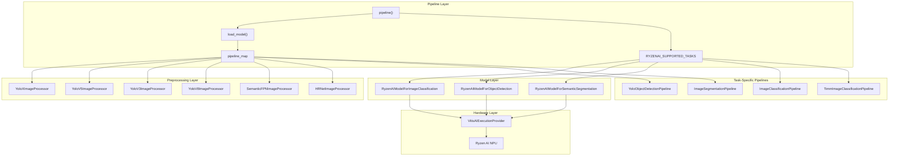
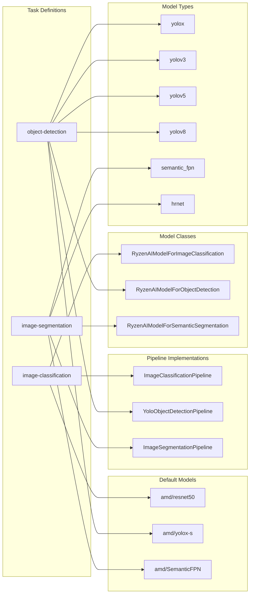
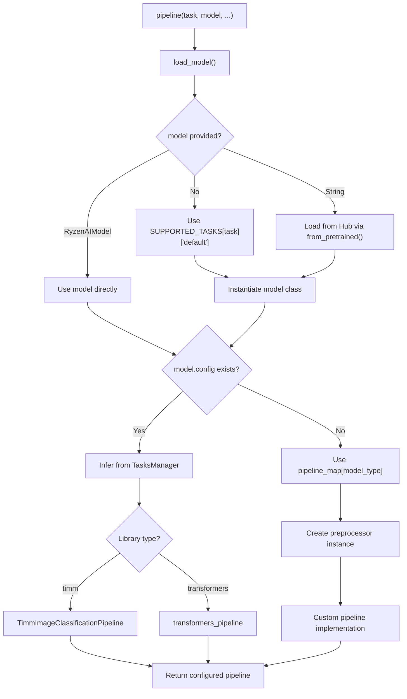
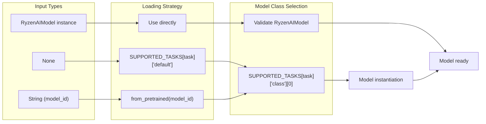

<!-- source: DeepWiki mcp.deepwiki.com · repo huggingface/optimum-amd · page 2.3 Pipelines · fetched 2026-10-26 -->

# Pipelines

<details>
<summary>Relevant source files</summary>

The following files were used as context for generating this wiki page:

- [docs/source/ryzenai/package_reference/pipelines.mdx](docs/source/ryzenai/package_reference/pipelines.mdx)
- [docs/source/ryzenai/usage_guides/pipelines.mdx](docs/source/ryzenai/usage_guides/pipelines.mdx)
- [optimum/amd/ryzenai/configs/vaip_config.json](optimum/amd/ryzenai/configs/vaip_config.json)
- [optimum/amd/ryzenai/pipelines/__init__.py](optimum/amd/ryzenai/pipelines/__init__.py)

</details>


The RyzenAI pipeline system provides a high-level, task-oriented interface for computer vision inference on AMD Ryzen AI NPUs. This system abstracts the complexity of model loading, preprocessing, and inference into simple, task-specific APIs that follow the Hugging Face transformers pipeline conventions.

For low-level model control and direct ONNX Runtime integration, see [Models and Inference](#2.1). For model optimization and quantization workflows, see [Quantization](#2.2). For runtime configuration details, see [Configuration](#2.4).

## Pipeline Architecture

The pipeline system sits at the highest level of abstraction in the RyzenAI stack, providing task-oriented interfaces that automatically handle model selection, preprocessing, and inference coordination.

### System Overview



**Sources:** [optimum/amd/ryzenai/pipelines/__init__.py:1-209]()

## Supported Tasks and Implementation Mapping

The pipeline system supports three primary computer vision tasks, each with specific model architectures and preprocessing requirements.

### Task Configuration



| Task | Pipeline Implementation | Model Class | Default Model | Supported Types |
|------|------------------------|-------------|---------------|-----------------|
| `image-classification` | `ImageClassificationPipeline` | `RyzenAIModelForImageClassification` | `amd/resnet50` | Standard, TIMM |
| `object-detection` | `YoloObjectDetectionPipeline` | `RyzenAIModelForObjectDetection` | `amd/yolox-s` | `yolox`, `yolov3`, `yolov5`, `yolov8` |
| `image-segmentation` | `ImageSegmentationPipeline` | `RyzenAIModelForSemanticSegmentation` | `amd/SemanticFPN` | `semantic_fpn`, `hrnet` |

**Sources:** [optimum/amd/ryzenai/pipelines/__init__.py:44-65](), [optimum/amd/ryzenai/pipelines/__init__.py:35-42]()

## Pipeline Implementation Flow

The pipeline creation process involves task resolution, model loading, and preprocessor selection through a structured workflow.

### Pipeline Creation Workflow



**Sources:** [optimum/amd/ryzenai/pipelines/__init__.py:104-209](), [optimum/amd/ryzenai/pipelines/__init__.py:68-101]()

## Core Components

### Pipeline Function

The main `pipeline()` function serves as the unified entry point for all RyzenAI computer vision tasks. It accepts standardized parameters and automatically configures the appropriate model, preprocessor, and pipeline implementation.

```python
def pipeline(
    task,
    model: Optional[Any] = None,
    vaip_config: Optional[str] = None,
    model_type: Optional[str] = None,
    # ... additional parameters
) -> Pipeline:
```

Key parameters:
- `task`: Task identifier (`"image-classification"`, `"object-detection"`, `"image-segmentation"`)
- `model`: Model identifier string, RyzenAIModel instance, or None for default
- `vaip_config`: Path to VitisAI runtime configuration file
- `model_type`: Explicit model architecture type for disambiguation

**Sources:** [optimum/amd/ryzenai/pipelines/__init__.py:104-115]()

### Model Loading Strategy

The `load_model()` function implements a flexible model loading strategy that handles different input types and automatically selects appropriate model classes.



**Sources:** [optimum/amd/ryzenai/pipelines/__init__.py:68-101]()

### Preprocessor Resolution

The system employs a two-tier preprocessor resolution strategy depending on whether the model has an associated configuration.

For models without configuration (`model.config is None`), the system uses the `pipeline_map` dictionary to determine the appropriate preprocessor and pipeline implementation based on the `model_type` parameter.

For models with configuration, the system attempts to automatically infer the appropriate preprocessor using the `TasksManager._infer_library_from_model()` method and falls back to `get_preprocessor()` for standard Hugging Face models.

**Sources:** [optimum/amd/ryzenai/pipelines/__init__.py:164-195]()

## Task-Specific Pipeline Classes

### Object Detection Pipeline

The `YoloObjectDetectionPipeline` handles YOLO-family models with specialized preprocessing for different YOLO variants through the `pipeline_map` configuration.

Supported model types and their preprocessors:
- `yolox`: `YoloXImageProcessor`  
- `yolov5`: `YoloV5ImageProcessor`
- `yolov3`: `YoloV3ImageProcessor`
- `yolov8`: `YoloV8ImageProcessor`

**Sources:** [optimum/amd/ryzenai/pipelines/__init__.py:35-42](), [optimum/amd/ryzenai/pipelines/__init__.py:19-26]()

### Image Segmentation Pipeline

The `ImageSegmentationPipeline` supports semantic segmentation models with architecture-specific preprocessing:
- `semantic_fpn`: `SemanticFPNImageProcessor`
- `hrnet`: `HRNetImageProcessor`

**Sources:** [optimum/amd/ryzenai/pipelines/__init__.py:40-41](), [optimum/amd/ryzenai/pipelines/__init__.py:20-21]()

### Image Classification Pipeline

Image classification uses either the standard `ImageClassificationPipeline` from transformers or the specialized `TimmImageClassificationPipeline` for TIMM models, determined automatically based on the model library.

**Sources:** [optimum/amd/ryzenai/pipelines/__init__.py:196-199](), [optimum/amd/ryzenai/pipelines/__init__.py:27]()

## Configuration Integration

The pipeline system integrates with the VitisAI runtime configuration through the `vaip_config` parameter, which specifies the path to a JSON configuration file containing optimization passes and execution provider settings.

The configuration system enables:
- Hardware-specific optimization passes
- DPU subgraph compilation settings  
- Performance tuning parameters
- Debug and profiling options

**Sources:** [optimum/amd/ryzenai/pipelines/__init__.py:130-132](), [optimum/amd/ryzenai/configs/vaip_config.json:1-307]()

---

