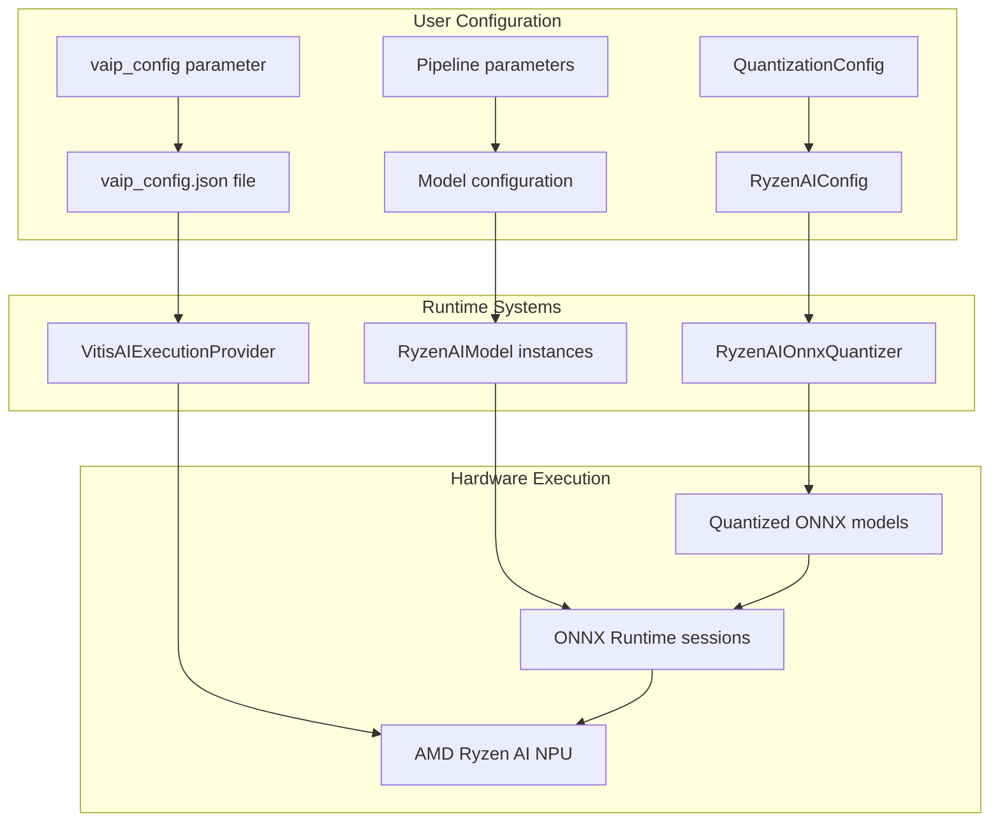
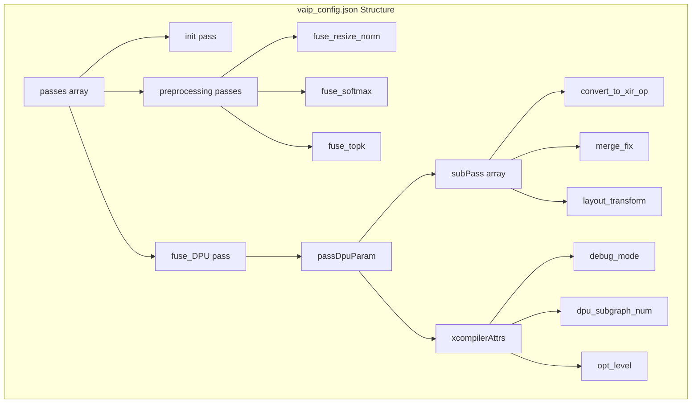
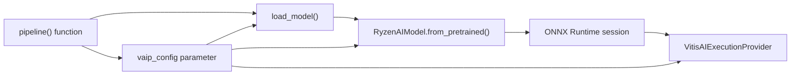
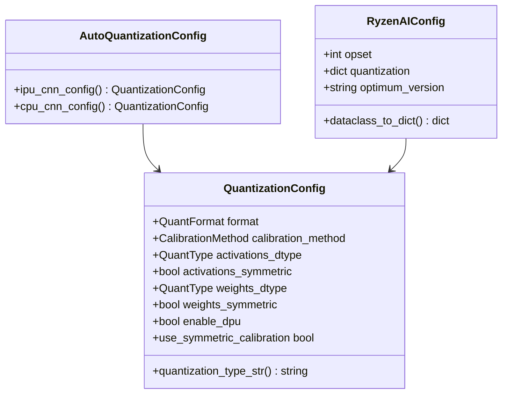
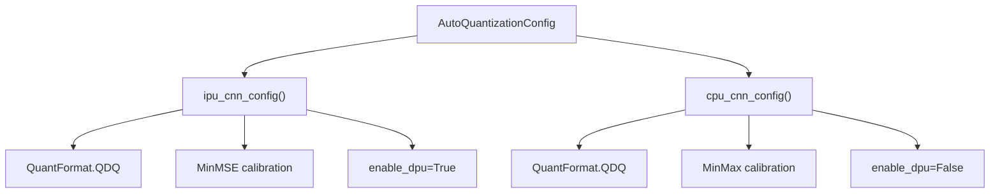
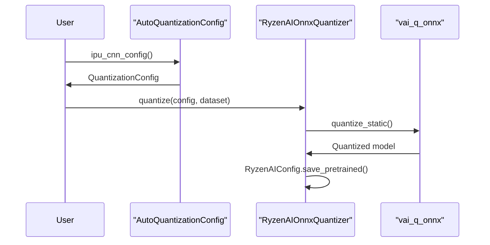
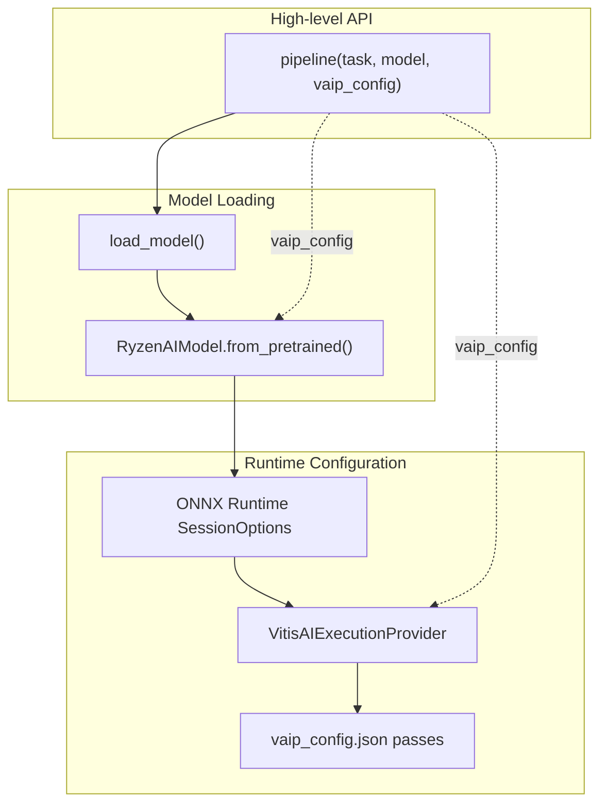

<!-- source: DeepWiki mcp.deepwiki.com · repo huggingface/optimum-amd · page 2.4 Configuration · fetched 2026-10-26 -->

# Configuration

Relevant source files

The following files were used as context for generating this wiki page:

- [docs/source/ryzenai/package_reference/pipelines.mdx](docs/source/ryzenai/package_reference/pipelines.mdx)
- [examples/quantization/ryzenai/README.md](examples/quantization/ryzenai/README.md)
- [examples/quantization/ryzenai/quantize_image_classification_model.py](examples/quantization/ryzenai/quantize_image_classification_model.py)
- [notebooks/image-classification/vaip_config.json](notebooks/image-classification/vaip_config.json)
- [optimum/amd/ryzenai/configs/vaip_config.json](optimum/amd/ryzenai/configs/vaip_config.json)
- [optimum/amd/ryzenai/configuration.py](optimum/amd/ryzenai/configuration.py)
- [optimum/amd/ryzenai/pipelines/__init__.py](optimum/amd/ryzenai/pipelines/__init__.py)
- [optimum/amd/ryzenai/quantization.py](optimum/amd/ryzenai/quantization.py)

This document covers the configuration systems within the RyzenAI component of optimum-amd. It explains how runtime behavior, quantization parameters, and model settings are controlled through various configuration mechanisms. For information about quantization workflows, see [Quantization](#2.2). For pipeline usage patterns, see [Pipelines](#2.3).

## Overview

The RyzenAI system uses multiple configuration layers to control inference behavior, optimization passes, and quantization parameters. Configuration flows from high-level user parameters down to low-level hardware-specific settings that control the VitisAI execution provider and NPU operations.

Sources: [optimum/amd/ryzenai/pipelines/__init__.py:104-208](), [optimum/amd/ryzenai/configuration.py:102-142](), [optimum/amd/ryzenai/quantization.py:133-191]()

## Runtime Configuration

### VAIP Configuration File

The `vaip_config.json` file controls the VitisAI execution provider runtime behavior. It specifies optimization passes that transform ONNX graphs for efficient NPU execution.

The configuration file contains three main sections:

| Section | Purpose | Key Parameters |
|---------|---------|----------------|
| Preprocessing passes | Graph fusion and optimization | `fuse_resize_norm`, `fuse_softmax`, `fuse_topk` |
| DPU passes | NPU-specific transformations | `convert_to_xir_op`, `merge_fix`, `layout_transform` |
| Compiler attributes | Hardware execution settings | `debug_mode`, `dpu_subgraph_num`, `opt_level` |

Sources: [optimum/amd/ryzenai/configs/vaip_config.json:1-306](), [notebooks/image-classification/vaip_config.json:1-283]()

### Configuration Usage in Pipelines

The `vaip_config` parameter flows through the pipeline system to control runtime behavior:

The configuration file path is passed through the call chain and ultimately used to initialize the VitisAI execution provider with the specified optimization passes.

Sources: [optimum/amd/ryzenai/pipelines/__init__.py:68-101](), [optimum/amd/ryzenai/pipelines/__init__.py:130-132]()

## Quantization Configuration

### QuantizationConfig Class

The `QuantizationConfig` dataclass defines parameters for model quantization:

Key configuration parameters:

| Parameter | Type | Purpose |
|-----------|------|---------|
| `format` | `QuantFormat` | QDQ or QOperator format |
| `calibration_method` | `CalibrationMethod` | MinMSE, MinMax, etc. |
| `activations_dtype` | `QuantType` | QUInt8 or QInt8 |
| `weights_dtype` | `QuantType` | QUInt8 or QInt8 |
| `enable_dpu` | `bool` | NPU-specific optimizations |

Sources: [optimum/amd/ryzenai/configuration.py:15-70](), [optimum/amd/ryzenai/configuration.py:72-100]()

### Predefined Configurations

The `AutoQuantizationConfig` class provides factory methods for common quantization scenarios:

The IPU configuration is optimized for RyzenAI NPU deployment, while the CPU configuration targets general-purpose inference.

Sources: [optimum/amd/ryzenai/configuration.py:74-84](), [optimum/amd/ryzenai/configuration.py:86-99]()

## Configuration Integration

### Quantization Workflow Configuration

The configuration classes integrate with the quantization workflow:

The quantizer uses configuration parameters to control the `vai_q_onnx.quantize_static()` function and saves a `RyzenAIConfig` with the quantized model.

Sources: [optimum/amd/ryzenai/quantization.py:133-191](), [examples/quantization/ryzenai/quantize_image_classification_model.py:44-58]()

### Pipeline Configuration Flow

Configuration parameters flow through the pipeline system:

The `vaip_config` parameter is threaded through the model loading process and ultimately configures the VitisAI execution provider.

Sources: [optimum/amd/ryzenai/pipelines/__init__.py:154-162](), [optimum/amd/ryzenai/pipelines/__init__.py:84-86]()

---

