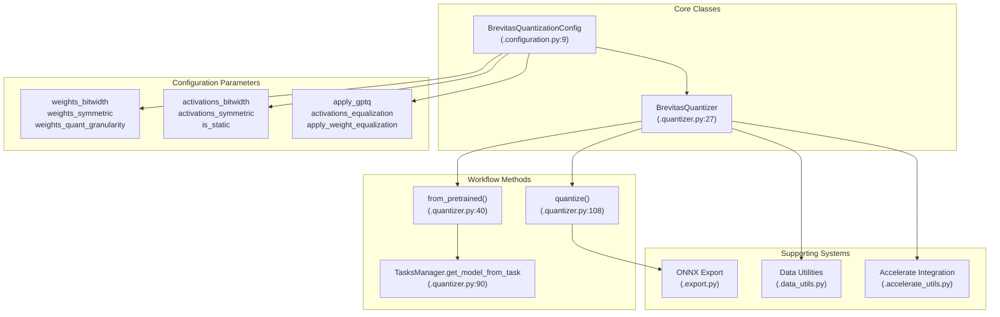
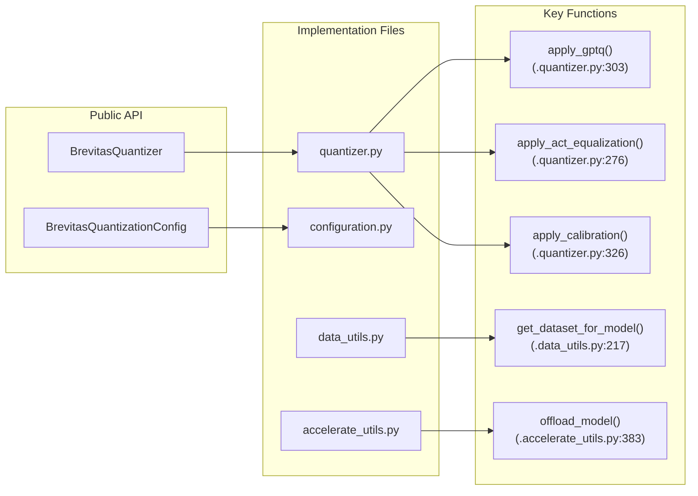
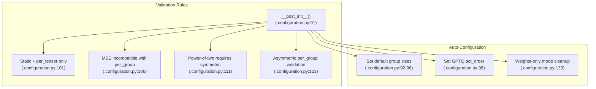
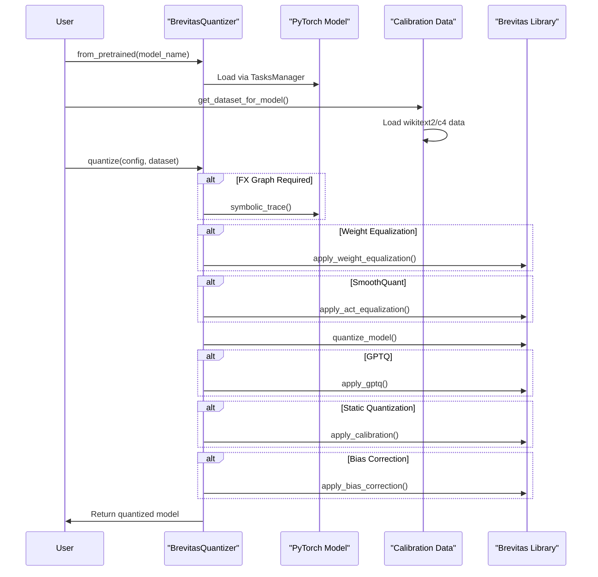
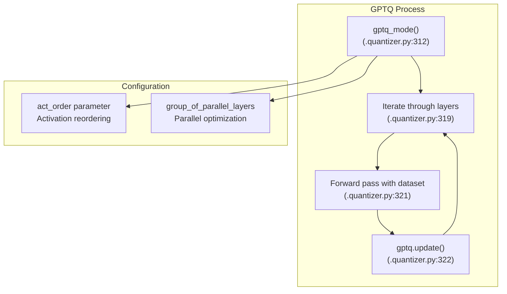
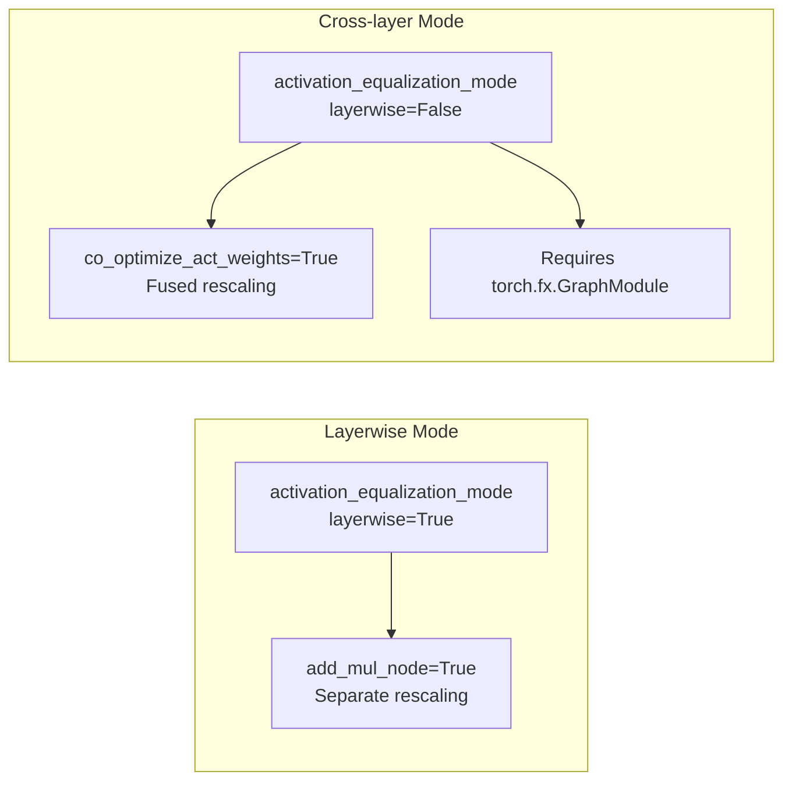
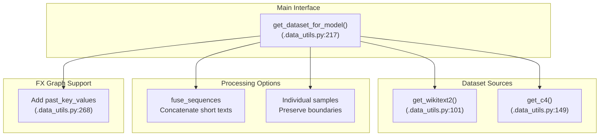
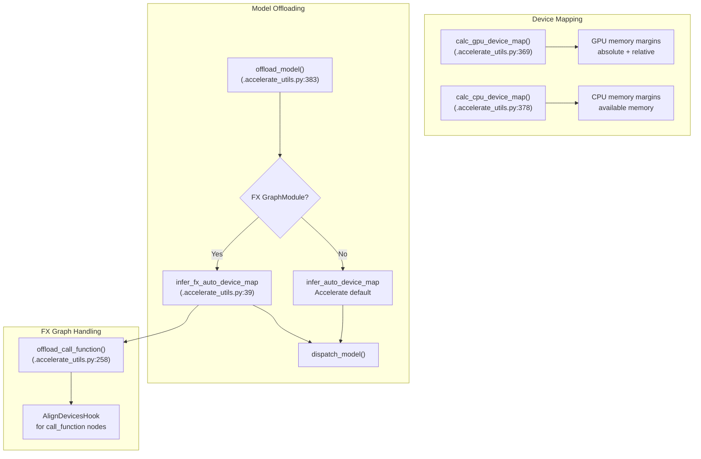
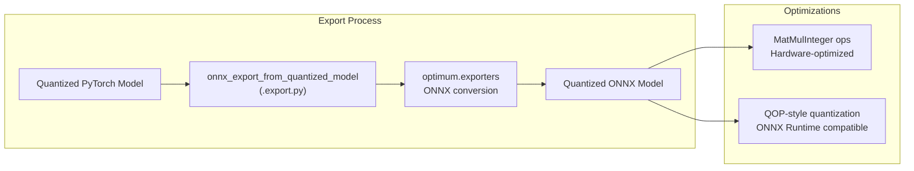

<!-- source: DeepWiki mcp.deepwiki.com · repo huggingface/optimum-amd · page 3 Brevitas Quantization · fetched 2026-10-26 -->

# Brevitas Quantization

<details>
<summary>Relevant source files</summary>

The following files were used as context for generating this wiki page:

- [docs/source/brevitas/usage_guide.mdx](docs/source/brevitas/usage_guide.mdx)
- [examples/quantization/brevitas/quantize_llm.py](examples/quantization/brevitas/quantize_llm.py)
- [optimum/amd/__init__.py](optimum/amd/__init__.py)
- [optimum/amd/brevitas/accelerate_utils.py](optimum/amd/brevitas/accelerate_utils.py)
- [optimum/amd/brevitas/configuration.py](optimum/amd/brevitas/configuration.py)
- [optimum/amd/brevitas/data_utils.py](optimum/amd/brevitas/data_utils.py)
- [optimum/amd/brevitas/quantizer.py](optimum/amd/brevitas/quantizer.py)

</details>


Brevitas Quantization is a neural network quantization system that provides advanced post-training quantization (PTQ) techniques for Large Language Models (LLMs) within the optimum-amd package. The system integrates AMD's Brevitas library with Hugging Face Transformers to enable efficient quantization of models for deployment on AMD hardware.

This page covers the quantization workflow, configuration options, and advanced techniques like GPTQ and SmoothQuant. For RyzenAI-specific quantization of vision models, see [RyzenAI Quantization](#2.2). For general AMD GPU support, see [ROCm GPU Support](#4).

## Core Components

The Brevitas quantization system consists of two primary classes and supporting utilities that handle the complete quantization workflow from model loading to ONNX export.



Sources: [optimum/amd/brevitas/quantizer.py:27-106](), [optimum/amd/brevitas/configuration.py:9-142]()

### Class Architecture Mapping

The system architecture maps directly to specific code entities within the codebase, providing a clear connection between conceptual components and their implementation.



Sources: [optimum/amd/__init__.py:10-16](), [optimum/amd/brevitas/quantizer.py:303-338](), [optimum/amd/brevitas/data_utils.py:217-294]()

## Quantization Configuration

The `BrevitasQuantizationConfig` class controls all aspects of the quantization process through a comprehensive set of parameters that define precision, granularity, and advanced optimization techniques.

### Core Configuration Parameters

| Parameter Category | Key Options | Default Values | Purpose |
|-------------------|-------------|----------------|---------|
| **Weight Quantization** | `weights_bitwidth` | 8 | Bit precision for weights |
| | `weights_symmetric` | True | Symmetric vs asymmetric quantization |
| | `weights_quant_granularity` | "per_tensor" | Granularity level (per_tensor/per_channel/per_group) |
| **Activation Quantization** | `activations_bitwidth` | 8 | Bit precision for activations |
| | `is_static` | False | Static vs dynamic quantization |
| | `activations_symmetric` | False | Symmetric vs asymmetric quantization |
| **Advanced Techniques** | `apply_gptq` | False | Enable GPTQ algorithm |
| | `activations_equalization` | "cross_layer" | SmoothQuant type |
| | `apply_weight_equalization` | False | Cross-layer weight balancing |

Sources: [optimum/amd/brevitas/configuration.py:67-89](), [optimum/amd/brevitas/configuration.py:14-65]()

### Configuration Validation

The configuration system includes extensive validation logic to ensure parameter compatibility and prevent invalid combinations.



Sources: [optimum/amd/brevitas/configuration.py:91-142]()

## Quantization Workflow

The quantization process follows a structured workflow that applies various optimization techniques in a specific order to achieve optimal quantized model performance.

### Complete Quantization Pipeline



Sources: [optimum/amd/brevitas/quantizer.py:108-250](), [examples/quantization/brevitas/quantize_llm.py:63-79]()

### Technique Application Order

The quantization techniques are applied in a carefully orchestrated sequence to maximize effectiveness:

1. **Weight Equalization** - Balances weight scales across layers [quantizer.py:180-183]()
2. **Activation Equalization (SmoothQuant)** - Rescales activations [quantizer.py:185-190]()
3. **Base Quantization** - Applies core quantization parameters [quantizer.py:199-222]()
4. **GPTQ** - Advanced weight optimization [quantizer.py:227-235]()
5. **Static Calibration** - For static activation quantization [quantizer.py:237-240]()
6. **Bias Correction** - Compensates for quantization bias [quantizer.py:242-248]()

Sources: [optimum/amd/brevitas/quantizer.py:180-250]()

## Advanced Quantization Techniques

### GPTQ Implementation

GPTQ (Generative Pre-trained Transformer Quantization) provides advanced weight quantization through iterative optimization based on the Hessian of the loss function.



Sources: [optimum/amd/brevitas/quantizer.py:303-323]()

### SmoothQuant (Activation Equalization)

SmoothQuant redistributes quantization difficulty from activations to weights through mathematical equivalence transformations.

| Mode | Description | Requirements |
|------|-------------|--------------|
| `layerwise` | Applies rescaling as separate multiplication nodes | Standard PyTorch model |
| `cross_layer` | Fuses rescaling into preceding layers | FX-traced GraphModule |

The implementation uses different approaches based on the chosen mode:



Sources: [optimum/amd/brevitas/quantizer.py:276-300]()

## Data Utilities

### Dataset Management

The data utilities provide standardized calibration datasets for quantization with support for multiple dataset sources and preprocessing options.



Sources: [optimum/amd/brevitas/data_utils.py:101-294]()

### Perplexity Evaluation

The system includes built-in perplexity computation for evaluating quantized model quality:

```python
perplexity = compute_perplexity(
    model=quantized_model,
    data=validation_dataset,
    context_length=args.seqlen // 2,
    tokenizer=tokenizer
)
```

The `compute_perplexity` function implements sliding window evaluation with cross-entropy loss calculation [data_utils.py:43-98]().

Sources: [optimum/amd/brevitas/data_utils.py:43-98](), [examples/quantization/brevitas/quantize_llm.py:66-70]()

## Memory Management Integration

### Accelerate Integration

The system integrates with Hugging Face Accelerate to handle large models that don't fit in single-device memory through sophisticated device mapping and offloading.



Sources: [optimum/amd/brevitas/accelerate_utils.py:369-454]()

### Hook Management

The integration provides specialized hook management for quantization workflows:

| Function | Purpose | Location |
|----------|---------|----------|
| `allocate_params()` | Move parameters to compute device | [accelerate_utils.py:423-434]() |
| `offload_params()` | Return parameters to storage | [accelerate_utils.py:436-446]() |
| `remove_hooks()` | Clean up all accelerate hooks | [accelerate_utils.py:314-331]() |

Sources: [optimum/amd/brevitas/accelerate_utils.py:314-454]()

## ONNX Export Integration

### Export Workflow

Brevitas quantized models can be exported to ONNX format using the optimum exporters framework with quantization-aware optimizations.



The export process maintains quantization information and applies ONNX-specific optimizations for efficient inference on AMD hardware.

Sources: [optimum/amd/brevitas/export.py](), [examples/quantization/brevitas/quantize_llm.py:77-78](), [docs/source/brevitas/usage_guide.mdx:71-81]()

---

