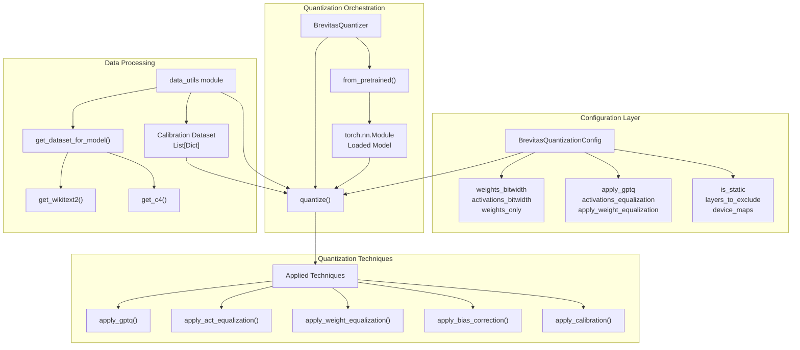
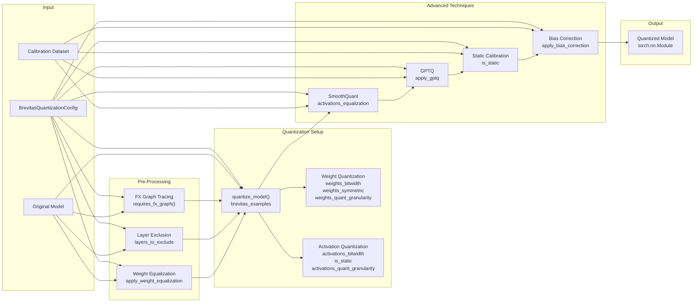
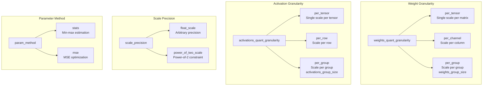
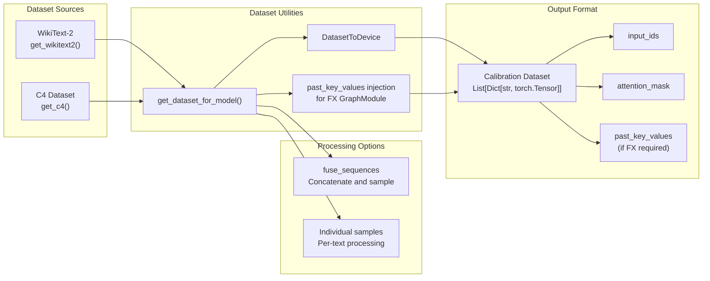

<!-- source: DeepWiki mcp.deepwiki.com · repo huggingface/optimum-amd · page 3.1 Core Concepts and Configuration · fetched 2026-10-26 -->

# Core Concepts and Configuration

Relevant source files

The following files were used as context for generating this wiki page:

- [optimum/amd/brevitas/__init__.py](optimum/amd/brevitas/__init__.py)
- [optimum/amd/brevitas/configuration.py](optimum/amd/brevitas/configuration.py)
- [optimum/amd/brevitas/data_utils.py](optimum/amd/brevitas/data_utils.py)
- [optimum/amd/brevitas/quantizer.py](optimum/amd/brevitas/quantizer.py)

This document explains the core concepts and configuration system for Brevitas quantization within optimum-amd. Brevitas provides advanced post-training quantization (PTQ) techniques specifically designed for large language models (LLMs), including GPTQ, SmoothQuant, weight equalization, and bias correction. For information about the complete LLM quantization workflow, see [LLM Quantization Workflow](#3.2). For ONNX export of quantized models, see [ONNX Export and Optimization](#3.3).

## Core Architecture

The Brevitas quantization system centers around two primary classes: `BrevitasQuantizer` for orchestrating the quantization process and `BrevitasQuantizationConfig` for specifying quantization parameters.

### Core Classes Relationship

**Sources:** [optimum/amd/brevitas/quantizer.py:27-106](), [optimum/amd/brevitas/configuration.py:8-142](), [optimum/amd/brevitas/data_utils.py:217-293]()

### Configuration-Driven Quantization Pipeline

**Sources:** [optimum/amd/brevitas/quantizer.py:108-250](), [optimum/amd/brevitas/configuration.py:140-142]()

## BrevitasQuantizer Class

The `BrevitasQuantizer` class orchestrates the entire quantization process and serves as the main entry point for quantizing models.

### Key Methods

| Method | Purpose | Parameters |
|--------|---------|------------|
| `from_pretrained()` | Load model and create quantizer instance | `model_name_or_path`, `device_map`, model loading args |
| `quantize()` | Execute quantization with given configuration | `quantization_config`, `calibration_dataset` |

### Quantization Workflow Control

The quantizer determines which techniques to apply based on the configuration:

1. **FX Graph Tracing** - Required for cross-layer SmoothQuant and weight equalization [optimum/amd/brevitas/quantizer.py:154-174]()
2. **Layer Exclusion** - Automatically excludes output embeddings unless overridden [optimum/amd/brevitas/quantizer.py:138-152]()
3. **Technique Application** - Applies advanced techniques in sequence based on configuration flags [optimum/amd/brevitas/quantizer.py:180-249]()

**Sources:** [optimum/amd/brevitas/quantizer.py:27-250]()

## BrevitasQuantizationConfig Class

The configuration class uses a dataclass structure with comprehensive validation to ensure compatible parameter combinations.

### Core Quantization Parameters

| Parameter Category | Key Options | Default Values |
|-------------------|-------------|----------------|
| **Weight Quantization** | `weights_bitwidth`, `weights_symmetric`, `weights_quant_granularity` | `8`, `True`, `"per_tensor"` |
| **Activation Quantization** | `activations_bitwidth`, `activations_symmetric`, `is_static` | `8`, `False`, `False` |
| **Advanced Techniques** | `apply_gptq`, `activations_equalization`, `apply_weight_equalization` | `False`, `"cross_layer"`, `False` |

### Quantization Granularity Options

**Sources:** [optimum/amd/brevitas/configuration.py:67-89](), [optimum/amd/brevitas/configuration.py:28-48]()

### Configuration Validation

The configuration includes extensive validation logic to prevent incompatible combinations:

| Validation Rule | Error Condition | Line Reference |
|-----------------|-----------------|----------------|
| Static + Granularity | `is_static=True` with non-`per_tensor` activations | [optimum/amd/brevitas/configuration.py:101-104]() |
| Per-group + MSE | `per_group` weights with `mse` parameter method | [optimum/amd/brevitas/configuration.py:106-109]() |
| Power-of-2 + Asymmetric | `power_of_two_scale` with asymmetric quantization | [optimum/amd/brevitas/configuration.py:111-116]() |
| Dynamic + Power-of-2 | Dynamic activations with power-of-2 scales | [optimum/amd/brevitas/configuration.py:128-131]() |

**Sources:** [optimum/amd/brevitas/configuration.py:91-142]()

## Dataset Requirements and Utilities

Brevitas quantization requires calibration datasets for several advanced techniques. The `data_utils` module provides utilities for dataset preparation.

### Dataset Generation

### Key Dataset Functions

| Function | Purpose | Parameters |
|----------|---------|------------|
| `get_dataset_for_model()` | Main dataset preparation entry point | `model_name_or_path`, `qconfig`, `dataset_name`, `tokenizer` |
| `get_wikitext2()` | WikiText-2 dataset preparation | `tokenizer`, `seqlen`, `nsamples`, `split` |
| `get_c4()` | C4 dataset preparation | `tokenizer`, `seqlen`, `nsamples`, `split` |

### FX Graph Module Support

When the configuration requires FX graph tracing (`requires_fx_graph()` returns `True`), the dataset preparation automatically adds empty `past_key_values` tensors to match the model's expected inputs [optimum/amd/brevitas/data_utils.py:268-289]().

**Sources:** [optimum/amd/brevitas/data_utils.py:217-293](), [optimum/amd/brevitas/data_utils.py:101-198]()

## Advanced Quantization Techniques

The configuration enables several advanced post-training quantization techniques:

### Technique Configuration Mapping

| Technique | Config Flag | Requirements | Purpose |
|-----------|-------------|--------------|---------|
| **GPTQ** | `apply_gptq` | Calibration dataset | Optimal weight quantization via second-order information |
| **SmoothQuant** | `activations_equalization` | Calibration dataset | Activation-weight balance for better quantization |
| **Weight Equalization** | `apply_weight_equalization` | None | Cross-layer weight rescaling |
| **Bias Correction** | `apply_bias_correction` | Calibration dataset | Compensate activation bias changes |
| **Static Calibration** | `is_static=True` | Calibration dataset | Pre-compute activation quantization ranges |

### SmoothQuant Variants

The `activations_equalization` parameter supports two approaches:
- `"layerwise"` - Add explicit multiplication nodes for activation rescaling
- `"cross_layer"` - Fuse rescaling into preceding layers (requires FX graph)

**Sources:** [optimum/amd/brevitas/quantizer.py:275-337](), [optimum/amd/brevitas/configuration.py:49-53]()

---

