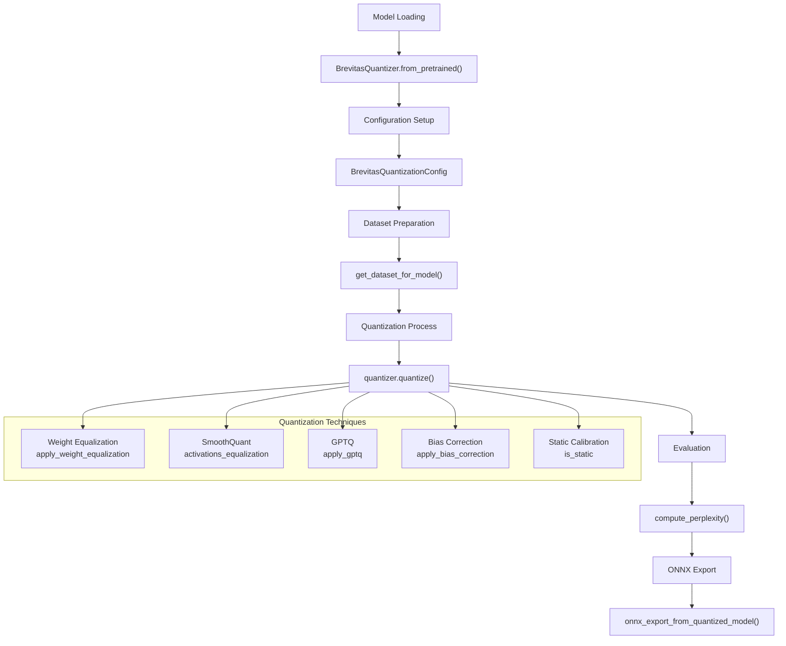
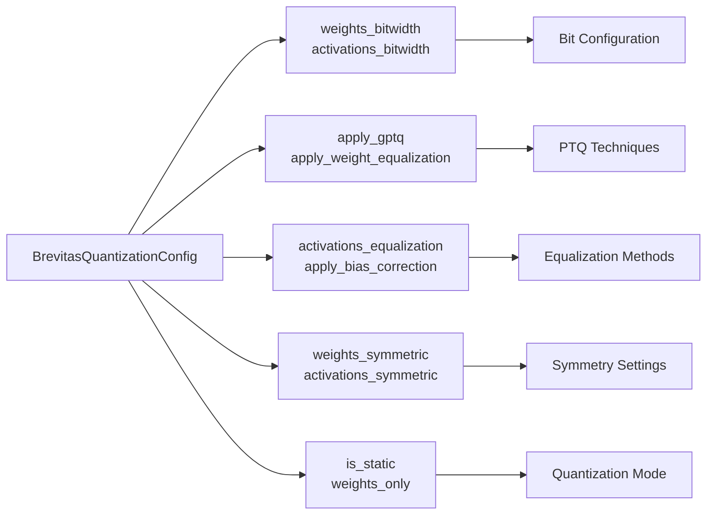
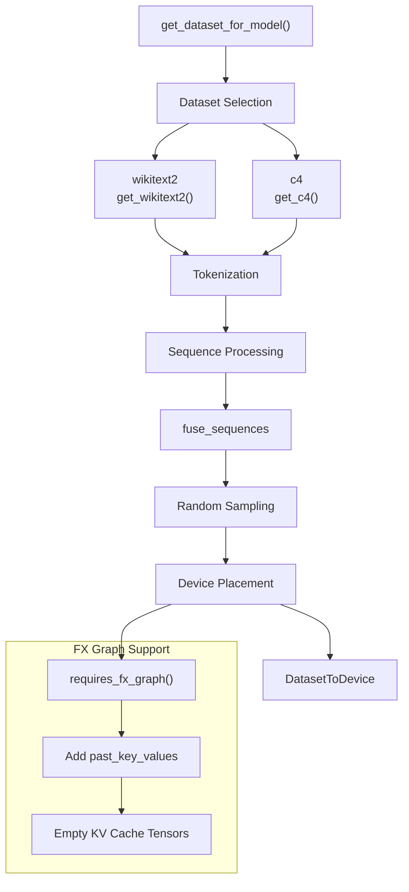
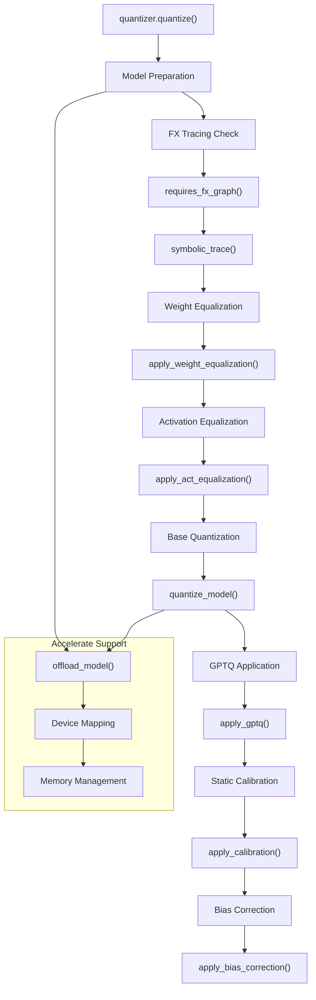
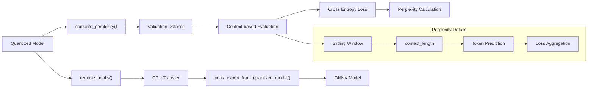
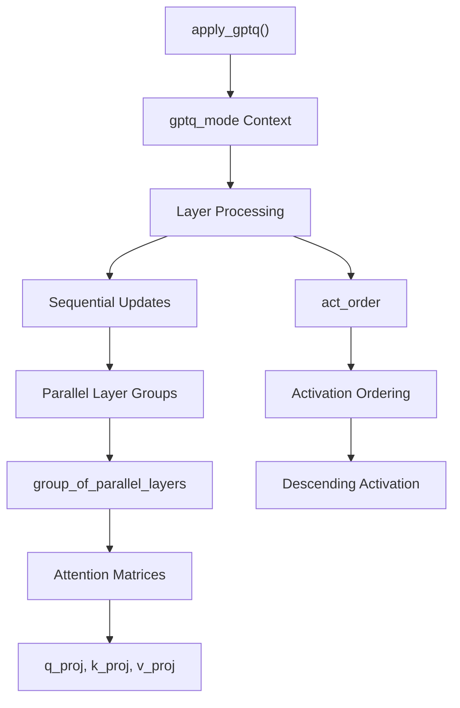
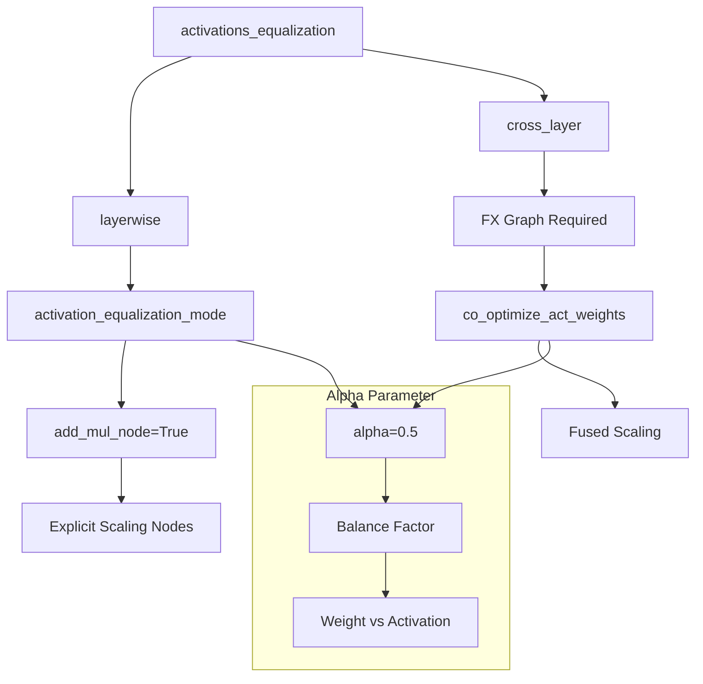
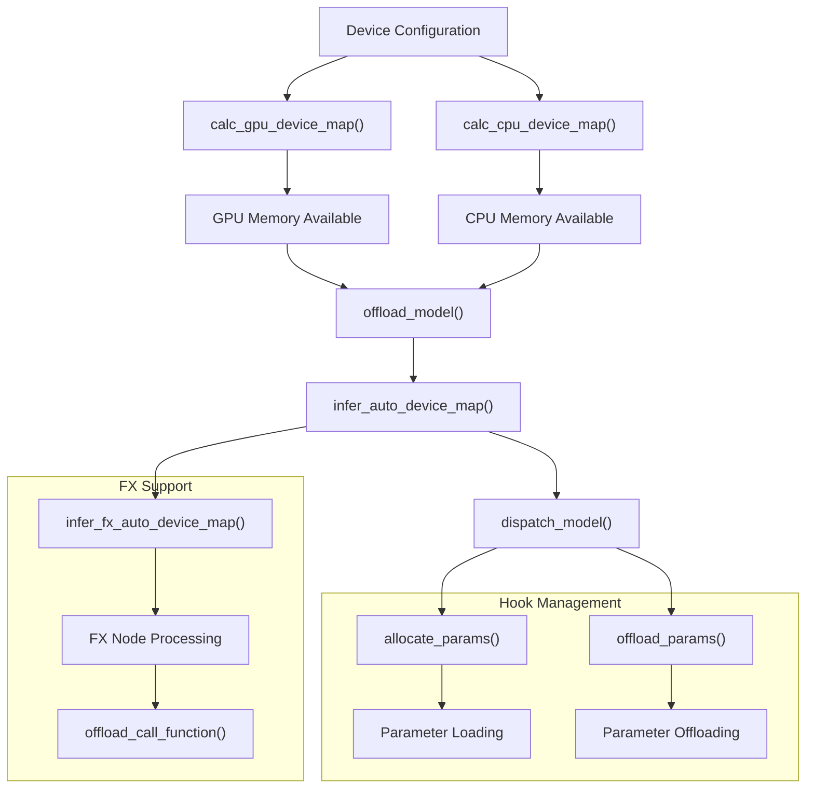

<!-- source: DeepWiki mcp.deepwiki.com · repo huggingface/optimum-amd · page 3.2 LLM Quantization Workflow · fetched 2026-10-26 -->

# LLM Quantization Workflow

Relevant source files

The following files were used as context for generating this wiki page:

- [docs/source/brevitas/usage_guide.mdx](docs/source/brevitas/usage_guide.mdx)
- [examples/quantization/brevitas/quantize_llm.py](examples/quantization/brevitas/quantize_llm.py)
- [optimum/amd/brevitas/accelerate_utils.py](optimum/amd/brevitas/accelerate_utils.py)
- [optimum/amd/brevitas/configuration.py](optimum/amd/brevitas/configuration.py)
- [optimum/amd/brevitas/data_utils.py](optimum/amd/brevitas/data_utils.py)
- [optimum/amd/brevitas/quantizer.py](optimum/amd/brevitas/quantizer.py)

This document describes the complete workflow for quantizing Large Language Models (LLMs) using the Brevitas quantization system in optimum-amd. The workflow covers model loading, configuration, calibration dataset preparation, quantization application, and export to ONNX format.

For information about the core Brevitas concepts and configuration options, see [Core Concepts and Configuration](#3.1). For details about ONNX export and optimization, see [ONNX Export and Optimization](#3.3).

## Overview of the Workflow

The LLM quantization workflow follows a structured pipeline from model loading through quantization to final export. The process supports various post-training quantization (PTQ) techniques including GPTQ, SmoothQuant (activation equalization), weight equalization, and bias correction.

Sources: [examples/quantization/brevitas/quantize_llm.py:10-79](), [optimum/amd/brevitas/quantizer.py:108-250]()

## Configuration Setup

The quantization workflow begins with creating a `BrevitasQuantizationConfig` that specifies which quantization techniques to apply and their parameters. The configuration system validates parameter combinations and sets appropriate defaults.

Key configuration parameters include:

| Parameter | Purpose | Default | Notes |
|-----------|---------|---------|--------|
| `weights_bitwidth` | Weight quantization precision | 8 | Typical values: 4, 8 |
| `activations_bitwidth` | Activation quantization precision | 8 | None if `weights_only=True` |
| `apply_gptq` | Enable GPTQ algorithm | False | Requires calibration data |
| `activations_equalization` | SmoothQuant method | "cross_layer" | None, "layerwise", "cross_layer" |
| `apply_weight_equalization` | Enable weight balancing | False | Useful for ReLU models |
| `is_static` | Static vs dynamic quantization | False | Static requires calibration |

Sources: [optimum/amd/brevitas/configuration.py:8-141](), [examples/quantization/brevitas/quantize_llm.py:17-25]()

## Dataset Preparation

The quantization process requires calibration datasets for techniques like GPTQ, SmoothQuant, and static quantization. The system provides utilities to prepare tokenized datasets from standard sources like WikiText-2 and C4.

The dataset preparation handles several key aspects:

- **Sequence Length Management**: Configurable `seqlen` parameter (default 128-2048 tokens)
- **Sample Count**: Configurable `nsamples` parameter (default 128 samples)  
- **Sequence Fusion**: Option to merge short sequences via `fuse_sequences`
- **FX Graph Compatibility**: Automatic addition of `past_key_values` for traced models

Sources: [optimum/amd/brevitas/data_utils.py:217-293](), [examples/quantization/brevitas/quantize_llm.py:30-52]()

## Quantization Process

The core quantization is performed by `BrevitasQuantizer.quantize()`, which applies the selected techniques in a specific order to maintain numerical stability and effectiveness.

The quantization order is critical:

1. **Weight Equalization**: Balances weight scales across layers before quantization
2. **Activation Equalization (SmoothQuant)**: Redistributes activation and weight ranges
3. **Base Quantization**: Applies core weight and activation quantization
4. **GPTQ**: Optimizes weight quantization using second-order information
5. **Static Calibration**: Collects activation statistics for static quantization
6. **Bias Correction**: Compensates for quantization-induced bias

Sources: [optimum/amd/brevitas/quantizer.py:108-250](), [optimum/amd/brevitas/quantizer.py:275-337]()

## Evaluation and Export

After quantization, the workflow typically evaluates model quality using perplexity on a validation dataset, then exports the quantized model to ONNX format for deployment.

The evaluation process uses a sliding window approach:

- **Context Length**: Typically `seqlen // 2` for balanced evaluation
- **Window Sliding**: Processes sequences in overlapping chunks
- **Loss Computation**: Cross-entropy loss between predictions and targets
- **Perplexity**: Exponential of average negative log-likelihood

Sources: [optimum/amd/brevitas/data_utils.py:42-98](), [examples/quantization/brevitas/quantize_llm.py:56-79]()

## Advanced Techniques

### GPTQ Implementation

GPTQ (Gradient-based Post-Training Quantization) optimizes weight quantization by minimizing the layer-wise reconstruction error using Hessian information.

GPTQ configuration options:

- **Act Order**: Reorders weight updates based on activation magnitudes (`gptq_act_order`)
- **Parallel Groups**: Processes attention projection matrices simultaneously
- **Layer-wise Updates**: Processes one transformer layer at a time

Sources: [optimum/amd/brevitas/quantizer.py:302-323]()

### SmoothQuant (Activation Equalization)

SmoothQuant addresses the challenge of quantizing both weights and activations by redistributing quantization difficulty between them.

The two modes offer different trade-offs:

- **Layerwise**: Adds explicit multiplication nodes, works with any model
- **Cross-layer**: Fuses scaling into preceding layers, requires FX tracing

Sources: [optimum/amd/brevitas/quantizer.py:275-299]()

## Memory Management

The workflow integrates with HuggingFace Accelerate for efficient memory management, especially important for large models that may not fit in GPU memory.

Key memory management features:

- **Automatic Device Mapping**: Distributes model layers across available devices
- **FX Graph Support**: Handles torch.fx traced models with custom device mapping
- **Parameter Hooks**: Dynamically loads/offloads parameters during quantization
- **Memory Margins**: Configurable safety margins for memory allocation

Sources: [optimum/amd/brevitas/accelerate_utils.py:369-453](), [examples/quantization/brevitas/quantize_llm.py:146-151]()

---

