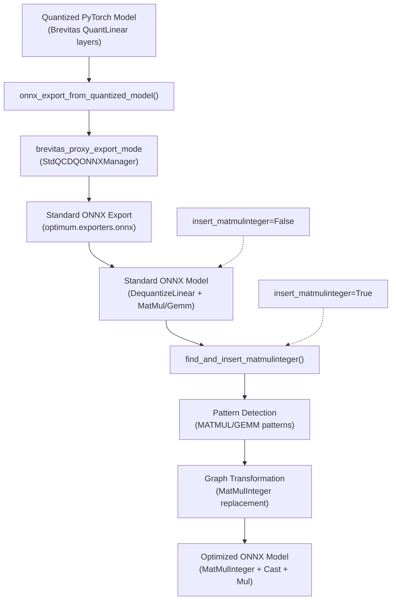
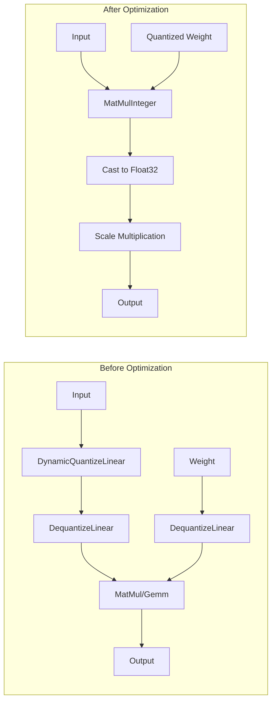
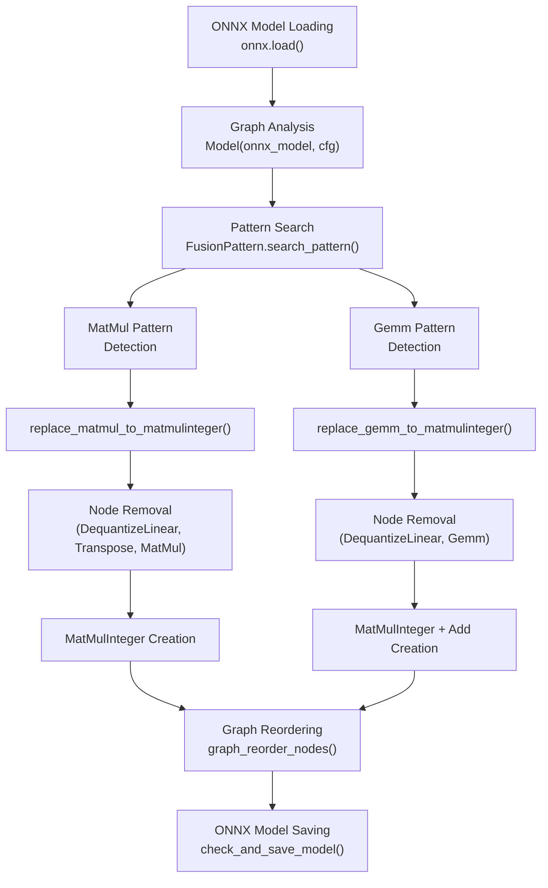
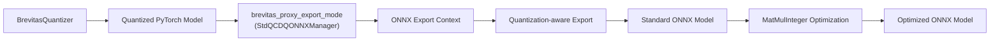

<!-- source: DeepWiki mcp.deepwiki.com · repo huggingface/optimum-amd · page 3.3 ONNX Export and Optimization · fetched 2026-10-26 -->

# ONNX Export and Optimization

Relevant source files

The following files were used as context for generating this wiki page:

- [optimum/amd/brevitas/export.py](optimum/amd/brevitas/export.py)
- [tests/brevitas/test_onnx_export.py](tests/brevitas/test_onnx_export.py)
- [tests/brevitas/test_quantization.py](tests/brevitas/test_quantization.py)

This document covers the ONNX export and optimization capabilities in the Brevitas quantization system. After quantizing LLM models using the techniques described in [Core Concepts and Configuration](#3.1) and [LLM Quantization Workflow](#3.2), this system converts the quantized PyTorch models to optimized ONNX format for deployment.

The primary focus is on the `MatMulInteger` optimization, which replaces standard floating-point quantized operations with efficient integer matrix multiplication operations in the exported ONNX graph.

## Export Workflow Overview

The ONNX export process transforms Brevitas-quantized PyTorch models into optimized ONNX representations suitable for hardware acceleration:

Sources: [optimum/amd/brevitas/export.py:301-344]()

The main entry point is the `onnx_export_from_quantized_model` function, which extends the standard Optimum ONNX export with Brevitas-specific quantization handling and optional `MatMulInteger` optimization.

## MatMulInteger Optimization

The core optimization replaces quantized linear operations with efficient integer matrix multiplication. This transformation reduces computational overhead by avoiding repeated quantization/dequantization cycles:

Sources: [optimum/amd/brevitas/export.py:133-185](), [optimum/amd/brevitas/export.py:188-244]()

## Pattern Matching System

The optimization uses predefined patterns to identify quantized operations that can be replaced with `MatMulInteger`. Two main patterns are supported:

### MatMul Pattern

The `MATMUL` pattern identifies sequences involving `DequantizeLinear`, `Transpose`, `DynamicQuantizeLinear`, and `MatMul` operations:

| Operation | Role | Inputs | Outputs |
|-----------|------|--------|---------|
| `DequantizeLinear` | Weight dequantization | Quantized weights, scale, zero_point | Float weights |
| `Transpose` | Weight reshaping | Float weights | Transposed weights |  
| `DynamicQuantizeLinear` | Input quantization | Float input | Quantized input, scale, zero_point |
| `DequantizeLinear` | Input dequantization | Quantized input, scale, zero_point | Float input |
| `MatMul` | Matrix multiplication | Float input, transposed weights | Output |

Sources: [optimum/amd/brevitas/export.py:29-72]()

### Gemm Pattern

The `GEMM` pattern handles General Matrix Multiplication with bias addition:

| Operation | Role | Inputs | Outputs |
|-----------|------|--------|---------|
| `DequantizeLinear` | Weight dequantization | Quantized weights, scale, zero_point | Float weights |
| `DynamicQuantizeLinear` | Input quantization | Float input | Quantized input, scale, zero_point |
| `DequantizeLinear` | Input dequantization | Quantized input, scale, zero_point | Float input |
| `Gemm` | Matrix multiplication + bias | Float input, weights, bias | Output |

Sources: [optimum/amd/brevitas/export.py:74-110]()

## Graph Transformation Process

The transformation process uses the `onnx_tool` library to analyze and modify ONNX graphs:

Sources: [optimum/amd/brevitas/export.py:247-299]()

### Replacement Operations

For each detected pattern, the transformation creates a sequence of optimized operations:

1. **MatMulInteger**: Performs integer matrix multiplication
2. **Cast**: Converts result to float32
3. **Mul**: Applies scale factors from quantization
4. **Add**: Adds bias (for Gemm patterns only)

The `create_nodes` function manages graph connectivity and tensor mapping during transformation:

Sources: [optimum/amd/brevitas/export.py:113-131]()

## Integration with Brevitas

The export system integrates closely with Brevitas quantization through the `brevitas_proxy_export_mode` context manager and `StdQCDQONNXManager`:

Sources: [optimum/amd/brevitas/export.py:320](), [tests/brevitas/test_onnx_export.py:60]()

The `StdQCDQONNXManager` ensures proper handling of quantized parameters during the ONNX conversion process, maintaining the quantization semantics established by Brevitas.

### Configuration Parameters

The `onnx_export_from_quantized_model` function supports several key parameters:

| Parameter | Type | Default | Description |
|-----------|------|---------|-------------|
| `insert_matmulinteger` | bool | True | Enable MatMulInteger optimization |
| `do_constant_folding` | bool | True | Apply constant folding optimizations |
| `no_dynamic_axes` | bool | False | Disable dynamic input shapes |
| `task` | str | "text-generation-with-past" | Model task type |

Sources: [optimum/amd/brevitas/export.py:301-344]()

The system validates the optimization by counting the number of `MatMulInteger` operations in the transformed graph, ensuring successful pattern replacement:

Sources: [tests/brevitas/test_onnx_export.py:149-172]()

---

