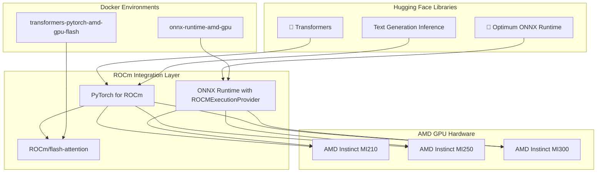
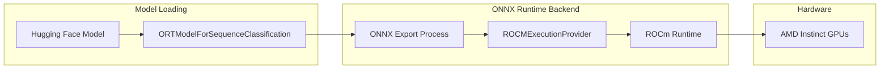
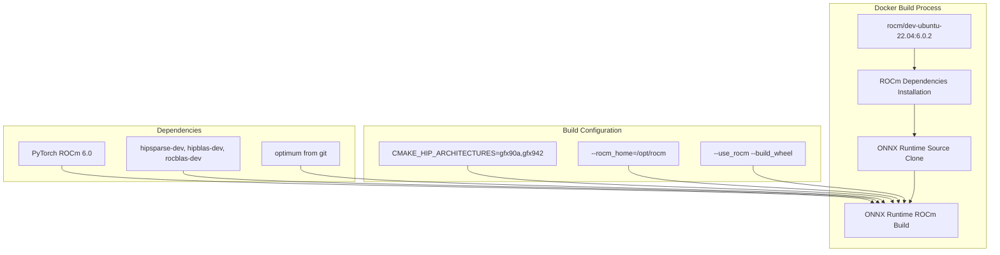

<!-- source: DeepWiki mcp.deepwiki.com · repo huggingface/optimum-amd · page 4 ROCm GPU Support · fetched 2026-10-26 -->

# ROCm GPU Support

<details>
<summary>Relevant source files</summary>

The following files were used as context for generating this wiki page:

- [README.md](README.md)
- [docker/onnx-runtime-amd-gpu/Dockerfile](docker/onnx-runtime-amd-gpu/Dockerfile)
- [docker/transformers-pytorch-amd-gpu-flash/Dockerfile](docker/transformers-pytorch-amd-gpu-flash/Dockerfile)
- [docs/source/amdgpu/overview.mdx](docs/source/amdgpu/overview.mdx)

</details>


This document covers AMD GPU acceleration through the ROCm platform in the optimum-amd ecosystem. ROCm GPU support enables running Hugging Face models on AMD Instinct MI210, MI250, and MI300 GPUs with minimal code changes. For AMD CPU optimization, see [ZenTorch CPU Optimization](#5). For AMD NPU acceleration, see [RyzenAI System](#2).

## Overview

ROCm GPU support in optimum-amd primarily leverages native PyTorch for ROCm and ONNX Runtime integrations rather than implementing custom AMD GPU kernels. The system provides Docker environments, configuration examples, and documentation to enable seamless usage of AMD GPUs with existing Hugging Face libraries.



Sources: [README.md:21-29](), [docs/source/amdgpu/overview.mdx:1-93]()

## PyTorch ROCm Integration

PyTorch for ROCm provides direct GPU acceleration for AMD hardware with zero code changes required. Models automatically utilize AMD GPUs when CUDA calls are made, as ROCm provides CUDA compatibility through HIP.

### Native Transformers Support

Standard Transformers models work directly with ROCm through the `torch.device("cuda")` context:

```python
import torch
from transformers import AutoModelForCausalLM, AutoTokenizer

tokenizer = AutoTokenizer.from_pretrained("tiiuae/falcon-7b")

with torch.device("cuda"):
    model = AutoModelForCausalLM.from_pretrained(
        "tiiuae/falcon-7b",
        torch_dtype=torch.float16,
    )
```

The system supports advanced features like Flash Attention 2 and GPTQ quantization through ROCm-specific implementations.

Sources: [README.md:23-25](), [docs/source/amdgpu/overview.mdx:15-27]()

## ONNX Runtime ROCm Integration

The `ROCMExecutionProvider` enables ONNX Runtime acceleration on AMD GPUs through optimum's ONNX Runtime integration.



### Usage Pattern

The `ORTModelForSequenceClassification.from_pretrained()` method accepts a `provider="ROCMExecutionProvider"` parameter to enable AMD GPU acceleration:

```python
from optimum.onnxruntime import ORTModelForSequenceClassification
from transformers import AutoTokenizer

ort_model = ORTModelForSequenceClassification.from_pretrained(
    "distilbert-base-uncased-finetuned-sst-2-english",
    export=True,
    provider="ROCMExecutionProvider",
)
```

Sources: [README.md:51-74](), [docs/source/amdgpu/overview.mdx:58-78]()

## Text Generation Inference Support

Text Generation Inference (TGI) provides native ROCm support for LLM deployment with specialized optimizations for AMD Instinct GPUs.

### Docker-based Deployment

TGI uses the `ghcr.io/huggingface/text-generation-inference:1.2-rocm` Docker image with specific ROCm device mounting:

```bash
docker run --cap-add=SYS_PTRACE --security-opt seccomp=unconfined \
  --device=/dev/kfd --device=/dev/dri --group-add video --ipc=host \
  --shm-size 1g -p 8080:80 -v $volume:/data \
  ghcr.io/huggingface/text-generation-inference:1.2-rocm \
  --model-id $model
```

The deployment requires specific device access (`/dev/kfd`, `/dev/dri`) and security configurations for ROCm functionality.

Sources: [README.md:31-49](), [docs/source/amdgpu/overview.mdx:50-56]()

## Flash Attention 2 Support

Flash Attention 2 acceleration uses the ROCm-specific implementation from `ROCm/flash-attention` repository.

### Docker Environment Configuration

The `transformers-pytorch-amd-gpu-flash` Docker environment builds Flash Attention 2 from source with ROCm-specific GPU architectures:

Key configuration elements:
- Base image: `rocm/dev-ubuntu-22.04:6.0.2`
- GPU architectures: `gfx90a;gfx942` 
- PyTorch ROCm arch: `gfx90a;gfx942`
- Flash Attention commit: `2554f490101742ccdc56620a938f847f61754be6`

The Dockerfile installs ROCm development dependencies and compiles Flash Attention with architecture-specific optimizations.

Sources: [docker/transformers-pytorch-amd-gpu-flash/Dockerfile:1-42](), [docs/source/amdgpu/overview.mdx:11-29]()

## ONNX Runtime ROCm Docker Environment

The `onnx-runtime-amd-gpu` Docker environment provides a complete ONNX Runtime build with ROCm support.



### Build Process

The ONNX Runtime build process uses specific configuration for AMD GPU architectures:

```bash
./build.sh --config Release --build_wheel --allow_running_as_root \
  --update --build --parallel \
  --cmake_extra_defines CMAKE_HIP_ARCHITECTURES=gfx90a,gfx942 \
  ONNXRUNTIME_VERSION=$(cat ./VERSION_NUMBER) \
  --use_rocm --rocm_home=/opt/rocm
```

Sources: [docker/onnx-runtime-amd-gpu/Dockerfile:1-68]()

## Quantization Support

### GPTQ Quantization

GPTQ quantization works through the AutoGPTQ library backend with ROCm support via hosted wheels. Models can be loaded directly with standard Transformers patterns:

```python
from transformers import AutoModelForCausalLM, AutoTokenizer

model = AutoModelForCausalLM.from_pretrained(
    "TheBloke/Llama-2-7B-Chat-GPTQ",
    torch_dtype=torch.float16,
)
```

### AWQ Quantization

AWQ quantization converts to GPTQ/Exllama format at load time, enabling AMD ROCm devices to use AWQ checkpoints with ExllamaV2 kernel optimizations.

### Bitsandbytes Status

Official bitsandbytes support for ROCm is under development. Advanced users can use the `ROCm/bitsandbytes` fork with the `rocm_enabled` branch.

Sources: [docs/source/amdgpu/overview.mdx:31-92]()

## Hardware Compatibility

### Validated Hardware
- AMD Instinct MI210
- AMD Instinct MI250  
- AMD Instinct MI300

### Expected Compatible Hardware
Other ROCm-powered GPUs are expected to work but have not been formally validated. The GPU architectures `gfx90a` and `gfx942` are specifically optimized in the Docker environments.

Sources: [docs/source/amdgpu/overview.mdx:5-7](), [docker/transformers-pytorch-amd-gpu-flash/Dockerfile:34](), [docker/onnx-runtime-amd-gpu/Dockerfile:62]()

## Performance Optimizations

The ROCm integration includes several performance optimizations:

- **Paged Attention**: Available in Text Generation Inference
- **Fused Kernels**: Positional encoding and layer norm fusion
- **Flash Attention 2**: Memory-efficient attention computation
- **Architecture-specific Compilation**: Optimized for `gfx90a` and `gfx942` architectures

These optimizations are automatically enabled when using the provided Docker environments and following the recommended deployment patterns.

Sources: [README.md:25](), [docs/source/amdgpu/overview.mdx:52]()

---

