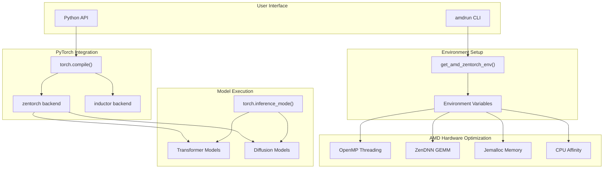
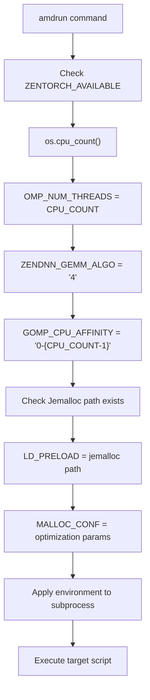
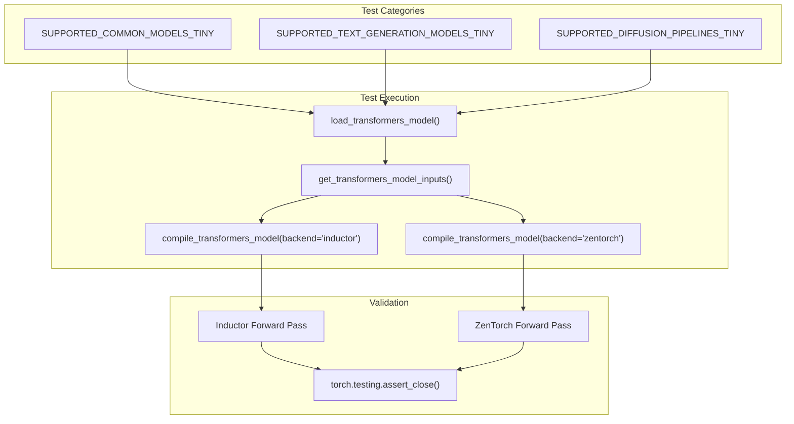

<!-- source: DeepWiki mcp.deepwiki.com · repo huggingface/optimum-amd · page 5 ZenTorch CPU Optimization · fetched 2026-10-26 -->

# ZenTorch CPU Optimization

<details>
<summary>Relevant source files</summary>

The following files were used as context for generating this wiki page:

- [.github/workflows/test_zentorch_plugin.yaml](.github/workflows/test_zentorch_plugin.yaml)
- [docker/transformers-pytorch-amd-cpu-zentorch/Dockerfile](docker/transformers-pytorch-amd-cpu-zentorch/Dockerfile)
- [optimum/amd/cli.py](optimum/amd/cli.py)
- [optimum/amd/topology_utils.py](optimum/amd/topology_utils.py)
- [setup.py](setup.py)
- [tests/zentorch/test_sanity.py](tests/zentorch/test_sanity.py)
- [tests/zentorch/testing_utils.py](tests/zentorch/testing_utils.py)

</details>


ZenTorch CPU Optimization provides AMD CPU-specific performance enhancements for PyTorch workloads through the ZenTorch plugin. This system automatically configures optimal environment settings, integrates with PyTorch's `torch.compile` infrastructure as a backend, and provides performance-optimized execution for transformer models and diffusion pipelines on AMD EPYC processors.

This page covers the ZenTorch plugin integration, environment optimization, and CPU-specific performance features. For AMD GPU acceleration using ROCm, see [ROCm GPU Support](#4). For the command-line interface that orchestrates these optimizations, see [Command Line Interface](#6).

## Architecture Overview

ZenTorch operates as a PyTorch compilation backend that optimizes neural network execution specifically for AMD CPU architectures. The system integrates with the existing PyTorch ecosystem while providing AMD-specific optimizations.



**Sources:** [optimum/amd/cli.py:16-21](), [optimum/amd/cli.py:39-88](), [tests/zentorch/testing_utils.py:131-148]()

## Environment Configuration System

The ZenTorch system automatically configures optimal environment variables for AMD CPU performance. The `get_amd_zentorch_env()` function in the CLI module establishes these settings based on system characteristics.

### Core Environment Variables

| Variable | Purpose | Default Value |
|----------|---------|---------------|
| `OMP_NUM_THREADS` | OpenMP thread count | `os.cpu_count()` |
| `OMP_DYNAMIC` | Dynamic thread allocation | `"False"` |
| `OMP_WAIT_POLICY` | Thread wait behavior | `"ACTIVE"` |
| `ZENDNN_GEMM_ALGO` | GEMM algorithm selection | `"4"` |
| `GOMP_CPU_AFFINITY` | CPU core binding | `"0-{CPU_COUNT-1}"` |
| `LD_PRELOAD` | Jemalloc library path | `/usr/lib/x86_64-linux-gnu/libjemalloc.so` |
| `MALLOC_CONF` | Jemalloc configuration | Advanced memory settings |

### Environment Setup Flow



**Sources:** [optimum/amd/cli.py:39-88](), [optimum/amd/cli.py:126-143]()

## torch.compile Backend Integration

ZenTorch integrates with PyTorch's compilation system as a backend option alongside the default `inductor` backend. This allows seamless adoption of AMD-specific optimizations in existing PyTorch workflows.

### Backend Selection and Usage

```python
# Standard inductor backend
model = torch.compile(model, backend="inductor")

# ZenTorch backend for AMD CPU optimization
model = torch.compile(model, backend="zentorch")
```

### Compilation Workflow

```mermaid
graph LR
    subgraph "Model Preparation"
        OriginalModel["Original PyTorch Model"]
        SetSeed["torch.manual_seed(SEED)"]
        ResetDynamo["torch._dynamo.reset()"]
    end
    
    subgraph "Compilation Process"
        TorchCompile["torch.compile(model, backend='zentorch')"]
        ZentorchPlugin["zentorch backend"]
        OptimizedModel["Optimized Model"]
    end
    
    subgraph "Execution"
        EvalMode["model.eval()"]
        InferenceMode["torch.inference_mode()"]
        ModelForward["model.forward(**inputs)"]
    end
    
    OriginalModel --> SetSeed
    SetSeed --> ResetDynamo
    ResetDynamo --> TorchCompile
    TorchCompile --> ZentorchPlugin
    ZentorchPlugin --> OptimizedModel
    OptimizedModel --> EvalMode
    EvalMode --> InferenceMode
    InferenceMode --> ModelForward
```



**Sources:** [tests/zentorch/testing_utils.py:131-138](), [tests/zentorch/test_sanity.py:49](), [tests/zentorch/test_sanity.py:72]()

## Performance Optimization Features

### Memory Management Optimization

The system configures Jemalloc with specific parameters for optimal memory allocation patterns in neural network workloads:

```
MALLOC_CONF="oversize_threshold:1,background_thread:true,metadata_thp:auto,dirty_decay_ms:-1,muzzy_decay_ms:-1"
```

These settings optimize for:
- **oversize_threshold:1** - Aggressive large allocation handling
- **background_thread:true** - Background memory management
- **metadata_thp:auto** - Transparent huge pages for metadata
- **dirty_decay_ms:-1** - Disable dirty page decay
- **muzzy_decay_ms:-1** - Disable muzzy page decay

### Threading and CPU Affinity

The system optimizes thread management through:
- **Active wait policy** - Reduces context switching overhead
- **Fixed thread count** - Matches physical CPU cores
- **CPU affinity binding** - Prevents thread migration
- **Disabled dynamic threading** - Ensures consistent performance

**Sources:** [optimum/amd/cli.py:54-61](), [optimum/amd/cli.py:65-72]()

## Testing and Validation Framework

ZenTorch validation ensures performance and correctness across multiple model architectures through comprehensive testing against the `inductor` backend.

### Test Architecture



### Model Coverage

The testing framework validates ZenTorch across multiple model architectures:

**Common Models:** BERT, XLNet, RoBERTa, DistilBERT, ViT  
**Text Generation:** Gemma, Phi, OPT, MPT, GPT-2, GPT-J, Bloom, LLaMA, Falcon, Mistral  
**Multimodal:** LLaVA, BLIP, BLIP-2, Whisper  
**Diffusion:** Stable Diffusion, Stable Diffusion XL

### Environment Validation

The test suite verifies proper environment configuration through `test_amdrun_zentorch_setup()`:

```python
assert os.environ["OMP_DYNAMIC"] == "False"
assert os.environ["ZENDNN_GEMM_ALGO"] == "4"
assert os.environ["OMP_WAIT_POLICY"] == "ACTIVE"
assert os.environ["OMP_NUM_THREADS"] == f"{os.cpu_count()}"
```

**Sources:** [tests/zentorch/test_sanity.py:21-32](), [tests/zentorch/testing_utils.py:33-72](), [.github/workflows/test_zentorch_plugin.yaml:48-50]()

## Docker Environment

ZenTorch testing and development uses a specialized Docker environment that provides consistent AMD CPU optimization capabilities.

### Container Configuration

The ZenTorch Docker environment includes:
- **Base:** Ubuntu 20.04
- **PyTorch:** Version 2.2.1 (CPU-only)
- **ZenTorch Plugin:** Pre-compiled wheel installation
- **Memory Management:** libjemalloc-dev package
- **Build Tools:** Complete compilation toolchain

### Integration with CI/CD

The continuous integration system uses this Docker environment on AMD EPYC Genoa processors:

```yaml
runs-on: [self-hosted, amd-cpu, epyc, genoa]
```

The CI workflow validates ZenTorch functionality using parallel test execution:

```bash
amdrun pytest tests/zentorch -s -v -n 32
```

**Sources:** [docker/transformers-pytorch-amd-cpu-zentorch/Dockerfile:15-58](), [.github/workflows/test_zentorch_plugin.yaml:22](), [.github/workflows/test_zentorch_plugin.yaml:50]()

---

