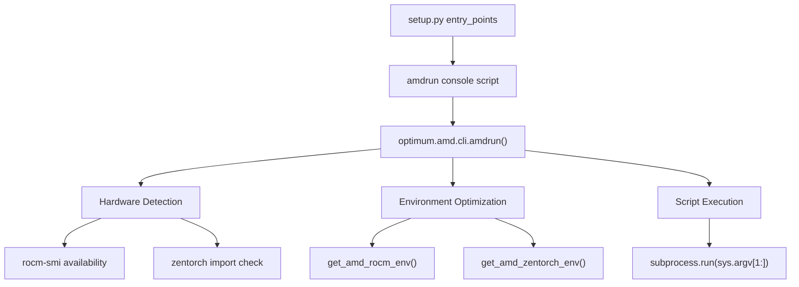
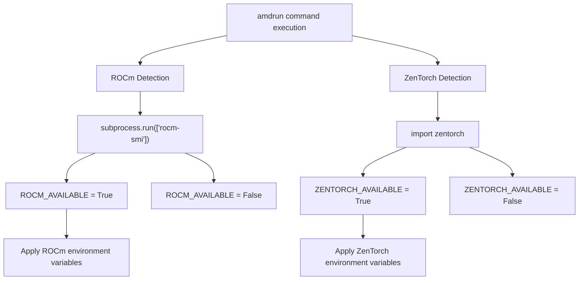
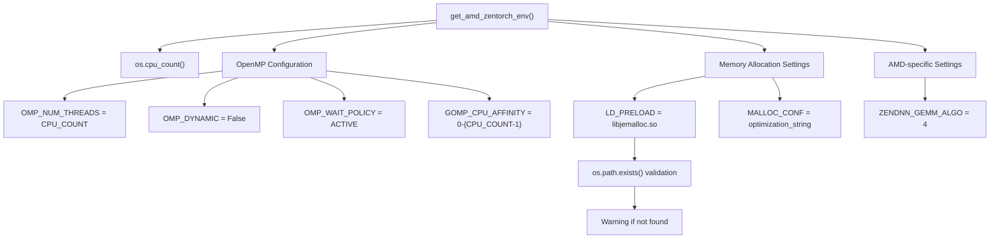
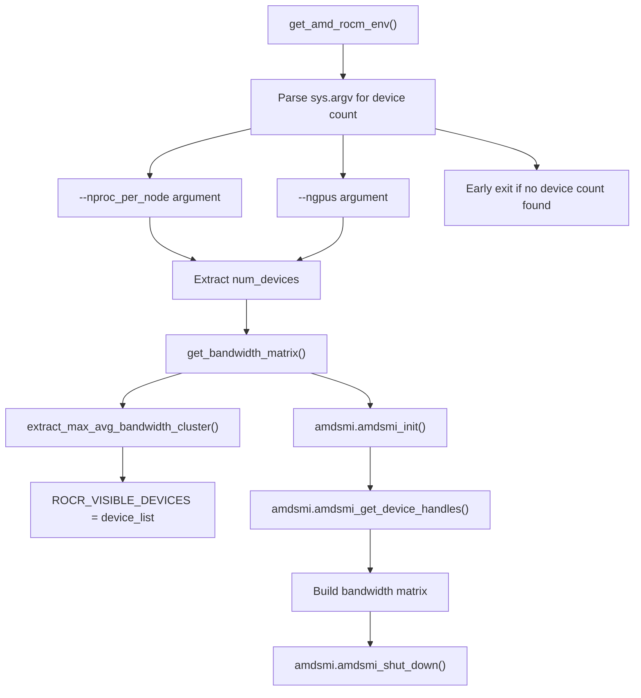
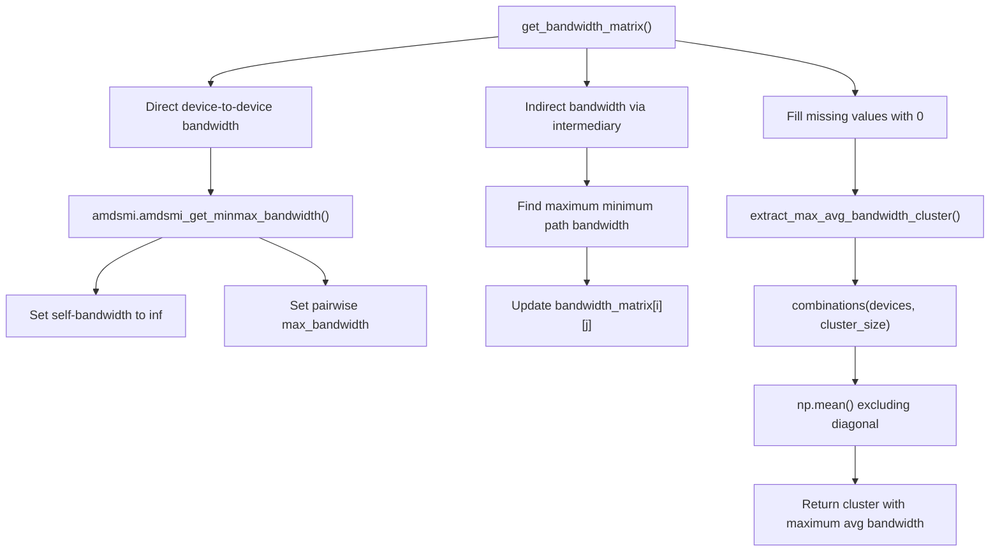
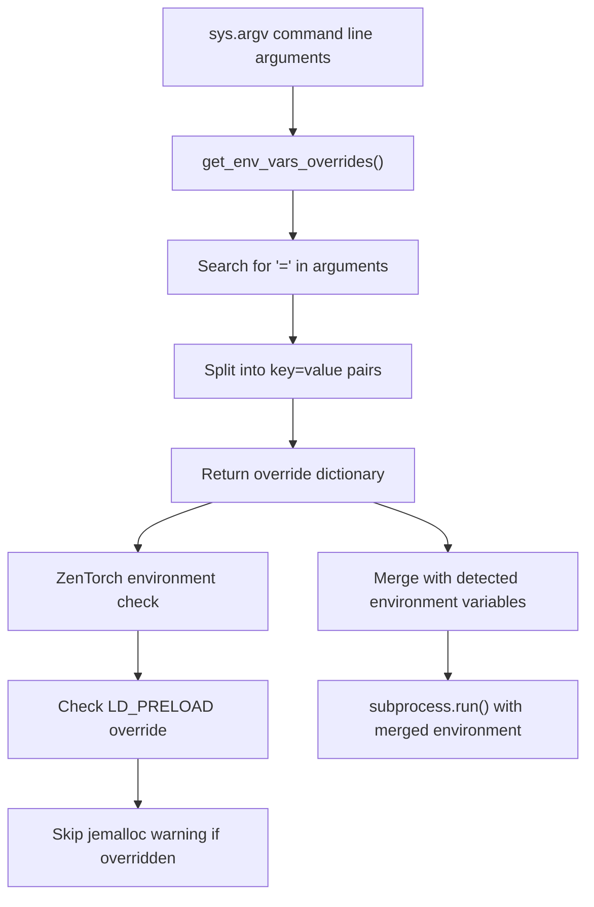
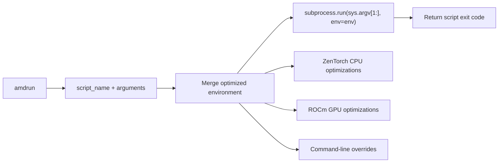
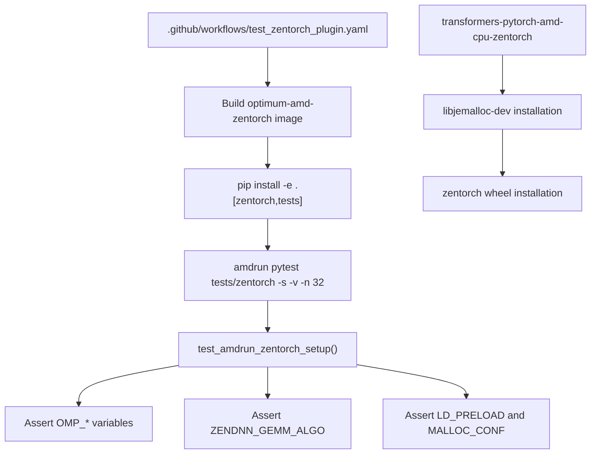

<!-- source: DeepWiki mcp.deepwiki.com · repo huggingface/optimum-amd · page 6 Command Line Interface · fetched 2026-10-26 -->

# Command Line Interface

Relevant source files

The following files were used as context for generating this wiki page:

- [.github/workflows/test_zentorch_plugin.yaml](.github/workflows/test_zentorch_plugin.yaml)
- [docker/transformers-pytorch-amd-cpu-zentorch/Dockerfile](docker/transformers-pytorch-amd-cpu-zentorch/Dockerfile)
- [optimum/amd/cli.py](optimum/amd/cli.py)
- [optimum/amd/topology_utils.py](optimum/amd/topology_utils.py)
- [setup.py](setup.py)
- [tests/zentorch/test_sanity.py](tests/zentorch/test_sanity.py)
- [tests/zentorch/testing_utils.py](tests/zentorch/testing_utils.py)

The optimum-amd command line interface provides the `amdrun` CLI tool for automatically optimizing environment variables and hardware configurations when running Python scripts on AMD hardware. The CLI detects available AMD hardware (ROCm GPUs, ZenTorch CPUs) and sets appropriate environment variables to maximize performance without requiring manual configuration.

For hardware-specific optimization details, see [ROCm GPU Support](#4) and [ZenTorch CPU Optimization](#5). For programmatic model optimization, see [RyzenAI System](#2).

## CLI Entry Point and Registration

The `amdrun` command is registered as a console script entry point in the package setup and provides a wrapper around script execution with optimized environment variables.

**Sources:** [setup.py:80](), [optimum/amd/cli.py:126-143]()

## Hardware Detection and Availability

The CLI automatically detects available AMD hardware components through runtime checks, setting global flags that determine which optimizations to apply.

**Sources:** [optimum/amd/cli.py:9-21](), [optimum/amd/cli.py:135-139]()

## ZenTorch CPU Environment Optimization

When ZenTorch is available, the CLI configures OpenMP, memory allocation, and AMD-specific optimization settings for CPU performance.

| Environment Variable | Purpose | Default Value |
|---------------------|---------|---------------|
| `OMP_NUM_THREADS` | OpenMP thread count | `{CPU_COUNT}` |
| `OMP_DYNAMIC` | Dynamic thread allocation | `"False"` |
| `OMP_WAIT_POLICY` | OpenMP wait strategy | `"ACTIVE"` |
| `ZENDNN_GEMM_ALGO` | GEMM algorithm selection | `"4"` |
| `GOMP_CPU_AFFINITY` | CPU core affinity | `"0-{CPU_COUNT-1}"` |
| `LD_PRELOAD` | Jemalloc library preload | `"/usr/lib/x86_64-linux-gnu/libjemalloc.so"` |
| `MALLOC_CONF` | Jemalloc configuration | Complex configuration string |

**Sources:** [optimum/amd/cli.py:39-88]()

## ROCm GPU Environment Optimization

For ROCm GPU scenarios, the CLI automatically selects optimal GPU devices based on inter-device bandwidth topology to maximize distributed training performance.

**Sources:** [optimum/amd/cli.py:91-123](), [optimum/amd/topology_utils.py:7-52]()

## Bandwidth Matrix and GPU Topology

The topology optimization system builds a comprehensive bandwidth matrix between all GPU devices and selects the optimal subset for distributed workloads.

**Sources:** [optimum/amd/topology_utils.py:55-77]()

## Environment Variable Overrides

The CLI supports runtime environment variable overrides through command-line arguments using key-value pair syntax.

**Sources:** [optimum/amd/cli.py:24-36](), [optimum/amd/cli.py:73-77]()

## Usage Patterns and Examples

The CLI is designed to work as a drop-in replacement for direct script execution, automatically applying hardware-specific optimizations.

| Usage Pattern | Command Example | Optimization Applied |
|---------------|----------------|---------------------|
| Single script execution | `amdrun python script.py` | ZenTorch CPU + ROCm detection |
| Distributed training (torchrun) | `amdrun torchrun --nproc_per_node 4 train.py` | Multi-GPU topology optimization |
| Distributed training (accelerate) | `amdrun accelerate launch --ngpus 2 train.py` | Multi-GPU topology optimization |
| Environment override | `amdrun LD_PRELOAD=/custom/path python script.py` | Custom environment variables |
| Test execution | `amdrun pytest tests/ -s -v -n 32` | Parallel testing with optimizations |

**Sources:** [optimum/amd/cli.py:126-143](), [.github/workflows/test_zentorch_plugin.yaml:50]()

## Integration with Testing Infrastructure

The CLI is integrated into the testing infrastructure to ensure consistent environment optimization across development and CI/CD workflows.

**Sources:** [.github/workflows/test_zentorch_plugin.yaml:40-50](), [tests/zentorch/test_sanity.py:21-31](), [docker/transformers-pytorch-amd-cpu-zentorch/Dockerfile:31]()

---

