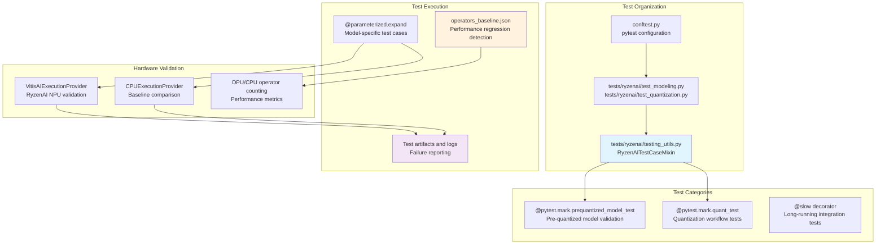
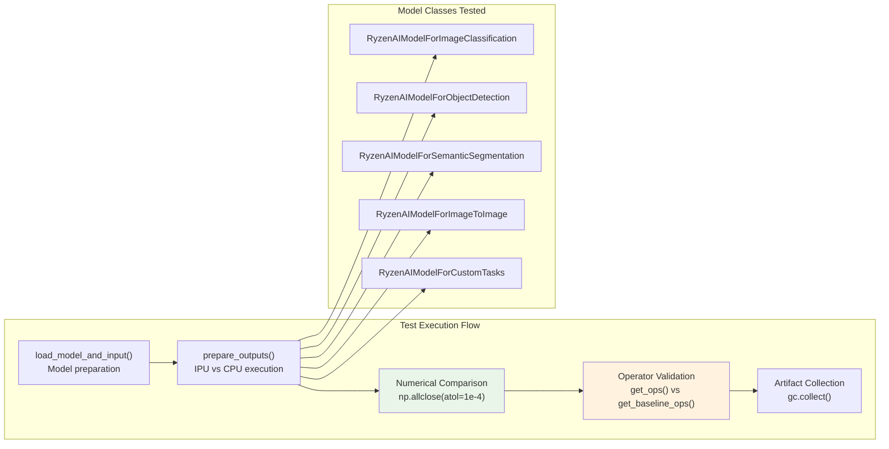
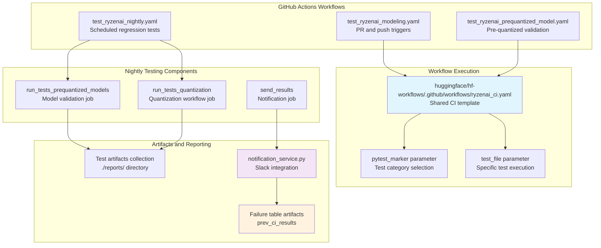
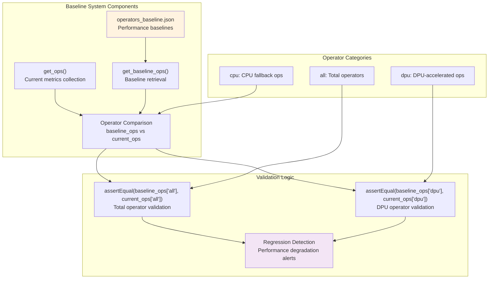
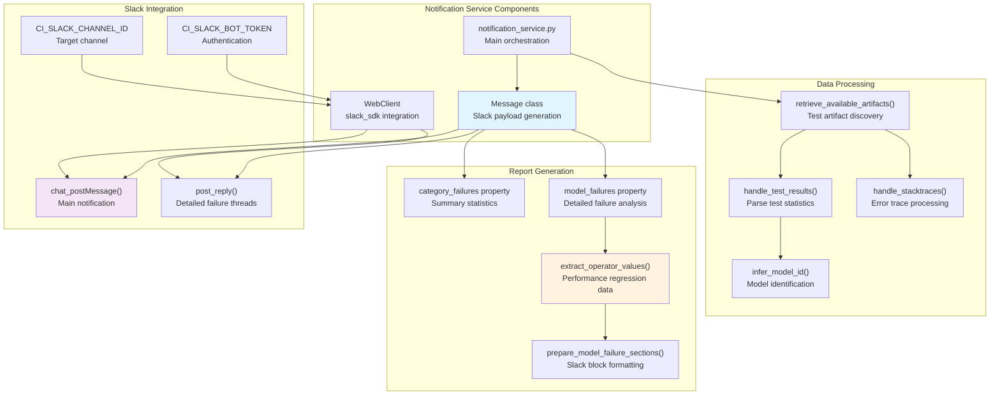
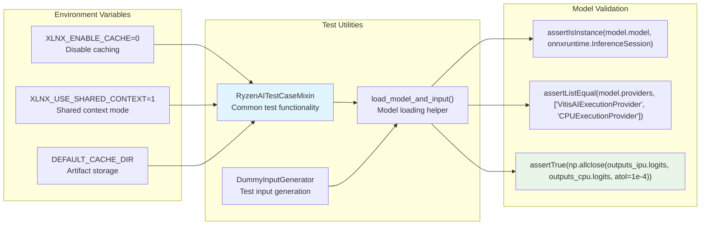

<!-- source: DeepWiki mcp.deepwiki.com · repo huggingface/optimum-amd · page 7 Development and Testing · fetched 2026-10-26 -->

# Development and Testing

Relevant source files

The following files were used as context for generating this wiki page:

- [.github/workflows/test_ryzenai_modeling.yaml](.github/workflows/test_ryzenai_modeling.yaml)
- [.github/workflows/test_ryzenai_nightly.yaml](.github/workflows/test_ryzenai_nightly.yaml)
- [.github/workflows/test_ryzenai_prequantized_model.yaml](.github/workflows/test_ryzenai_prequantized_model.yaml)
- [conftest.py](conftest.py)
- [tests/ryzenai/test_modeling.py](tests/ryzenai/test_modeling.py)
- [utils/ryzenai/notification_service.py](utils/ryzenai/notification_service.py)

This document covers the comprehensive development and testing infrastructure for optimum-amd, including the testing framework, CI/CD pipelines, performance validation systems, and automated reporting mechanisms. The focus is on the technical implementation details of how tests are organized, executed, and validated across different AMD hardware targets.

For information about specific testing of individual components, see [Testing Framework](#7.1), [CI/CD Workflows](#7.2), [Docker Environments](#7.3), and [Documentation System](#7.4).

## Testing Framework Architecture

The testing infrastructure is built around pytest with custom mixins and utilities specifically designed for AMD hardware validation. The framework supports multiple test categories, performance baseline validation, and automated artifact collection.

**Sources:** [tests/ryzenai/test_modeling.py:1-280](), [conftest.py:1-17]()

## Test Categories and Execution Patterns

The testing system uses pytest markers to organize tests into distinct categories, each targeting different aspects of the AMD hardware integration.

| Test Marker | Purpose | Execution Context | Validation Method |
|-------------|---------|-------------------|-------------------|
| `prequantized_model_test` | Validates pre-quantized ONNX models | RyzenAI NPU vs CPU comparison | Numerical accuracy + operator baselines |
| `quant_test` | Tests quantization workflows | End-to-end quantization pipeline | Model output validation |
| `slow` | Long-running integration tests | Pipeline interface testing | Functional correctness |

**Sources:** [tests/ryzenai/test_modeling.py:46-61](), [tests/ryzenai/test_modeling.py:100-114]()

## CI/CD Pipeline Architecture

The continuous integration system uses GitHub Actions with specialized workflows for different testing scenarios, including pull request validation, nightly regression testing, and performance monitoring.

**Sources:** [.github/workflows/test_ryzenai_modeling.yaml:1-30](), [.github/workflows/test_ryzenai_nightly.yaml:1-65]()

## Performance Baseline Validation System

The testing framework includes a sophisticated baseline validation system that tracks operator distribution and performance metrics to detect regressions in model optimization.

**Sources:** [tests/ryzenai/test_modeling.py:109-114](), [utils/ryzenai/notification_service.py:222-226]()

## Notification and Reporting System

The automated notification system provides comprehensive test result reporting through Slack integration, including detailed failure analysis and performance regression tracking.

**Sources:** [utils/ryzenai/notification_service.py:126-506](), [.github/workflows/test_ryzenai_nightly.yaml:44-56]()

## Test Execution Environment Configuration

The testing system includes environment-specific configurations and utilities that ensure consistent behavior across different execution contexts.

**Sources:** [tests/ryzenai/test_modeling.py:69-75](), [tests/ryzenai/test_modeling.py:46-61](), [tests/ryzenai/test_modeling.py:107-108]()

---

