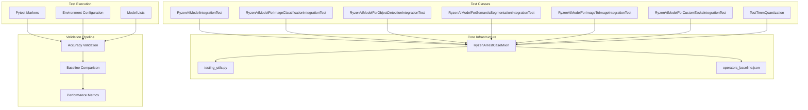
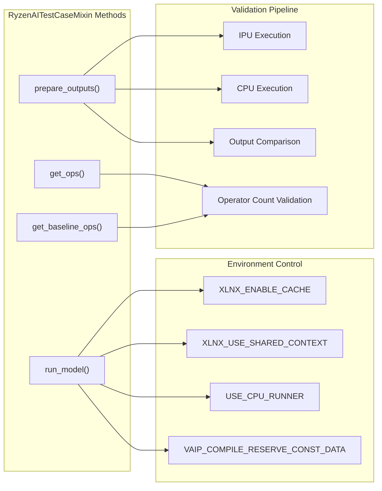
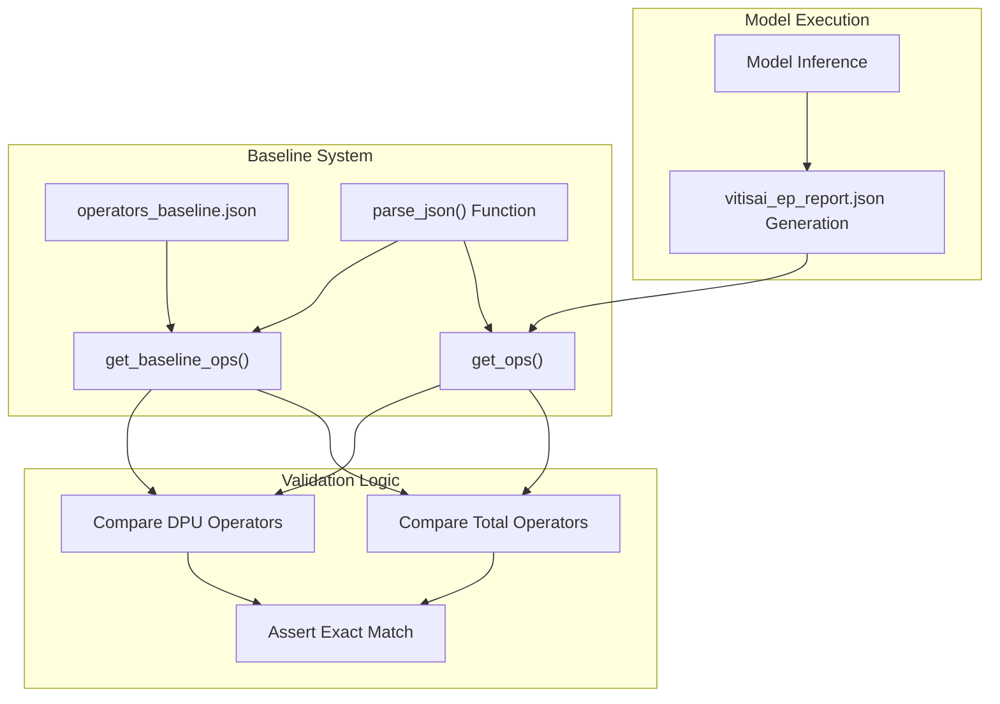
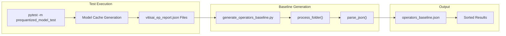
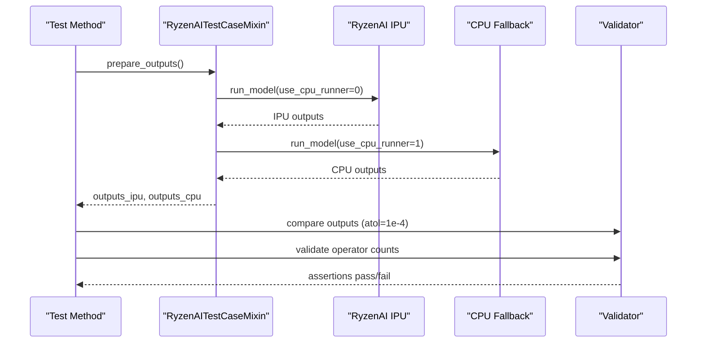
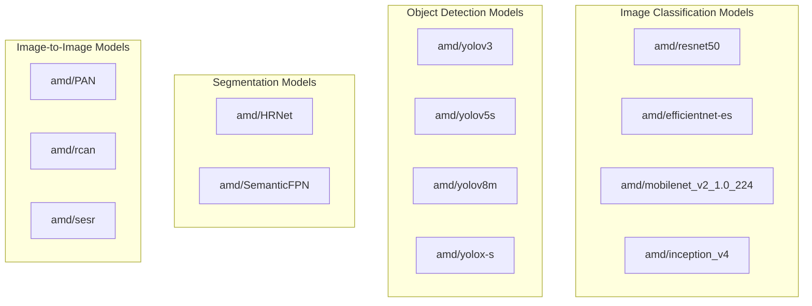
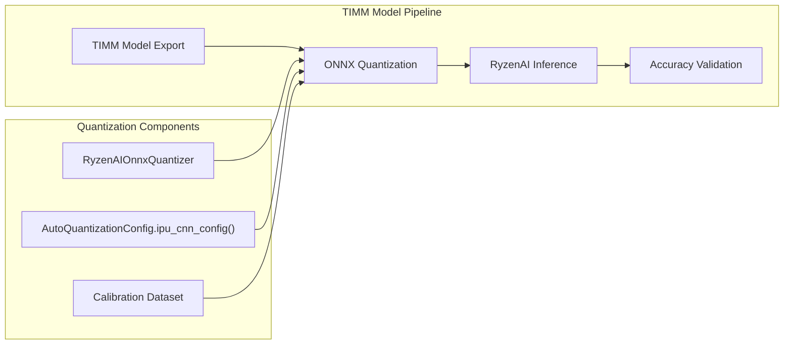
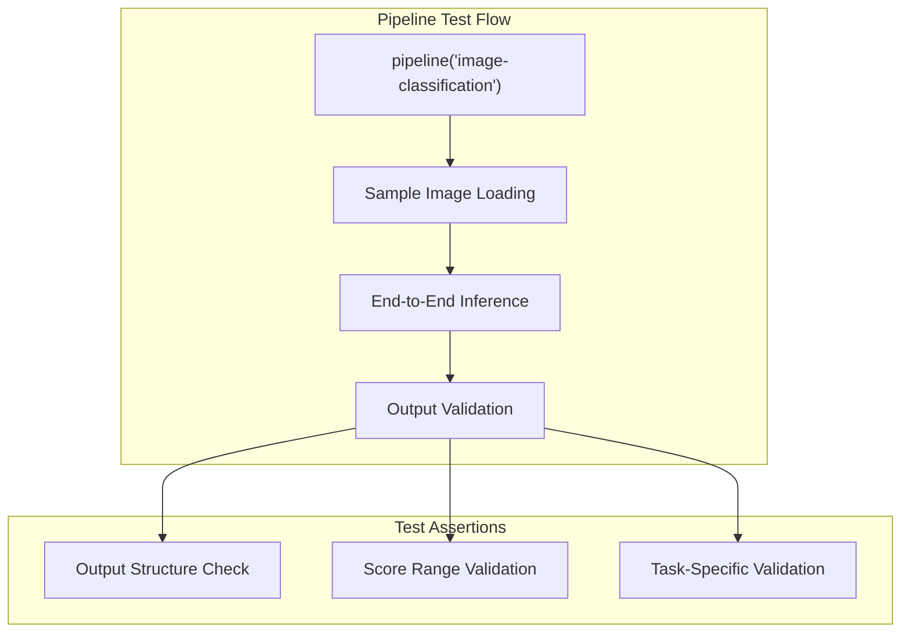

<!-- source: DeepWiki mcp.deepwiki.com · repo huggingface/optimum-amd · page 7.1 Testing Framework · fetched 2026-10-26 -->

# Testing Framework

Relevant source files

The following files were used as context for generating this wiki page:

- [tests/ryzenai/operators_baseline.json](tests/ryzenai/operators_baseline.json)
- [tests/ryzenai/test_modeling.py](tests/ryzenai/test_modeling.py)
- [tests/ryzenai/test_quantization.py](tests/ryzenai/test_quantization.py)
- [tests/ryzenai/testing_utils.py](tests/ryzenai/testing_utils.py)
- [utils/ryzenai/README.md](utils/ryzenai/README.md)
- [utils/ryzenai/generate_operators_baseline.py](utils/ryzenai/generate_operators_baseline.py)

The testing framework for optimum-amd provides comprehensive validation of RyzenAI model functionality, quantization pipelines, and performance baselines. It ensures that models execute correctly on AMD RyzenAI hardware while maintaining accuracy and meeting performance expectations.

This document covers the test infrastructure, baseline validation system, and test execution patterns. For information about CI/CD workflows and automation, see [CI/CD Workflows](#7.2). For Docker-based testing environments, see [Docker Environments](#7.3).

## Test Architecture Overview

The testing framework is built around a modular architecture that separates concerns between different hardware targets and model types:

Sources: [tests/ryzenai/test_modeling.py](), [tests/ryzenai/test_quantization.py](), [tests/ryzenai/testing_utils.py]()

## Core Testing Components

### RyzenAITestCaseMixin

The `RyzenAITestCaseMixin` class provides the foundational testing utilities shared across all test classes:

The `run_model` method [tests/ryzenai/testing_utils.py:27-56]() executes models with configurable environment settings, while `prepare_outputs` [tests/ryzenai/testing_utils.py:58-80]() orchestrates dual execution on IPU and CPU for comparison.

Sources: [tests/ryzenai/testing_utils.py:26-90]()

### Model Test Categories

The framework organizes tests by computer vision task types, each inheriting from `RyzenAITestCaseMixin`:

| Test Class | Model Types | Pytest Marker |
|------------|-------------|----------------|
| `RyzenAIModelForImageClassificationIntegrationTest` | ResNet, EfficientNet, MobileNet | `@pytest.mark.prequantized_model_test` |
| `RyzenAIModelForObjectDetectionIntegrationTest` | YOLO variants, RetinaFace | `@pytest.mark.prequantized_model_test` |
| `RyzenAIModelForSemanticSegmentationIntegrationTest` | HRNet, SemanticFPN | `@pytest.mark.prequantized_model_test` |
| `RyzenAIModelForImageToImageIntegrationTest` | PAN, RCAN, SESR | `@pytest.mark.prequantized_model_test` |
| `RyzenAIModelForCustomTasksIntegrationTest` | MoveNet pose estimation | `@pytest.mark.prequantized_model_test` |
| `TestTimmQuantization` | TIMM model quantization | `@pytest.mark.quant_test` |

Sources: [tests/ryzenai/test_modeling.py:91-279](), [tests/ryzenai/test_quantization.py:59-155]()

## Baseline Validation System

### Operator Count Tracking

The testing framework maintains performance baselines by tracking operator execution distribution between DPU (Data Processing Unit) and CPU:

The baseline validation ensures that models maintain consistent operator distribution patterns. For example, the `amd/resnet50` model baseline expects 399 total operators with 397 on DPU and 2 on CPU [tests/ryzenai/operators_baseline.json:47-51]().

Sources: [tests/ryzenai/testing_utils.py:82-89](), [tests/ryzenai/operators_baseline.json]()

### Baseline Generation Workflow

The framework includes utilities to generate and update performance baselines:

The baseline generation process [utils/ryzenai/generate_operators_baseline.py:30-53]() aggregates operator statistics from all test executions into a consolidated baseline file.

Sources: [utils/ryzenai/generate_operators_baseline.py](), [utils/ryzenai/README.md]()

## Test Execution Patterns

### Dual Execution Validation

Each model test follows a standardized dual-execution pattern to ensure accuracy:

The accuracy validation uses `np.allclose()` with absolute tolerance of 1e-4 [tests/ryzenai/test_modeling.py:107]() to ensure numerical consistency between IPU and CPU execution.

Sources: [tests/ryzenai/testing_utils.py:58-80](), [tests/ryzenai/test_modeling.py:100-115]()

### Environment Configuration

Tests configure the RyzenAI runtime through environment variables:

| Variable | Purpose | Values |
|----------|---------|---------|
| `XLNX_ENABLE_CACHE` | Controls model caching | `0` (disabled), `1` (enabled) |
| `XLNX_USE_SHARED_CONTEXT` | Shared execution context | `0` (separate), `1` (shared) |
| `USE_CPU_RUNNER` | Execution target | `0` (IPU), `1` (CPU) |
| `VAIP_COMPILE_RESERVE_CONST_DATA` | Constant data handling | `0` (release), `1` (reserve) |

The environment configuration [tests/ryzenai/testing_utils.py:38-41]() allows tests to control execution behavior for different validation scenarios.

Sources: [tests/ryzenai/testing_utils.py:38-41](), [tests/ryzenai/test_modeling.py:69-70]()

## Model Test Coverage

### Prequantized Model Sets

The framework maintains comprehensive model coverage through predefined test sets:

Each model set is defined as constants in `testing_utils.py` [tests/ryzenai/testing_utils.py:92-117]() and used with parameterized tests to ensure comprehensive coverage.

Sources: [tests/ryzenai/testing_utils.py:92-117]()

### Quantization Testing

The quantization tests validate end-to-end model preparation workflows:

The quantization workflow [tests/ryzenai/test_quantization.py:60-132]() includes model export, static quantization with calibration data, and accuracy validation against baseline performance.

Sources: [tests/ryzenai/test_quantization.py:60-155]()

## Pipeline Integration Testing

### High-Level API Validation

The framework includes integration tests for the high-level `pipeline` interface:

Pipeline tests [tests/ryzenai/test_modeling.py:121-132]() validate the complete user experience from model loading through inference to result interpretation.

Sources: [tests/ryzenai/test_modeling.py:121-204]()

---

