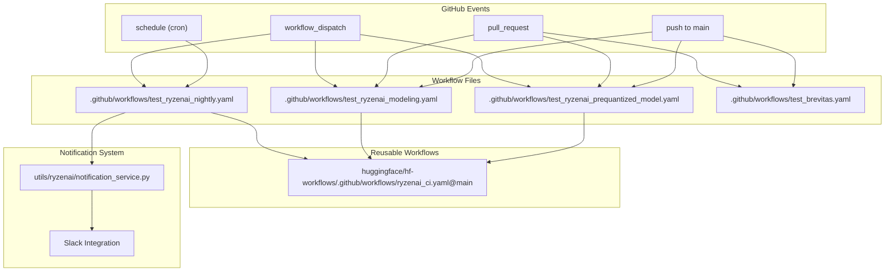
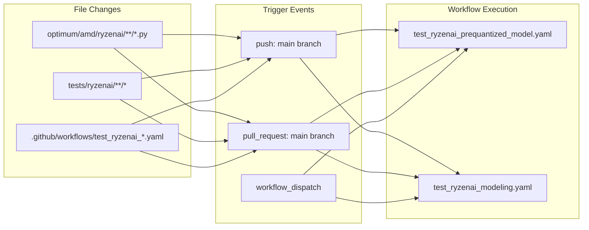
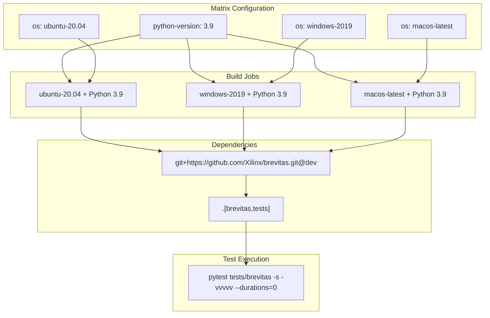
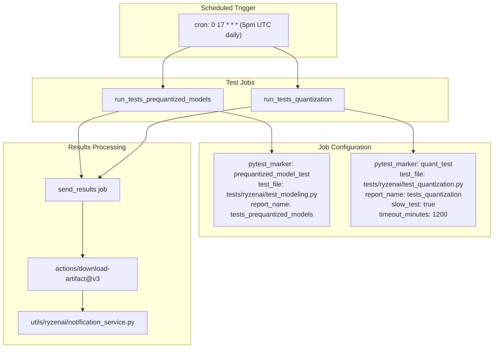
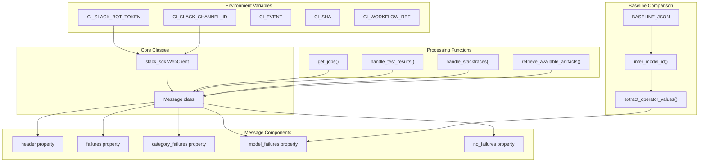
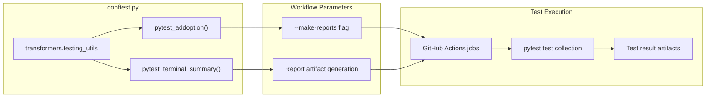

<!-- source: DeepWiki mcp.deepwiki.com · repo huggingface/optimum-amd · page 7.2 CI/CD Workflows · fetched 2026-10-26 -->

# CI/CD Workflows

<details>
<summary>Relevant source files</summary>

The following files were used as context for generating this wiki page:

- [.github/workflows/test_brevitas.yaml](.github/workflows/test_brevitas.yaml)
- [.github/workflows/test_ryzenai_modeling.yaml](.github/workflows/test_ryzenai_modeling.yaml)
- [.github/workflows/test_ryzenai_nightly.yaml](.github/workflows/test_ryzenai_nightly.yaml)
- [.github/workflows/test_ryzenai_prequantized_model.yaml](.github/workflows/test_ryzenai_prequantized_model.yaml)
- [conftest.py](conftest.py)
- [examples/quantization/brevitas/README.md](examples/quantization/brevitas/README.md)
- [utils/ryzenai/notification_service.py](utils/ryzenai/notification_service.py)

</details>


This document covers the continuous integration and continuous deployment (CI/CD) workflows implemented through GitHub Actions in the optimum-amd repository. The workflows handle automated testing for different AMD hardware targets including RyzenAI NPUs and multi-platform validation for Brevitas quantization. For information about the underlying testing framework and utilities, see [Testing Framework](#7.1). For details about Docker environments used in these workflows, see [Docker Environments](#7.3).

## Workflow Architecture Overview

The CI/CD system uses GitHub Actions to orchestrate testing across different AMD hardware targets and platforms. The workflows are designed with specific triggers, concurrency controls, and notification mechanisms.



**Sources:** [.github/workflows/test_ryzenai_prequantized_model.yaml:1-30](), [.github/workflows/test_ryzenai_modeling.yaml:1-30](), [.github/workflows/test_ryzenai_nightly.yaml:1-65](), [.github/workflows/test_brevitas.yaml:1-45]()

## RyzenAI Testing Workflows

The RyzenAI workflows use a reusable workflow pattern, delegating execution to `huggingface/hf-workflows/.github/workflows/ryzenai_ci.yaml@main`. Each workflow targets specific test categories using pytest markers.

### Workflow Triggers and Path Filtering



**Sources:** [.github/workflows/test_ryzenai_prequantized_model.yaml:5-18](), [.github/workflows/test_ryzenai_modeling.yaml:5-18]()

### Pytest Marker Configuration

The workflows differentiate test execution using pytest markers defined in the test files:

| Workflow | Pytest Marker | Test File | Purpose |
|----------|---------------|-----------|---------|
| `test_ryzenai_prequantized_model.yaml` | `prequantized_model_test` | `tests/ryzenai/test_modeling.py` | Tests pre-quantized model inference |
| `test_ryzenai_modeling.yaml` | `not prequantized_model_test` | `tests/ryzenai/test_modeling.py` | Tests general modeling functionality |

**Sources:** [.github/workflows/test_ryzenai_prequantized_model.yaml:26-29](), [.github/workflows/test_ryzenai_modeling.yaml:26-29]()

### Concurrency Control

All RyzenAI workflows implement concurrency control to prevent resource conflicts:

```yaml
concurrency:
  group: ${{ github.workflow }}-${{ github.head_ref || github.run_id }}
  cancel-in-progress: true
```

**Sources:** [.github/workflows/test_ryzenai_prequantized_model.yaml:20-22](), [.github/workflows/test_ryzenai_modeling.yaml:20-22]()

## Brevitas Cross-Platform Testing

The Brevitas workflow implements a matrix strategy for cross-platform validation across Ubuntu, Windows, and macOS.



**Sources:** [.github/workflows/test_brevitas.yaml:23-44]()

## Nightly Testing and Notification System

The nightly workflow runs comprehensive tests and provides detailed reporting through Slack integration.

### Nightly Workflow Structure



**Sources:** [.github/workflows/test_ryzenai_nightly.yaml:1-65]()

### Notification Service Implementation

The notification service (`utils/ryzenai/notification_service.py`) processes test results and sends detailed reports to Slack.



**Sources:** [utils/ryzenai/notification_service.py:1-717]()

### Test Result Categories and Baseline Validation

The notification service categorizes test results and compares against performance baselines:

| Test Category | Job Name | Pytest Marker | Baseline Comparison |
|---------------|----------|---------------|---------------------|
| Pre-Quantized Model | `run_tests_prequantized_models` | `prequantized_model_test` | Operator count validation |
| Timm Quantization | `run_tests_quantization` | `quant_test` | Performance regression detection |

The system validates operator counts against `operators_baseline.json` and flags regressions:

```python
# Extract baseline values for the identified model_id
baseline_ops = baseline_data.get(model_id.lower().replace("/", "_"), {})
cpu_baseline_value = baseline_ops.get("cpu", 0)
dpu_baseline_value = baseline_ops.get("dpu", 0)
all_baseline_value = baseline_ops.get("all", 0)
```

**Sources:** [utils/ryzenai/notification_service.py:254-262]()

## Workflow Integration with Testing Infrastructure

The workflows integrate with the broader testing infrastructure through pytest configuration and shared utilities.

### Pytest Configuration Integration



**Sources:** [conftest.py:1-17]()

### Slack Integration Details

The notification service constructs comprehensive Slack messages with interactive elements:

```python
"accessory": {
    "type": "button",
    "text": {"type": "plain_text", "text": "Check Action results", "emoji": True},
    "url": f"https://github.com/huggingface/optimum-amd/actions/runs/{os.environ['GITHUB_RUN_ID']}",
}
```

Messages include:
- Test summary statistics (passed/failed counts)
- Execution time tracking
- Category-wise failure breakdowns
- Operator count regression analysis
- Direct links to GitHub Actions runs
- Threaded replies with detailed stack traces

**Sources:** [utils/ryzenai/notification_service.py:182-186](), [utils/ryzenai/notification_service.py:474-506]()

---

