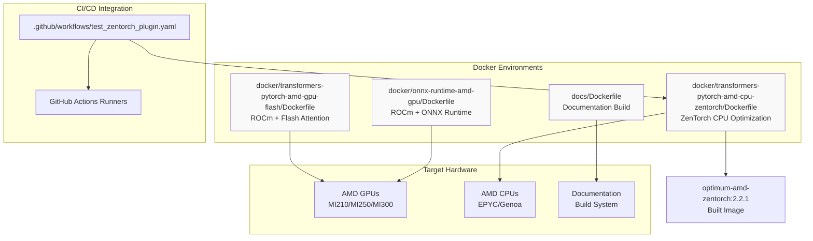
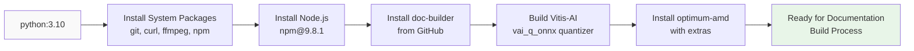
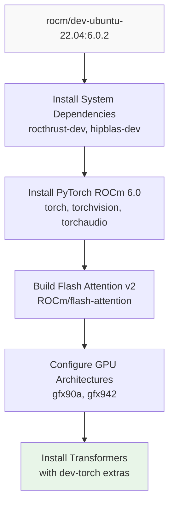
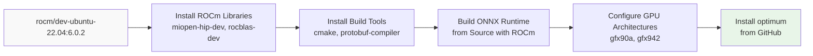
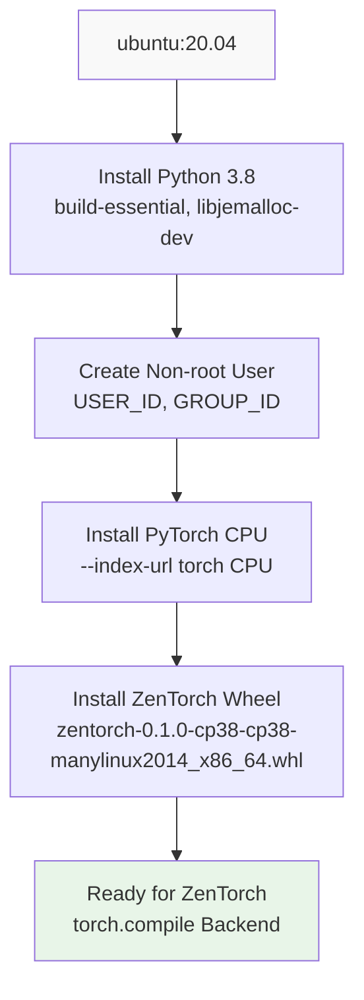
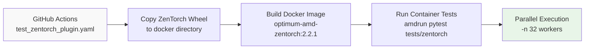

<!-- source: DeepWiki mcp.deepwiki.com · repo huggingface/optimum-amd · page 7.3 Docker Environments · fetched 2026-10-26 -->

# Docker Environments

<details>
<summary>Relevant source files</summary>

The following files were used as context for generating this wiki page:

- [.github/workflows/test_zentorch_plugin.yaml](.github/workflows/test_zentorch_plugin.yaml)
- [docker/onnx-runtime-amd-gpu/Dockerfile](docker/onnx-runtime-amd-gpu/Dockerfile)
- [docker/transformers-pytorch-amd-cpu-zentorch/Dockerfile](docker/transformers-pytorch-amd-cpu-zentorch/Dockerfile)
- [docker/transformers-pytorch-amd-gpu-flash/Dockerfile](docker/transformers-pytorch-amd-gpu-flash/Dockerfile)
- [docs/Dockerfile](docs/Dockerfile)
- [docs/source/amdgpu/overview.mdx](docs/source/amdgpu/overview.mdx)
- [optimum/amd/cli.py](optimum/amd/cli.py)
- [optimum/amd/topology_utils.py](optimum/amd/topology_utils.py)
- [tests/zentorch/test_sanity.py](tests/zentorch/test_sanity.py)
- [tests/zentorch/testing_utils.py](tests/zentorch/testing_utils.py)

</details>


This document covers the Docker-based development and testing environments used in optimum-amd for different AMD hardware targets. These environments provide isolated, reproducible setups for ROCm GPUs, ZenTorch CPUs, and documentation building. For information about the testing framework that uses these environments, see [Testing Framework](#7.1). For CI/CD workflows that orchestrate these containers, see [CI/CD Workflows](#7.2).

## Environment Architecture Overview

The optimum-amd repository maintains specialized Docker environments for different AMD hardware acceleration paths and development workflows.



Sources: [docs/Dockerfile:1-32](), [docker/transformers-pytorch-amd-gpu-flash/Dockerfile:1-42](), [docker/onnx-runtime-amd-gpu/Dockerfile:1-68](), [docker/transformers-pytorch-amd-cpu-zentorch/Dockerfile:1-59]()

## Documentation Build Environment

The documentation environment provides a complete setup for building optimum-amd documentation with all required dependencies.

### Base Configuration

| Component | Details |
|-----------|---------|
| Base Image | `python:3.10` |
| Key Dependencies | `git`, `node`, `npm`, `doc-builder` |
| Vitis-AI Version | `v3.5` |
| Python Packages | `optimum-amd[brevitas,tests]`, `onnxruntime==1.14.0` |

The environment includes several critical build steps:



Sources: [docs/Dockerfile:1-32]()

### Vitis-AI Integration

The documentation environment specifically builds the Vitis-AI quantization tools from source:

- Clones Vitis-AI repository at tag `v3.5`
- Builds `vai_q_onnx` quantizer using [docs/Dockerfile:27]()
- Installs resulting wheel packages for quantization functionality

## AMD GPU Environments

Two specialized environments support AMD GPU development with different focus areas.

### Flash Attention Environment

The `transformers-pytorch-amd-gpu-flash` environment targets high-performance inference with Flash Attention v2.



Sources: [docker/transformers-pytorch-amd-gpu-flash/Dockerfile:1-42]()

#### Key Components

| Component | Configuration |
|-----------|---------------|
| ROCm Version | 6.0.2 |
| GPU Architectures | `gfx90a`, `gfx942` (MI250, MI300 series) |
| Flash Attention | ROCm-optimized fork with commit `2554f490101742ccdc56620a938f847f61754be6` |
| PyTorch Index | `https://download.pytorch.org/whl/rocm6.0` |

### ONNX Runtime Environment  

The `onnx-runtime-amd-gpu` environment focuses on ONNX model execution with ROCm acceleration.



Sources: [docker/onnx-runtime-amd-gpu/Dockerfile:1-68]()

#### ONNX Runtime Build Configuration

The environment builds ONNX Runtime with specific ROCm optimizations:

- Build command: `./build.sh --config Release --build_wheel --use_rocm --rocm_home=/opt/rocm`
- Target architectures: `CMAKE_HIP_ARCHITECTURES=gfx90a,gfx942`
- Installs wheel from `onnxruntime/build/Linux/Release/dist/`

## AMD CPU Environment (ZenTorch)

The ZenTorch environment provides CPU-optimized inference capabilities for AMD processors.

### Environment Specification



Sources: [docker/transformers-pytorch-amd-cpu-zentorch/Dockerfile:1-59]()

### Configuration Details

| Setting | Value |
|---------|-------|
| Base OS | Ubuntu 20.04 |
| Python Version | 3.8 |
| PyTorch Version | 2.2.1 (configurable) |
| Memory Allocator | jemalloc (`libjemalloc-dev`) |
| User Management | Non-root user with configurable UID/GID |

The environment supports flexible PyTorch installation through build arguments:
- `stable`: Latest stable release
- `nightly`: Nightly builds
- Specific version: e.g., `2.2.1`

## CI/CD Integration

The Docker environments integrate with GitHub Actions for automated testing.

### ZenTorch Testing Workflow

The ZenTorch environment demonstrates the complete CI/CD integration pattern:



Sources: [.github/workflows/test_zentorch_plugin.yaml:1-51]()

#### Test Execution Pattern

The workflow demonstrates key integration points:

- **Wheel Management**: Copies ZenTorch binary from runner filesystem [.github/workflows/test_zentorch_plugin.yaml:27-30]()
- **Build Arguments**: Passes `USER_ID` and `GROUP_ID` for permission management [.github/workflows/test_zentorch_plugin.yaml:34-35]()
- **Volume Mounting**: Maps workspace to `/workspace` for source access [.github/workflows/test_zentorch_plugin.yaml:46]()
- **CLI Integration**: Uses `amdrun` command for optimized environment setup [.github/workflows/test_zentorch_plugin.yaml:50]()

### Container Configuration

| Setting | Value |
|---------|-------|
| Shared Memory | `64G` |
| Working Directory | `/workspace` |
| Test Command | `amdrun pytest tests/zentorch -s -v -n 32` |
| Installation | `pip install -e .[zentorch,tests]` |

## Usage Patterns

### Local Development

For local development with ZenTorch:

```bash
# Build image
docker build \
  --build-arg USER_ID=$(id -u) \
  --build-arg GROUP_ID=$(id -g) \
  --tag optimum-amd-zentorch:2.2.1 \
  docker/transformers-pytorch-amd-cpu-zentorch

# Run container
docker run -it \
  --shm-size 64G \
  --volume $(pwd):/workspace \
  --workdir /workspace \
  optimum-amd-zentorch:2.2.1
```

### Environment Variable Integration

The Docker environments work with the `amdrun` CLI for automatic environment optimization:

- **ZenTorch Variables**: `OMP_NUM_THREADS`, `ZENDNN_GEMM_ALGO`, `LD_PRELOAD`
- **ROCm Variables**: `ROCR_VISIBLE_DEVICES` for GPU selection
- **Memory Configuration**: `MALLOC_CONF` for jemalloc tuning

Sources: [optimum/amd/cli.py:24-143](), [tests/zentorch/test_sanity.py:21-31]()

---

