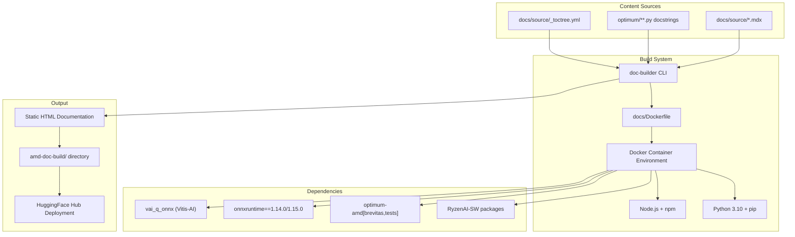
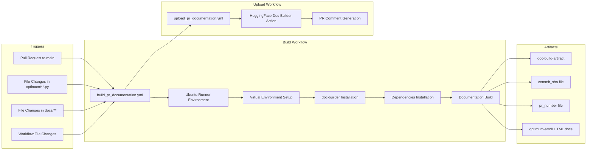
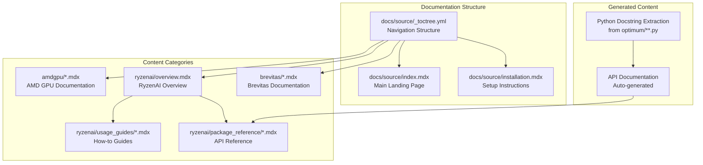

<!-- source: DeepWiki mcp.deepwiki.com · repo huggingface/optimum-amd · page 7.4 Documentation System · fetched 2026-10-26 -->

# Documentation System

<details>
<summary>Relevant source files</summary>

The following files were used as context for generating this wiki page:

- [.github/workflows/build_pr_documentation.yml](.github/workflows/build_pr_documentation.yml)
- [.github/workflows/upload_pr_documentation.yml](.github/workflows/upload_pr_documentation.yml)
- [docs/Dockerfile](docs/Dockerfile)
- [docs/README.md](docs/README.md)
- [docs/source/_toctree.yml](docs/source/_toctree.yml)
- [docs/source/installation.mdx](docs/source/installation.mdx)

</details>


This document covers the comprehensive documentation system used by optimum-amd, including the build infrastructure, content organization, automated workflows, and development processes. The system uses HuggingFace's `doc-builder` tool with custom Docker environments to generate and deploy documentation automatically.

For information about the overall development and testing infrastructure, see [Development and Testing](#7).

## System Architecture

The optimum-amd documentation system is built on HuggingFace's `doc-builder` with custom Docker containers and GitHub Actions workflows for automated building and deployment.

### Documentation Build Architecture



Sources: [docs/Dockerfile:1-32](), [.github/workflows/build_pr_documentation.yml:25-64]()

### CI/CD Documentation Pipeline



Sources: [.github/workflows/build_pr_documentation.yml:3-15](), [.github/workflows/upload_pr_documentation.yml:3-16]()

## Build Infrastructure

### Docker Environment

The documentation build process uses a custom Docker container that provides a complete environment with all necessary dependencies:

```dockerfile
FROM python:3.10
```

The container includes:
- **Base System**: Python 3.10, git, curl, Node.js for HTML generation
- **Media Libraries**: ffmpeg, libsm6, libxext6 for multimedia content
- **Documentation Tools**: `doc-builder` from HuggingFace
- **AMD Dependencies**: Vitis-AI vai_q_onnx quantization tools
- **Runtime Dependencies**: onnxruntime, optimum-amd with brevitas and tests

The build process clones and installs Vitis-AI components specifically:
```bash
git clone --depth 1 --branch v3.5 https://github.com/Xilinx/Vitis-AI.git && cd Vitis-AI/src/vai_quantizer/vai_q_onnx && sh build.sh && pip install pkgs/*.whl
```

Sources: [docs/Dockerfile:1-32]()

### Doc-Builder Integration

The system uses HuggingFace's `doc-builder` tool with the following command structure:

```bash
doc-builder build optimum.amd docs/source/ --build_dir amd-doc-build --version pr_$PR_NUMBER --version_tag_suffix "" --html --clean
```

Key parameters:
- **Package**: `optimum.amd` - specifies the Python package to document
- **Source Directory**: `docs/source/` - location of MDX content files
- **Build Directory**: `amd-doc-build` - output directory for generated HTML
- **Versioning**: Uses PR numbers for preview builds
- **Output Format**: HTML with clean rebuild

Sources: [.github/workflows/build_pr_documentation.yml:63]()

## Content Structure and Organization

### Table of Contents Structure

The documentation structure is defined in `_toctree.yml` using hierarchical YAML:

```yaml
- sections:
  - local: index
    title: 🤗 Optimum-AMD
  - local: installation
    title: Installation
  - local: amdgpu/overview
    title: AMD GPUs quicktour
```

The structure includes:
- **Main Sections**: Overview, Installation, AMD GPUs
- **RyzenAI Section**: Comprehensive coverage with subsections for usage guides and package reference
- **Brevitas Section**: Usage guides and API reference
- **Expandable Sections**: Uses `isExpanded: false` for collapsible navigation

Sources: [docs/source/_toctree.yml:1-42]()

### Content Format and File Organization



All content files use MDX format with front-matter headers:
```mdx
<!--Copyright 2023 The HuggingFace Team. All rights reserved.
Licensed under the MIT License.
-->

# Installation
```

Sources: [docs/source/_toctree.yml:10-39](), [docs/source/installation.mdx:1-6]()

## Development Workflow

### Local Development Setup

For local development, the system provides a streamlined setup process:

1. **Installation**: 
   ```bash
   pip install hf-doc-builder watchdog --upgrade
   ```

2. **Live Preview**:
   ```bash
   doc-builder preview optimum.amd docs/source/
   ```

3. **Static Build**:
   ```bash
   doc-builder build optimum.amd docs/source/ --build_dir build/
   ```

Sources: [docs/README.md:4-15]()

### CI/CD Integration Details

The automated workflow includes several key steps:

1. **Environment Setup**: Creates virtual environment and installs doc-builder from main branch
2. **Dependency Installation**: Installs RyzenAI packages, optimum-amd with extras, and specific onnxruntime versions
3. **Build Process**: Executes doc-builder with PR-specific versioning
4. **Artifact Management**: Saves build artifacts with commit SHA and PR number for tracking
5. **Upload Process**: Uses HuggingFace's reusable workflow for deployment

The system maintains version consistency by using:
- `COMMIT_SHA`: `${{ github.event.pull_request.head.sha }}`
- `PR_NUMBER`: `${{ github.event.number }}`
- `PR_CLONE_URL`: `${{ github.event.pull_request.head.repo.clone_url }}`

Sources: [.github/workflows/build_pr_documentation.yml:20-23](), [.github/workflows/build_pr_documentation.yml:42-57]()

### Dependency Management

The documentation build requires several specialized dependencies:

| Dependency Category | Components | Purpose |
|-------------------|------------|---------|
| **Core Documentation** | `doc-builder`, `black`, `wheel` | Documentation generation and formatting |
| **AMD Hardware Support** | `vai_q_onnx` from Vitis-AI, RyzenAI-SW packages | Hardware-specific quantization and runtime |
| **ML Runtime** | `onnxruntime==1.14.0/1.15.0` | Model execution and inference |
| **Package Components** | `optimum-amd[brevitas,tests]` | Full package with optional dependencies |

The system handles version-specific installations and ensures compatibility across different build contexts.

Sources: [docs/Dockerfile:25-31](), [.github/workflows/build_pr_documentation.yml:51-56]()

---

