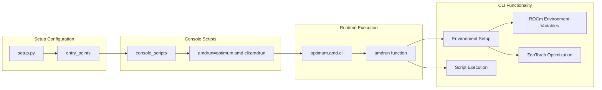
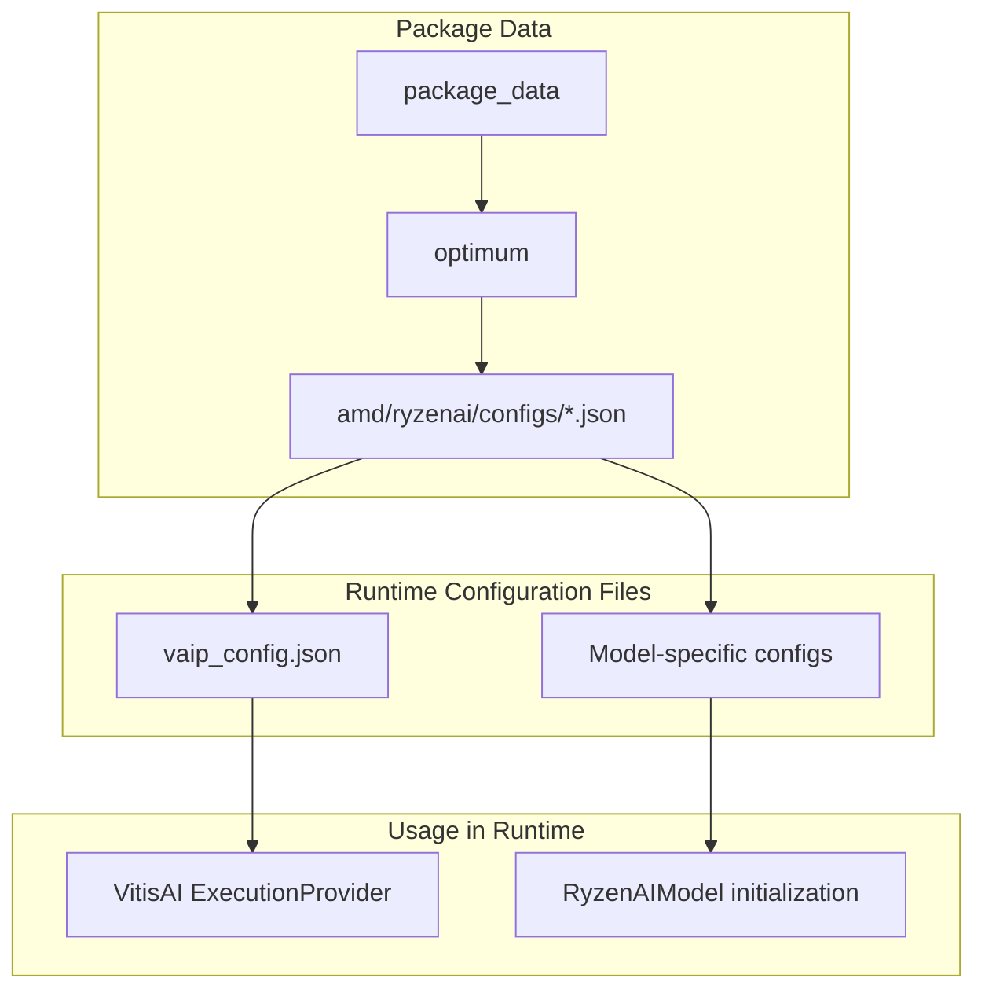

<!-- source: DeepWiki mcp.deepwiki.com · repo huggingface/optimum-amd · page 8 Package Reference · fetched 2026-10-26 -->

# Package Reference

<details>
<summary>Relevant source files</summary>

The following files were used as context for generating this wiki page:

- [optimum/amd/__init__.py](optimum/amd/__init__.py)
- [optimum/amd/ryzenai/__init__.py](optimum/amd/ryzenai/__init__.py)
- [setup.py](setup.py)

</details>


This document provides low-level API documentation and package structure reference for developers working with or extending the `optimum-amd` codebase. It covers the modular organization, import structure, dependencies, and entry points that define how the library is packaged and distributed.

For high-level usage guides, see [RyzenAI System](#2), [Brevitas Quantization](#3), and [Command Line Interface](#6). For development workflows and testing, see [Development and Testing](#7).

## Package Structure

The `optimum-amd` package follows a hierarchical namespace structure that organizes functionality by AMD hardware target and core capabilities.

### Module Organization

```mermaid
graph TD
    subgraph "Package Root"
        Root[optimum.amd]
    end
    
    subgraph "Hardware-Specific Modules"
        RyzenAI[optimum.amd.ryzenai]
        Brevitas[optimum.amd.brevitas]
    end
    
    subgraph "RyzenAI Submodules"
        RyzenAI --> Config[configuration]
        RyzenAI --> Modeling[modeling]
        RyzenAI --> Quant[quantization]
        RyzenAI --> Pipelines[pipelines]
        RyzenAI --> Utils[utils]
    end
    
    subgraph "Brevitas Submodules"
        Brevitas --> BrevConfig[brevitas.configuration]
        Brevitas --> BrevQuant[brevitas.quantizer]
    end
    
    subgraph "CLI Entry Point"
        CLI[amdrun CLI] --> CLIModule[optimum.amd.cli:amdrun]
    end
    
    Root --> RyzenAI
    Root --> Brevitas
    Root --> CLI
    
    subgraph "Exported Classes"
        Config --> RyzenAIConfig
        Config --> QuantizationConfig
        Config --> AutoQuantizationConfig
        
        Modeling --> RyzenAIModel
        Modeling --> RyzenAIModelForImageClassification
        Modeling --> RyzenAIModelForObjectDetection
        Modeling --> RyzenAIModelForSemanticSegmentation
        Modeling --> RyzenAIModelForImageToImage
        Modeling --> RyzenAIModelForCustomTasks
        
        Quant --> RyzenAIOnnxQuantizer
        Pipelines --> pipeline
        Utils --> DEFAULT_VAIP_CONFIG
        
        BrevConfig --> BrevitasQuantizationConfig
        BrevQuant --> BrevitasQuantizer
    end
```



**Sources:** [optimum/amd/__init__.py:9-16](), [optimum/amd/ryzenai/__init__.py:9-22]()

### Lazy Loading Implementation

The package uses `transformers.utils._LazyModule` for delayed imports, improving startup performance by loading modules only when accessed.

| Module | Lazy Import Structure | Exported Classes |
|--------|----------------------|------------------|
| `optimum.amd` | Brevitas-only | `BrevitasQuantizationConfig`, `BrevitasQuantizer` |
| `optimum.amd.ryzenai` | Full RyzenAI stack | 10 classes across configuration, modeling, quantization, pipelines, utils |

The lazy loading pattern follows this structure:
- `_import_structure` dictionary maps module names to exported class lists
- `TYPE_CHECKING` block provides direct imports for type checking
- Runtime uses `_LazyModule` for deferred loading

**Sources:** [optimum/amd/__init__.py:24-29](), [optimum/amd/ryzenai/__init__.py:40-42]()

## Dependencies and Installation

### Core Dependencies

```mermaid
graph TD
    subgraph "Required Dependencies"
        Core[optimum-amd] --> Optimum[optimum]
        Core --> Transformers["transformers>=4.38"]
        Core --> ONNX[onnx]
        Core --> ONNXExt[onnxruntime-extensions]
    end
    
    subgraph "Extra Dependencies"
        RyzenAIExtra[ryzenai extra] --> OpenCV[opencv-python]
        RyzenAIExtra --> TIMM[timm]
        
        ZenTorchExtra[zentorch extra] --> PyTorch["torch==2.2.1"]
        
        BrevitasExtra[brevitas extra] --> BrevitasLib[brevitas]
        BrevitasExtra --> PyTorchBrev["torch>=2.2"]
        BrevitasExtra --> Datasets["datasets>=2.17"]
        BrevitasExtra --> Accelerate["accelerate>=0.30"]
        BrevitasExtra --> ONNXTool[onnx-tool]
        BrevitasExtra --> OptimumBrev["optimum>=1.17"]
    end
    
    subgraph "Development Dependencies"
        TestsExtra[tests extra] --> PyTest["pytest<=7.4.4"]
        TestsExtra --> Parameterized[parameterized]
        TestsExtra --> Evaluate[evaluate]
        TestsExtra --> ScikitLearn[scikit-learn]
        TestsExtra --> ONNXRuntime[onnxruntime]
        TestsExtra --> TorchVision["torchvision==0.17.1"]
        TestsExtra --> Diffusers[diffusers]
        
        QualityExtra[quality extra] --> Black["black~=23.1"]
        QualityExtra --> Ruff["ruff>=0.0.241,<=0.0.259"]
    end
    
    Core --> RyzenAIExtra
    Core --> ZenTorchExtra
    Core --> BrevitasExtra
    Core --> TestsExtra
    Core --> QualityExtra
```



**Sources:** [setup.py:17](), [setup.py:36-51](), [setup.py:20-32](), [setup.py:34]()

### Installation Extras

The package defines several installation extras for different use cases:

| Extra | Purpose | Key Dependencies |
|-------|---------|------------------|
| `ryzenai` | RyzenAI NPU support | `opencv-python`, `timm` |
| `zentorch` | ZenTorch CPU optimization | `torch==2.2.1` |
| `brevitas` | LLM quantization | `brevitas`, `torch>=2.2`, `accelerate>=0.30` |
| `tests` | Development testing | `pytest<=7.4.4`, `evaluate`, `timm` |
| `quality` | Code quality tools | `black~=23.1`, `ruff` |

**Sources:** [setup.py:36-51]()

## Entry Points and CLI Integration

### Console Script Registration

The package registers a single console script entry point through setuptools:



**Sources:** [setup.py:80]()

The `amdrun` command provides automatic environment optimization for AMD hardware targets, as detailed in [Command Line Interface](#6).

## Package Metadata and Distribution

### Package Configuration

| Property | Value | Description |
|----------|-------|-------------|
| Name | `optimum-amd` | PyPI package name |
| License | MIT | Open source license |
| Author | HuggingFace Inc. Special Ops Team | Maintainer |
| URL | https://github.com/huggingface/optimum-amd | Repository |
| Python Support | 3.8 - 3.11 | Supported Python versions |

**Sources:** [setup.py:54](), [setup.py:78](), [setup.py:76](), [setup.py:75](), [setup.py:68-71]()

### Package Data and Resources

The package includes configuration files for RyzenAI runtime:



**Sources:** [setup.py:83]()

These configuration files are automatically included in the package distribution and accessed by the RyzenAI runtime system for hardware optimization settings.

### Version Management

Version information is dynamically loaded from `optimum/amd/version.py` during package build:

```python
# Version extraction pattern from setup.py
filepath = "optimum/amd/version.py"
with open(filepath) as version_file:
    (__version__,) = re.findall('__version__ = "(.*)"', version_file.read())
```

**Sources:** [setup.py:10-14]()

This ensures consistency between the package version and the version exposed in the Python API.