# Page: Overview

# Overview

<details>
<summary>Relevant source files</summary>

The following files were used as context for generating this wiki page:

- [README.md](README.md)
- [docs/source/index.mdx](docs/source/index.mdx)
- [setup.py](setup.py)

</details>


## Purpose and Scope

Optimum-AMD is the interface layer between Hugging Face libraries and AMD's hardware acceleration platforms. This library provides performance optimizations and hardware-specific integrations for three main AMD compute targets: ROCm-enabled GPUs, RyzenAI Neural Processing Units (NPUs), and ZenTorch-optimized CPUs.

The library extends the Hugging Face ecosystem by providing drop-in replacements for standard model classes, specialized quantization tools, and optimized inference pipelines tailored for AMD hardware. For detailed information about specific hardware targets, see [RyzenAI System](#2), [Brevitas Quantization](#3), [ROCm GPU Support](#4), and [ZenTorch CPU Optimization](#5).

Sources: [README.md:1-11](), [setup.py:54-58](), [docs/source/index.mdx:7-7]()

## Hardware Target Architecture

The following diagram illustrates the three primary AMD hardware targets and their corresponding software integrations:

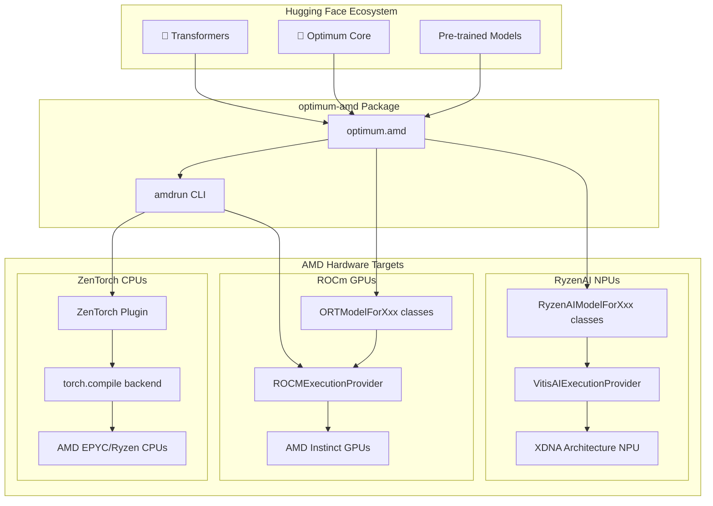

Sources: [README.md:21-29](), [README.md:76-81](), [setup.py:80-80]()

## Core System Components

### RyzenAI Integration

The RyzenAI system represents the most comprehensive component of optimum-amd, providing specialized model classes and quantization tools for AMD's Neural Processing Units.

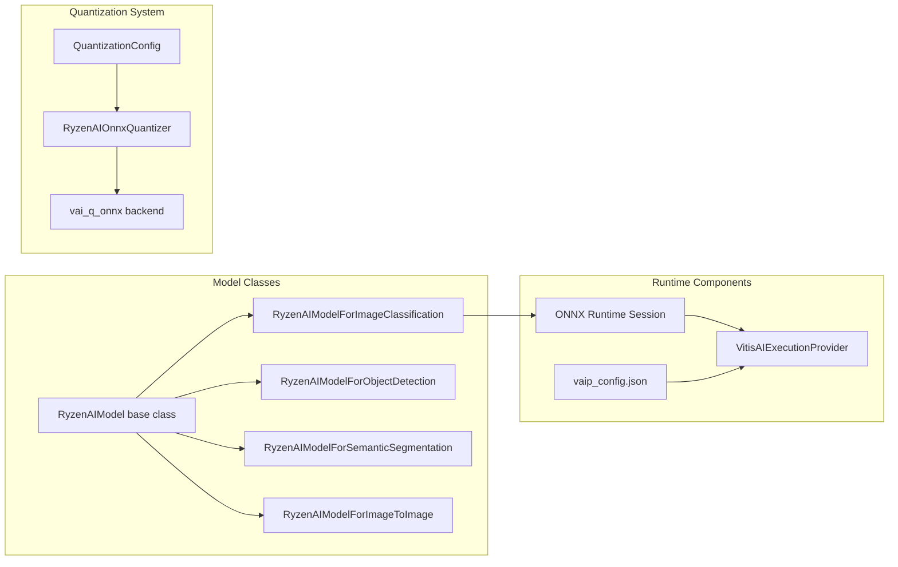

Sources: [README.md:93-112](), [setup.py:39-39](), [setup.py:83-83]()

### Brevitas Quantization System

Brevitas provides advanced post-training quantization techniques specifically optimized for Large Language Models, with support for GPTQ, SmoothQuant, and weight equalization methods.

| Component | Purpose | Code Entity |
|-----------|---------|-------------|
| `BrevitasQuantizer` | Main quantization interface | Core quantizer class |
| `BrevitasQuantizationConfig` | Configuration management | Quantization parameters |
| GPTQ Implementation | Post-training quantization | GPTQ algorithm support |
| ONNX Export | Model format conversion | ONNX optimization pipeline |

Sources: [setup.py:41-50]()

### ROCm GPU Acceleration

ROCm support leverages existing Hugging Face integrations with PyTorch and ONNX Runtime, providing seamless GPU acceleration for AMD hardware.

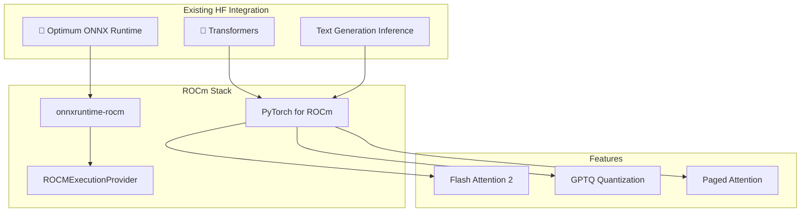

Sources: [README.md:21-28](), [README.md:51-74]()

## Package Structure and Entry Points

The library provides multiple interfaces for different use cases and technical requirements:

### Installation Variants

| Installation Command | Purpose | Dependencies |
|---------------------|---------|-------------|
| `pip install optimum[amd]` | Base installation | Core optimum-amd functionality |
| `pip install optimum-amd[ryzenai]` | RyzenAI support | opencv-python, timm |
| `pip install optimum-amd[brevitas]` | LLM quantization | brevitas, torch>=2.2, datasets |
| `pip install optimum-amd[zentorch]` | CPU optimization | torch==2.2.1 |

Sources: [README.md:7-19](), [setup.py:36-51]()

### Command Line Interface

The `amdrun` CLI provides automatic environment optimization for AMD hardware:

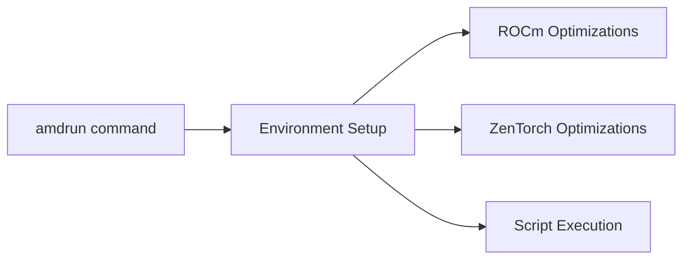

Sources: [setup.py:80-80]()

### Python API Structure

The library follows Hugging Face conventions with drop-in replacement classes:

```python
# Standard Transformers usage
from transformers import AutoModelForImageClassification

# Drop-in replacement for RyzenAI
from optimum.amd.ryzenai import RyzenAIModelForImageClassification

# ROCm GPU usage with ONNX Runtime
from optimum.onnxruntime import ORTModelForSequenceClassification

# Brevitas quantization
from optimum.amd.brevitas import BrevitasQuantizer
```

Sources: [README.md:93-112](), [README.md:59-74]()

## Development and Testing Infrastructure

The repository includes comprehensive testing and development tools:

- **Test Framework**: Pytest-based with custom markers (`prequantized_model_test`, `quant_test`)
- **CI/CD**: GitHub Actions workflows with AMD hardware-specific testing
- **Docker Support**: Pre-configured environments for ROCm, RyzenAI, and ZenTorch
- **Quality Assurance**: Black, Ruff formatting with automated checks

For detailed development information, see [Development and Testing](#7).

Sources: [README.md:114-152](), [setup.py:20-34]()

---

# Page: Installation and Setup

# Installation and Setup

<details>
<summary>Relevant source files</summary>

The following files were used as context for generating this wiki page:

- [.github/workflows/test_ryzenai_quantization_timm.yaml](.github/workflows/test_ryzenai_quantization_timm.yaml)
- [README.md](README.md)
- [pyproject.toml](pyproject.toml)
- [setup.py](setup.py)

</details>


This document covers the installation and configuration of optimum-amd, including its hardware-specific dependencies for AMD CPUs, GPUs, and NPUs. For detailed usage of specific hardware targets, see [RyzenAI System](#2) for NPU usage, [ROCm GPU Support](#4) for GPU acceleration, [ZenTorch CPU Optimization](#5) for CPU optimization, and [Brevitas Quantization](#3) for LLM quantization workflows.

## Installation Methods

### Standard Installation

The simplest installation method uses pip to install optimum-amd with its core dependencies:

```bash
pip install --upgrade-strategy eager optimum[amd]
```

This installs the base package with dependencies defined in [setup.py:17](), including `optimum`, `transformers>=4.38`, `onnx`, and `onnxruntime-extensions`.

### Development Installation

For development or to get the latest features, install from source:

```bash
git clone https://github.com/huggingface/optimum-amd.git
cd optimum-amd
pip install -e .
```

### Installation Flow

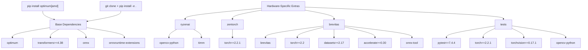

*Installation dependency structure showing base requirements and optional hardware-specific extras*

Sources: [setup.py:17-51](), [README.md:7-19]()

## Hardware-Specific Installation

### RyzenAI NPU Setup

For AMD Ryzen AI NPU support, install the RyzenAI extras:

```bash
pip install optimum[amd,ryzenai]
```

This includes additional dependencies like `opencv-python` and `timm` as defined in [setup.py:39](). However, the core RyzenAI runtime environment requires separate installation following [AMD's RyzenAI documentation](https://ryzenai.docs.amd.com/en/latest/inst.html).

**Required External Setup:**
1. Install RyzenAI Software from AMD
2. Configure the runtime environment per [RyzenAI Runtime Setup](https://ryzenai.docs.amd.com/en/latest/runtime_setup.html)
3. Verify `VitisAIExecutionProvider` is available in ONNX Runtime

### ROCm GPU Support

For AMD GPU acceleration with ROCm:

```bash
# Install PyTorch for ROCm first
pip install torch torchvision --index-url https://download.pytorch.org/whl/rocm5.7

# Then install optimum-amd
pip install optimum[amd]
```

**Required External Setup:**
1. Install [ROCm 5.7](https://rocm.docs.amd.com/en/latest/deploy/linux/index.html) on the host system
2. For ONNX Runtime support, build `onnxruntime-rocm` from source (pip wheels not available)
3. Use the provided [Docker environment](docker/onnx-runtime-amd-gpu/Dockerfile) for containerized deployment

### ZenTorch CPU Optimization

For AMD CPU optimization with ZenTorch:

```bash
pip install optimum[amd,zentorch]
```

This installs the specific PyTorch version required for ZenTorch integration as specified in [setup.py:40]().

### Brevitas Quantization

For LLM quantization with Brevitas:

```bash
pip install optimum[amd,brevitas]
```

This installs the comprehensive quantization stack including `brevitas`, `datasets>=2.17`, `accelerate>=0.30`, and related tools as defined in [setup.py:41-50]().

## Dependency Structure

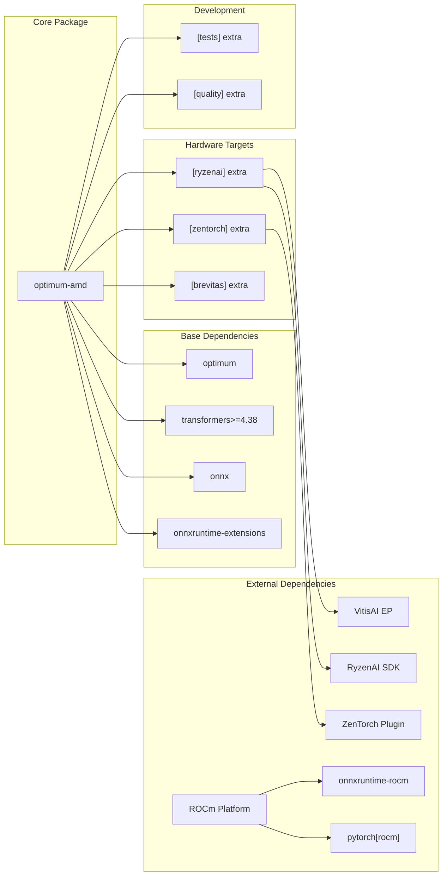

*Package dependency architecture showing internal and external requirements*

Sources: [setup.py:17-51](), [README.md:21-28](), [README.md:82-84]()

## Development Environment Setup

### Testing Installation

For running the test suite, install test dependencies:

```bash
pip install .[tests]
```

This installs testing tools including `pytest<=7.4.4`, `parameterized`, `timm`, and other dependencies defined in [setup.py:20-32]().

### Code Quality Tools

For development with code formatting and linting:

```bash
pip install .[quality]
```

This installs `black~=23.1` and `ruff>=0.0.241,<=0.0.259` as specified in [setup.py:34]().

### Configuration Files

The development environment uses several configuration files:

| File | Purpose | Key Settings |
|------|---------|-------------|
| `pyproject.toml` | Code quality configuration | Black line length: 119, Ruff rules, pytest markers |
| `setup.py` | Package definition | Entry points, dependencies, extras |

Sources: [pyproject.toml:1-23](), [setup.py:53-86]()

## Installation Verification

### Basic Verification

Verify the core installation:

```python
import optimum.amd
from optimum.amd import __version__
print(f"Optimum-AMD version: {__version__}")
```

### Hardware-Specific Verification

#### RyzenAI Verification

```python
from optimum.amd.ryzenai import RyzenAIModel
# Should import without errors if RyzenAI SDK is properly installed
```

#### ROCm Verification

```python
import torch
print(f"ROCm available: {torch.cuda.is_available()}")
print(f"ROCm device count: {torch.cuda.device_count()}")
```

#### Command Line Interface

The package installs the `amdrun` CLI tool defined in [setup.py:80]():

```bash
amdrun --help
```

For detailed CLI usage, see [Command Line Interface](#6).

## Environment Variables and Runtime Configuration

### RyzenAI Configuration

RyzenAI models use configuration files located in `optimum/amd/ryzenai/configs/*.json` as specified in [setup.py:83](). The runtime can be configured through `vaip_config.json` files for detailed performance tuning.

### Testing Environment Variables

Several environment variables control test behavior as shown in [README.md:134-147]():

| Variable | Purpose | Example |
|----------|---------|---------|
| `RUN_SLOW` | Enable slow tests that download large models | `RUN_SLOW=1 pytest` |

Sources: [README.md:114-151](), [setup.py:80-84]()

## Docker Environments

For consistent development and deployment, several Docker environments are available:

- `docker/onnx-runtime-amd-gpu/Dockerfile` - ROCm + ONNX Runtime environment
- `docker/transformers-pytorch-amd-gpu-flash/Dockerfile` - ROCm + Flash Attention
- `docker/optimum-amd-zentorch/Dockerfile` - AMD CPU + ZenTorch optimization

For detailed Docker setup, see [Docker Environments](#7.3).

Sources: [README.md:56](), [.github/workflows/test_ryzenai_quantization_timm.yaml:24-31]()

---

# Page: RyzenAI System

# RyzenAI System

<details>
<summary>Relevant source files</summary>

The following files were used as context for generating this wiki page:

- [docs/source/ryzenai/overview.mdx](docs/source/ryzenai/overview.mdx)
- [optimum/amd/ryzenai/__init__.py](optimum/amd/ryzenai/__init__.py)
- [optimum/amd/ryzenai/modeling.py](optimum/amd/ryzenai/modeling.py)
- [optimum/amd/ryzenai/utils.py](optimum/amd/ryzenai/utils.py)

</details>


The RyzenAI System provides optimized inference for Hugging Face models on AMD Ryzen AI NPU hardware using the VitisAI execution provider within ONNX Runtime. This system handles the complete workflow from ONNX model loading to hardware-accelerated inference for computer vision tasks.

For details on model quantization specific to RyzenAI, see [Quantization](#2.2). For high-level pipeline interfaces, see [Pipelines](#2.3). For runtime configuration options, see [Configuration](#2.4). For detailed model implementation and inference mechanics, see [Models and Inference](#2.1).

## System Architecture

The RyzenAI system bridges Hugging Face models with AMD NPU hardware through a layered architecture:

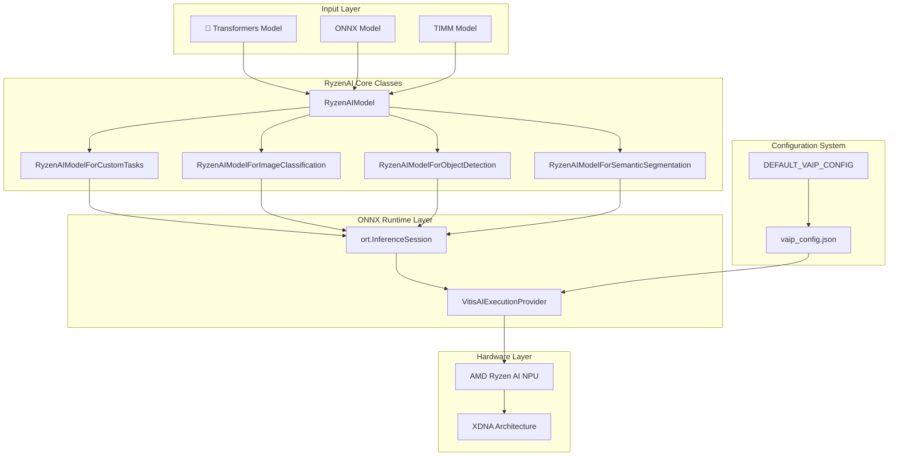

Sources: [optimum/amd/ryzenai/modeling.py:47-70](), [optimum/amd/ryzenai/modeling.py:568-701](), [optimum/amd/ryzenai/utils.py:13]()

## Core Components

### RyzenAIModel Base Class

The `RyzenAIModel` class serves as the foundation for all RyzenAI model implementations:

| Component | Code Entity | Purpose |
|-----------|-------------|---------|
| Base Model | `RyzenAIModel` | Abstract base class with common functionality |
| ONNX Session | `ort.InferenceSession` | ONNX Runtime inference session |
| Provider | `VitisAIExecutionProvider` | AMD NPU execution provider |
| Configuration | `vaip_config` | Runtime configuration for VitisAI |

The class hierarchy establishes shared attributes and methods for model loading, configuration management, and hardware integration.

Sources: [optimum/amd/ryzenai/modeling.py:47-135]()

### Task-Specific Model Classes

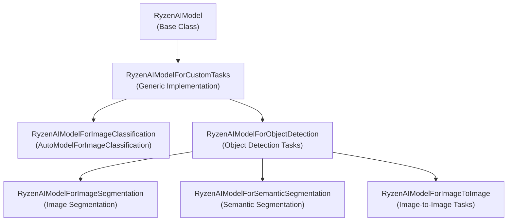

Each task-specific class implements the `forward()` method optimized for its particular use case while inheriting common functionality from the base classes.

Sources: [optimum/amd/ryzenai/modeling.py:568-701]()

## Model Loading and Initialization

### Loading Workflow

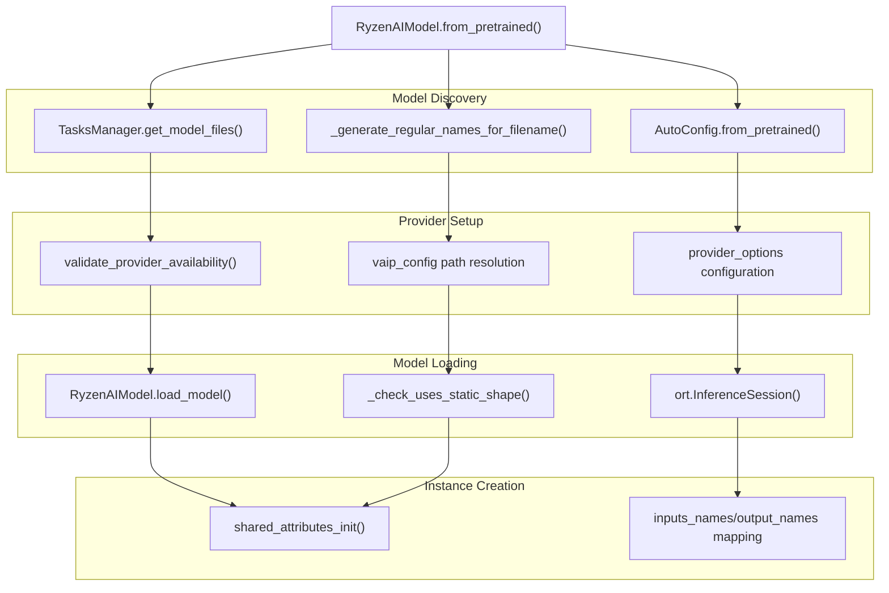

The loading process validates provider availability, resolves configuration paths, performs static shape checking, and initializes the ONNX Runtime session with VitisAI provider.

Sources: [optimum/amd/ryzenai/modeling.py:227-508](), [optimum/amd/ryzenai/modeling.py:144-189]()

### Key Loading Parameters

| Parameter | Default | Purpose |
|-----------|---------|---------|
| `provider` | `"VitisAIExecutionProvider"` | ONNX Runtime execution provider |
| `vaip_config` | `DEFAULT_VAIP_CONFIG` | VitisAI runtime configuration |
| `file_name` | Auto-detected | ONNX model filename |
| `provider_options` | `None` | Provider-specific options |

Sources: [optimum/amd/ryzenai/modeling.py:240-297](), [optimum/amd/ryzenai/utils.py:13]()

## Execution Flow

### Inference Pipeline

The inference execution follows a standardized pattern across all task-specific models:

```mermaid
graph LR
    input["Input Tensors"]
    
    subgraph "Preprocessing"
        torch_check["isinstance(input, torch.Tensor)"]
        numpy_convert["tensor.cpu().detach().numpy()"]
        onnx_inputs["onnx_inputs dict preparation"]
    end
    
    subgraph "Inference"
        session_run["model.run(None, onnx_inputs)"]
        ort_execution["ONNX Runtime + VitisAI"]
    end
    
    subgraph "Postprocessing"
        output_mapping["output_names index mapping"]
        torch_convert["torch.from_numpy()"]
        model_output["ModelOutput/ImageClassifierOutput"]
    end
    
    input --> torch_check
    torch_check --> numpy_convert
    numpy_convert --> onnx_inputs
    onnx_inputs --> session_run
    session_run --> ort_execution
    ort_execution --> output_mapping
    output_mapping --> torch_convert
    torch_convert --> model_output
```

Sources: [optimum/amd/ryzenai/modeling.py:569-601](), [optimum/amd/ryzenai/modeling.py:607-619]()

### Static Shape Requirements

The system enforces static input/output shapes for VitisAI compatibility:

- Dynamic axes detection via `_check_uses_static_shape()`
- Shape validation during model loading
- Runtime error for models with dynamic dimensions
- Shape reshaping support via `reshape()` method

Sources: [optimum/amd/ryzenai/modeling.py:511-565]()

## Model Export and Compatibility

### Export Capabilities

The system provides export functionality for select model types:

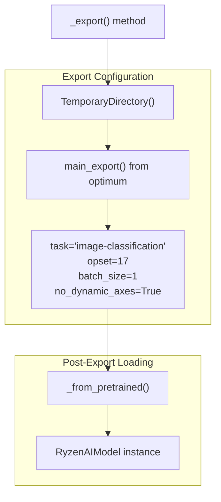

Export is currently supported for `RyzenAIModelForImageClassification` with specific constraints for NPU compatibility.

Sources: [optimum/amd/ryzenai/modeling.py:622-673]()

---

# Page: Models and Inference

# Models and Inference

<details>
<summary>Relevant source files</summary>

The following files were used as context for generating this wiki page:

- [docs/source/ryzenai/package_reference/modeling.mdx](docs/source/ryzenai/package_reference/modeling.mdx)
- [optimum/amd/ryzenai/modeling.py](optimum/amd/ryzenai/modeling.py)
- [optimum/amd/ryzenai/models/hrnet/__init__.py](optimum/amd/ryzenai/models/hrnet/__init__.py)
- [optimum/amd/ryzenai/models/hrnet/image_processing_hrnet.py](optimum/amd/ryzenai/models/hrnet/image_processing_hrnet.py)
- [optimum/amd/ryzenai/models/semanticfpn/__init__.py](optimum/amd/ryzenai/models/semanticfpn/__init__.py)
- [optimum/amd/ryzenai/models/semanticfpn/image_processing_semantic_fpn.py](optimum/amd/ryzenai/models/semanticfpn/image_processing_semantic_fpn.py)
- [optimum/amd/ryzenai/pipelines/image_segmentation.py](optimum/amd/ryzenai/pipelines/image_segmentation.py)
- [optimum/amd/ryzenai/utils.py](optimum/amd/ryzenai/utils.py)
- [tests/ryzenai/test_modeling.py](tests/ryzenai/test_modeling.py)

</details>


This document covers the core RyzenAI model classes and inference system that enables running ONNX models on AMD Ryzen AI NPUs through the VitisAI execution provider. This includes the `RyzenAIModel` base class, task-specific model implementations, ONNX Runtime integration, and the complete inference workflow from model loading to output processing.

For information about quantizing models for RyzenAI deployment, see [Quantization](#2.2). For high-level pipeline interfaces, see [Pipelines](#2.3). For runtime configuration options, see [Configuration](#2.4).

## Core Model Classes

The RyzenAI system implements a hierarchy of model classes that provide a unified interface for running ONNX models on AMD hardware. All model classes inherit from the base `RyzenAIModel` class and follow the Hugging Face `OptimizedModel` pattern.

### Class Hierarchy

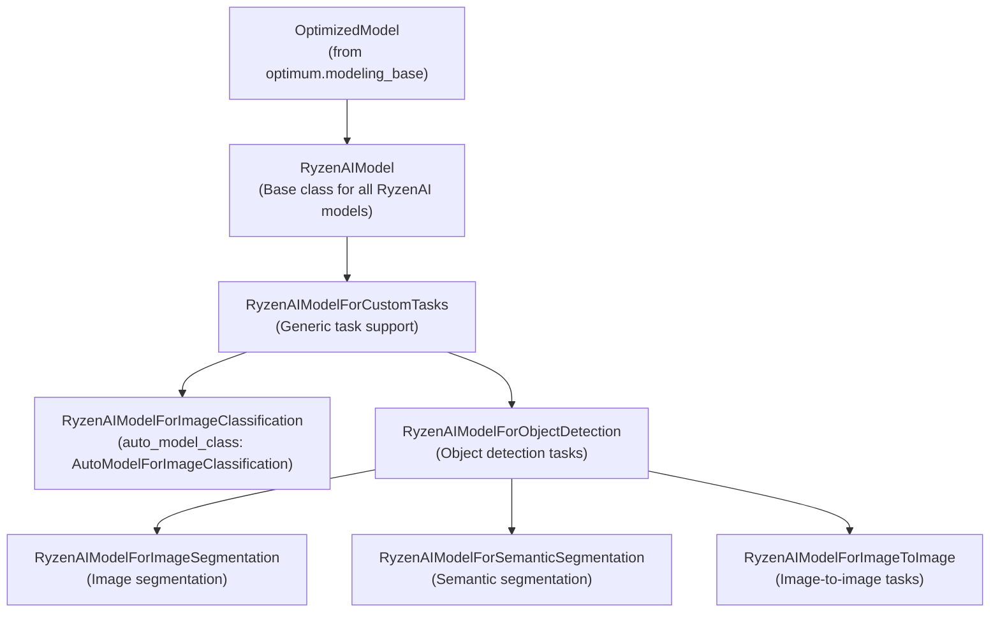

**Sources:** [optimum/amd/ryzenai/modeling.py:47-701]()

### Base RyzenAIModel Class

The `RyzenAIModel` class serves as the foundation for all RyzenAI model implementations. It provides core functionality for model loading, ONNX Runtime session management, and Hugging Face Hub integration.

| Attribute | Type | Description |
|-----------|------|-------------|
| `model` | `ort.InferenceSession` | The ONNX Runtime inference session |
| `config` | `PretrainedConfig` | The model configuration |
| `model_save_dir` | `Path` | Directory containing the ONNX model files |
| `providers` | `List[str]` | Available ONNX Runtime execution providers |
| `vaip_config` | `Path` | Path to VitisAI configuration file |

**Sources:** [optimum/amd/ryzenai/modeling.py:47-132]()

## Model Loading and Initialization

The RyzenAI system provides a comprehensive model loading workflow that handles both local and Hub-based models, with automatic configuration management and provider setup.

### Loading Workflow

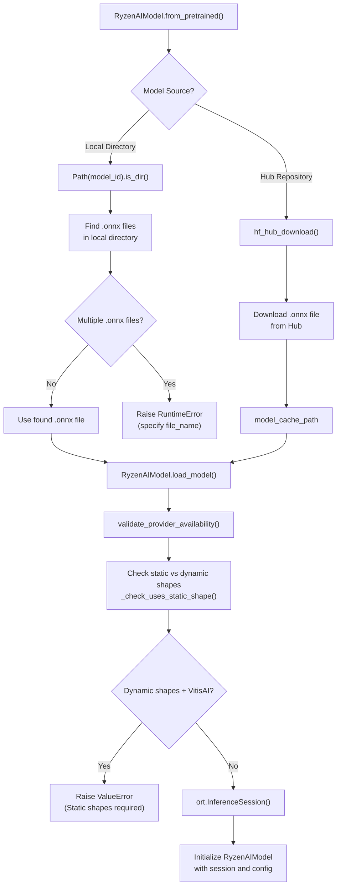

**Sources:** [optimum/amd/ryzenai/modeling.py:228-357](), [optimum/amd/ryzenai/modeling.py:143-189]()

### Provider Configuration

The system automatically configures the VitisAI execution provider with appropriate settings:

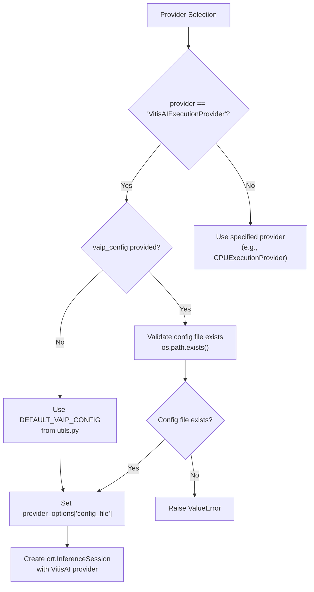

**Sources:** [optimum/amd/ryzenai/modeling.py:277-298](), [optimum/amd/ryzenai/utils.py:13]()

## ONNX Runtime Integration

The RyzenAI system integrates deeply with ONNX Runtime, providing specialized handling for the VitisAI execution provider and AMD NPU hardware.

### Session Management

| Method | Purpose | Key Features |
|--------|---------|--------------|
| `load_model()` | Creates ONNX Runtime session | Provider validation, static shape checking |
| `_check_uses_static_shape()` | Validates model shapes | Ensures NPU compatibility |
| `reshape()` | Converts dynamic to static shapes | Uses `update_model_dims.update_inputs_outputs_dims()` |

### Execution Provider Chain

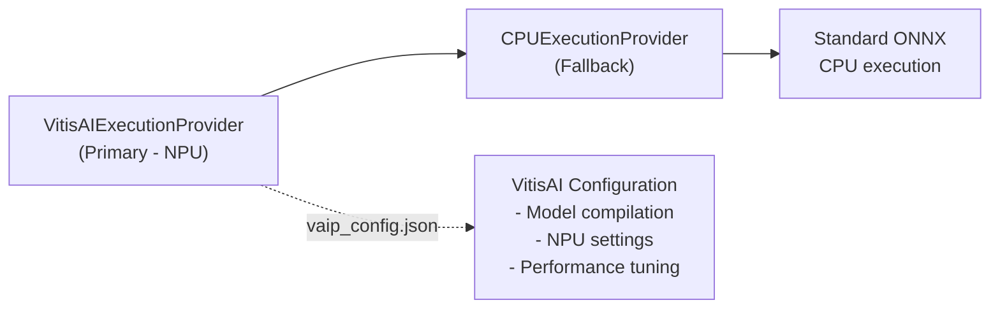

**Sources:** [optimum/amd/ryzenai/modeling.py:165-189](), [optimum/amd/ryzenai/utils.py:16-27]()

## Task-Specific Model Classes

Each task-specific model class provides specialized input/output handling and integrates with the broader Hugging Face ecosystem through auto-registration.

### Input/Output Processing

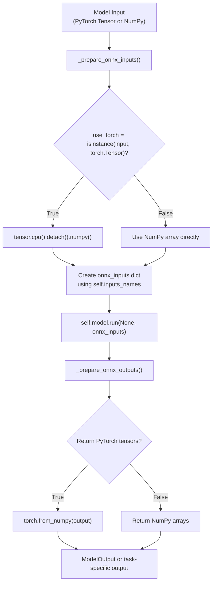

**Sources:** [optimum/amd/ryzenai/modeling.py:581-601]()

### Task-Specific Implementations

| Class | Auto Model Class | Output Format | Specialization |
|-------|------------------|---------------|----------------|
| `RyzenAIModelForImageClassification` | `AutoModelForImageClassification` | `ImageClassifierOutput` | Single input handling, logits extraction |
| `RyzenAIModelForObjectDetection` | None | `ModelOutput` | Multiple outputs for bounding boxes |
| `RyzenAIModelForSemanticSegmentation` | None | `ModelOutput` | Segmentation mask outputs |
| `RyzenAIModelForCustomTasks` | None | `ModelOutput` | Generic input/output mapping |

**Sources:** [optimum/amd/ryzenai/modeling.py:604-701]()

## Model Shape Management

RyzenAI requires static input shapes for NPU execution. The system provides utilities to detect and convert dynamic models to static shapes.

### Shape Detection and Conversion

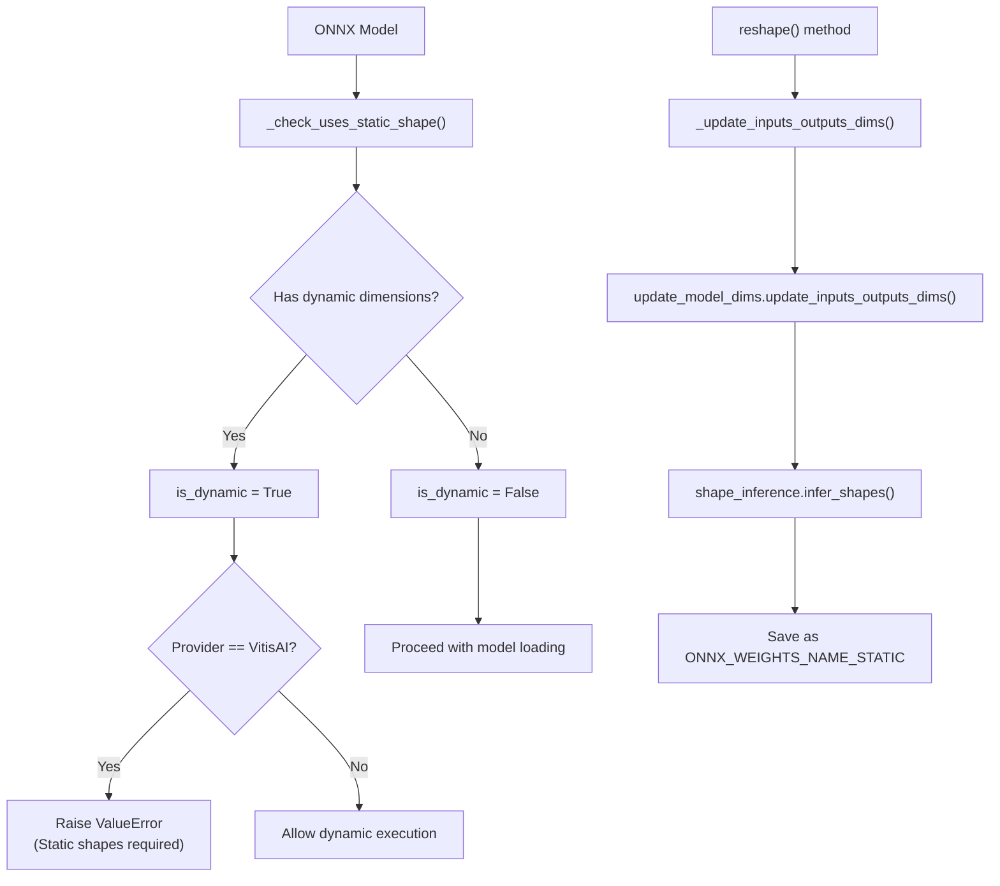

**Sources:** [optimum/amd/ryzenai/modeling.py:510-565](), [optimum/amd/ryzenai/utils.py:10-11]()

## Preprocessor Integration

The system automatically loads and manages preprocessors (image processors, tokenizers) from the Hugging Face Hub, ensuring compatibility with the broader ecosystem.

### Preprocessor Loading

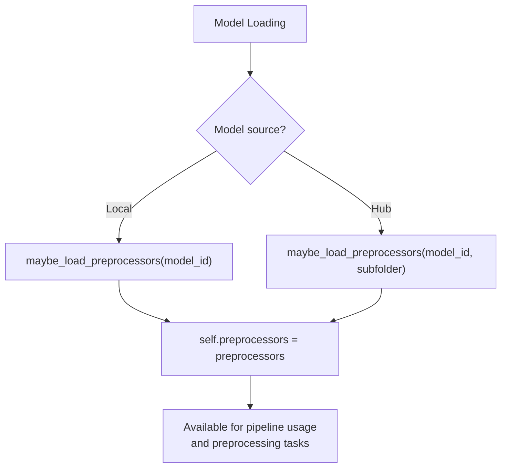

**Sources:** [optimum/amd/ryzenai/modeling.py:308](), [optimum/amd/ryzenai/modeling.py:344]()

---

# Page: Quantization

# Quantization

<details>
<summary>Relevant source files</summary>

The following files were used as context for generating this wiki page:

- [examples/quantization/ryzenai/README.md](examples/quantization/ryzenai/README.md)
- [examples/quantization/ryzenai/quantize_image_classification_model.py](examples/quantization/ryzenai/quantize_image_classification_model.py)
- [notebooks/image-classification/vaip_config.json](notebooks/image-classification/vaip_config.json)
- [optimum/amd/ryzenai/configuration.py](optimum/amd/ryzenai/configuration.py)
- [optimum/amd/ryzenai/quantization.py](optimum/amd/ryzenai/quantization.py)
- [tests/ryzenai/operators_baseline.json](tests/ryzenai/operators_baseline.json)
- [tests/ryzenai/test_quantization.py](tests/ryzenai/test_quantization.py)
- [tests/ryzenai/testing_utils.py](tests/ryzenai/testing_utils.py)
- [utils/ryzenai/README.md](utils/ryzenai/README.md)
- [utils/ryzenai/generate_operators_baseline.py](utils/ryzenai/generate_operators_baseline.py)

</details>


This document covers the RyzenAI quantization system for converting ONNX models to quantized formats optimized for AMD RyzenAI NPU hardware. The quantization process uses static calibration with the `vai_q_onnx` backend to produce models suitable for efficient inference on RyzenAI NPUs.

For information about Brevitas-based quantization for LLMs, see [Brevitas Quantization](#3). For general RyzenAI model inference, see [Models and Inference](#2.1).

## Core Quantization Components

The RyzenAI quantization system is built around three main classes that work together to provide a complete quantization workflow:

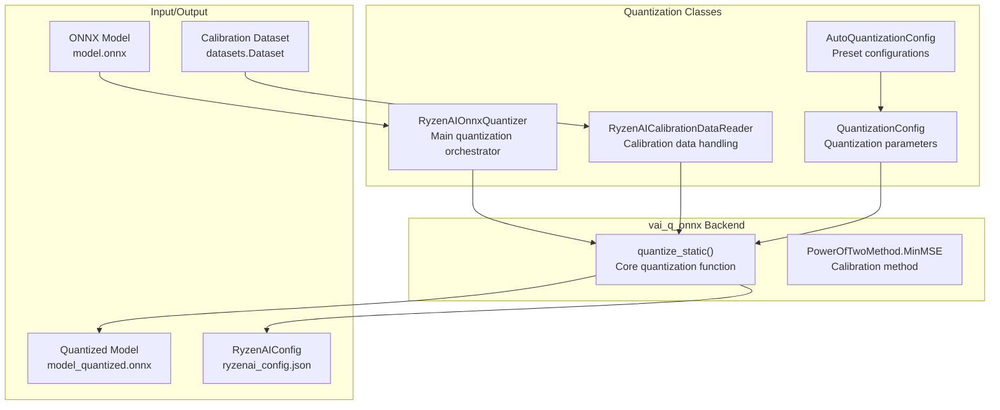

**Sources:** [optimum/amd/ryzenai/quantization.py:63-259](), [optimum/amd/ryzenai/configuration.py:15-142]()

### RyzenAIOnnxQuantizer

The `RyzenAIOnnxQuantizer` class serves as the main entry point for quantization operations. It extends `OptimumQuantizer` and provides methods for loading ONNX models, generating calibration datasets, and performing static quantization:

| Method | Purpose |
|--------|---------|
| `from_pretrained()` | Load quantizer from ONNX model path |
| `quantize()` | Perform static quantization with calibration dataset |
| `get_calibration_dataset()` | Generate calibration dataset from HuggingFace datasets |
| `identify_unused_columns()` | Filter dataset columns to match model inputs |

**Sources:** [optimum/amd/ryzenai/quantization.py:63-131](), [optimum/amd/ryzenai/quantization.py:133-191]()

### QuantizationConfig

The `QuantizationConfig` dataclass defines all quantization parameters using ONNX Runtime quantization types:

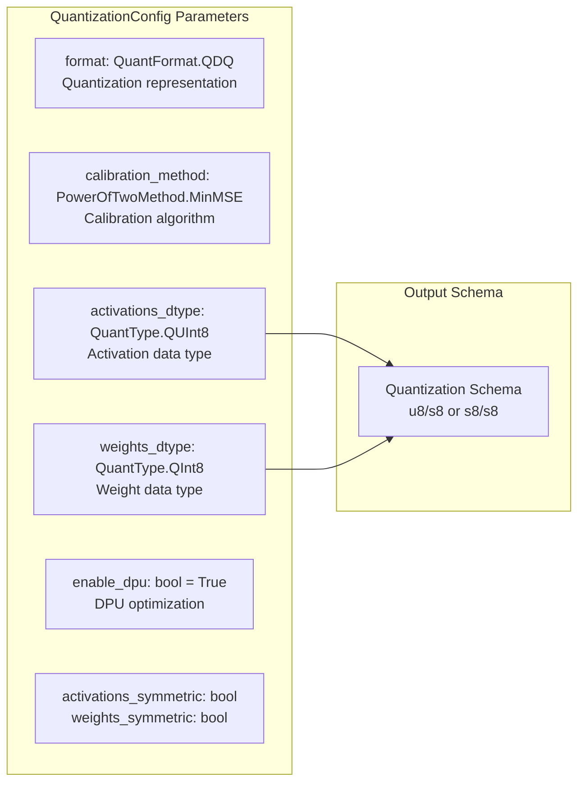

**Sources:** [optimum/amd/ryzenai/configuration.py:15-70]()

### AutoQuantizationConfig

The `AutoQuantizationConfig` class provides factory methods for common quantization configurations:

| Configuration | Target | Parameters |
|---------------|--------|------------|
| `ipu_cnn_config()` | RyzenAI NPU | QDQ format, MinMSE calibration, u8/s8 schema, DPU enabled |
| `cpu_cnn_config()` | CPU inference | QDQ format, MinMax calibration, configurable symmetry |

**Sources:** [optimum/amd/ryzenai/configuration.py:72-100]()

## Quantization Workflow

The complete quantization workflow involves model export, calibration dataset preparation, and static quantization:

```mermaid
flowchart TD
    subgraph "Model Preparation"
        HF_Model["HuggingFace Model<br/>model_name_or_path"]
        ONNX_Export["ONNX Export<br/>main_export()"]
        ONNX_Model["ONNX Model<br/>model.onnx"]
    end
    
    subgraph "Quantizer Setup"
        Create_Quantizer["RyzenAIOnnxQuantizer.from_pretrained()<br/>Load from ONNX model"]
        Load_Config["AutoQuantizationConfig.ipu_cnn_config()<br/>Get quantization parameters"]
    end
    
    subgraph "Calibration Dataset"
        Load_Dataset["load_dataset()<br/>Load raw dataset"]
        Preprocess["preprocess_function<br/>Transform to model inputs"]
        Calib_Dataset["Calibration Dataset<br/>datasets.Dataset"]
        DataReader["RyzenAICalibrationDataReader<br/>Batch calibration data"]
    end
    
    subgraph "Quantization Process"
        quantize_static_call["quantize_static()<br/>vai_q_onnx backend"]
        Quantized_ONNX["Quantized ONNX<br/>model_quantized.onnx"]
        Save_Config["Save Configuration<br/>ryzenai_config.json"]
    end
    
    HF_Model --> ONNX_Export
    ONNX_Export --> ONNX_Model
    ONNX_Model --> Create_Quantizer
    Create_Quantizer --> Load_Config
    
    Load_Dataset --> Preprocess
    Preprocess --> Calib_Dataset
    Calib_Dataset --> DataReader
    
    Create_Quantizer --> quantize_static_call
    Load_Config --> quantize_static_call
    DataReader --> quantize_static_call
    
    quantize_static_call --> Quantized_ONNX
    quantize_static_call --> Save_Config
```

**Sources:** [tests/ryzenai/test_quantization.py:60-132](), [examples/quantization/ryzenai/quantize_image_classification_model.py:25-59]()

## Static Quantization Process

RyzenAI quantization uses post-training static quantization, which requires a calibration dataset to determine optimal quantization parameters for activations:

### Calibration Data Reader

The `RyzenAICalibrationDataReader` implements the ONNX Runtime `CalibrationDataReader` interface to provide calibration samples during quantization:

```mermaid
graph TD
    subgraph "Dataset Processing"
        Raw_Dataset["Raw Dataset<br/>HuggingFace datasets"]
        Preprocessing["Preprocessing Function<br/>Transform images/inputs"]
        Filtered_Dataset["Filtered Dataset<br/>Remove unused columns"]
    end
    
    subgraph "Calibration Reader"
        DataReader["RyzenAICalibrationDataReader"]
        get_next["get_next()<br/>Yield batched samples"]
        Batch_Data["Batched Calibration Data<br/>{input_name: [values]}"]
    end
    
    subgraph "vai_q_onnx Integration"
        quantize_static_func["quantize_static()"]
        Calibration["Model Calibration<br/>Determine quantization ranges"]
        Quantized_Output["Quantized Model Output"]
    end
    
    Raw_Dataset --> Preprocessing
    Preprocessing --> Filtered_Dataset
    Filtered_Dataset --> DataReader
    DataReader --> get_next
    get_next --> Batch_Data
    Batch_Data --> quantize_static_func
    quantize_static_func --> Calibration
    Calibration --> Quantized_Output
```

**Sources:** [optimum/amd/ryzenai/quantization.py:27-61](), [optimum/amd/ryzenai/quantization.py:192-253]()

### vai_q_onnx Integration

The quantization process integrates with AMD's `vai_q_onnx` library through the `quantize_static()` function call:

| Parameter | Source | Purpose |
|-----------|--------|---------|
| `model_input` | `onnx_model_path` | Path to input ONNX model |
| `model_output` | `quantized_model_path` | Path for quantized output model |
| `calibration_data_reader` | `RyzenAICalibrationDataReader` | Calibration data provider |
| `quant_format` | `QuantizationConfig.format` | QDQ or QOperator format |
| `calibrate_method` | `QuantizationConfig.calibration_method` | MinMSE or MinMax |
| `weight_type` | `QuantizationConfig.weights_dtype` | Weight quantization type |
| `activation_type` | `QuantizationConfig.activations_dtype` | Activation quantization type |
| `enable_dpu` | `QuantizationConfig.enable_dpu` | DPU optimization flag |

**Sources:** [optimum/amd/ryzenai/quantization.py:166-179]()

## Configuration System

The RyzenAI quantization system provides flexible configuration through multiple layers:

### Quantization Parameters

```mermaid
graph TD
    subgraph "Data Types"
        ActType["Activation Types<br/>QuantType.QUInt8<br/>QuantType.QInt8"]
        WeightType["Weight Types<br/>QuantType.QInt8<br/>QuantType.QUInt8"]
    end
    
    subgraph "Calibration Methods"
        MinMSE["PowerOfTwoMethod.MinMSE<br/>Better accuracy, RyzenAI optimized"]
        MinMax["CalibrationMethod.MinMax<br/>Faster calibration"]
    end
    
    subgraph "Quantization Formats"
        QDQ["QuantFormat.QDQ<br/>QuantizeLinear/DequantizeLinear"]
        QOperator["QuantFormat.QOperator<br/>Quantized operator definitions"]
    end
    
    subgraph "Hardware Optimization"
        EnableDPU["enable_dpu: True<br/>RyzenAI NPU optimization"]
        Symmetric["Symmetric Quantization<br/>weights_symmetric<br/>activations_symmetric"]
    end
```

**Sources:** [optimum/amd/ryzenai/configuration.py:44-51]()

### Configuration Persistence

The quantization configuration is saved alongside the quantized model for reproducibility:

| File | Content | Purpose |
|------|---------|---------|
| `ryzenai_config.json` | `RyzenAIConfig` serialization | Complete quantization metadata |
| `config.json` | Original model configuration | Model architecture parameters |
| `model_quantized.onnx` | Quantized ONNX model | Inference-ready model |

**Sources:** [optimum/amd/ryzenai/quantization.py:183-190](), [optimum/amd/ryzenai/configuration.py:102-142]()

## Testing and Validation

The quantization system includes comprehensive testing to ensure correctness and performance:

### Operator Validation

The testing framework validates quantized models by comparing DPU and CPU execution results and tracking operator distribution:

```mermaid
graph TD
    subgraph "Test Execution"
        TestModel["Test Model<br/>TIMM/HuggingFace model"]
        Quantization["Quantization Process<br/>_quantize() method"]
        ModelComparison["Model Comparison<br/>IPU vs CPU execution"]
    end
    
    subgraph "Validation Metrics"
        OperatorCount["Operator Count<br/>all/dpu/cpu distribution"]
        AccuracyCheck["Accuracy Check<br/>torch.allclose() validation"]
        BaselineComparison["Baseline Comparison<br/>operators_baseline.json"]
    end
    
    subgraph "Performance Tracking"
        VitisAIReport["vitisai_ep_report.json<br/>Runtime statistics"]
        OperatorBaseline["operators_baseline.json<br/>Expected operator counts"]
        CacheSystem["ryzen_cache/<br/>Compiled model cache"]
    end
    
    TestModel --> Quantization
    Quantization --> ModelComparison
    ModelComparison --> AccuracyCheck
    ModelComparison --> OperatorCount
    OperatorCount --> BaselineComparison
    
    ModelComparison --> VitisAIReport
    VitisAIReport --> OperatorBaseline
    OperatorBaseline --> CacheSystem
```

**Sources:** [tests/ryzenai/test_quantization.py:59-154](), [tests/ryzenai/testing_utils.py:82-90](), [tests/ryzenai/operators_baseline.json:1-1624]()

### Baseline Management

The system maintains performance baselines for different model architectures:

| Model Category | Example Models | DPU Operators | CPU Operators |
|----------------|----------------|---------------|---------------|
| AMD Pre-quantized | `amd/resnet50` | 397 | 2 |
| TIMM EfficientNet | `timm/efficientnet_b0.ra_in1k` | 1052 | 2 |
| TIMM ResNet | `timm/resnet50.a1_in1k` | 393 | 2 |
| Complex Models | `timm/inception_v4.tf_in1k` | 1085 | 2 |

**Sources:** [tests/ryzenai/operators_baseline.json:47-51](), [tests/ryzenai/operators_baseline.json:332-336](), [utils/ryzenai/generate_operators_baseline.py:9-28]()

---

# Page: Pipelines

# Pipelines

<details>
<summary>Relevant source files</summary>

The following files were used as context for generating this wiki page:

- [docs/source/ryzenai/package_reference/pipelines.mdx](docs/source/ryzenai/package_reference/pipelines.mdx)
- [docs/source/ryzenai/usage_guides/pipelines.mdx](docs/source/ryzenai/usage_guides/pipelines.mdx)
- [optimum/amd/ryzenai/configs/vaip_config.json](optimum/amd/ryzenai/configs/vaip_config.json)
- [optimum/amd/ryzenai/pipelines/__init__.py](optimum/amd/ryzenai/pipelines/__init__.py)

</details>


The RyzenAI pipeline system provides a high-level, task-oriented interface for computer vision inference on AMD Ryzen AI NPUs. This system abstracts the complexity of model loading, preprocessing, and inference into simple, task-specific APIs that follow the Hugging Face transformers pipeline conventions.

For low-level model control and direct ONNX Runtime integration, see [Models and Inference](#2.1). For model optimization and quantization workflows, see [Quantization](#2.2). For runtime configuration details, see [Configuration](#2.4).

## Pipeline Architecture

The pipeline system sits at the highest level of abstraction in the RyzenAI stack, providing task-oriented interfaces that automatically handle model selection, preprocessing, and inference coordination.

### System Overview

```mermaid
graph TB
    subgraph "Pipeline Layer"
        PF["pipeline()"]
        LM["load_model()"]
        RST["RYZENAI_SUPPORTED_TASKS"]
        PM["pipeline_map"]
    end
    
    subgraph "Task-Specific Pipelines"
        ICP["ImageClassificationPipeline"]
        YODP["YoloObjectDetectionPipeline"]
        ISP["ImageSegmentationPipeline"]
        TICP["TimmImageClassificationPipeline"]
    end
    
    subgraph "Model Layer"
        RAIC["RyzenAIModelForImageClassification"]
        RAOD["RyzenAIModelForObjectDetection"]
        RASS["RyzenAIModelForSemanticSegmentation"]
    end
    
    subgraph "Preprocessing Layer"
        YX["YoloXImageProcessor"]
        Y5["YoloV5ImageProcessor"]
        Y3["YoloV3ImageProcessor"]
        Y8["YoloV8ImageProcessor"]
        SFPN["SemanticFPNImageProcessor"]
        HR["HRNetImageProcessor"]
    end
    
    subgraph "Hardware Layer"
        VAI["VitisAIExecutionProvider"]
        NPU["Ryzen AI NPU"]
    end
    
    PF --> LM
    PF --> RST
    LM --> PM
    RST --> RAIC
    RST --> RAOD
    RST --> RASS
    
    PM --> YX
    PM --> Y5
    PM --> Y3
    PM --> Y8
    PM --> SFPN
    PM --> HR
    
    PM --> YODP
    PM --> ISP
    
    RST --> ICP
    RST --> TICP
    
    RAIC --> VAI
    RAOD --> VAI
    RASS --> VAI
    VAI --> NPU
```

**Sources:** [optimum/amd/ryzenai/pipelines/__init__.py:1-209]()

## Supported Tasks and Implementation Mapping

The pipeline system supports three primary computer vision tasks, each with specific model architectures and preprocessing requirements.

### Task Configuration

```mermaid
graph LR
    subgraph "Task Definitions"
        IC["image-classification"]
        OD["object-detection"]
        IS["image-segmentation"]
    end
    
    subgraph "Default Models"
        IC --> ICM["amd/resnet50"]
        OD --> ODM["amd/yolox-s"]
        IS --> ISM["amd/SemanticFPN"]
    end
    
    subgraph "Pipeline Implementations"
        IC --> ICP["ImageClassificationPipeline"]
        OD --> YODP["YoloObjectDetectionPipeline"]
        IS --> ISP["ImageSegmentationPipeline"]
    end
    
    subgraph "Model Classes"
        IC --> RAIC["RyzenAIModelForImageClassification"]
        OD --> RAOD["RyzenAIModelForObjectDetection"] 
        IS --> RASS["RyzenAIModelForSemanticSegmentation"]
    end
    
    subgraph "Model Types"
        OD --> YOLOX["yolox"]
        OD --> YOLOV3["yolov3"]
        OD --> YOLOV5["yolov5"]
        OD --> YOLOV8["yolov8"]
        IS --> SFPN["semantic_fpn"]
        IS --> HRNET["hrnet"]
    end
```

| Task | Pipeline Implementation | Model Class | Default Model | Supported Types |
|------|------------------------|-------------|---------------|-----------------|
| `image-classification` | `ImageClassificationPipeline` | `RyzenAIModelForImageClassification` | `amd/resnet50` | Standard, TIMM |
| `object-detection` | `YoloObjectDetectionPipeline` | `RyzenAIModelForObjectDetection` | `amd/yolox-s` | `yolox`, `yolov3`, `yolov5`, `yolov8` |
| `image-segmentation` | `ImageSegmentationPipeline` | `RyzenAIModelForSemanticSegmentation` | `amd/SemanticFPN` | `semantic_fpn`, `hrnet` |

**Sources:** [optimum/amd/ryzenai/pipelines/__init__.py:44-65](), [optimum/amd/ryzenai/pipelines/__init__.py:35-42]()

## Pipeline Implementation Flow

The pipeline creation process involves task resolution, model loading, and preprocessor selection through a structured workflow.

### Pipeline Creation Workflow

```mermaid
graph TD
    START["pipeline(task, model, ...)"] --> LOAD["load_model()"]
    LOAD --> CHECK_MODEL{"model provided?"}
    
    CHECK_MODEL -->|No| DEFAULT["Use SUPPORTED_TASKS[task]['default']"]
    CHECK_MODEL -->|String| FROM_HUB["Load from Hub via from_pretrained()"]
    CHECK_MODEL -->|RyzenAIModel| USE_DIRECT["Use model directly"]
    
    DEFAULT --> INSTANTIATE["Instantiate model class"]
    FROM_HUB --> INSTANTIATE
    USE_DIRECT --> CONFIG_CHECK{"model.config exists?"}
    
    INSTANTIATE --> CONFIG_CHECK
    
    CONFIG_CHECK -->|No| MANUAL_CONFIG["Use pipeline_map[model_type]"]
    CONFIG_CHECK -->|Yes| AUTO_CONFIG["Infer from TasksManager"]
    
    MANUAL_CONFIG --> CREATE_PREPROCESSOR["Create preprocessor instance"]
    AUTO_CONFIG --> DETECT_LIBRARY{"Library type?"}
    
    DETECT_LIBRARY -->|timm| TIMM_PIPELINE["TimmImageClassificationPipeline"]
    DETECT_LIBRARY -->|transformers| TRANSFORMERS_PIPELINE["transformers_pipeline"]
    
    CREATE_PREPROCESSOR --> CUSTOM_PIPELINE["Custom pipeline implementation"]
    
    TIMM_PIPELINE --> RETURN["Return configured pipeline"]
    TRANSFORMERS_PIPELINE --> RETURN
    CUSTOM_PIPELINE --> RETURN
```

**Sources:** [optimum/amd/ryzenai/pipelines/__init__.py:104-209](), [optimum/amd/ryzenai/pipelines/__init__.py:68-101]()

## Core Components

### Pipeline Function

The main `pipeline()` function serves as the unified entry point for all RyzenAI computer vision tasks. It accepts standardized parameters and automatically configures the appropriate model, preprocessor, and pipeline implementation.

```python
def pipeline(
    task,
    model: Optional[Any] = None,
    vaip_config: Optional[str] = None,
    model_type: Optional[str] = None,
    # ... additional parameters
) -> Pipeline:
```

Key parameters:
- `task`: Task identifier (`"image-classification"`, `"object-detection"`, `"image-segmentation"`)
- `model`: Model identifier string, RyzenAIModel instance, or None for default
- `vaip_config`: Path to VitisAI runtime configuration file
- `model_type`: Explicit model architecture type for disambiguation

**Sources:** [optimum/amd/ryzenai/pipelines/__init__.py:104-115]()

### Model Loading Strategy

The `load_model()` function implements a flexible model loading strategy that handles different input types and automatically selects appropriate model classes.

```mermaid
graph LR
    subgraph "Input Types"
        NULL["None"]
        STR["String (model_id)"]
        INST["RyzenAIModel instance"]
    end
    
    subgraph "Loading Strategy"
        NULL --> DEFAULT_MODEL["SUPPORTED_TASKS[task]['default']"]
        STR --> HUB_LOADING["from_pretrained(model_id)"]
        INST --> DIRECT_USE["Use directly"]
    end
    
    subgraph "Model Class Selection"
        DEFAULT_MODEL --> CLASS_LOOKUP["SUPPORTED_TASKS[task]['class'][0]"]
        HUB_LOADING --> CLASS_LOOKUP
        DIRECT_USE --> VALIDATION["Validate RyzenAIModel"]
    end
    
    CLASS_LOOKUP --> INSTANTIATE["Model instantiation"]
    VALIDATION --> READY["Model ready"]
    INSTANTIATE --> READY
```

**Sources:** [optimum/amd/ryzenai/pipelines/__init__.py:68-101]()

### Preprocessor Resolution

The system employs a two-tier preprocessor resolution strategy depending on whether the model has an associated configuration.

For models without configuration (`model.config is None`), the system uses the `pipeline_map` dictionary to determine the appropriate preprocessor and pipeline implementation based on the `model_type` parameter.

For models with configuration, the system attempts to automatically infer the appropriate preprocessor using the `TasksManager._infer_library_from_model()` method and falls back to `get_preprocessor()` for standard Hugging Face models.

**Sources:** [optimum/amd/ryzenai/pipelines/__init__.py:164-195]()

## Task-Specific Pipeline Classes

### Object Detection Pipeline

The `YoloObjectDetectionPipeline` handles YOLO-family models with specialized preprocessing for different YOLO variants through the `pipeline_map` configuration.

Supported model types and their preprocessors:
- `yolox`: `YoloXImageProcessor`  
- `yolov5`: `YoloV5ImageProcessor`
- `yolov3`: `YoloV3ImageProcessor`
- `yolov8`: `YoloV8ImageProcessor`

**Sources:** [optimum/amd/ryzenai/pipelines/__init__.py:35-42](), [optimum/amd/ryzenai/pipelines/__init__.py:19-26]()

### Image Segmentation Pipeline

The `ImageSegmentationPipeline` supports semantic segmentation models with architecture-specific preprocessing:
- `semantic_fpn`: `SemanticFPNImageProcessor`
- `hrnet`: `HRNetImageProcessor`

**Sources:** [optimum/amd/ryzenai/pipelines/__init__.py:40-41](), [optimum/amd/ryzenai/pipelines/__init__.py:20-21]()

### Image Classification Pipeline

Image classification uses either the standard `ImageClassificationPipeline` from transformers or the specialized `TimmImageClassificationPipeline` for TIMM models, determined automatically based on the model library.

**Sources:** [optimum/amd/ryzenai/pipelines/__init__.py:196-199](), [optimum/amd/ryzenai/pipelines/__init__.py:27]()

## Configuration Integration

The pipeline system integrates with the VitisAI runtime configuration through the `vaip_config` parameter, which specifies the path to a JSON configuration file containing optimization passes and execution provider settings.

The configuration system enables:
- Hardware-specific optimization passes
- DPU subgraph compilation settings  
- Performance tuning parameters
- Debug and profiling options

**Sources:** [optimum/amd/ryzenai/pipelines/__init__.py:130-132](), [optimum/amd/ryzenai/configs/vaip_config.json:1-307]()

---

# Page: Configuration

# Configuration

<details>
<summary>Relevant source files</summary>

The following files were used as context for generating this wiki page:

- [docs/source/ryzenai/package_reference/pipelines.mdx](docs/source/ryzenai/package_reference/pipelines.mdx)
- [examples/quantization/ryzenai/README.md](examples/quantization/ryzenai/README.md)
- [examples/quantization/ryzenai/quantize_image_classification_model.py](examples/quantization/ryzenai/quantize_image_classification_model.py)
- [notebooks/image-classification/vaip_config.json](notebooks/image-classification/vaip_config.json)
- [optimum/amd/ryzenai/configs/vaip_config.json](optimum/amd/ryzenai/configs/vaip_config.json)
- [optimum/amd/ryzenai/configuration.py](optimum/amd/ryzenai/configuration.py)
- [optimum/amd/ryzenai/pipelines/__init__.py](optimum/amd/ryzenai/pipelines/__init__.py)
- [optimum/amd/ryzenai/quantization.py](optimum/amd/ryzenai/quantization.py)

</details>


This document covers the configuration systems within the RyzenAI component of optimum-amd. It explains how runtime behavior, quantization parameters, and model settings are controlled through various configuration mechanisms. For information about quantization workflows, see [Quantization](#2.2). For pipeline usage patterns, see [Pipelines](#2.3).

## Overview

The RyzenAI system uses multiple configuration layers to control inference behavior, optimization passes, and quantization parameters. Configuration flows from high-level user parameters down to low-level hardware-specific settings that control the VitisAI execution provider and NPU operations.

```mermaid
graph TD
    subgraph "User Configuration"
        A["vaip_config parameter"] --> B["vaip_config.json file"]
        C["QuantizationConfig"] --> D["RyzenAIConfig"]
        E["Pipeline parameters"] --> F["Model configuration"]
    end
    
    subgraph "Runtime Systems"
        B --> G["VitisAIExecutionProvider"]
        D --> H["RyzenAIOnnxQuantizer"]
        F --> I["RyzenAIModel instances"]
    end
    
    subgraph "Hardware Execution"
        G --> J["AMD Ryzen AI NPU"]
        H --> K["Quantized ONNX models"]
        I --> L["ONNX Runtime sessions"]
    end
    
    K --> L
    L --> J
```

Sources: [optimum/amd/ryzenai/pipelines/__init__.py:104-208](), [optimum/amd/ryzenai/configuration.py:102-142](), [optimum/amd/ryzenai/quantization.py:133-191]()

## Runtime Configuration

### VAIP Configuration File

The `vaip_config.json` file controls the VitisAI execution provider runtime behavior. It specifies optimization passes that transform ONNX graphs for efficient NPU execution.

```mermaid
graph TD
    subgraph "vaip_config.json Structure"
        A["passes array"] --> B["init pass"]
        A --> C["preprocessing passes"]
        A --> D["fuse_DPU pass"]
        
        C --> C1["fuse_resize_norm"]
        C --> C2["fuse_softmax"] 
        C --> C3["fuse_topk"]
        
        D --> E["passDpuParam"]
        E --> F["subPass array"]
        E --> G["xcompilerAttrs"]
        
        F --> F1["convert_to_xir_op"]
        F --> F2["merge_fix"]
        F --> F3["layout_transform"]
        
        G --> G1["debug_mode"]
        G --> G2["dpu_subgraph_num"]
        G --> G3["opt_level"]
    end
```

The configuration file contains three main sections:

| Section | Purpose | Key Parameters |
|---------|---------|----------------|
| Preprocessing passes | Graph fusion and optimization | `fuse_resize_norm`, `fuse_softmax`, `fuse_topk` |
| DPU passes | NPU-specific transformations | `convert_to_xir_op`, `merge_fix`, `layout_transform` |
| Compiler attributes | Hardware execution settings | `debug_mode`, `dpu_subgraph_num`, `opt_level` |

Sources: [optimum/amd/ryzenai/configs/vaip_config.json:1-306](), [notebooks/image-classification/vaip_config.json:1-283]()

### Configuration Usage in Pipelines

The `vaip_config` parameter flows through the pipeline system to control runtime behavior:

```mermaid
graph LR
    A["pipeline() function"] --> B["load_model()"]
    B --> C["RyzenAIModel.from_pretrained()"]
    C --> D["ONNX Runtime session"]
    D --> E["VitisAIExecutionProvider"]
    
    A --> A1["vaip_config parameter"]
    A1 --> B
    A1 --> C
    A1 --> E
```

The configuration file path is passed through the call chain and ultimately used to initialize the VitisAI execution provider with the specified optimization passes.

Sources: [optimum/amd/ryzenai/pipelines/__init__.py:68-101](), [optimum/amd/ryzenai/pipelines/__init__.py:130-132]()

## Quantization Configuration

### QuantizationConfig Class

The `QuantizationConfig` dataclass defines parameters for model quantization:

```mermaid
classDiagram
    class QuantizationConfig {
        +QuantFormat format
        +CalibrationMethod calibration_method
        +QuantType activations_dtype
        +bool activations_symmetric
        +QuantType weights_dtype
        +bool weights_symmetric
        +bool enable_dpu
        +quantization_type_str() string
        +use_symmetric_calibration bool
    }
    
    class AutoQuantizationConfig {
        +ipu_cnn_config() QuantizationConfig
        +cpu_cnn_config() QuantizationConfig
    }
    
    class RyzenAIConfig {
        +int opset
        +dict quantization
        +string optimum_version
        +dataclass_to_dict() dict
    }
    
    AutoQuantizationConfig --> QuantizationConfig
    RyzenAIConfig --> QuantizationConfig
```

Key configuration parameters:

| Parameter | Type | Purpose |
|-----------|------|---------|
| `format` | `QuantFormat` | QDQ or QOperator format |
| `calibration_method` | `CalibrationMethod` | MinMSE, MinMax, etc. |
| `activations_dtype` | `QuantType` | QUInt8 or QInt8 |
| `weights_dtype` | `QuantType` | QUInt8 or QInt8 |
| `enable_dpu` | `bool` | NPU-specific optimizations |

Sources: [optimum/amd/ryzenai/configuration.py:15-70](), [optimum/amd/ryzenai/configuration.py:72-100]()

### Predefined Configurations

The `AutoQuantizationConfig` class provides factory methods for common quantization scenarios:

```mermaid
graph TD
    A["AutoQuantizationConfig"] --> B["ipu_cnn_config()"]
    A --> C["cpu_cnn_config()"]
    
    B --> B1["QuantFormat.QDQ"]
    B --> B2["MinMSE calibration"]
    B --> B3["enable_dpu=True"]
    
    C --> C1["QuantFormat.QDQ"]
    C --> C2["MinMax calibration"]
    C --> C3["enable_dpu=False"]
```

The IPU configuration is optimized for RyzenAI NPU deployment, while the CPU configuration targets general-purpose inference.

Sources: [optimum/amd/ryzenai/configuration.py:74-84](), [optimum/amd/ryzenai/configuration.py:86-99]()

## Configuration Integration

### Quantization Workflow Configuration

The configuration classes integrate with the quantization workflow:

```mermaid
sequenceDiagram
    participant User
    participant Config as "AutoQuantizationConfig"
    participant Quantizer as "RyzenAIOnnxQuantizer"
    participant Runtime as "vai_q_onnx"
    
    User->>Config: ipu_cnn_config()
    Config->>User: QuantizationConfig
    User->>Quantizer: quantize(config, dataset)
    Quantizer->>Runtime: quantize_static()
    Runtime->>Quantizer: Quantized model
    Quantizer->>Quantizer: RyzenAIConfig.save_pretrained()
```

The quantizer uses configuration parameters to control the `vai_q_onnx.quantize_static()` function and saves a `RyzenAIConfig` with the quantized model.

Sources: [optimum/amd/ryzenai/quantization.py:133-191](), [examples/quantization/ryzenai/quantize_image_classification_model.py:44-58]()

### Pipeline Configuration Flow

Configuration parameters flow through the pipeline system:

```mermaid
graph TD
    subgraph "High-level API"
        A["pipeline(task, model, vaip_config)"]
    end
    
    subgraph "Model Loading"
        B["load_model()"]
        C["RyzenAIModel.from_pretrained()"]
    end
    
    subgraph "Runtime Configuration" 
        D["ONNX Runtime SessionOptions"]
        E["VitisAIExecutionProvider"]
        F["vaip_config.json passes"]
    end
    
    A --> B
    B --> C
    C --> D
    D --> E
    E --> F
    
    A -.vaip_config.-> C
    A -.vaip_config.-> E
```

The `vaip_config` parameter is threaded through the model loading process and ultimately configures the VitisAI execution provider.

Sources: [optimum/amd/ryzenai/pipelines/__init__.py:154-162](), [optimum/amd/ryzenai/pipelines/__init__.py:84-86]()

---

# Page: Brevitas Quantization

# Brevitas Quantization

<details>
<summary>Relevant source files</summary>

The following files were used as context for generating this wiki page:

- [docs/source/brevitas/usage_guide.mdx](docs/source/brevitas/usage_guide.mdx)
- [examples/quantization/brevitas/quantize_llm.py](examples/quantization/brevitas/quantize_llm.py)
- [optimum/amd/__init__.py](optimum/amd/__init__.py)
- [optimum/amd/brevitas/accelerate_utils.py](optimum/amd/brevitas/accelerate_utils.py)
- [optimum/amd/brevitas/configuration.py](optimum/amd/brevitas/configuration.py)
- [optimum/amd/brevitas/data_utils.py](optimum/amd/brevitas/data_utils.py)
- [optimum/amd/brevitas/quantizer.py](optimum/amd/brevitas/quantizer.py)

</details>


Brevitas Quantization is a neural network quantization system that provides advanced post-training quantization (PTQ) techniques for Large Language Models (LLMs) within the optimum-amd package. The system integrates AMD's Brevitas library with Hugging Face Transformers to enable efficient quantization of models for deployment on AMD hardware.

This page covers the quantization workflow, configuration options, and advanced techniques like GPTQ and SmoothQuant. For RyzenAI-specific quantization of vision models, see [RyzenAI Quantization](#2.2). For general AMD GPU support, see [ROCm GPU Support](#4).

## Core Components

The Brevitas quantization system consists of two primary classes and supporting utilities that handle the complete quantization workflow from model loading to ONNX export.

```mermaid
graph TD
    subgraph "Core Classes"
        BQ["BrevitasQuantizer<br/>(.quantizer.py:27)"]
        BQC["BrevitasQuantizationConfig<br/>(.configuration.py:9)"]
    end
    
    subgraph "Workflow Methods"
        BQ --> from_pretrained["from_pretrained()<br/>(.quantizer.py:40)"]
        BQ --> quantize["quantize()<br/>(.quantizer.py:108)"]
        from_pretrained --> load_model["TasksManager.get_model_from_task<br/>(.quantizer.py:90)"]
    end
    
    subgraph "Supporting Systems"
        data_utils["Data Utilities<br/>(.data_utils.py)"]
        accel_utils["Accelerate Integration<br/>(.accelerate_utils.py)"]
        export_utils["ONNX Export<br/>(.export.py)"]
    end
    
    subgraph "Configuration Parameters"
        BQC --> weights_config["weights_bitwidth<br/>weights_symmetric<br/>weights_quant_granularity"]
        BQC --> activations_config["activations_bitwidth<br/>activations_symmetric<br/>is_static"]
        BQC --> advanced_config["apply_gptq<br/>activations_equalization<br/>apply_weight_equalization"]
    end
    
    BQ --> data_utils
    BQ --> accel_utils
    quantize --> export_utils
    BQC --> BQ
```

Sources: [optimum/amd/brevitas/quantizer.py:27-106](), [optimum/amd/brevitas/configuration.py:9-142]()

### Class Architecture Mapping

The system architecture maps directly to specific code entities within the codebase, providing a clear connection between conceptual components and their implementation.

```mermaid
graph LR
    subgraph "Public API"
        API_BQ["BrevitasQuantizer"]
        API_BQC["BrevitasQuantizationConfig"]
    end
    
    subgraph "Implementation Files"
        quantizer_py["quantizer.py"]
        config_py["configuration.py"]
        data_utils_py["data_utils.py"]
        accel_utils_py["accelerate_utils.py"]
    end
    
    subgraph "Key Functions"
        apply_gptq["apply_gptq()<br/>(.quantizer.py:303)"]
        apply_act_equalization["apply_act_equalization()<br/>(.quantizer.py:276)"]
        apply_calibration["apply_calibration()<br/>(.quantizer.py:326)"]
        get_dataset_for_model["get_dataset_for_model()<br/>(.data_utils.py:217)"]
        offload_model["offload_model()<br/>(.accelerate_utils.py:383)"]
    end
    
    API_BQ --> quantizer_py
    API_BQC --> config_py
    quantizer_py --> apply_gptq
    quantizer_py --> apply_act_equalization
    quantizer_py --> apply_calibration
    data_utils_py --> get_dataset_for_model
    accel_utils_py --> offload_model
```

Sources: [optimum/amd/__init__.py:10-16](), [optimum/amd/brevitas/quantizer.py:303-338](), [optimum/amd/brevitas/data_utils.py:217-294]()

## Quantization Configuration

The `BrevitasQuantizationConfig` class controls all aspects of the quantization process through a comprehensive set of parameters that define precision, granularity, and advanced optimization techniques.

### Core Configuration Parameters

| Parameter Category | Key Options | Default Values | Purpose |
|-------------------|-------------|----------------|---------|
| **Weight Quantization** | `weights_bitwidth` | 8 | Bit precision for weights |
| | `weights_symmetric` | True | Symmetric vs asymmetric quantization |
| | `weights_quant_granularity` | "per_tensor" | Granularity level (per_tensor/per_channel/per_group) |
| **Activation Quantization** | `activations_bitwidth` | 8 | Bit precision for activations |
| | `is_static` | False | Static vs dynamic quantization |
| | `activations_symmetric` | False | Symmetric vs asymmetric quantization |
| **Advanced Techniques** | `apply_gptq` | False | Enable GPTQ algorithm |
| | `activations_equalization` | "cross_layer" | SmoothQuant type |
| | `apply_weight_equalization` | False | Cross-layer weight balancing |

Sources: [optimum/amd/brevitas/configuration.py:67-89](), [optimum/amd/brevitas/configuration.py:14-65]()

### Configuration Validation

The configuration system includes extensive validation logic to ensure parameter compatibility and prevent invalid combinations.

```mermaid
graph TD
    subgraph "Validation Rules"
        post_init["__post_init__()<br/>(.configuration.py:91)"]
        
        post_init --> check_static["Static + per_tensor only<br/>(.configuration.py:101)"]
        post_init --> check_mse_group["MSE incompatible with per_group<br/>(.configuration.py:106)"]
        post_init --> check_power_of_two["Power-of-two requires symmetric<br/>(.configuration.py:111)"]
        post_init --> check_asymmetric_group["Asymmetric per_group validation<br/>(.configuration.py:123)"]
    end
    
    subgraph "Auto-Configuration"
        post_init --> set_defaults["Set default group sizes<br/>(.configuration.py:92-96)"]
        post_init --> set_gptq_order["Set GPTQ act_order<br/>(.configuration.py:98)"]
        post_init --> disable_activations["Weights-only mode cleanup<br/>(.configuration.py:133)"]
    end
```

Sources: [optimum/amd/brevitas/configuration.py:91-142]()

## Quantization Workflow

The quantization process follows a structured workflow that applies various optimization techniques in a specific order to achieve optimal quantized model performance.

### Complete Quantization Pipeline

```mermaid
sequenceDiagram
    participant User
    participant BQ as "BrevitasQuantizer"
    participant Model as "PyTorch Model"
    participant Dataset as "Calibration Data"
    participant BrevitasLib as "Brevitas Library"

    User->>BQ: from_pretrained(model_name)
    BQ->>Model: Load via TasksManager
    
    User->>Dataset: get_dataset_for_model()
    Dataset->>Dataset: Load wikitext2/c4 data
    
    User->>BQ: quantize(config, dataset)
    
    alt FX Graph Required
        BQ->>Model: symbolic_trace()
    end
    
    alt Weight Equalization
        BQ->>BrevitasLib: apply_weight_equalization()
    end
    
    alt SmoothQuant
        BQ->>BrevitasLib: apply_act_equalization()
    end
    
    BQ->>BrevitasLib: quantize_model()
    
    alt GPTQ
        BQ->>BrevitasLib: apply_gptq()
    end
    
    alt Static Quantization
        BQ->>BrevitasLib: apply_calibration()
    end
    
    alt Bias Correction
        BQ->>BrevitasLib: apply_bias_correction()
    end
    
    BQ->>User: Return quantized model
```

Sources: [optimum/amd/brevitas/quantizer.py:108-250](), [examples/quantization/brevitas/quantize_llm.py:63-79]()

### Technique Application Order

The quantization techniques are applied in a carefully orchestrated sequence to maximize effectiveness:

1. **Weight Equalization** - Balances weight scales across layers [quantizer.py:180-183]()
2. **Activation Equalization (SmoothQuant)** - Rescales activations [quantizer.py:185-190]()
3. **Base Quantization** - Applies core quantization parameters [quantizer.py:199-222]()
4. **GPTQ** - Advanced weight optimization [quantizer.py:227-235]()
5. **Static Calibration** - For static activation quantization [quantizer.py:237-240]()
6. **Bias Correction** - Compensates for quantization bias [quantizer.py:242-248]()

Sources: [optimum/amd/brevitas/quantizer.py:180-250]()

## Advanced Quantization Techniques

### GPTQ Implementation

GPTQ (Generative Pre-trained Transformer Quantization) provides advanced weight quantization through iterative optimization based on the Hessian of the loss function.

```mermaid
graph TD
    subgraph "GPTQ Process"
        gptq_mode["gptq_mode()<br/>(.quantizer.py:312)"]
        
        gptq_mode --> iterate["Iterate through layers<br/>(.quantizer.py:319)"]
        iterate --> forward_pass["Forward pass with dataset<br/>(.quantizer.py:321)"]
        forward_pass --> update["gptq.update()<br/>(.quantizer.py:322)"]
        update --> iterate
    end
    
    subgraph "Configuration"
        act_order["act_order parameter<br/>Activation reordering"]
        parallel_layers["group_of_parallel_layers<br/>Parallel optimization"]
    end
    
    gptq_mode --> act_order
    gptq_mode --> parallel_layers
```

Sources: [optimum/amd/brevitas/quantizer.py:303-323]()

### SmoothQuant (Activation Equalization)

SmoothQuant redistributes quantization difficulty from activations to weights through mathematical equivalence transformations.

| Mode | Description | Requirements |
|------|-------------|--------------|
| `layerwise` | Applies rescaling as separate multiplication nodes | Standard PyTorch model |
| `cross_layer` | Fuses rescaling into preceding layers | FX-traced GraphModule |

The implementation uses different approaches based on the chosen mode:

```mermaid
graph LR
    subgraph "Layerwise Mode"
        layerwise["activation_equalization_mode<br/>layerwise=True"]
        layerwise --> mul_node["add_mul_node=True<br/>Separate rescaling"]
    end
    
    subgraph "Cross-layer Mode"
        cross_layer["activation_equalization_mode<br/>layerwise=False"]
        cross_layer --> fused["co_optimize_act_weights=True<br/>Fused rescaling"]
        cross_layer --> fx_required["Requires torch.fx.GraphModule"]
    end
```

Sources: [optimum/amd/brevitas/quantizer.py:276-300]()

## Data Utilities

### Dataset Management

The data utilities provide standardized calibration datasets for quantization with support for multiple dataset sources and preprocessing options.

```mermaid
graph TD
    subgraph "Dataset Sources"
        wikitext2["get_wikitext2()<br/>(.data_utils.py:101)"]
        c4["get_c4()<br/>(.data_utils.py:149)"]
    end
    
    subgraph "Processing Options"
        fuse_seq["fuse_sequences<br/>Concatenate short texts"]
        individual["Individual samples<br/>Preserve boundaries"]
    end
    
    subgraph "Main Interface"
        get_dataset["get_dataset_for_model()<br/>(.data_utils.py:217)"]
        get_dataset --> wikitext2
        get_dataset --> c4
        get_dataset --> fuse_seq
        get_dataset --> individual
    end
    
    subgraph "FX Graph Support"
        fx_support["Add past_key_values<br/>(.data_utils.py:268)"]
        get_dataset --> fx_support
    end
```

Sources: [optimum/amd/brevitas/data_utils.py:101-294]()

### Perplexity Evaluation

The system includes built-in perplexity computation for evaluating quantized model quality:

```python
perplexity = compute_perplexity(
    model=quantized_model,
    data=validation_dataset,
    context_length=args.seqlen // 2,
    tokenizer=tokenizer
)
```

The `compute_perplexity` function implements sliding window evaluation with cross-entropy loss calculation [data_utils.py:43-98]().

Sources: [optimum/amd/brevitas/data_utils.py:43-98](), [examples/quantization/brevitas/quantize_llm.py:66-70]()

## Memory Management Integration

### Accelerate Integration

The system integrates with Hugging Face Accelerate to handle large models that don't fit in single-device memory through sophisticated device mapping and offloading.

```mermaid
graph TD
    subgraph "Device Mapping"
        calc_gpu["calc_gpu_device_map()<br/>(.accelerate_utils.py:369)"]
        calc_cpu["calc_cpu_device_map()<br/>(.accelerate_utils.py:378)"]
        
        calc_gpu --> gpu_margin["GPU memory margins<br/>absolute + relative"]
        calc_cpu --> cpu_margin["CPU memory margins<br/>available memory"]
    end
    
    subgraph "Model Offloading"
        offload["offload_model()<br/>(.accelerate_utils.py:383)"]
        
        offload --> fx_check{"FX GraphModule?"}
        fx_check -->|Yes| infer_fx["infer_fx_auto_device_map<br/>(.accelerate_utils.py:39)"]
        fx_check -->|No| infer_regular["infer_auto_device_map<br/>Accelerate default"]
        
        infer_fx --> dispatch["dispatch_model()"]
        infer_regular --> dispatch
    end
    
    subgraph "FX Graph Handling"
        infer_fx --> offload_call_function["offload_call_function()<br/>(.accelerate_utils.py:258)"]
        offload_call_function --> align_devices["AlignDevicesHook<br/>for call_function nodes"]
    end
```

Sources: [optimum/amd/brevitas/accelerate_utils.py:369-454]()

### Hook Management

The integration provides specialized hook management for quantization workflows:

| Function | Purpose | Location |
|----------|---------|----------|
| `allocate_params()` | Move parameters to compute device | [accelerate_utils.py:423-434]() |
| `offload_params()` | Return parameters to storage | [accelerate_utils.py:436-446]() |
| `remove_hooks()` | Clean up all accelerate hooks | [accelerate_utils.py:314-331]() |

Sources: [optimum/amd/brevitas/accelerate_utils.py:314-454]()

## ONNX Export Integration

### Export Workflow

Brevitas quantized models can be exported to ONNX format using the optimum exporters framework with quantization-aware optimizations.

```mermaid
graph LR
    subgraph "Export Process"
        quantized_model["Quantized PyTorch Model"]
        
        quantized_model --> onnx_export["onnx_export_from_quantized_model<br/>(.export.py)"]
        onnx_export --> optimum_exporters["optimum.exporters<br/>ONNX conversion"]
        optimum_exporters --> quantized_onnx["Quantized ONNX Model"]
    end
    
    subgraph "Optimizations"
        quantized_onnx --> matmul_integer["MatMulInteger ops<br/>Hardware-optimized"]
        quantized_onnx --> qop_style["QOP-style quantization<br/>ONNX Runtime compatible"]
    end
```

The export process maintains quantization information and applies ONNX-specific optimizations for efficient inference on AMD hardware.

Sources: [optimum/amd/brevitas/export.py](), [examples/quantization/brevitas/quantize_llm.py:77-78](), [docs/source/brevitas/usage_guide.mdx:71-81]()

---

# Page: Core Concepts and Configuration

# Core Concepts and Configuration

<details>
<summary>Relevant source files</summary>

The following files were used as context for generating this wiki page:

- [optimum/amd/brevitas/__init__.py](optimum/amd/brevitas/__init__.py)
- [optimum/amd/brevitas/configuration.py](optimum/amd/brevitas/configuration.py)
- [optimum/amd/brevitas/data_utils.py](optimum/amd/brevitas/data_utils.py)
- [optimum/amd/brevitas/quantizer.py](optimum/amd/brevitas/quantizer.py)

</details>


This document explains the core concepts and configuration system for Brevitas quantization within optimum-amd. Brevitas provides advanced post-training quantization (PTQ) techniques specifically designed for large language models (LLMs), including GPTQ, SmoothQuant, weight equalization, and bias correction. For information about the complete LLM quantization workflow, see [LLM Quantization Workflow](#3.2). For ONNX export of quantized models, see [ONNX Export and Optimization](#3.3).

## Core Architecture

The Brevitas quantization system centers around two primary classes: `BrevitasQuantizer` for orchestrating the quantization process and `BrevitasQuantizationConfig` for specifying quantization parameters.

### Core Classes Relationship

```mermaid
graph TD
    subgraph "Configuration Layer"
        BQC["BrevitasQuantizationConfig"]
        BQC --> BQC1["weights_bitwidth<br/>activations_bitwidth<br/>weights_only"]
        BQC --> BQC2["apply_gptq<br/>activations_equalization<br/>apply_weight_equalization"]
        BQC --> BQC3["is_static<br/>layers_to_exclude<br/>device_maps"]
    end
    
    subgraph "Quantization Orchestration"
        BQ["BrevitasQuantizer"]
        BQ --> BQ1["from_pretrained()"]
        BQ --> BQ2["quantize()"]
        BQ1 --> Model["torch.nn.Module<br/>Loaded Model"]
    end
    
    subgraph "Data Processing"
        DataUtils["data_utils module"]
        DataUtils --> Dataset["get_dataset_for_model()"]
        DataUtils --> Calib["Calibration Dataset<br/>List[Dict]"]
        Dataset --> Wikitext["get_wikitext2()"]
        Dataset --> C4["get_c4()"]
    end
    
    subgraph "Quantization Techniques"
        QT["Applied Techniques"]
        QT --> GPTQ["apply_gptq()"]
        QT --> SmoothQuant["apply_act_equalization()"]
        QT --> WeightEq["apply_weight_equalization()"]
        QT --> BiasCorr["apply_bias_correction()"]
        QT --> StaticCal["apply_calibration()"]
    end
    
    BQC --> BQ2
    Model --> BQ2
    Calib --> BQ2
    BQ2 --> QT
    
    DataUtils --> BQ2
```

**Sources:** [optimum/amd/brevitas/quantizer.py:27-106](), [optimum/amd/brevitas/configuration.py:8-142](), [optimum/amd/brevitas/data_utils.py:217-293]()

### Configuration-Driven Quantization Pipeline

```mermaid
graph LR
    subgraph "Input"
        Config["BrevitasQuantizationConfig"]
        Model["Original Model"]
        Data["Calibration Dataset"]
    end
    
    subgraph "Pre-Processing"
        FX["FX Graph Tracing<br/>requires_fx_graph()"]
        LayerExcl["Layer Exclusion<br/>layers_to_exclude"]
        WeightEq["Weight Equalization<br/>apply_weight_equalization"]
    end
    
    subgraph "Quantization Setup"
        QuanModel["quantize_model()<br/>brevitas_examples"]
        QuanModel --> WeightQuant["Weight Quantization<br/>weights_bitwidth<br/>weights_symmetric<br/>weights_quant_granularity"]
        QuanModel --> ActQuant["Activation Quantization<br/>activations_bitwidth<br/>is_static<br/>activations_quant_granularity"]
    end
    
    subgraph "Advanced Techniques"
        SmoothQ["SmoothQuant<br/>activations_equalization"]
        GPTQ["GPTQ<br/>apply_gptq"]
        StaticCal["Static Calibration<br/>is_static"]
        BiasCorr["Bias Correction<br/>apply_bias_correction"]
    end
    
    subgraph "Output"
        QuantModel["Quantized Model<br/>torch.nn.Module"]
    end
    
    Config --> FX
    Config --> LayerExcl
    Config --> WeightEq
    Config --> QuanModel
    Config --> SmoothQ
    Config --> GPTQ
    Config --> StaticCal
    Config --> BiasCorr
    
    Model --> FX
    Model --> LayerExcl
    Model --> WeightEq
    Model --> QuanModel
    
    Data --> SmoothQ
    Data --> GPTQ
    Data --> StaticCal
    Data --> BiasCorr
    
    FX --> QuanModel
    LayerExcl --> QuanModel
    WeightEq --> QuanModel
    QuanModel --> SmoothQ
    SmoothQ --> GPTQ
    GPTQ --> StaticCal
    StaticCal --> BiasCorr
    BiasCorr --> QuantModel
```

**Sources:** [optimum/amd/brevitas/quantizer.py:108-250](), [optimum/amd/brevitas/configuration.py:140-142]()

## BrevitasQuantizer Class

The `BrevitasQuantizer` class orchestrates the entire quantization process and serves as the main entry point for quantizing models.

### Key Methods

| Method | Purpose | Parameters |
|--------|---------|------------|
| `from_pretrained()` | Load model and create quantizer instance | `model_name_or_path`, `device_map`, model loading args |
| `quantize()` | Execute quantization with given configuration | `quantization_config`, `calibration_dataset` |

### Quantization Workflow Control

The quantizer determines which techniques to apply based on the configuration:

1. **FX Graph Tracing** - Required for cross-layer SmoothQuant and weight equalization [optimum/amd/brevitas/quantizer.py:154-174]()
2. **Layer Exclusion** - Automatically excludes output embeddings unless overridden [optimum/amd/brevitas/quantizer.py:138-152]()
3. **Technique Application** - Applies advanced techniques in sequence based on configuration flags [optimum/amd/brevitas/quantizer.py:180-249]()

**Sources:** [optimum/amd/brevitas/quantizer.py:27-250]()

## BrevitasQuantizationConfig Class

The configuration class uses a dataclass structure with comprehensive validation to ensure compatible parameter combinations.

### Core Quantization Parameters

| Parameter Category | Key Options | Default Values |
|-------------------|-------------|----------------|
| **Weight Quantization** | `weights_bitwidth`, `weights_symmetric`, `weights_quant_granularity` | `8`, `True`, `"per_tensor"` |
| **Activation Quantization** | `activations_bitwidth`, `activations_symmetric`, `is_static` | `8`, `False`, `False` |
| **Advanced Techniques** | `apply_gptq`, `activations_equalization`, `apply_weight_equalization` | `False`, `"cross_layer"`, `False` |

### Quantization Granularity Options

```mermaid
graph TD
    subgraph "Weight Granularity"
        WT["weights_quant_granularity"]
        WT --> WT1["per_tensor<br/>Single scale per matrix"]
        WT --> WT2["per_channel<br/>Scale per column"]
        WT --> WT3["per_group<br/>Scale per group<br/>weights_group_size"]
    end
    
    subgraph "Activation Granularity"
        AT["activations_quant_granularity"]
        AT --> AT1["per_tensor<br/>Single scale per tensor"]
        AT --> AT2["per_row<br/>Scale per row"]
        AT --> AT3["per_group<br/>Scale per group<br/>activations_group_size"]
    end
    
    subgraph "Scale Precision"
        SP["scale_precision"]
        SP --> SP1["float_scale<br/>Arbitrary precision"]
        SP --> SP2["power_of_two_scale<br/>Power-of-2 constraint"]
    end
    
    subgraph "Parameter Method"
        PM["param_method"]
        PM --> PM1["stats<br/>Min-max estimation"]
        PM --> PM2["mse<br/>MSE optimization"]
    end
```

**Sources:** [optimum/amd/brevitas/configuration.py:67-89](), [optimum/amd/brevitas/configuration.py:28-48]()

### Configuration Validation

The configuration includes extensive validation logic to prevent incompatible combinations:

| Validation Rule | Error Condition | Line Reference |
|-----------------|-----------------|----------------|
| Static + Granularity | `is_static=True` with non-`per_tensor` activations | [optimum/amd/brevitas/configuration.py:101-104]() |
| Per-group + MSE | `per_group` weights with `mse` parameter method | [optimum/amd/brevitas/configuration.py:106-109]() |
| Power-of-2 + Asymmetric | `power_of_two_scale` with asymmetric quantization | [optimum/amd/brevitas/configuration.py:111-116]() |
| Dynamic + Power-of-2 | Dynamic activations with power-of-2 scales | [optimum/amd/brevitas/configuration.py:128-131]() |

**Sources:** [optimum/amd/brevitas/configuration.py:91-142]()

## Dataset Requirements and Utilities

Brevitas quantization requires calibration datasets for several advanced techniques. The `data_utils` module provides utilities for dataset preparation.

### Dataset Generation

```mermaid
graph LR
    subgraph "Dataset Sources"
        Wiki["WikiText-2<br/>get_wikitext2()"]
        C4["C4 Dataset<br/>get_c4()"]
    end
    
    subgraph "Processing Options"
        Fuse["fuse_sequences<br/>Concatenate and sample"]
        NoFuse["Individual samples<br/>Per-text processing"]
    end
    
    subgraph "Dataset Utilities"
        GetDS["get_dataset_for_model()"]
        DeviceDS["DatasetToDevice"]
        PastKV["past_key_values injection<br/>for FX GraphModule"]
    end
    
    subgraph "Output Format"
        CalibDS["Calibration Dataset<br/>List[Dict[str, torch.Tensor]]"]
        CalibDS --> InputIDs["input_ids"]
        CalibDS --> AttentionMask["attention_mask"]
        CalibDS --> PastKVOut["past_key_values<br/>(if FX required)"]
    end
    
    Wiki --> GetDS
    C4 --> GetDS
    GetDS --> Fuse
    GetDS --> NoFuse
    GetDS --> DeviceDS
    GetDS --> PastKV
    
    DeviceDS --> CalibDS
    PastKV --> CalibDS
```

### Key Dataset Functions

| Function | Purpose | Parameters |
|----------|---------|------------|
| `get_dataset_for_model()` | Main dataset preparation entry point | `model_name_or_path`, `qconfig`, `dataset_name`, `tokenizer` |
| `get_wikitext2()` | WikiText-2 dataset preparation | `tokenizer`, `seqlen`, `nsamples`, `split` |
| `get_c4()` | C4 dataset preparation | `tokenizer`, `seqlen`, `nsamples`, `split` |

### FX Graph Module Support

When the configuration requires FX graph tracing (`requires_fx_graph()` returns `True`), the dataset preparation automatically adds empty `past_key_values` tensors to match the model's expected inputs [optimum/amd/brevitas/data_utils.py:268-289]().

**Sources:** [optimum/amd/brevitas/data_utils.py:217-293](), [optimum/amd/brevitas/data_utils.py:101-198]()

## Advanced Quantization Techniques

The configuration enables several advanced post-training quantization techniques:

### Technique Configuration Mapping

| Technique | Config Flag | Requirements | Purpose |
|-----------|-------------|--------------|---------|
| **GPTQ** | `apply_gptq` | Calibration dataset | Optimal weight quantization via second-order information |
| **SmoothQuant** | `activations_equalization` | Calibration dataset | Activation-weight balance for better quantization |
| **Weight Equalization** | `apply_weight_equalization` | None | Cross-layer weight rescaling |
| **Bias Correction** | `apply_bias_correction` | Calibration dataset | Compensate activation bias changes |
| **Static Calibration** | `is_static=True` | Calibration dataset | Pre-compute activation quantization ranges |

### SmoothQuant Variants

The `activations_equalization` parameter supports two approaches:
- `"layerwise"` - Add explicit multiplication nodes for activation rescaling
- `"cross_layer"` - Fuse rescaling into preceding layers (requires FX graph)

**Sources:** [optimum/amd/brevitas/quantizer.py:275-337](), [optimum/amd/brevitas/configuration.py:49-53]()

---

# Page: LLM Quantization Workflow

# LLM Quantization Workflow

<details>
<summary>Relevant source files</summary>

The following files were used as context for generating this wiki page:

- [docs/source/brevitas/usage_guide.mdx](docs/source/brevitas/usage_guide.mdx)
- [examples/quantization/brevitas/quantize_llm.py](examples/quantization/brevitas/quantize_llm.py)
- [optimum/amd/brevitas/accelerate_utils.py](optimum/amd/brevitas/accelerate_utils.py)
- [optimum/amd/brevitas/configuration.py](optimum/amd/brevitas/configuration.py)
- [optimum/amd/brevitas/data_utils.py](optimum/amd/brevitas/data_utils.py)
- [optimum/amd/brevitas/quantizer.py](optimum/amd/brevitas/quantizer.py)

</details>


This document describes the complete workflow for quantizing Large Language Models (LLMs) using the Brevitas quantization system in optimum-amd. The workflow covers model loading, configuration, calibration dataset preparation, quantization application, and export to ONNX format.

For information about the core Brevitas concepts and configuration options, see [Core Concepts and Configuration](#3.1). For details about ONNX export and optimization, see [ONNX Export and Optimization](#3.3).

## Overview of the Workflow

The LLM quantization workflow follows a structured pipeline from model loading through quantization to final export. The process supports various post-training quantization (PTQ) techniques including GPTQ, SmoothQuant (activation equalization), weight equalization, and bias correction.

```mermaid
graph TD
    A["Model Loading"] --> B["BrevitasQuantizer.from_pretrained()"]
    B --> C["Configuration Setup"]
    C --> D["BrevitasQuantizationConfig"]
    D --> E["Dataset Preparation"]
    E --> F["get_dataset_for_model()"]
    F --> G["Quantization Process"]
    G --> H["quantizer.quantize()"]
    H --> I["Evaluation"]
    I --> J["compute_perplexity()"]
    J --> K["ONNX Export"]
    K --> L["onnx_export_from_quantized_model()"]
    
    subgraph "Quantization Techniques"
        M["Weight Equalization<br/>apply_weight_equalization"]
        N["SmoothQuant<br/>activations_equalization"]
        O["GPTQ<br/>apply_gptq"]
        P["Bias Correction<br/>apply_bias_correction"]
        Q["Static Calibration<br/>is_static"]
    end
    
    H --> M
    H --> N
    H --> O
    H --> P
    H --> Q
```

Sources: [examples/quantization/brevitas/quantize_llm.py:10-79](), [optimum/amd/brevitas/quantizer.py:108-250]()

## Configuration Setup

The quantization workflow begins with creating a `BrevitasQuantizationConfig` that specifies which quantization techniques to apply and their parameters. The configuration system validates parameter combinations and sets appropriate defaults.

```mermaid
graph LR
    A["BrevitasQuantizationConfig"] --> B["weights_bitwidth<br/>activations_bitwidth"]
    A --> C["apply_gptq<br/>apply_weight_equalization"]
    A --> D["activations_equalization<br/>apply_bias_correction"]
    A --> E["weights_symmetric<br/>activations_symmetric"]
    A --> F["is_static<br/>weights_only"]
    
    B --> G["Bit Configuration"]
    C --> H["PTQ Techniques"]
    D --> I["Equalization Methods"]
    E --> J["Symmetry Settings"]
    F --> K["Quantization Mode"]
```

Key configuration parameters include:

| Parameter | Purpose | Default | Notes |
|-----------|---------|---------|--------|
| `weights_bitwidth` | Weight quantization precision | 8 | Typical values: 4, 8 |
| `activations_bitwidth` | Activation quantization precision | 8 | None if `weights_only=True` |
| `apply_gptq` | Enable GPTQ algorithm | False | Requires calibration data |
| `activations_equalization` | SmoothQuant method | "cross_layer" | None, "layerwise", "cross_layer" |
| `apply_weight_equalization` | Enable weight balancing | False | Useful for ReLU models |
| `is_static` | Static vs dynamic quantization | False | Static requires calibration |

Sources: [optimum/amd/brevitas/configuration.py:8-141](), [examples/quantization/brevitas/quantize_llm.py:17-25]()

## Dataset Preparation

The quantization process requires calibration datasets for techniques like GPTQ, SmoothQuant, and static quantization. The system provides utilities to prepare tokenized datasets from standard sources like WikiText-2 and C4.

```mermaid
graph TD
    A["get_dataset_for_model()"] --> B["Dataset Selection"]
    B --> C["wikitext2<br/>get_wikitext2()"]
    B --> D["c4<br/>get_c4()"]
    
    C --> E["Tokenization"]
    D --> E
    E --> F["Sequence Processing"]
    F --> G["fuse_sequences"]
    G --> H["Random Sampling"]
    H --> I["Device Placement"]
    I --> J["DatasetToDevice"]
    
    subgraph "FX Graph Support"
        K["requires_fx_graph()"] --> L["Add past_key_values"]
        L --> M["Empty KV Cache Tensors"]
    end
    
    I --> K
```

The dataset preparation handles several key aspects:

- **Sequence Length Management**: Configurable `seqlen` parameter (default 128-2048 tokens)
- **Sample Count**: Configurable `nsamples` parameter (default 128 samples)  
- **Sequence Fusion**: Option to merge short sequences via `fuse_sequences`
- **FX Graph Compatibility**: Automatic addition of `past_key_values` for traced models

Sources: [optimum/amd/brevitas/data_utils.py:217-293](), [examples/quantization/brevitas/quantize_llm.py:30-52]()

## Quantization Process

The core quantization is performed by `BrevitasQuantizer.quantize()`, which applies the selected techniques in a specific order to maintain numerical stability and effectiveness.

```mermaid
graph TD
    A["quantizer.quantize()"] --> B["Model Preparation"]
    B --> C["FX Tracing Check"]
    C --> D["requires_fx_graph()"]
    D --> E["symbolic_trace()"]
    
    E --> F["Weight Equalization"]
    F --> G["apply_weight_equalization()"]
    G --> H["Activation Equalization"]
    H --> I["apply_act_equalization()"]
    
    I --> J["Base Quantization"]
    J --> K["quantize_model()"]
    K --> L["GPTQ Application"]
    L --> M["apply_gptq()"]
    
    M --> N["Static Calibration"]
    N --> O["apply_calibration()"]
    O --> P["Bias Correction"]
    P --> Q["apply_bias_correction()"]
    
    subgraph "Accelerate Support"
        R["offload_model()"] --> S["Device Mapping"]
        S --> T["Memory Management"]
    end
    
    B --> R
    K --> R
```

The quantization order is critical:

1. **Weight Equalization**: Balances weight scales across layers before quantization
2. **Activation Equalization (SmoothQuant)**: Redistributes activation and weight ranges
3. **Base Quantization**: Applies core weight and activation quantization
4. **GPTQ**: Optimizes weight quantization using second-order information
5. **Static Calibration**: Collects activation statistics for static quantization
6. **Bias Correction**: Compensates for quantization-induced bias

Sources: [optimum/amd/brevitas/quantizer.py:108-250](), [optimum/amd/brevitas/quantizer.py:275-337]()

## Evaluation and Export

After quantization, the workflow typically evaluates model quality using perplexity on a validation dataset, then exports the quantized model to ONNX format for deployment.

```mermaid
graph LR
    A["Quantized Model"] --> B["compute_perplexity()"]
    B --> C["Validation Dataset"]
    C --> D["Context-based Evaluation"]
    D --> E["Cross Entropy Loss"]
    E --> F["Perplexity Calculation"]
    
    A --> G["remove_hooks()"]
    G --> H["CPU Transfer"]
    H --> I["onnx_export_from_quantized_model()"]
    I --> J["ONNX Model"]
    
    subgraph "Perplexity Details"
        K["Sliding Window"] --> L["context_length"]
        L --> M["Token Prediction"]
        M --> N["Loss Aggregation"]
    end
    
    D --> K
```

The evaluation process uses a sliding window approach:

- **Context Length**: Typically `seqlen // 2` for balanced evaluation
- **Window Sliding**: Processes sequences in overlapping chunks
- **Loss Computation**: Cross-entropy loss between predictions and targets
- **Perplexity**: Exponential of average negative log-likelihood

Sources: [optimum/amd/brevitas/data_utils.py:42-98](), [examples/quantization/brevitas/quantize_llm.py:56-79]()

## Advanced Techniques

### GPTQ Implementation

GPTQ (Gradient-based Post-Training Quantization) optimizes weight quantization by minimizing the layer-wise reconstruction error using Hessian information.

```mermaid
graph TD
    A["apply_gptq()"] --> B["gptq_mode Context"]
    B --> C["Layer Processing"]
    C --> D["Sequential Updates"]
    D --> E["Parallel Layer Groups"]
    
    E --> F["group_of_parallel_layers"]
    F --> G["Attention Matrices"]
    G --> H["q_proj, k_proj, v_proj"]
    
    C --> I["act_order"]
    I --> J["Activation Ordering"]
    J --> K["Descending Activation"]
```

GPTQ configuration options:

- **Act Order**: Reorders weight updates based on activation magnitudes (`gptq_act_order`)
- **Parallel Groups**: Processes attention projection matrices simultaneously
- **Layer-wise Updates**: Processes one transformer layer at a time

Sources: [optimum/amd/brevitas/quantizer.py:302-323]()

### SmoothQuant (Activation Equalization)

SmoothQuant addresses the challenge of quantizing both weights and activations by redistributing quantization difficulty between them.

```mermaid
graph TD
    A["activations_equalization"] --> B["layerwise"]
    A --> C["cross_layer"]
    
    B --> D["activation_equalization_mode"]
    D --> E["add_mul_node=True"]
    E --> F["Explicit Scaling Nodes"]
    
    C --> G["FX Graph Required"]
    G --> H["co_optimize_act_weights"]
    H --> I["Fused Scaling"]
    
    subgraph "Alpha Parameter"
        J["alpha=0.5"] --> K["Balance Factor"]
        K --> L["Weight vs Activation"]
    end
    
    D --> J
    H --> J
```

The two modes offer different trade-offs:

- **Layerwise**: Adds explicit multiplication nodes, works with any model
- **Cross-layer**: Fuses scaling into preceding layers, requires FX tracing

Sources: [optimum/amd/brevitas/quantizer.py:275-299]()

## Memory Management

The workflow integrates with HuggingFace Accelerate for efficient memory management, especially important for large models that may not fit in GPU memory.

```mermaid
graph TD
    A["Device Configuration"] --> B["calc_gpu_device_map()"]
    A --> C["calc_cpu_device_map()"]
    
    B --> D["GPU Memory Available"]
    C --> E["CPU Memory Available"]
    
    D --> F["offload_model()"]
    E --> F
    F --> G["infer_auto_device_map()"]
    G --> H["dispatch_model()"]
    
    subgraph "FX Support"
        I["infer_fx_auto_device_map()"] --> J["FX Node Processing"]
        J --> K["offload_call_function()"]
    end
    
    G --> I
    
    subgraph "Hook Management"
        L["allocate_params()"] --> M["Parameter Loading"]
        N["offload_params()"] --> O["Parameter Offloading"]
    end
    
    H --> L
    H --> N
```

Key memory management features:

- **Automatic Device Mapping**: Distributes model layers across available devices
- **FX Graph Support**: Handles torch.fx traced models with custom device mapping
- **Parameter Hooks**: Dynamically loads/offloads parameters during quantization
- **Memory Margins**: Configurable safety margins for memory allocation

Sources: [optimum/amd/brevitas/accelerate_utils.py:369-453](), [examples/quantization/brevitas/quantize_llm.py:146-151]()

---

# Page: ONNX Export and Optimization

# ONNX Export and Optimization

<details>
<summary>Relevant source files</summary>

The following files were used as context for generating this wiki page:

- [optimum/amd/brevitas/export.py](optimum/amd/brevitas/export.py)
- [tests/brevitas/test_onnx_export.py](tests/brevitas/test_onnx_export.py)
- [tests/brevitas/test_quantization.py](tests/brevitas/test_quantization.py)

</details>


This document covers the ONNX export and optimization capabilities in the Brevitas quantization system. After quantizing LLM models using the techniques described in [Core Concepts and Configuration](#3.1) and [LLM Quantization Workflow](#3.2), this system converts the quantized PyTorch models to optimized ONNX format for deployment.

The primary focus is on the `MatMulInteger` optimization, which replaces standard floating-point quantized operations with efficient integer matrix multiplication operations in the exported ONNX graph.

## Export Workflow Overview

The ONNX export process transforms Brevitas-quantized PyTorch models into optimized ONNX representations suitable for hardware acceleration:

```mermaid
graph TD
    A["Quantized PyTorch Model<br/>(Brevitas QuantLinear layers)"] --> B["onnx_export_from_quantized_model()"]
    B --> C["brevitas_proxy_export_mode<br/>(StdQCDQONNXManager)"]
    C --> D["Standard ONNX Export<br/>(optimum.exporters.onnx)"]
    D --> E["Standard ONNX Model<br/>(DequantizeLinear + MatMul/Gemm)"]
    E --> F["find_and_insert_matmulinteger()"]
    F --> G["Pattern Detection<br/>(MATMUL/GEMM patterns)"]
    G --> H["Graph Transformation<br/>(MatMulInteger replacement)"]
    H --> I["Optimized ONNX Model<br/>(MatMulInteger + Cast + Mul)"]
    
    J["insert_matmulinteger=True"] -.-> F
    K["insert_matmulinteger=False"] -.-> E
```

Sources: [optimum/amd/brevitas/export.py:301-344]()

The main entry point is the `onnx_export_from_quantized_model` function, which extends the standard Optimum ONNX export with Brevitas-specific quantization handling and optional `MatMulInteger` optimization.

## MatMulInteger Optimization

The core optimization replaces quantized linear operations with efficient integer matrix multiplication. This transformation reduces computational overhead by avoiding repeated quantization/dequantization cycles:

```mermaid
graph LR
    subgraph "Before Optimization"
        A1["Input"] --> B1["DynamicQuantizeLinear"]
        B1 --> C1["DequantizeLinear"] 
        C1 --> D1["MatMul/Gemm"]
        E1["Weight"] --> F1["DequantizeLinear"]
        F1 --> D1
        D1 --> G1["Output"]
    end
    
    subgraph "After Optimization"
        A2["Input"] --> B2["MatMulInteger"]
        B2 --> C2["Cast to Float32"]
        C2 --> D2["Scale Multiplication"]
        D2 --> E2["Output"]
        F2["Quantized Weight"] --> B2
    end
```

Sources: [optimum/amd/brevitas/export.py:133-185](), [optimum/amd/brevitas/export.py:188-244]()

## Pattern Matching System

The optimization uses predefined patterns to identify quantized operations that can be replaced with `MatMulInteger`. Two main patterns are supported:

### MatMul Pattern

The `MATMUL` pattern identifies sequences involving `DequantizeLinear`, `Transpose`, `DynamicQuantizeLinear`, and `MatMul` operations:

| Operation | Role | Inputs | Outputs |
|-----------|------|--------|---------|
| `DequantizeLinear` | Weight dequantization | Quantized weights, scale, zero_point | Float weights |
| `Transpose` | Weight reshaping | Float weights | Transposed weights |  
| `DynamicQuantizeLinear` | Input quantization | Float input | Quantized input, scale, zero_point |
| `DequantizeLinear` | Input dequantization | Quantized input, scale, zero_point | Float input |
| `MatMul` | Matrix multiplication | Float input, transposed weights | Output |

Sources: [optimum/amd/brevitas/export.py:29-72]()

### Gemm Pattern

The `GEMM` pattern handles General Matrix Multiplication with bias addition:

| Operation | Role | Inputs | Outputs |
|-----------|------|--------|---------|
| `DequantizeLinear` | Weight dequantization | Quantized weights, scale, zero_point | Float weights |
| `DynamicQuantizeLinear` | Input quantization | Float input | Quantized input, scale, zero_point |
| `DequantizeLinear` | Input dequantization | Quantized input, scale, zero_point | Float input |
| `Gemm` | Matrix multiplication + bias | Float input, weights, bias | Output |

Sources: [optimum/amd/brevitas/export.py:74-110]()

## Graph Transformation Process

The transformation process uses the `onnx_tool` library to analyze and modify ONNX graphs:

```mermaid
graph TD
    A["ONNX Model Loading<br/>onnx.load()"] --> B["Graph Analysis<br/>Model(onnx_model, cfg)"]
    B --> C["Pattern Search<br/>FusionPattern.search_pattern()"]
    C --> D["MatMul Pattern<br/>Detection"]
    C --> E["Gemm Pattern<br/>Detection"]
    
    D --> F["replace_matmul_to_matmulinteger()"]
    E --> G["replace_gemm_to_matmulinteger()"]
    
    F --> H["Node Removal<br/>(DequantizeLinear, Transpose, MatMul)"]
    G --> I["Node Removal<br/>(DequantizeLinear, Gemm)"]
    
    H --> J["MatMulInteger Creation"]
    I --> K["MatMulInteger + Add Creation"]
    
    J --> L["Graph Reordering<br/>graph_reorder_nodes()"]
    K --> L
    L --> M["ONNX Model Saving<br/>check_and_save_model()"]
```

Sources: [optimum/amd/brevitas/export.py:247-299]()

### Replacement Operations

For each detected pattern, the transformation creates a sequence of optimized operations:

1. **MatMulInteger**: Performs integer matrix multiplication
2. **Cast**: Converts result to float32
3. **Mul**: Applies scale factors from quantization
4. **Add**: Adds bias (for Gemm patterns only)

The `create_nodes` function manages graph connectivity and tensor mapping during transformation:

Sources: [optimum/amd/brevitas/export.py:113-131]()

## Integration with Brevitas

The export system integrates closely with Brevitas quantization through the `brevitas_proxy_export_mode` context manager and `StdQCDQONNXManager`:

```mermaid
graph LR
    A["BrevitasQuantizer"] --> B["Quantized PyTorch Model"]
    B --> C["brevitas_proxy_export_mode<br/>(StdQCDQONNXManager)"]
    C --> D["ONNX Export Context"]
    D --> E["Quantization-aware Export"]
    E --> F["Standard ONNX Model"]
    F --> G["MatMulInteger Optimization"]
    G --> H["Optimized ONNX Model"]
```

Sources: [optimum/amd/brevitas/export.py:320](), [tests/brevitas/test_onnx_export.py:60]()

The `StdQCDQONNXManager` ensures proper handling of quantized parameters during the ONNX conversion process, maintaining the quantization semantics established by Brevitas.

### Configuration Parameters

The `onnx_export_from_quantized_model` function supports several key parameters:

| Parameter | Type | Default | Description |
|-----------|------|---------|-------------|
| `insert_matmulinteger` | bool | True | Enable MatMulInteger optimization |
| `do_constant_folding` | bool | True | Apply constant folding optimizations |
| `no_dynamic_axes` | bool | False | Disable dynamic input shapes |
| `task` | str | "text-generation-with-past" | Model task type |

Sources: [optimum/amd/brevitas/export.py:301-344]()

The system validates the optimization by counting the number of `MatMulInteger` operations in the transformed graph, ensuring successful pattern replacement:

Sources: [tests/brevitas/test_onnx_export.py:149-172]()

---

# Page: ROCm GPU Support

# ROCm GPU Support

<details>
<summary>Relevant source files</summary>

The following files were used as context for generating this wiki page:

- [README.md](README.md)
- [docker/onnx-runtime-amd-gpu/Dockerfile](docker/onnx-runtime-amd-gpu/Dockerfile)
- [docker/transformers-pytorch-amd-gpu-flash/Dockerfile](docker/transformers-pytorch-amd-gpu-flash/Dockerfile)
- [docs/source/amdgpu/overview.mdx](docs/source/amdgpu/overview.mdx)

</details>


This document covers AMD GPU acceleration through the ROCm platform in the optimum-amd ecosystem. ROCm GPU support enables running Hugging Face models on AMD Instinct MI210, MI250, and MI300 GPUs with minimal code changes. For AMD CPU optimization, see [ZenTorch CPU Optimization](#5). For AMD NPU acceleration, see [RyzenAI System](#2).

## Overview

ROCm GPU support in optimum-amd primarily leverages native PyTorch for ROCm and ONNX Runtime integrations rather than implementing custom AMD GPU kernels. The system provides Docker environments, configuration examples, and documentation to enable seamless usage of AMD GPUs with existing Hugging Face libraries.

```mermaid
graph TB
    subgraph "Hugging Face Libraries"
        Transformers["🤗 Transformers"]
        OptimumORT["🤗 Optimum ONNX Runtime"]
        TGI["Text Generation Inference"]
    end
    
    subgraph "ROCm Integration Layer"
        PyTorchROCm["PyTorch for ROCm"]
        ORTROCm["ONNX Runtime with ROCMExecutionProvider"]
        FlashAttROCm["ROCm/flash-attention"]
    end
    
    subgraph "AMD GPU Hardware"
        MI210["AMD Instinct MI210"]
        MI250["AMD Instinct MI250"] 
        MI300["AMD Instinct MI300"]
    end
    
    subgraph "Docker Environments"
        FlashDocker["transformers-pytorch-amd-gpu-flash"]
        ORTDocker["onnx-runtime-amd-gpu"]
    end
    
    Transformers --> PyTorchROCm
    OptimumORT --> ORTROCm
    TGI --> PyTorchROCm
    
    PyTorchROCm --> FlashAttROCm
    PyTorchROCm --> MI210
    PyTorchROCm --> MI250
    PyTorchROCm --> MI300
    
    ORTROCm --> MI210
    ORTROCm --> MI250
    ORTROCm --> MI300
    
    FlashDocker --> FlashAttROCm
    ORTDocker --> ORTROCm
```

Sources: [README.md:21-29](), [docs/source/amdgpu/overview.mdx:1-93]()

## PyTorch ROCm Integration

PyTorch for ROCm provides direct GPU acceleration for AMD hardware with zero code changes required. Models automatically utilize AMD GPUs when CUDA calls are made, as ROCm provides CUDA compatibility through HIP.

### Native Transformers Support

Standard Transformers models work directly with ROCm through the `torch.device("cuda")` context:

```python
import torch
from transformers import AutoModelForCausalLM, AutoTokenizer

tokenizer = AutoTokenizer.from_pretrained("tiiuae/falcon-7b")

with torch.device("cuda"):
    model = AutoModelForCausalLM.from_pretrained(
        "tiiuae/falcon-7b",
        torch_dtype=torch.float16,
    )
```

The system supports advanced features like Flash Attention 2 and GPTQ quantization through ROCm-specific implementations.

Sources: [README.md:23-25](), [docs/source/amdgpu/overview.mdx:15-27]()

## ONNX Runtime ROCm Integration

The `ROCMExecutionProvider` enables ONNX Runtime acceleration on AMD GPUs through optimum's ONNX Runtime integration.

```mermaid
graph LR
    subgraph "Model Loading"
        HFModel["Hugging Face Model"]
        ORTModel["ORTModelForSequenceClassification"]
    end
    
    subgraph "ONNX Runtime Backend"
        ONNXExport["ONNX Export Process"]
        ROCMProvider["ROCMExecutionProvider"]
        ROCmRuntime["ROCm Runtime"]
    end
    
    subgraph "Hardware"
        AMDGPUs["AMD Instinct GPUs"]
    end
    
    HFModel --> ORTModel
    ORTModel --> ONNXExport
    ONNXExport --> ROCMProvider
    ROCMProvider --> ROCmRuntime
    ROCmRuntime --> AMDGPUs
```

### Usage Pattern

The `ORTModelForSequenceClassification.from_pretrained()` method accepts a `provider="ROCMExecutionProvider"` parameter to enable AMD GPU acceleration:

```python
from optimum.onnxruntime import ORTModelForSequenceClassification
from transformers import AutoTokenizer

ort_model = ORTModelForSequenceClassification.from_pretrained(
    "distilbert-base-uncased-finetuned-sst-2-english",
    export=True,
    provider="ROCMExecutionProvider",
)
```

Sources: [README.md:51-74](), [docs/source/amdgpu/overview.mdx:58-78]()

## Text Generation Inference Support

Text Generation Inference (TGI) provides native ROCm support for LLM deployment with specialized optimizations for AMD Instinct GPUs.

### Docker-based Deployment

TGI uses the `ghcr.io/huggingface/text-generation-inference:1.2-rocm` Docker image with specific ROCm device mounting:

```bash
docker run --cap-add=SYS_PTRACE --security-opt seccomp=unconfined \
  --device=/dev/kfd --device=/dev/dri --group-add video --ipc=host \
  --shm-size 1g -p 8080:80 -v $volume:/data \
  ghcr.io/huggingface/text-generation-inference:1.2-rocm \
  --model-id $model
```

The deployment requires specific device access (`/dev/kfd`, `/dev/dri`) and security configurations for ROCm functionality.

Sources: [README.md:31-49](), [docs/source/amdgpu/overview.mdx:50-56]()

## Flash Attention 2 Support

Flash Attention 2 acceleration uses the ROCm-specific implementation from `ROCm/flash-attention` repository.

### Docker Environment Configuration

The `transformers-pytorch-amd-gpu-flash` Docker environment builds Flash Attention 2 from source with ROCm-specific GPU architectures:

Key configuration elements:
- Base image: `rocm/dev-ubuntu-22.04:6.0.2`
- GPU architectures: `gfx90a;gfx942` 
- PyTorch ROCm arch: `gfx90a;gfx942`
- Flash Attention commit: `2554f490101742ccdc56620a938f847f61754be6`

The Dockerfile installs ROCm development dependencies and compiles Flash Attention with architecture-specific optimizations.

Sources: [docker/transformers-pytorch-amd-gpu-flash/Dockerfile:1-42](), [docs/source/amdgpu/overview.mdx:11-29]()

## ONNX Runtime ROCm Docker Environment

The `onnx-runtime-amd-gpu` Docker environment provides a complete ONNX Runtime build with ROCm support.

```mermaid
graph TD
    subgraph "Docker Build Process"
        BaseImage["rocm/dev-ubuntu-22.04:6.0.2"]
        ROCmDeps["ROCm Dependencies Installation"]
        ONNXClone["ONNX Runtime Source Clone"]
        ONNXBuild["ONNX Runtime ROCm Build"]
    end
    
    subgraph "Build Configuration"
        CMakeArgs["CMAKE_HIP_ARCHITECTURES=gfx90a,gfx942"]
        ROCmHome["--rocm_home=/opt/rocm"]
        BuildFlags["--use_rocm --build_wheel"]
    end
    
    subgraph "Dependencies"
        PyTorchROCm["PyTorch ROCm 6.0"]
        ROCmLibs["hipsparse-dev, hipblas-dev, rocblas-dev"]
        OptimumLib["optimum from git"]
    end
    
    BaseImage --> ROCmDeps
    ROCmDeps --> ONNXClone
    ONNXClone --> ONNXBuild
    
    CMakeArgs --> ONNXBuild
    ROCmHome --> ONNXBuild
    BuildFlags --> ONNXBuild
    
    PyTorchROCm --> ONNXBuild
    ROCmLibs --> ONNXBuild
    OptimumLib --> ONNXBuild
```

### Build Process

The ONNX Runtime build process uses specific configuration for AMD GPU architectures:

```bash
./build.sh --config Release --build_wheel --allow_running_as_root \
  --update --build --parallel \
  --cmake_extra_defines CMAKE_HIP_ARCHITECTURES=gfx90a,gfx942 \
  ONNXRUNTIME_VERSION=$(cat ./VERSION_NUMBER) \
  --use_rocm --rocm_home=/opt/rocm
```

Sources: [docker/onnx-runtime-amd-gpu/Dockerfile:1-68]()

## Quantization Support

### GPTQ Quantization

GPTQ quantization works through the AutoGPTQ library backend with ROCm support via hosted wheels. Models can be loaded directly with standard Transformers patterns:

```python
from transformers import AutoModelForCausalLM, AutoTokenizer

model = AutoModelForCausalLM.from_pretrained(
    "TheBloke/Llama-2-7B-Chat-GPTQ",
    torch_dtype=torch.float16,
)
```

### AWQ Quantization

AWQ quantization converts to GPTQ/Exllama format at load time, enabling AMD ROCm devices to use AWQ checkpoints with ExllamaV2 kernel optimizations.

### Bitsandbytes Status

Official bitsandbytes support for ROCm is under development. Advanced users can use the `ROCm/bitsandbytes` fork with the `rocm_enabled` branch.

Sources: [docs/source/amdgpu/overview.mdx:31-92]()

## Hardware Compatibility

### Validated Hardware
- AMD Instinct MI210
- AMD Instinct MI250  
- AMD Instinct MI300

### Expected Compatible Hardware
Other ROCm-powered GPUs are expected to work but have not been formally validated. The GPU architectures `gfx90a` and `gfx942` are specifically optimized in the Docker environments.

Sources: [docs/source/amdgpu/overview.mdx:5-7](), [docker/transformers-pytorch-amd-gpu-flash/Dockerfile:34](), [docker/onnx-runtime-amd-gpu/Dockerfile:62]()

## Performance Optimizations

The ROCm integration includes several performance optimizations:

- **Paged Attention**: Available in Text Generation Inference
- **Fused Kernels**: Positional encoding and layer norm fusion
- **Flash Attention 2**: Memory-efficient attention computation
- **Architecture-specific Compilation**: Optimized for `gfx90a` and `gfx942` architectures

These optimizations are automatically enabled when using the provided Docker environments and following the recommended deployment patterns.

Sources: [README.md:25](), [docs/source/amdgpu/overview.mdx:52]()

---

# Page: ZenTorch CPU Optimization

# ZenTorch CPU Optimization

<details>
<summary>Relevant source files</summary>

The following files were used as context for generating this wiki page:

- [.github/workflows/test_zentorch_plugin.yaml](.github/workflows/test_zentorch_plugin.yaml)
- [docker/transformers-pytorch-amd-cpu-zentorch/Dockerfile](docker/transformers-pytorch-amd-cpu-zentorch/Dockerfile)
- [optimum/amd/cli.py](optimum/amd/cli.py)
- [optimum/amd/topology_utils.py](optimum/amd/topology_utils.py)
- [setup.py](setup.py)
- [tests/zentorch/test_sanity.py](tests/zentorch/test_sanity.py)
- [tests/zentorch/testing_utils.py](tests/zentorch/testing_utils.py)

</details>


ZenTorch CPU Optimization provides AMD CPU-specific performance enhancements for PyTorch workloads through the ZenTorch plugin. This system automatically configures optimal environment settings, integrates with PyTorch's `torch.compile` infrastructure as a backend, and provides performance-optimized execution for transformer models and diffusion pipelines on AMD EPYC processors.

This page covers the ZenTorch plugin integration, environment optimization, and CPU-specific performance features. For AMD GPU acceleration using ROCm, see [ROCm GPU Support](#4). For the command-line interface that orchestrates these optimizations, see [Command Line Interface](#6).

## Architecture Overview

ZenTorch operates as a PyTorch compilation backend that optimizes neural network execution specifically for AMD CPU architectures. The system integrates with the existing PyTorch ecosystem while providing AMD-specific optimizations.

```mermaid
graph TB
    subgraph "User Interface"
        CLI["amdrun CLI"]
        PythonAPI["Python API"]
    end
    
    subgraph "Environment Setup"
        EnvConfig["get_amd_zentorch_env()"]
        EnvVars["Environment Variables"]
    end
    
    subgraph "PyTorch Integration"
        TorchCompile["torch.compile()"]
        ZenTorchBackend["zentorch backend"]
        InductorBackend["inductor backend"]
    end
    
    subgraph "AMD Hardware Optimization"
        OpenMP["OpenMP Threading"]
        ZenDNN["ZenDNN GEMM"]
        Jemalloc["Jemalloc Memory"]
        CPUAffinity["CPU Affinity"]
    end
    
    subgraph "Model Execution"
        Transformers["Transformer Models"]
        Diffusion["Diffusion Models"]
        InferenceMode["torch.inference_mode()"]
    end
    
    CLI --> EnvConfig
    PythonAPI --> TorchCompile
    EnvConfig --> EnvVars
    EnvVars --> OpenMP
    EnvVars --> ZenDNN
    EnvVars --> Jemalloc
    EnvVars --> CPUAffinity
    
    TorchCompile --> ZenTorchBackend
    TorchCompile --> InductorBackend
    ZenTorchBackend --> Transformers
    ZenTorchBackend --> Diffusion
    InferenceMode --> Transformers
    InferenceMode --> Diffusion
```

**Sources:** [optimum/amd/cli.py:16-21](), [optimum/amd/cli.py:39-88](), [tests/zentorch/testing_utils.py:131-148]()

## Environment Configuration System

The ZenTorch system automatically configures optimal environment variables for AMD CPU performance. The `get_amd_zentorch_env()` function in the CLI module establishes these settings based on system characteristics.

### Core Environment Variables

| Variable | Purpose | Default Value |
|----------|---------|---------------|
| `OMP_NUM_THREADS` | OpenMP thread count | `os.cpu_count()` |
| `OMP_DYNAMIC` | Dynamic thread allocation | `"False"` |
| `OMP_WAIT_POLICY` | Thread wait behavior | `"ACTIVE"` |
| `ZENDNN_GEMM_ALGO` | GEMM algorithm selection | `"4"` |
| `GOMP_CPU_AFFINITY` | CPU core binding | `"0-{CPU_COUNT-1}"` |
| `LD_PRELOAD` | Jemalloc library path | `/usr/lib/x86_64-linux-gnu/libjemalloc.so` |
| `MALLOC_CONF` | Jemalloc configuration | Advanced memory settings |

### Environment Setup Flow

```mermaid
graph TD
    Start["amdrun command"] --> CheckZenTorch["Check ZENTORCH_AVAILABLE"]
    CheckZenTorch --> GetCPUCount["os.cpu_count()"]
    GetCPUCount --> SetOMPThreads["OMP_NUM_THREADS = CPU_COUNT"]
    SetOMPThreads --> SetGEMMAlgo["ZENDNN_GEMM_ALGO = '4'"]
    SetGEMMAlgo --> SetAffinity["GOMP_CPU_AFFINITY = '0-{CPU_COUNT-1}'"]
    SetAffinity --> CheckJemalloc["Check Jemalloc path exists"]
    CheckJemalloc --> SetPreload["LD_PRELOAD = jemalloc path"]
    SetPreload --> SetMallocConf["MALLOC_CONF = optimization params"]
    SetMallocConf --> ApplyEnv["Apply environment to subprocess"]
    ApplyEnv --> ExecuteScript["Execute target script"]
```

**Sources:** [optimum/amd/cli.py:39-88](), [optimum/amd/cli.py:126-143]()

## torch.compile Backend Integration

ZenTorch integrates with PyTorch's compilation system as a backend option alongside the default `inductor` backend. This allows seamless adoption of AMD-specific optimizations in existing PyTorch workflows.

### Backend Selection and Usage

```python
# Standard inductor backend
model = torch.compile(model, backend="inductor")

# ZenTorch backend for AMD CPU optimization
model = torch.compile(model, backend="zentorch")
```

### Compilation Workflow

```mermaid
graph LR
    subgraph "Model Preparation"
        OriginalModel["Original PyTorch Model"]
        SetSeed["torch.manual_seed(SEED)"]
        ResetDynamo["torch._dynamo.reset()"]
    end
    
    subgraph "Compilation Process"
        TorchCompile["torch.compile(model, backend='zentorch')"]
        ZentorchPlugin["zentorch backend"]
        OptimizedModel["Optimized Model"]
    end
    
    subgraph "Execution"
        EvalMode["model.eval()"]
        InferenceMode["torch.inference_mode()"]
        ModelForward["model.forward(**inputs)"]
    end
    
    OriginalModel --> SetSeed
    SetSeed --> ResetDynamo
    ResetDynamo --> TorchCompile
    TorchCompile --> ZentorchPlugin
    ZentorchPlugin --> OptimizedModel
    OptimizedModel --> EvalMode
    EvalMode --> InferenceMode
    InferenceMode --> ModelForward
```

**Sources:** [tests/zentorch/testing_utils.py:131-138](), [tests/zentorch/test_sanity.py:49](), [tests/zentorch/test_sanity.py:72]()

## Performance Optimization Features

### Memory Management Optimization

The system configures Jemalloc with specific parameters for optimal memory allocation patterns in neural network workloads:

```
MALLOC_CONF="oversize_threshold:1,background_thread:true,metadata_thp:auto,dirty_decay_ms:-1,muzzy_decay_ms:-1"
```

These settings optimize for:
- **oversize_threshold:1** - Aggressive large allocation handling
- **background_thread:true** - Background memory management
- **metadata_thp:auto** - Transparent huge pages for metadata
- **dirty_decay_ms:-1** - Disable dirty page decay
- **muzzy_decay_ms:-1** - Disable muzzy page decay

### Threading and CPU Affinity

The system optimizes thread management through:
- **Active wait policy** - Reduces context switching overhead
- **Fixed thread count** - Matches physical CPU cores
- **CPU affinity binding** - Prevents thread migration
- **Disabled dynamic threading** - Ensures consistent performance

**Sources:** [optimum/amd/cli.py:54-61](), [optimum/amd/cli.py:65-72]()

## Testing and Validation Framework

ZenTorch validation ensures performance and correctness across multiple model architectures through comprehensive testing against the `inductor` backend.

### Test Architecture

```mermaid
graph TD
    subgraph "Test Categories"
        CommonModels["SUPPORTED_COMMON_MODELS_TINY"]
        TextGenModels["SUPPORTED_TEXT_GENERATION_MODELS_TINY"] 
        DiffusionModels["SUPPORTED_DIFFUSION_PIPELINES_TINY"]
    end
    
    subgraph "Test Execution"
        LoadModel["load_transformers_model()"]
        GetInputs["get_transformers_model_inputs()"]
        CompileInductor["compile_transformers_model(backend='inductor')"]
        CompileZentorch["compile_transformers_model(backend='zentorch')"]
    end
    
    subgraph "Validation"
        InductorOutput["Inductor Forward Pass"]
        ZentorchOutput["ZenTorch Forward Pass"]
        AssertClose["torch.testing.assert_close()"]
    end
    
    CommonModels --> LoadModel
    TextGenModels --> LoadModel
    DiffusionModels --> LoadModel
    LoadModel --> GetInputs
    GetInputs --> CompileInductor
    GetInputs --> CompileZentorch
    CompileInductor --> InductorOutput
    CompileZentorch --> ZentorchOutput
    InductorOutput --> AssertClose
    ZentorchOutput --> AssertClose
```

### Model Coverage

The testing framework validates ZenTorch across multiple model architectures:

**Common Models:** BERT, XLNet, RoBERTa, DistilBERT, ViT  
**Text Generation:** Gemma, Phi, OPT, MPT, GPT-2, GPT-J, Bloom, LLaMA, Falcon, Mistral  
**Multimodal:** LLaVA, BLIP, BLIP-2, Whisper  
**Diffusion:** Stable Diffusion, Stable Diffusion XL

### Environment Validation

The test suite verifies proper environment configuration through `test_amdrun_zentorch_setup()`:

```python
assert os.environ["OMP_DYNAMIC"] == "False"
assert os.environ["ZENDNN_GEMM_ALGO"] == "4"
assert os.environ["OMP_WAIT_POLICY"] == "ACTIVE"
assert os.environ["OMP_NUM_THREADS"] == f"{os.cpu_count()}"
```

**Sources:** [tests/zentorch/test_sanity.py:21-32](), [tests/zentorch/testing_utils.py:33-72](), [.github/workflows/test_zentorch_plugin.yaml:48-50]()

## Docker Environment

ZenTorch testing and development uses a specialized Docker environment that provides consistent AMD CPU optimization capabilities.

### Container Configuration

The ZenTorch Docker environment includes:
- **Base:** Ubuntu 20.04
- **PyTorch:** Version 2.2.1 (CPU-only)
- **ZenTorch Plugin:** Pre-compiled wheel installation
- **Memory Management:** libjemalloc-dev package
- **Build Tools:** Complete compilation toolchain

### Integration with CI/CD

The continuous integration system uses this Docker environment on AMD EPYC Genoa processors:

```yaml
runs-on: [self-hosted, amd-cpu, epyc, genoa]
```

The CI workflow validates ZenTorch functionality using parallel test execution:

```bash
amdrun pytest tests/zentorch -s -v -n 32
```

**Sources:** [docker/transformers-pytorch-amd-cpu-zentorch/Dockerfile:15-58](), [.github/workflows/test_zentorch_plugin.yaml:22](), [.github/workflows/test_zentorch_plugin.yaml:50]()

---

# Page: Command Line Interface

# Command Line Interface

<details>
<summary>Relevant source files</summary>

The following files were used as context for generating this wiki page:

- [.github/workflows/test_zentorch_plugin.yaml](.github/workflows/test_zentorch_plugin.yaml)
- [docker/transformers-pytorch-amd-cpu-zentorch/Dockerfile](docker/transformers-pytorch-amd-cpu-zentorch/Dockerfile)
- [optimum/amd/cli.py](optimum/amd/cli.py)
- [optimum/amd/topology_utils.py](optimum/amd/topology_utils.py)
- [setup.py](setup.py)
- [tests/zentorch/test_sanity.py](tests/zentorch/test_sanity.py)
- [tests/zentorch/testing_utils.py](tests/zentorch/testing_utils.py)

</details>


The optimum-amd command line interface provides the `amdrun` CLI tool for automatically optimizing environment variables and hardware configurations when running Python scripts on AMD hardware. The CLI detects available AMD hardware (ROCm GPUs, ZenTorch CPUs) and sets appropriate environment variables to maximize performance without requiring manual configuration.

For hardware-specific optimization details, see [ROCm GPU Support](#4) and [ZenTorch CPU Optimization](#5). For programmatic model optimization, see [RyzenAI System](#2).

## CLI Entry Point and Registration

The `amdrun` command is registered as a console script entry point in the package setup and provides a wrapper around script execution with optimized environment variables.

```mermaid
flowchart TD
    Setup["setup.py entry_points"] --> ConsoleScript["amdrun console script"]
    ConsoleScript --> CLIModule["optimum.amd.cli.amdrun()"]
    CLIModule --> HardwareDetection["Hardware Detection"]
    CLIModule --> EnvOptimization["Environment Optimization"]
    CLIModule --> ScriptExecution["Script Execution"]
    
    HardwareDetection --> ROCmCheck["rocm-smi availability"]
    HardwareDetection --> ZenTorchCheck["zentorch import check"]
    
    EnvOptimization --> ROCmEnv["get_amd_rocm_env()"]
    EnvOptimization --> ZenTorchEnv["get_amd_zentorch_env()"]
    
    ScriptExecution --> SubprocessRun["subprocess.run(sys.argv[1:])"]
```

**Sources:** [setup.py:80](), [optimum/amd/cli.py:126-143]()

## Hardware Detection and Availability

The CLI automatically detects available AMD hardware components through runtime checks, setting global flags that determine which optimizations to apply.

```mermaid
flowchart TD
    CLIStart["amdrun command execution"] --> ROCmDetection["ROCm Detection"]
    CLIStart --> ZenTorchDetection["ZenTorch Detection"]
    
    ROCmDetection --> ROCmSMI["subprocess.run(['rocm-smi'])"]
    ROCmSMI --> ROCmSuccess["ROCM_AVAILABLE = True"]
    ROCmSMI --> ROCmFail["ROCM_AVAILABLE = False"]
    
    ZenTorchDetection --> ZenTorchImport["import zentorch"]
    ZenTorchImport --> ZenTorchSuccess["ZENTORCH_AVAILABLE = True"]
    ZenTorchImport --> ZenTorchFail["ZENTORCH_AVAILABLE = False"]
    
    ROCmSuccess --> ApplyROCmEnv["Apply ROCm environment variables"]
    ZenTorchSuccess --> ApplyZenTorchEnv["Apply ZenTorch environment variables"]
```

**Sources:** [optimum/amd/cli.py:9-21](), [optimum/amd/cli.py:135-139]()

## ZenTorch CPU Environment Optimization

When ZenTorch is available, the CLI configures OpenMP, memory allocation, and AMD-specific optimization settings for CPU performance.

| Environment Variable | Purpose | Default Value |
|---------------------|---------|---------------|
| `OMP_NUM_THREADS` | OpenMP thread count | `{CPU_COUNT}` |
| `OMP_DYNAMIC` | Dynamic thread allocation | `"False"` |
| `OMP_WAIT_POLICY` | OpenMP wait strategy | `"ACTIVE"` |
| `ZENDNN_GEMM_ALGO` | GEMM algorithm selection | `"4"` |
| `GOMP_CPU_AFFINITY` | CPU core affinity | `"0-{CPU_COUNT-1}"` |
| `LD_PRELOAD` | Jemalloc library preload | `"/usr/lib/x86_64-linux-gnu/libjemalloc.so"` |
| `MALLOC_CONF` | Jemalloc configuration | Complex configuration string |

```mermaid
flowchart TD
    GetZenTorchEnv["get_amd_zentorch_env()"] --> CPUCount["os.cpu_count()"]
    GetZenTorchEnv --> OMPSettings["OpenMP Configuration"]
    GetZenTorchEnv --> MemorySettings["Memory Allocation Settings"]
    GetZenTorchEnv --> AMDSettings["AMD-specific Settings"]
    
    OMPSettings --> OMPThreads["OMP_NUM_THREADS = CPU_COUNT"]
    OMPSettings --> OMPDynamic["OMP_DYNAMIC = False"]
    OMPSettings --> OMPWait["OMP_WAIT_POLICY = ACTIVE"]
    OMPSettings --> GOMPAffinity["GOMP_CPU_AFFINITY = 0-{CPU_COUNT-1}"]
    
    MemorySettings --> LDPreload["LD_PRELOAD = libjemalloc.so"]
    MemorySettings --> MallocConf["MALLOC_CONF = optimization_string"]
    
    AMDSettings --> ZenDNNAlgo["ZENDNN_GEMM_ALGO = 4"]
    
    LDPreload --> JemallocCheck["os.path.exists() validation"]
    JemallocCheck --> JemallocWarning["Warning if not found"]
```

**Sources:** [optimum/amd/cli.py:39-88]()

## ROCm GPU Environment Optimization

For ROCm GPU scenarios, the CLI automatically selects optimal GPU devices based on inter-device bandwidth topology to maximize distributed training performance.

```mermaid
flowchart TD
    GetROCmEnv["get_amd_rocm_env()"] --> ParseArgs["Parse sys.argv for device count"]
    ParseArgs --> TorchrunStyle["--nproc_per_node argument"]
    ParseArgs --> DeepSpeedStyle["--ngpus argument"]
    ParseArgs --> EarlyExit["Early exit if no device count found"]
    
    TorchrunStyle --> ExtractDeviceCount["Extract num_devices"]
    DeepSpeedStyle --> ExtractDeviceCount
    
    ExtractDeviceCount --> GetBandwidthMatrix["get_bandwidth_matrix()"]
    GetBandwidthMatrix --> ExtractCluster["extract_max_avg_bandwidth_cluster()"]
    ExtractCluster --> SetROCRVisible["ROCR_VISIBLE_DEVICES = device_list"]
    
    GetBandwidthMatrix --> AMDSMIInit["amdsmi.amdsmi_init()"]
    AMDSMIInit --> GetDeviceHandles["amdsmi.amdsmi_get_device_handles()"]
    GetDeviceHandles --> BandwidthMatrix["Build bandwidth matrix"]
    BandwidthMatrix --> AMDSMIShutdown["amdsmi.amdsmi_shut_down()"]
```

**Sources:** [optimum/amd/cli.py:91-123](), [optimum/amd/topology_utils.py:7-52]()

## Bandwidth Matrix and GPU Topology

The topology optimization system builds a comprehensive bandwidth matrix between all GPU devices and selects the optimal subset for distributed workloads.

```mermaid
flowchart TD
    BuildMatrix["get_bandwidth_matrix()"] --> DirectBandwidth["Direct device-to-device bandwidth"]
    BuildMatrix --> IndirectBandwidth["Indirect bandwidth via intermediary"]
    BuildMatrix --> FillMissing["Fill missing values with 0"]
    
    DirectBandwidth --> AMDSMIQuery["amdsmi.amdsmi_get_minmax_bandwidth()"]
    AMDSMIQuery --> SelfBandwidth["Set self-bandwidth to inf"]
    AMDSMIQuery --> PairBandwidth["Set pairwise max_bandwidth"]
    
    IndirectBandwidth --> MaxMinSearch["Find maximum minimum path bandwidth"]
    MaxMinSearch --> UpdateMatrix["Update bandwidth_matrix[i][j]"]
    
    FillMissing --> ExtractCluster["extract_max_avg_bandwidth_cluster()"]
    ExtractCluster --> CombinationsSearch["combinations(devices, cluster_size)"]
    CombinationsSearch --> AvgBandwidthCalc["np.mean() excluding diagonal"]
    AvgBandwidthCalc --> MaxCluster["Return cluster with maximum avg bandwidth"]
```

**Sources:** [optimum/amd/topology_utils.py:55-77]()

## Environment Variable Overrides

The CLI supports runtime environment variable overrides through command-line arguments using key-value pair syntax.

```mermaid
flowchart TD
    CLIArgs["sys.argv command line arguments"] --> ParseOverrides["get_env_vars_overrides()"]
    ParseOverrides --> FindEquals["Search for '=' in arguments"]
    FindEquals --> SplitKeyValue["Split into key=value pairs"]
    SplitKeyValue --> OverrideDict["Return override dictionary"]
    
    OverrideDict --> ZenTorchCheck["ZenTorch environment check"]
    ZenTorchCheck --> JemallocOverride["Check LD_PRELOAD override"]
    JemallocOverride --> SkipWarning["Skip jemalloc warning if overridden"]
    
    OverrideDict --> MergeEnv["Merge with detected environment variables"]
    MergeEnv --> SubprocessExec["subprocess.run() with merged environment"]
```

**Sources:** [optimum/amd/cli.py:24-36](), [optimum/amd/cli.py:73-77]()

## Usage Patterns and Examples

The CLI is designed to work as a drop-in replacement for direct script execution, automatically applying hardware-specific optimizations.

| Usage Pattern | Command Example | Optimization Applied |
|---------------|----------------|---------------------|
| Single script execution | `amdrun python script.py` | ZenTorch CPU + ROCm detection |
| Distributed training (torchrun) | `amdrun torchrun --nproc_per_node 4 train.py` | Multi-GPU topology optimization |
| Distributed training (accelerate) | `amdrun accelerate launch --ngpus 2 train.py` | Multi-GPU topology optimization |
| Environment override | `amdrun LD_PRELOAD=/custom/path python script.py` | Custom environment variables |
| Test execution | `amdrun pytest tests/ -s -v -n 32` | Parallel testing with optimizations |

```mermaid
flowchart LR
    AMDRun["amdrun"] --> ScriptArgs["script_name + arguments"]
    ScriptArgs --> EnvMerge["Merge optimized environment"]
    EnvMerge --> SubprocessCall["subprocess.run(sys.argv[1:], env=env)"]
    SubprocessCall --> ExitCode["Return script exit code"]
    
    EnvMerge --> CPUOptimizations["ZenTorch CPU optimizations"]
    EnvMerge --> GPUOptimizations["ROCm GPU optimizations"]
    EnvMerge --> UserOverrides["Command-line overrides"]
```

**Sources:** [optimum/amd/cli.py:126-143](), [.github/workflows/test_zentorch_plugin.yaml:50]()

## Integration with Testing Infrastructure

The CLI is integrated into the testing infrastructure to ensure consistent environment optimization across development and CI/CD workflows.

```mermaid
flowchart TD
    CIWorkflow[".github/workflows/test_zentorch_plugin.yaml"] --> DockerBuild["Build optimum-amd-zentorch image"]
    DockerBuild --> InstallOptimumAMD["pip install -e .[zentorch,tests]"]
    InstallOptimumAMD --> AMDRunTests["amdrun pytest tests/zentorch -s -v -n 32"]
    
    AMDRunTests --> EnvValidation["test_amdrun_zentorch_setup()"]
    EnvValidation --> OMPValidation["Assert OMP_* variables"]
    EnvValidation --> ZenDNNValidation["Assert ZENDNN_GEMM_ALGO"]
    EnvValidation --> JemallocValidation["Assert LD_PRELOAD and MALLOC_CONF"]
    
    DockerImage["transformers-pytorch-amd-cpu-zentorch"] --> JemallocInstall["libjemalloc-dev installation"]
    JemallocInstall --> ZenTorchWheel["zentorch wheel installation"]
```

**Sources:** [.github/workflows/test_zentorch_plugin.yaml:40-50](), [tests/zentorch/test_sanity.py:21-31](), [docker/transformers-pytorch-amd-cpu-zentorch/Dockerfile:31]()

---

# Page: Development and Testing

# Development and Testing

<details>
<summary>Relevant source files</summary>

The following files were used as context for generating this wiki page:

- [.github/workflows/test_ryzenai_modeling.yaml](.github/workflows/test_ryzenai_modeling.yaml)
- [.github/workflows/test_ryzenai_nightly.yaml](.github/workflows/test_ryzenai_nightly.yaml)
- [.github/workflows/test_ryzenai_prequantized_model.yaml](.github/workflows/test_ryzenai_prequantized_model.yaml)
- [conftest.py](conftest.py)
- [tests/ryzenai/test_modeling.py](tests/ryzenai/test_modeling.py)
- [utils/ryzenai/notification_service.py](utils/ryzenai/notification_service.py)

</details>


This document covers the comprehensive development and testing infrastructure for optimum-amd, including the testing framework, CI/CD pipelines, performance validation systems, and automated reporting mechanisms. The focus is on the technical implementation details of how tests are organized, executed, and validated across different AMD hardware targets.

For information about specific testing of individual components, see [Testing Framework](#7.1), [CI/CD Workflows](#7.2), [Docker Environments](#7.3), and [Documentation System](#7.4).

## Testing Framework Architecture

The testing infrastructure is built around pytest with custom mixins and utilities specifically designed for AMD hardware validation. The framework supports multiple test categories, performance baseline validation, and automated artifact collection.

```mermaid
graph TD
    subgraph "Test Organization"
        TestFiles["tests/ryzenai/test_modeling.py<br/>tests/ryzenai/test_quantization.py"]
        ConfTest["conftest.py<br/>pytest configuration"]
        TestUtils["tests/ryzenai/testing_utils.py<br/>RyzenAITestCaseMixin"]
    end
    
    subgraph "Test Categories"
        PreQuantTest["@pytest.mark.prequantized_model_test<br/>Pre-quantized model validation"]
        QuantTest["@pytest.mark.quant_test<br/>Quantization workflow tests"]
        SlowTest["@slow decorator<br/>Long-running integration tests"]
    end
    
    subgraph "Test Execution"
        ParamTest["@parameterized.expand<br/>Model-specific test cases"]
        BaselineValidation["operators_baseline.json<br/>Performance regression detection"]
        ArtifactCollection["Test artifacts and logs<br/>Failure reporting"]
    end
    
    subgraph "Hardware Validation"
        IPUTests["VitisAIExecutionProvider<br/>RyzenAI NPU validation"]
        CPUTests["CPUExecutionProvider<br/>Baseline comparison"]
        OpValidation["DPU/CPU operator counting<br/>Performance metrics"]
    end
    
    TestFiles --> TestUtils
    ConfTest --> TestFiles
    TestUtils --> PreQuantTest
    TestUtils --> QuantTest
    ParamTest --> IPUTests
    ParamTest --> CPUTests
    BaselineValidation --> OpValidation
    IPUTests --> ArtifactCollection
    CPUTests --> ArtifactCollection
    
    style TestUtils fill:#e1f5fe
    style BaselineValidation fill:#fff3e0
    style ArtifactCollection fill:#f3e5f5
```

**Sources:** [tests/ryzenai/test_modeling.py:1-280](), [conftest.py:1-17]()

## Test Categories and Execution Patterns

The testing system uses pytest markers to organize tests into distinct categories, each targeting different aspects of the AMD hardware integration.

| Test Marker | Purpose | Execution Context | Validation Method |
|-------------|---------|-------------------|-------------------|
| `prequantized_model_test` | Validates pre-quantized ONNX models | RyzenAI NPU vs CPU comparison | Numerical accuracy + operator baselines |
| `quant_test` | Tests quantization workflows | End-to-end quantization pipeline | Model output validation |
| `slow` | Long-running integration tests | Pipeline interface testing | Functional correctness |

```mermaid
graph LR
    subgraph "Test Execution Flow"
        A["load_model_and_input()<br/>Model preparation"]
        B["prepare_outputs()<br/>IPU vs CPU execution"]
        C["Numerical Comparison<br/>np.allclose(atol=1e-4)"]
        D["Operator Validation<br/>get_ops() vs get_baseline_ops()"]
        E["Artifact Collection<br/>gc.collect()"]
    end
    
    A --> B
    B --> C
    C --> D
    D --> E
    
    subgraph "Model Classes Tested"
        F["RyzenAIModelForImageClassification"]
        G["RyzenAIModelForObjectDetection"]
        H["RyzenAIModelForSemanticSegmentation"]
        I["RyzenAIModelForImageToImage"]
        J["RyzenAIModelForCustomTasks"]
    end
    
    B --> F
    B --> G
    B --> H
    B --> I
    B --> J
    
    style C fill:#e8f5e8
    style D fill:#fff3e0
```

**Sources:** [tests/ryzenai/test_modeling.py:46-61](), [tests/ryzenai/test_modeling.py:100-114]()

## CI/CD Pipeline Architecture

The continuous integration system uses GitHub Actions with specialized workflows for different testing scenarios, including pull request validation, nightly regression testing, and performance monitoring.

```mermaid
graph TD
    subgraph "GitHub Actions Workflows"
        A["test_ryzenai_modeling.yaml<br/>PR and push triggers"]
        B["test_ryzenai_prequantized_model.yaml<br/>Pre-quantized validation"]
        C["test_ryzenai_nightly.yaml<br/>Scheduled regression tests"]
    end
    
    subgraph "Workflow Execution"
        D["huggingface/hf-workflows/.github/workflows/ryzenai_ci.yaml<br/>Shared CI template"]
        E["pytest_marker parameter<br/>Test category selection"]
        F["test_file parameter<br/>Specific test execution"]
    end
    
    subgraph "Nightly Testing Components"
        G["run_tests_prequantized_models<br/>Model validation job"]
        H["run_tests_quantization<br/>Quantization workflow job"]
        I["send_results<br/>Notification job"]
    end
    
    subgraph "Artifacts and Reporting"
        J["Test artifacts collection<br/>./reports/ directory"]
        K["notification_service.py<br/>Slack integration"]
        L["Failure table artifacts<br/>prev_ci_results"]
    end
    
    A --> D
    B --> D
    C --> G
    C --> H
    D --> E
    D --> F
    
    G --> J
    H --> J
    I --> K
    K --> L
    
    style D fill:#e1f5fe
    style K fill:#f3e5f5
    style L fill:#fff3e0
```

**Sources:** [.github/workflows/test_ryzenai_modeling.yaml:1-30](), [.github/workflows/test_ryzenai_nightly.yaml:1-65]()

## Performance Baseline Validation System

The testing framework includes a sophisticated baseline validation system that tracks operator distribution and performance metrics to detect regressions in model optimization.

```mermaid
graph TD
    subgraph "Baseline System Components"
        A["operators_baseline.json<br/>Performance baselines"]
        B["get_baseline_ops()<br/>Baseline retrieval"]
        C["get_ops()<br/>Current metrics collection"]
        D["Operator Comparison<br/>baseline_ops vs current_ops"]
    end
    
    subgraph "Operator Categories"
        E["all: Total operators"]
        F["dpu: DPU-accelerated ops"]
        G["cpu: CPU fallback ops"]
    end
    
    subgraph "Validation Logic"
        H["assertEqual(baseline_ops['all'], current_ops['all'])<br/>Total operator validation"]
        I["assertEqual(baseline_ops['dpu'], current_ops['dpu'])<br/>DPU operator validation"]
        J["Regression Detection<br/>Performance degradation alerts"]
    end
    
    A --> B
    C --> D
    B --> D
    D --> H
    D --> I
    
    E --> H
    F --> I
    G --> D
    
    H --> J
    I --> J
    
    style A fill:#fff3e0
    style J fill:#f3e5f5
```

**Sources:** [tests/ryzenai/test_modeling.py:109-114](), [utils/ryzenai/notification_service.py:222-226]()

## Notification and Reporting System

The automated notification system provides comprehensive test result reporting through Slack integration, including detailed failure analysis and performance regression tracking.

```mermaid
graph TD
    subgraph "Notification Service Components"
        A["notification_service.py<br/>Main orchestration"]
        B["Message class<br/>Slack payload generation"]
        C["WebClient<br/>slack_sdk integration"]
    end
    
    subgraph "Data Processing"
        D["retrieve_available_artifacts()<br/>Test artifact discovery"]
        E["handle_test_results()<br/>Parse test statistics"]
        F["handle_stacktraces()<br/>Error trace processing"]
        G["infer_model_id()<br/>Model identification"]
    end
    
    subgraph "Report Generation"
        H["category_failures property<br/>Summary statistics"]
        I["model_failures property<br/>Detailed failure analysis"]
        J["extract_operator_values()<br/>Performance regression data"]
        K["prepare_model_failure_sections()<br/>Slack block formatting"]
    end
    
    subgraph "Slack Integration"
        L["chat_postMessage()<br/>Main notification"]
        M["post_reply()<br/>Detailed failure threads"]
        N["CI_SLACK_BOT_TOKEN<br/>Authentication"]
        O["CI_SLACK_CHANNEL_ID<br/>Target channel"]
    end
    
    A --> B
    A --> D
    D --> E
    D --> F
    E --> G
    
    B --> H
    B --> I
    I --> J
    J --> K
    
    B --> L
    B --> M
    C --> L
    C --> M
    
    N --> C
    O --> C
    
    style B fill:#e1f5fe
    style J fill:#fff3e0
    style L fill:#f3e5f5
```

**Sources:** [utils/ryzenai/notification_service.py:126-506](), [.github/workflows/test_ryzenai_nightly.yaml:44-56]()

## Test Execution Environment Configuration

The testing system includes environment-specific configurations and utilities that ensure consistent behavior across different execution contexts.

```mermaid
graph LR
    subgraph "Environment Variables"
        A["XLNX_ENABLE_CACHE=0<br/>Disable caching"]
        B["XLNX_USE_SHARED_CONTEXT=1<br/>Shared context mode"]
        C["DEFAULT_CACHE_DIR<br/>Artifact storage"]
    end
    
    subgraph "Test Utilities"
        D["RyzenAITestCaseMixin<br/>Common test functionality"]
        E["DummyInputGenerator<br/>Test input generation"]
        F["load_model_and_input()<br/>Model loading helper"]
    end
    
    subgraph "Model Validation"
        G["assertIsInstance(model.model, onnxruntime.InferenceSession)"]
        H["assertListEqual(model.providers, ['VitisAIExecutionProvider', 'CPUExecutionProvider'])"]
        I["assertTrue(np.allclose(outputs_ipu.logits, outputs_cpu.logits, atol=1e-4))"]
    end
    
    A --> D
    B --> D
    C --> D
    
    D --> F
    E --> F
    F --> G
    F --> H
    F --> I
    
    style D fill:#e1f5fe
    style I fill:#e8f5e8
```

**Sources:** [tests/ryzenai/test_modeling.py:69-75](), [tests/ryzenai/test_modeling.py:46-61](), [tests/ryzenai/test_modeling.py:107-108]()

---

# Page: Testing Framework

# Testing Framework

<details>
<summary>Relevant source files</summary>

The following files were used as context for generating this wiki page:

- [tests/ryzenai/operators_baseline.json](tests/ryzenai/operators_baseline.json)
- [tests/ryzenai/test_modeling.py](tests/ryzenai/test_modeling.py)
- [tests/ryzenai/test_quantization.py](tests/ryzenai/test_quantization.py)
- [tests/ryzenai/testing_utils.py](tests/ryzenai/testing_utils.py)
- [utils/ryzenai/README.md](utils/ryzenai/README.md)
- [utils/ryzenai/generate_operators_baseline.py](utils/ryzenai/generate_operators_baseline.py)

</details>


The testing framework for optimum-amd provides comprehensive validation of RyzenAI model functionality, quantization pipelines, and performance baselines. It ensures that models execute correctly on AMD RyzenAI hardware while maintaining accuracy and meeting performance expectations.

This document covers the test infrastructure, baseline validation system, and test execution patterns. For information about CI/CD workflows and automation, see [CI/CD Workflows](#7.2). For Docker-based testing environments, see [Docker Environments](#7.3).

## Test Architecture Overview

The testing framework is built around a modular architecture that separates concerns between different hardware targets and model types:

```mermaid
graph TD
    subgraph "Test Classes"
        A["RyzenAIModelIntegrationTest"]
        B["RyzenAIModelForImageClassificationIntegrationTest"]  
        C["RyzenAIModelForObjectDetectionIntegrationTest"]
        D["RyzenAIModelForSemanticSegmentationIntegrationTest"]
        E["RyzenAIModelForImageToImageIntegrationTest"]
        F["RyzenAIModelForCustomTasksIntegrationTest"]
        G["TestTimmQuantization"]
    end
    
    subgraph "Core Infrastructure"
        H["RyzenAITestCaseMixin"]
        I["testing_utils.py"]
        J["operators_baseline.json"]
    end
    
    subgraph "Test Execution"
        K["Pytest Markers"]
        L["Environment Configuration"]  
        M["Model Lists"]
    end
    
    subgraph "Validation Pipeline"
        N["Accuracy Validation"]
        O["Baseline Comparison"]
        P["Performance Metrics"]
    end
    
    A --> H
    B --> H
    C --> H
    D --> H
    E --> H
    F --> H
    G --> H
    
    H --> I
    H --> J
    
    K --> N
    L --> N
    M --> N
    
    N --> O
    O --> P
```

Sources: [tests/ryzenai/test_modeling.py](), [tests/ryzenai/test_quantization.py](), [tests/ryzenai/testing_utils.py]()

## Core Testing Components

### RyzenAITestCaseMixin

The `RyzenAITestCaseMixin` class provides the foundational testing utilities shared across all test classes:

```mermaid
graph LR
    subgraph "RyzenAITestCaseMixin Methods"
        A["run_model()"]
        B["prepare_outputs()"] 
        C["get_ops()"]
        D["get_baseline_ops()"]
    end
    
    subgraph "Environment Control"
        E["XLNX_ENABLE_CACHE"]
        F["XLNX_USE_SHARED_CONTEXT"]
        G["USE_CPU_RUNNER"]
        H["VAIP_COMPILE_RESERVE_CONST_DATA"]
    end
    
    subgraph "Validation Pipeline"
        I["IPU Execution"]
        J["CPU Execution"] 
        K["Output Comparison"]
        L["Operator Count Validation"]
    end
    
    A --> E
    A --> F
    A --> G
    A --> H
    
    B --> I
    B --> J
    B --> K
    
    C --> L
    D --> L
```

The `run_model` method [tests/ryzenai/testing_utils.py:27-56]() executes models with configurable environment settings, while `prepare_outputs` [tests/ryzenai/testing_utils.py:58-80]() orchestrates dual execution on IPU and CPU for comparison.

Sources: [tests/ryzenai/testing_utils.py:26-90]()

### Model Test Categories

The framework organizes tests by computer vision task types, each inheriting from `RyzenAITestCaseMixin`:

| Test Class | Model Types | Pytest Marker |
|------------|-------------|----------------|
| `RyzenAIModelForImageClassificationIntegrationTest` | ResNet, EfficientNet, MobileNet | `@pytest.mark.prequantized_model_test` |
| `RyzenAIModelForObjectDetectionIntegrationTest` | YOLO variants, RetinaFace | `@pytest.mark.prequantized_model_test` |
| `RyzenAIModelForSemanticSegmentationIntegrationTest` | HRNet, SemanticFPN | `@pytest.mark.prequantized_model_test` |
| `RyzenAIModelForImageToImageIntegrationTest` | PAN, RCAN, SESR | `@pytest.mark.prequantized_model_test` |
| `RyzenAIModelForCustomTasksIntegrationTest` | MoveNet pose estimation | `@pytest.mark.prequantized_model_test` |
| `TestTimmQuantization` | TIMM model quantization | `@pytest.mark.quant_test` |

Sources: [tests/ryzenai/test_modeling.py:91-279](), [tests/ryzenai/test_quantization.py:59-155]()

## Baseline Validation System

### Operator Count Tracking

The testing framework maintains performance baselines by tracking operator execution distribution between DPU (Data Processing Unit) and CPU:

```mermaid
graph TD
    subgraph "Model Execution"
        A["Model Inference"]
        B["vitisai_ep_report.json Generation"]
    end
    
    subgraph "Baseline System"
        C["operators_baseline.json"]
        D["parse_json() Function"]
        E["get_baseline_ops()"]
        F["get_ops()"]
    end
    
    subgraph "Validation Logic"
        G["Compare Total Operators"]
        H["Compare DPU Operators"] 
        I["Assert Exact Match"]
    end
    
    A --> B
    B --> F
    C --> E
    D --> F
    D --> E
    
    F --> G
    E --> G
    F --> H
    E --> H
    
    G --> I
    H --> I
```

The baseline validation ensures that models maintain consistent operator distribution patterns. For example, the `amd/resnet50` model baseline expects 399 total operators with 397 on DPU and 2 on CPU [tests/ryzenai/operators_baseline.json:47-51]().

Sources: [tests/ryzenai/testing_utils.py:82-89](), [tests/ryzenai/operators_baseline.json]()

### Baseline Generation Workflow

The framework includes utilities to generate and update performance baselines:

```mermaid
graph LR
    subgraph "Test Execution"
        A["pytest -m prequantized_model_test"]
        B["Model Cache Generation"] 
        C["vitisai_ep_report.json Files"]
    end
    
    subgraph "Baseline Generation"
        D["generate_operators_baseline.py"]
        E["process_folder()"]
        F["parse_json()"]
    end
    
    subgraph "Output"
        G["operators_baseline.json"]
        H["Sorted Results"]
    end
    
    A --> B
    B --> C
    C --> D
    D --> E
    E --> F
    F --> G
    G --> H
```

The baseline generation process [utils/ryzenai/generate_operators_baseline.py:30-53]() aggregates operator statistics from all test executions into a consolidated baseline file.

Sources: [utils/ryzenai/generate_operators_baseline.py](), [utils/ryzenai/README.md]()

## Test Execution Patterns

### Dual Execution Validation

Each model test follows a standardized dual-execution pattern to ensure accuracy:

```mermaid
sequenceDiagram
    participant T as "Test Method"
    participant M as "RyzenAITestCaseMixin"
    participant IPU as "RyzenAI IPU"
    participant CPU as "CPU Fallback"
    participant V as "Validator"
    
    T->>M: prepare_outputs()
    M->>IPU: run_model(use_cpu_runner=0)
    IPU-->>M: IPU outputs
    M->>CPU: run_model(use_cpu_runner=1) 
    CPU-->>M: CPU outputs
    M-->>T: outputs_ipu, outputs_cpu
    
    T->>V: compare outputs (atol=1e-4)
    T->>V: validate operator counts
    V-->>T: assertions pass/fail
```

The accuracy validation uses `np.allclose()` with absolute tolerance of 1e-4 [tests/ryzenai/test_modeling.py:107]() to ensure numerical consistency between IPU and CPU execution.

Sources: [tests/ryzenai/testing_utils.py:58-80](), [tests/ryzenai/test_modeling.py:100-115]()

### Environment Configuration

Tests configure the RyzenAI runtime through environment variables:

| Variable | Purpose | Values |
|----------|---------|---------|
| `XLNX_ENABLE_CACHE` | Controls model caching | `0` (disabled), `1` (enabled) |
| `XLNX_USE_SHARED_CONTEXT` | Shared execution context | `0` (separate), `1` (shared) |
| `USE_CPU_RUNNER` | Execution target | `0` (IPU), `1` (CPU) |
| `VAIP_COMPILE_RESERVE_CONST_DATA` | Constant data handling | `0` (release), `1` (reserve) |

The environment configuration [tests/ryzenai/testing_utils.py:38-41]() allows tests to control execution behavior for different validation scenarios.

Sources: [tests/ryzenai/testing_utils.py:38-41](), [tests/ryzenai/test_modeling.py:69-70]()

## Model Test Coverage

### Prequantized Model Sets

The framework maintains comprehensive model coverage through predefined test sets:

```mermaid
graph TD
    subgraph "Image Classification Models"
        A["amd/resnet50"]
        B["amd/efficientnet-es"] 
        C["amd/mobilenet_v2_1.0_224"]
        D["amd/inception_v4"]
    end
    
    subgraph "Object Detection Models"
        E["amd/yolov3"]
        F["amd/yolov5s"]
        G["amd/yolov8m"] 
        H["amd/yolox-s"]
    end
    
    subgraph "Segmentation Models"
        I["amd/HRNet"]
        J["amd/SemanticFPN"]
    end
    
    subgraph "Image-to-Image Models"
        K["amd/PAN"]
        L["amd/rcan"]
        M["amd/sesr"]
    end
```

Each model set is defined as constants in `testing_utils.py` [tests/ryzenai/testing_utils.py:92-117]() and used with parameterized tests to ensure comprehensive coverage.

Sources: [tests/ryzenai/testing_utils.py:92-117]()

### Quantization Testing

The quantization tests validate end-to-end model preparation workflows:

```mermaid
graph LR
    subgraph "TIMM Model Pipeline"
        A["TIMM Model Export"]
        B["ONNX Quantization"]
        C["RyzenAI Inference"]
        D["Accuracy Validation"]
    end
    
    subgraph "Quantization Components"
        E["RyzenAIOnnxQuantizer"]
        F["AutoQuantizationConfig.ipu_cnn_config()"]
        G["Calibration Dataset"]
    end
    
    A --> B
    B --> C
    C --> D
    
    E --> B
    F --> B
    G --> B
```

The quantization workflow [tests/ryzenai/test_quantization.py:60-132]() includes model export, static quantization with calibration data, and accuracy validation against baseline performance.

Sources: [tests/ryzenai/test_quantization.py:60-155]()

## Pipeline Integration Testing

### High-Level API Validation

The framework includes integration tests for the high-level `pipeline` interface:

```mermaid
graph TD
    subgraph "Pipeline Test Flow"
        A["pipeline('image-classification')"]
        B["Sample Image Loading"]
        C["End-to-End Inference"]
        D["Output Validation"]
    end
    
    subgraph "Test Assertions"
        E["Output Structure Check"]
        F["Score Range Validation"] 
        G["Task-Specific Validation"]
    end
    
    A --> B
    B --> C
    C --> D
    D --> E
    D --> F  
    D --> G
```

Pipeline tests [tests/ryzenai/test_modeling.py:121-132]() validate the complete user experience from model loading through inference to result interpretation.

Sources: [tests/ryzenai/test_modeling.py:121-204]()

---

# Page: CI/CD Workflows

# CI/CD Workflows

<details>
<summary>Relevant source files</summary>

The following files were used as context for generating this wiki page:

- [.github/workflows/test_brevitas.yaml](.github/workflows/test_brevitas.yaml)
- [.github/workflows/test_ryzenai_modeling.yaml](.github/workflows/test_ryzenai_modeling.yaml)
- [.github/workflows/test_ryzenai_nightly.yaml](.github/workflows/test_ryzenai_nightly.yaml)
- [.github/workflows/test_ryzenai_prequantized_model.yaml](.github/workflows/test_ryzenai_prequantized_model.yaml)
- [conftest.py](conftest.py)
- [examples/quantization/brevitas/README.md](examples/quantization/brevitas/README.md)
- [utils/ryzenai/notification_service.py](utils/ryzenai/notification_service.py)

</details>


This document covers the continuous integration and continuous deployment (CI/CD) workflows implemented through GitHub Actions in the optimum-amd repository. The workflows handle automated testing for different AMD hardware targets including RyzenAI NPUs and multi-platform validation for Brevitas quantization. For information about the underlying testing framework and utilities, see [Testing Framework](#7.1). For details about Docker environments used in these workflows, see [Docker Environments](#7.3).

## Workflow Architecture Overview

The CI/CD system uses GitHub Actions to orchestrate testing across different AMD hardware targets and platforms. The workflows are designed with specific triggers, concurrency controls, and notification mechanisms.

```mermaid
graph TD
    subgraph "GitHub Events"
        Push["push to main"]
        PR["pull_request"]
        Schedule["schedule (cron)"]
        Manual["workflow_dispatch"]
    end
    
    subgraph "Workflow Files"
        RyzenPrequant[".github/workflows/test_ryzenai_prequantized_model.yaml"]
        RyzenModel[".github/workflows/test_ryzenai_modeling.yaml"]
        RyzenNightly[".github/workflows/test_ryzenai_nightly.yaml"]
        Brevitas[".github/workflows/test_brevitas.yaml"]
    end
    
    subgraph "Reusable Workflows"
        HFRyzenCI["huggingface/hf-workflows/.github/workflows/ryzenai_ci.yaml@main"]
    end
    
    subgraph "Notification System"
        NotificationService["utils/ryzenai/notification_service.py"]
        SlackWebhook["Slack Integration"]
    end
    
    Push --> RyzenPrequant
    Push --> RyzenModel
    Push --> Brevitas
    PR --> RyzenPrequant
    PR --> RyzenModel
    PR --> Brevitas
    Schedule --> RyzenNightly
    Manual --> RyzenPrequant
    Manual --> RyzenModel
    Manual --> RyzenNightly
    
    RyzenPrequant --> HFRyzenCI
    RyzenModel --> HFRyzenCI
    RyzenNightly --> HFRyzenCI
    
    RyzenNightly --> NotificationService
    NotificationService --> SlackWebhook
```

**Sources:** [.github/workflows/test_ryzenai_prequantized_model.yaml:1-30](), [.github/workflows/test_ryzenai_modeling.yaml:1-30](), [.github/workflows/test_ryzenai_nightly.yaml:1-65](), [.github/workflows/test_brevitas.yaml:1-45]()

## RyzenAI Testing Workflows

The RyzenAI workflows use a reusable workflow pattern, delegating execution to `huggingface/hf-workflows/.github/workflows/ryzenai_ci.yaml@main`. Each workflow targets specific test categories using pytest markers.

### Workflow Triggers and Path Filtering

```mermaid
graph LR
    subgraph "File Changes"
        RyzenAICode["optimum/amd/ryzenai/**/*.py"]
        RyzenAITests["tests/ryzenai/**/*"]
        WorkflowFiles[".github/workflows/test_ryzenai_*.yaml"]
    end
    
    subgraph "Trigger Events"
        PushMain["push: main branch"]
        PRMain["pull_request: main branch"]
        WorkflowDispatch["workflow_dispatch"]
    end
    
    subgraph "Workflow Execution"
        PrequantizedTest["test_ryzenai_prequantized_model.yaml"]
        ModelingTest["test_ryzenai_modeling.yaml"]
    end
    
    RyzenAICode --> PushMain
    RyzenAICode --> PRMain
    RyzenAITests --> PushMain
    RyzenAITests --> PRMain
    WorkflowFiles --> PushMain
    WorkflowFiles --> PRMain
    
    PushMain --> PrequantizedTest
    PushMain --> ModelingTest
    PRMain --> PrequantizedTest
    PRMain --> ModelingTest
    WorkflowDispatch --> PrequantizedTest
    WorkflowDispatch --> ModelingTest
```

**Sources:** [.github/workflows/test_ryzenai_prequantized_model.yaml:5-18](), [.github/workflows/test_ryzenai_modeling.yaml:5-18]()

### Pytest Marker Configuration

The workflows differentiate test execution using pytest markers defined in the test files:

| Workflow | Pytest Marker | Test File | Purpose |
|----------|---------------|-----------|---------|
| `test_ryzenai_prequantized_model.yaml` | `prequantized_model_test` | `tests/ryzenai/test_modeling.py` | Tests pre-quantized model inference |
| `test_ryzenai_modeling.yaml` | `not prequantized_model_test` | `tests/ryzenai/test_modeling.py` | Tests general modeling functionality |

**Sources:** [.github/workflows/test_ryzenai_prequantized_model.yaml:26-29](), [.github/workflows/test_ryzenai_modeling.yaml:26-29]()

### Concurrency Control

All RyzenAI workflows implement concurrency control to prevent resource conflicts:

```yaml
concurrency:
  group: ${{ github.workflow }}-${{ github.head_ref || github.run_id }}
  cancel-in-progress: true
```

**Sources:** [.github/workflows/test_ryzenai_prequantized_model.yaml:20-22](), [.github/workflows/test_ryzenai_modeling.yaml:20-22]()

## Brevitas Cross-Platform Testing

The Brevitas workflow implements a matrix strategy for cross-platform validation across Ubuntu, Windows, and macOS.

```mermaid
graph TD
    subgraph "Matrix Configuration"
        Python39["python-version: 3.9"]
        Ubuntu["os: ubuntu-20.04"]
        Windows["os: windows-2019"] 
        MacOS["os: macos-latest"]
    end
    
    subgraph "Build Jobs"
        Job1["ubuntu-20.04 + Python 3.9"]
        Job2["windows-2019 + Python 3.9"]
        Job3["macos-latest + Python 3.9"]
    end
    
    subgraph "Dependencies"
        BrevitasDev["git+https://github.com/Xilinx/brevitas.git@dev"]
        OptimumAMD[".[brevitas,tests]"]
    end
    
    subgraph "Test Execution"
        PytestCmd["pytest tests/brevitas -s -vvvvv --durations=0"]
    end
    
    Python39 --> Job1
    Python39 --> Job2
    Python39 --> Job3
    Ubuntu --> Job1
    Windows --> Job2
    MacOS --> Job3
    
    Job1 --> BrevitasDev
    Job2 --> BrevitasDev
    Job3 --> BrevitasDev
    BrevitasDev --> OptimumAMD
    OptimumAMD --> PytestCmd
```

**Sources:** [.github/workflows/test_brevitas.yaml:23-44]()

## Nightly Testing and Notification System

The nightly workflow runs comprehensive tests and provides detailed reporting through Slack integration.

### Nightly Workflow Structure

```mermaid
graph TD
    subgraph "Scheduled Trigger"
        Cron["cron: 0 17 * * * (5pm UTC daily)"]
    end
    
    subgraph "Test Jobs"
        PrequantJob["run_tests_prequantized_models"]
        QuantJob["run_tests_quantization"]
    end
    
    subgraph "Job Configuration"
        PrequantConfig["pytest_marker: prequantized_model_test<br/>test_file: tests/ryzenai/test_modeling.py<br/>report_name: tests_prequantized_models"]
        QuantConfig["pytest_marker: quant_test<br/>test_file: tests/ryzenai/test_quantization.py<br/>report_name: tests_quantization<br/>slow_test: true<br/>timeout_minutes: 1200"]
    end
    
    subgraph "Results Processing"
        SendResults["send_results job"]
        DownloadArtifacts["actions/download-artifact@v3"]
        NotifySlack["utils/ryzenai/notification_service.py"]
    end
    
    Cron --> PrequantJob
    Cron --> QuantJob
    PrequantJob --> PrequantConfig
    QuantJob --> QuantConfig
    
    PrequantJob --> SendResults
    QuantJob --> SendResults
    SendResults --> DownloadArtifacts
    DownloadArtifacts --> NotifySlack
```

**Sources:** [.github/workflows/test_ryzenai_nightly.yaml:1-65]()

### Notification Service Implementation

The notification service (`utils/ryzenai/notification_service.py`) processes test results and sends detailed reports to Slack.

```mermaid
graph TD
    subgraph "Environment Variables"
        SlackToken["CI_SLACK_BOT_TOKEN"]
        SlackChannel["CI_SLACK_CHANNEL_ID"]
        CIEvent["CI_EVENT"]
        CISha["CI_SHA"]
        WorkflowRef["CI_WORKFLOW_REF"]
    end
    
    subgraph "Core Classes"
        MessageClass["Message class"]
        WebClient["slack_sdk.WebClient"]
    end
    
    subgraph "Processing Functions"
        GetJobs["get_jobs()"]
        HandleResults["handle_test_results()"]
        HandleStacktraces["handle_stacktraces()"]
        RetrieveArtifacts["retrieve_available_artifacts()"]
    end
    
    subgraph "Message Components"
        Header["header property"]
        Failures["failures property"] 
        CategoryFailures["category_failures property"]
        ModelFailures["model_failures property"]
        NoFailures["no_failures property"]
    end
    
    subgraph "Baseline Comparison"
        BaselineJSON["BASELINE_JSON"]
        InferModelID["infer_model_id()"]
        ExtractOperatorValues["extract_operator_values()"]
    end
    
    SlackToken --> WebClient
    SlackChannel --> WebClient
    
    WebClient --> MessageClass
    GetJobs --> MessageClass
    HandleResults --> MessageClass
    HandleStacktraces --> MessageClass
    RetrieveArtifacts --> MessageClass
    
    MessageClass --> Header
    MessageClass --> Failures
    MessageClass --> CategoryFailures
    MessageClass --> ModelFailures
    MessageClass --> NoFailures
    
    BaselineJSON --> InferModelID
    InferModelID --> ExtractOperatorValues
    ExtractOperatorValues --> ModelFailures
```

**Sources:** [utils/ryzenai/notification_service.py:1-717]()

### Test Result Categories and Baseline Validation

The notification service categorizes test results and compares against performance baselines:

| Test Category | Job Name | Pytest Marker | Baseline Comparison |
|---------------|----------|---------------|---------------------|
| Pre-Quantized Model | `run_tests_prequantized_models` | `prequantized_model_test` | Operator count validation |
| Timm Quantization | `run_tests_quantization` | `quant_test` | Performance regression detection |

The system validates operator counts against `operators_baseline.json` and flags regressions:

```python
# Extract baseline values for the identified model_id
baseline_ops = baseline_data.get(model_id.lower().replace("/", "_"), {})
cpu_baseline_value = baseline_ops.get("cpu", 0)
dpu_baseline_value = baseline_ops.get("dpu", 0)
all_baseline_value = baseline_ops.get("all", 0)
```

**Sources:** [utils/ryzenai/notification_service.py:254-262]()

## Workflow Integration with Testing Infrastructure

The workflows integrate with the broader testing infrastructure through pytest configuration and shared utilities.

### Pytest Configuration Integration

```mermaid
graph LR
    subgraph "conftest.py"
        PytestAddoption["pytest_addoption()"]
        PytestSummary["pytest_terminal_summary()"]
        TransformersUtils["transformers.testing_utils"]
    end
    
    subgraph "Workflow Parameters"
        MakeReports["--make-reports flag"]
        ReportGeneration["Report artifact generation"]
    end
    
    subgraph "Test Execution"
        WorkflowRuns["GitHub Actions jobs"]
        TestCollection["pytest test collection"]
        ResultArtifacts["Test result artifacts"]
    end
    
    TransformersUtils --> PytestAddoption
    TransformersUtils --> PytestSummary
    PytestAddoption --> MakeReports
    PytestSummary --> ReportGeneration
    
    MakeReports --> WorkflowRuns
    ReportGeneration --> WorkflowRuns
    WorkflowRuns --> TestCollection
    TestCollection --> ResultArtifacts
```

**Sources:** [conftest.py:1-17]()

### Slack Integration Details

The notification service constructs comprehensive Slack messages with interactive elements:

```python
"accessory": {
    "type": "button",
    "text": {"type": "plain_text", "text": "Check Action results", "emoji": True},
    "url": f"https://github.com/huggingface/optimum-amd/actions/runs/{os.environ['GITHUB_RUN_ID']}",
}
```

Messages include:
- Test summary statistics (passed/failed counts)
- Execution time tracking
- Category-wise failure breakdowns
- Operator count regression analysis
- Direct links to GitHub Actions runs
- Threaded replies with detailed stack traces

**Sources:** [utils/ryzenai/notification_service.py:182-186](), [utils/ryzenai/notification_service.py:474-506]()

---

# Page: Docker Environments

# Docker Environments

<details>
<summary>Relevant source files</summary>

The following files were used as context for generating this wiki page:

- [.github/workflows/test_zentorch_plugin.yaml](.github/workflows/test_zentorch_plugin.yaml)
- [docker/onnx-runtime-amd-gpu/Dockerfile](docker/onnx-runtime-amd-gpu/Dockerfile)
- [docker/transformers-pytorch-amd-cpu-zentorch/Dockerfile](docker/transformers-pytorch-amd-cpu-zentorch/Dockerfile)
- [docker/transformers-pytorch-amd-gpu-flash/Dockerfile](docker/transformers-pytorch-amd-gpu-flash/Dockerfile)
- [docs/Dockerfile](docs/Dockerfile)
- [docs/source/amdgpu/overview.mdx](docs/source/amdgpu/overview.mdx)
- [optimum/amd/cli.py](optimum/amd/cli.py)
- [optimum/amd/topology_utils.py](optimum/amd/topology_utils.py)
- [tests/zentorch/test_sanity.py](tests/zentorch/test_sanity.py)
- [tests/zentorch/testing_utils.py](tests/zentorch/testing_utils.py)

</details>


This document covers the Docker-based development and testing environments used in optimum-amd for different AMD hardware targets. These environments provide isolated, reproducible setups for ROCm GPUs, ZenTorch CPUs, and documentation building. For information about the testing framework that uses these environments, see [Testing Framework](#7.1). For CI/CD workflows that orchestrate these containers, see [CI/CD Workflows](#7.2).

## Environment Architecture Overview

The optimum-amd repository maintains specialized Docker environments for different AMD hardware acceleration paths and development workflows.

```mermaid
graph TD
    subgraph "Docker Environments"
        A["docs/Dockerfile<br/>Documentation Build"]
        B["docker/transformers-pytorch-amd-gpu-flash/Dockerfile<br/>ROCm + Flash Attention"]
        C["docker/onnx-runtime-amd-gpu/Dockerfile<br/>ROCm + ONNX Runtime"]
        D["docker/transformers-pytorch-amd-cpu-zentorch/Dockerfile<br/>ZenTorch CPU Optimization"]
    end
    
    subgraph "Target Hardware"
        E["AMD GPUs<br/>MI210/MI250/MI300"]
        F["AMD CPUs<br/>EPYC/Genoa"]
        G["Documentation<br/>Build System"]
    end
    
    subgraph "CI/CD Integration"
        H[".github/workflows/test_zentorch_plugin.yaml"]
        I["GitHub Actions Runners"]
    end
    
    B --> E
    C --> E
    D --> F
    A --> G
    
    H --> D
    H --> I
    
    D --> J["optimum-amd-zentorch:2.2.1<br/>Built Image"]
    
    style A fill:#f9f9f9
    style B fill:#f9f9f9
    style C fill:#f9f9f9
    style D fill:#f9f9f9
```

Sources: [docs/Dockerfile:1-32](), [docker/transformers-pytorch-amd-gpu-flash/Dockerfile:1-42](), [docker/onnx-runtime-amd-gpu/Dockerfile:1-68](), [docker/transformers-pytorch-amd-cpu-zentorch/Dockerfile:1-59]()

## Documentation Build Environment

The documentation environment provides a complete setup for building optimum-amd documentation with all required dependencies.

### Base Configuration

| Component | Details |
|-----------|---------|
| Base Image | `python:3.10` |
| Key Dependencies | `git`, `node`, `npm`, `doc-builder` |
| Vitis-AI Version | `v3.5` |
| Python Packages | `optimum-amd[brevitas,tests]`, `onnxruntime==1.14.0` |

The environment includes several critical build steps:

```mermaid
graph LR
    A["python:3.10"] --> B["Install System Packages<br/>git, curl, ffmpeg, npm"]
    B --> C["Install Node.js<br/>npm@9.8.1"]
    C --> D["Install doc-builder<br/>from GitHub"]
    D --> E["Build Vitis-AI<br/>vai_q_onnx quantizer"]
    E --> F["Install optimum-amd<br/>with extras"]
    F --> G["Ready for Documentation<br/>Build Process"]
    
    style A fill:#f9f9f9
    style G fill:#e8f5e8
```

Sources: [docs/Dockerfile:1-32]()

### Vitis-AI Integration

The documentation environment specifically builds the Vitis-AI quantization tools from source:

- Clones Vitis-AI repository at tag `v3.5`
- Builds `vai_q_onnx` quantizer using [docs/Dockerfile:27]()
- Installs resulting wheel packages for quantization functionality

## AMD GPU Environments

Two specialized environments support AMD GPU development with different focus areas.

### Flash Attention Environment

The `transformers-pytorch-amd-gpu-flash` environment targets high-performance inference with Flash Attention v2.

```mermaid
graph TD
    A["rocm/dev-ubuntu-22.04:6.0.2"] --> B["Install System Dependencies<br/>rocthrust-dev, hipblas-dev"]
    B --> C["Install PyTorch ROCm 6.0<br/>torch, torchvision, torchaudio"]
    C --> D["Build Flash Attention v2<br/>ROCm/flash-attention"]
    D --> E["Configure GPU Architectures<br/>gfx90a, gfx942"]
    E --> F["Install Transformers<br/>with dev-torch extras"]
    
    style A fill:#f9f9f9
    style F fill:#e8f5e8
```

Sources: [docker/transformers-pytorch-amd-gpu-flash/Dockerfile:1-42]()

#### Key Components

| Component | Configuration |
|-----------|---------------|
| ROCm Version | 6.0.2 |
| GPU Architectures | `gfx90a`, `gfx942` (MI250, MI300 series) |
| Flash Attention | ROCm-optimized fork with commit `2554f490101742ccdc56620a938f847f61754be6` |
| PyTorch Index | `https://download.pytorch.org/whl/rocm6.0` |

### ONNX Runtime Environment  

The `onnx-runtime-amd-gpu` environment focuses on ONNX model execution with ROCm acceleration.

```mermaid
graph LR
    A["rocm/dev-ubuntu-22.04:6.0.2"] --> B["Install ROCm Libraries<br/>miopen-hip-dev, rocblas-dev"]
    B --> C["Install Build Tools<br/>cmake, protobuf-compiler"]
    C --> D["Build ONNX Runtime<br/>from Source with ROCm"]
    D --> E["Configure GPU Architectures<br/>gfx90a, gfx942"]
    E --> F["Install optimum<br/>from GitHub"]
    
    style A fill:#f9f9f9
    style F fill:#e8f5e8
```

Sources: [docker/onnx-runtime-amd-gpu/Dockerfile:1-68]()

#### ONNX Runtime Build Configuration

The environment builds ONNX Runtime with specific ROCm optimizations:

- Build command: `./build.sh --config Release --build_wheel --use_rocm --rocm_home=/opt/rocm`
- Target architectures: `CMAKE_HIP_ARCHITECTURES=gfx90a,gfx942`
- Installs wheel from `onnxruntime/build/Linux/Release/dist/`

## AMD CPU Environment (ZenTorch)

The ZenTorch environment provides CPU-optimized inference capabilities for AMD processors.

### Environment Specification

```mermaid
graph TD
    A["ubuntu:20.04"] --> B["Install Python 3.8<br/>build-essential, libjemalloc-dev"]
    B --> C["Create Non-root User<br/>USER_ID, GROUP_ID"]
    C --> D["Install PyTorch CPU<br/>--index-url torch CPU"]
    D --> E["Install ZenTorch Wheel<br/>zentorch-0.1.0-cp38-cp38-manylinux2014_x86_64.whl"]
    E --> F["Ready for ZenTorch<br/>torch.compile Backend"]
    
    style A fill:#f9f9f9
    style F fill:#e8f5e8
```

Sources: [docker/transformers-pytorch-amd-cpu-zentorch/Dockerfile:1-59]()

### Configuration Details

| Setting | Value |
|---------|-------|
| Base OS | Ubuntu 20.04 |
| Python Version | 3.8 |
| PyTorch Version | 2.2.1 (configurable) |
| Memory Allocator | jemalloc (`libjemalloc-dev`) |
| User Management | Non-root user with configurable UID/GID |

The environment supports flexible PyTorch installation through build arguments:
- `stable`: Latest stable release
- `nightly`: Nightly builds
- Specific version: e.g., `2.2.1`

## CI/CD Integration

The Docker environments integrate with GitHub Actions for automated testing.

### ZenTorch Testing Workflow

The ZenTorch environment demonstrates the complete CI/CD integration pattern:

```mermaid
graph LR
    A["GitHub Actions<br/>test_zentorch_plugin.yaml"] --> B["Copy ZenTorch Wheel<br/>to docker directory"]
    B --> C["Build Docker Image<br/>optimum-amd-zentorch:2.2.1"]
    C --> D["Run Container Tests<br/>amdrun pytest tests/zentorch"]
    D --> E["Parallel Execution<br/>-n 32 workers"]
    
    style A fill:#f9f9f9
    style E fill:#e8f5e8
```

Sources: [.github/workflows/test_zentorch_plugin.yaml:1-51]()

#### Test Execution Pattern

The workflow demonstrates key integration points:

- **Wheel Management**: Copies ZenTorch binary from runner filesystem [.github/workflows/test_zentorch_plugin.yaml:27-30]()
- **Build Arguments**: Passes `USER_ID` and `GROUP_ID` for permission management [.github/workflows/test_zentorch_plugin.yaml:34-35]()
- **Volume Mounting**: Maps workspace to `/workspace` for source access [.github/workflows/test_zentorch_plugin.yaml:46]()
- **CLI Integration**: Uses `amdrun` command for optimized environment setup [.github/workflows/test_zentorch_plugin.yaml:50]()

### Container Configuration

| Setting | Value |
|---------|-------|
| Shared Memory | `64G` |
| Working Directory | `/workspace` |
| Test Command | `amdrun pytest tests/zentorch -s -v -n 32` |
| Installation | `pip install -e .[zentorch,tests]` |

## Usage Patterns

### Local Development

For local development with ZenTorch:

```bash
# Build image
docker build \
  --build-arg USER_ID=$(id -u) \
  --build-arg GROUP_ID=$(id -g) \
  --tag optimum-amd-zentorch:2.2.1 \
  docker/transformers-pytorch-amd-cpu-zentorch

# Run container
docker run -it \
  --shm-size 64G \
  --volume $(pwd):/workspace \
  --workdir /workspace \
  optimum-amd-zentorch:2.2.1
```

### Environment Variable Integration

The Docker environments work with the `amdrun` CLI for automatic environment optimization:

- **ZenTorch Variables**: `OMP_NUM_THREADS`, `ZENDNN_GEMM_ALGO`, `LD_PRELOAD`
- **ROCm Variables**: `ROCR_VISIBLE_DEVICES` for GPU selection
- **Memory Configuration**: `MALLOC_CONF` for jemalloc tuning

Sources: [optimum/amd/cli.py:24-143](), [tests/zentorch/test_sanity.py:21-31]()

---

# Page: Documentation System

# Documentation System

<details>
<summary>Relevant source files</summary>

The following files were used as context for generating this wiki page:

- [.github/workflows/build_pr_documentation.yml](.github/workflows/build_pr_documentation.yml)
- [.github/workflows/upload_pr_documentation.yml](.github/workflows/upload_pr_documentation.yml)
- [docs/Dockerfile](docs/Dockerfile)
- [docs/README.md](docs/README.md)
- [docs/source/_toctree.yml](docs/source/_toctree.yml)
- [docs/source/installation.mdx](docs/source/installation.mdx)

</details>


This document covers the comprehensive documentation system used by optimum-amd, including the build infrastructure, content organization, automated workflows, and development processes. The system uses HuggingFace's `doc-builder` tool with custom Docker environments to generate and deploy documentation automatically.

For information about the overall development and testing infrastructure, see [Development and Testing](#7).

## System Architecture

The optimum-amd documentation system is built on HuggingFace's `doc-builder` with custom Docker containers and GitHub Actions workflows for automated building and deployment.

### Documentation Build Architecture

```mermaid
graph TB
    subgraph "Content Sources"
        A["docs/source/*.mdx"]
        B["optimum/**.py docstrings"] 
        C["docs/source/_toctree.yml"]
    end
    
    subgraph "Build System"
        D["doc-builder CLI"]
        E["docs/Dockerfile"]
        F["Docker Container Environment"]
        G["Node.js + npm"]
        H["Python 3.10 + pip"]
    end
    
    subgraph "Dependencies"
        I["vai_q_onnx (Vitis-AI)"]
        J["onnxruntime==1.14.0/1.15.0"]
        K["optimum-amd[brevitas,tests]"]
        L["RyzenAI-SW packages"]
    end
    
    subgraph "Output"
        M["Static HTML Documentation"]
        N["amd-doc-build/ directory"]
        O["HuggingFace Hub Deployment"]
    end
    
    A --> D
    B --> D
    C --> D
    
    D --> E
    E --> F
    F --> G
    F --> H
    
    F --> I
    F --> J
    F --> K
    F --> L
    
    D --> M
    M --> N
    N --> O
```

Sources: [docs/Dockerfile:1-32](), [.github/workflows/build_pr_documentation.yml:25-64]()

### CI/CD Documentation Pipeline

```mermaid
graph LR
    subgraph "Triggers"
        A["Pull Request to main"]
        B["File Changes in optimum/**.py"]
        C["File Changes in docs/**"]
        D["Workflow File Changes"]
    end
    
    subgraph "Build Workflow"
        E["build_pr_documentation.yml"]
        F["Ubuntu Runner Environment"]
        G["Virtual Environment Setup"]
        H["doc-builder Installation"]
        I["Dependencies Installation"]
        J["Documentation Build"]
    end
    
    subgraph "Upload Workflow"  
        K["upload_pr_documentation.yml"]
        L["HuggingFace Doc Builder Action"]
        M["PR Comment Generation"]
    end
    
    subgraph "Artifacts"
        N["doc-build-artifact"]
        O["commit_sha file"]
        P["pr_number file"] 
        Q["optimum-amd/ HTML docs"]
    end
    
    A --> E
    B --> E
    C --> E
    D --> E
    
    E --> F
    F --> G
    G --> H
    H --> I
    I --> J
    
    J --> N
    J --> O
    J --> P
    J --> Q
    
    E --> K
    K --> L
    L --> M
```

Sources: [.github/workflows/build_pr_documentation.yml:3-15](), [.github/workflows/upload_pr_documentation.yml:3-16]()

## Build Infrastructure

### Docker Environment

The documentation build process uses a custom Docker container that provides a complete environment with all necessary dependencies:

```dockerfile
FROM python:3.10
```

The container includes:
- **Base System**: Python 3.10, git, curl, Node.js for HTML generation
- **Media Libraries**: ffmpeg, libsm6, libxext6 for multimedia content
- **Documentation Tools**: `doc-builder` from HuggingFace
- **AMD Dependencies**: Vitis-AI vai_q_onnx quantization tools
- **Runtime Dependencies**: onnxruntime, optimum-amd with brevitas and tests

The build process clones and installs Vitis-AI components specifically:
```bash
git clone --depth 1 --branch v3.5 https://github.com/Xilinx/Vitis-AI.git && cd Vitis-AI/src/vai_quantizer/vai_q_onnx && sh build.sh && pip install pkgs/*.whl
```

Sources: [docs/Dockerfile:1-32]()

### Doc-Builder Integration

The system uses HuggingFace's `doc-builder` tool with the following command structure:

```bash
doc-builder build optimum.amd docs/source/ --build_dir amd-doc-build --version pr_$PR_NUMBER --version_tag_suffix "" --html --clean
```

Key parameters:
- **Package**: `optimum.amd` - specifies the Python package to document
- **Source Directory**: `docs/source/` - location of MDX content files
- **Build Directory**: `amd-doc-build` - output directory for generated HTML
- **Versioning**: Uses PR numbers for preview builds
- **Output Format**: HTML with clean rebuild

Sources: [.github/workflows/build_pr_documentation.yml:63]()

## Content Structure and Organization

### Table of Contents Structure

The documentation structure is defined in `_toctree.yml` using hierarchical YAML:

```yaml
- sections:
  - local: index
    title: 🤗 Optimum-AMD
  - local: installation
    title: Installation
  - local: amdgpu/overview
    title: AMD GPUs quicktour
```

The structure includes:
- **Main Sections**: Overview, Installation, AMD GPUs
- **RyzenAI Section**: Comprehensive coverage with subsections for usage guides and package reference
- **Brevitas Section**: Usage guides and API reference
- **Expandable Sections**: Uses `isExpanded: false` for collapsible navigation

Sources: [docs/source/_toctree.yml:1-42]()

### Content Format and File Organization

```mermaid
graph TD
    subgraph "Documentation Structure"
        A["docs/source/_toctree.yml<br/>Navigation Structure"]
        B["docs/source/index.mdx<br/>Main Landing Page"]
        C["docs/source/installation.mdx<br/>Setup Instructions"]
    end
    
    subgraph "Content Categories"
        D["amdgpu/*.mdx<br/>AMD GPU Documentation"]
        E["ryzenai/overview.mdx<br/>RyzenAI Overview"]
        F["ryzenai/usage_guides/*.mdx<br/>How-to Guides"]
        G["ryzenai/package_reference/*.mdx<br/>API Reference"]
        H["brevitas/*.mdx<br/>Brevitas Documentation"]
    end
    
    subgraph "Generated Content"
        I["Python Docstring Extraction<br/>from optimum/**.py"]
        J["API Documentation<br/>Auto-generated"]
    end
    
    A --> B
    A --> C
    A --> D
    A --> E
    
    E --> F
    E --> G
    
    A --> H
    
    I --> J
    J --> G
```

All content files use MDX format with front-matter headers:
```mdx
<!--Copyright 2023 The HuggingFace Team. All rights reserved.
Licensed under the MIT License.
-->

# Installation
```

Sources: [docs/source/_toctree.yml:10-39](), [docs/source/installation.mdx:1-6]()

## Development Workflow

### Local Development Setup

For local development, the system provides a streamlined setup process:

1. **Installation**: 
   ```bash
   pip install hf-doc-builder watchdog --upgrade
   ```

2. **Live Preview**:
   ```bash
   doc-builder preview optimum.amd docs/source/
   ```

3. **Static Build**:
   ```bash
   doc-builder build optimum.amd docs/source/ --build_dir build/
   ```

Sources: [docs/README.md:4-15]()

### CI/CD Integration Details

The automated workflow includes several key steps:

1. **Environment Setup**: Creates virtual environment and installs doc-builder from main branch
2. **Dependency Installation**: Installs RyzenAI packages, optimum-amd with extras, and specific onnxruntime versions
3. **Build Process**: Executes doc-builder with PR-specific versioning
4. **Artifact Management**: Saves build artifacts with commit SHA and PR number for tracking
5. **Upload Process**: Uses HuggingFace's reusable workflow for deployment

The system maintains version consistency by using:
- `COMMIT_SHA`: `${{ github.event.pull_request.head.sha }}`
- `PR_NUMBER`: `${{ github.event.number }}`
- `PR_CLONE_URL`: `${{ github.event.pull_request.head.repo.clone_url }}`

Sources: [.github/workflows/build_pr_documentation.yml:20-23](), [.github/workflows/build_pr_documentation.yml:42-57]()

### Dependency Management

The documentation build requires several specialized dependencies:

| Dependency Category | Components | Purpose |
|-------------------|------------|---------|
| **Core Documentation** | `doc-builder`, `black`, `wheel` | Documentation generation and formatting |
| **AMD Hardware Support** | `vai_q_onnx` from Vitis-AI, RyzenAI-SW packages | Hardware-specific quantization and runtime |
| **ML Runtime** | `onnxruntime==1.14.0/1.15.0` | Model execution and inference |
| **Package Components** | `optimum-amd[brevitas,tests]` | Full package with optional dependencies |

The system handles version-specific installations and ensures compatibility across different build contexts.

Sources: [docs/Dockerfile:25-31](), [.github/workflows/build_pr_documentation.yml:51-56]()

---

# Page: Package Reference

# Package Reference

<details>
<summary>Relevant source files</summary>

The following files were used as context for generating this wiki page:

- [optimum/amd/__init__.py](optimum/amd/__init__.py)
- [optimum/amd/ryzenai/__init__.py](optimum/amd/ryzenai/__init__.py)
- [setup.py](setup.py)

</details>


This document provides low-level API documentation and package structure reference for developers working with or extending the `optimum-amd` codebase. It covers the modular organization, import structure, dependencies, and entry points that define how the library is packaged and distributed.

For high-level usage guides, see [RyzenAI System](#2), [Brevitas Quantization](#3), and [Command Line Interface](#6). For development workflows and testing, see [Development and Testing](#7).

## Package Structure

The `optimum-amd` package follows a hierarchical namespace structure that organizes functionality by AMD hardware target and core capabilities.

### Module Organization

```mermaid
graph TD
    subgraph "Package Root"
        Root[optimum.amd]
    end
    
    subgraph "Hardware-Specific Modules"
        RyzenAI[optimum.amd.ryzenai]
        Brevitas[optimum.amd.brevitas]
    end
    
    subgraph "RyzenAI Submodules"
        RyzenAI --> Config[configuration]
        RyzenAI --> Modeling[modeling]
        RyzenAI --> Quant[quantization]
        RyzenAI --> Pipelines[pipelines]
        RyzenAI --> Utils[utils]
    end
    
    subgraph "Brevitas Submodules"
        Brevitas --> BrevConfig[brevitas.configuration]
        Brevitas --> BrevQuant[brevitas.quantizer]
    end
    
    subgraph "CLI Entry Point"
        CLI[amdrun CLI] --> CLIModule[optimum.amd.cli:amdrun]
    end
    
    Root --> RyzenAI
    Root --> Brevitas
    Root --> CLI
    
    subgraph "Exported Classes"
        Config --> RyzenAIConfig
        Config --> QuantizationConfig
        Config --> AutoQuantizationConfig
        
        Modeling --> RyzenAIModel
        Modeling --> RyzenAIModelForImageClassification
        Modeling --> RyzenAIModelForObjectDetection
        Modeling --> RyzenAIModelForSemanticSegmentation
        Modeling --> RyzenAIModelForImageToImage
        Modeling --> RyzenAIModelForCustomTasks
        
        Quant --> RyzenAIOnnxQuantizer
        Pipelines --> pipeline
        Utils --> DEFAULT_VAIP_CONFIG
        
        BrevConfig --> BrevitasQuantizationConfig
        BrevQuant --> BrevitasQuantizer
    end
```

**Sources:** [optimum/amd/__init__.py:9-16](), [optimum/amd/ryzenai/__init__.py:9-22]()

### Lazy Loading Implementation

The package uses `transformers.utils._LazyModule` for delayed imports, improving startup performance by loading modules only when accessed.

| Module | Lazy Import Structure | Exported Classes |
|--------|----------------------|------------------|
| `optimum.amd` | Brevitas-only | `BrevitasQuantizationConfig`, `BrevitasQuantizer` |
| `optimum.amd.ryzenai` | Full RyzenAI stack | 10 classes across configuration, modeling, quantization, pipelines, utils |

The lazy loading pattern follows this structure:
- `_import_structure` dictionary maps module names to exported class lists
- `TYPE_CHECKING` block provides direct imports for type checking
- Runtime uses `_LazyModule` for deferred loading

**Sources:** [optimum/amd/__init__.py:24-29](), [optimum/amd/ryzenai/__init__.py:40-42]()

## Dependencies and Installation

### Core Dependencies

```mermaid
graph TD
    subgraph "Required Dependencies"
        Core[optimum-amd] --> Optimum[optimum]
        Core --> Transformers["transformers>=4.38"]
        Core --> ONNX[onnx]
        Core --> ONNXExt[onnxruntime-extensions]
    end
    
    subgraph "Extra Dependencies"
        RyzenAIExtra[ryzenai extra] --> OpenCV[opencv-python]
        RyzenAIExtra --> TIMM[timm]
        
        ZenTorchExtra[zentorch extra] --> PyTorch["torch==2.2.1"]
        
        BrevitasExtra[brevitas extra] --> BrevitasLib[brevitas]
        BrevitasExtra --> PyTorchBrev["torch>=2.2"]
        BrevitasExtra --> Datasets["datasets>=2.17"]
        BrevitasExtra --> Accelerate["accelerate>=0.30"]
        BrevitasExtra --> ONNXTool[onnx-tool]
        BrevitasExtra --> OptimumBrev["optimum>=1.17"]
    end
    
    subgraph "Development Dependencies"
        TestsExtra[tests extra] --> PyTest["pytest<=7.4.4"]
        TestsExtra --> Parameterized[parameterized]
        TestsExtra --> Evaluate[evaluate]
        TestsExtra --> ScikitLearn[scikit-learn]
        TestsExtra --> ONNXRuntime[onnxruntime]
        TestsExtra --> TorchVision["torchvision==0.17.1"]
        TestsExtra --> Diffusers[diffusers]
        
        QualityExtra[quality extra] --> Black["black~=23.1"]
        QualityExtra --> Ruff["ruff>=0.0.241,<=0.0.259"]
    end
    
    Core --> RyzenAIExtra
    Core --> ZenTorchExtra
    Core --> BrevitasExtra
    Core --> TestsExtra
    Core --> QualityExtra
```

**Sources:** [setup.py:17](), [setup.py:36-51](), [setup.py:20-32](), [setup.py:34]()

### Installation Extras

The package defines several installation extras for different use cases:

| Extra | Purpose | Key Dependencies |
|-------|---------|------------------|
| `ryzenai` | RyzenAI NPU support | `opencv-python`, `timm` |
| `zentorch` | ZenTorch CPU optimization | `torch==2.2.1` |
| `brevitas` | LLM quantization | `brevitas`, `torch>=2.2`, `accelerate>=0.30` |
| `tests` | Development testing | `pytest<=7.4.4`, `evaluate`, `timm` |
| `quality` | Code quality tools | `black~=23.1`, `ruff` |

**Sources:** [setup.py:36-51]()

## Entry Points and CLI Integration

### Console Script Registration

The package registers a single console script entry point through setuptools:

```mermaid
graph LR
    subgraph "Setup Configuration"
        Setup[setup.py] --> EntryPoints["entry_points"]
    end
    
    subgraph "Console Scripts"
        EntryPoints --> ConsoleScripts["console_scripts"]
        ConsoleScripts --> AMDRun["amdrun=optimum.amd.cli:amdrun"]
    end
    
    subgraph "Runtime Execution"
        AMDRun --> CLIModule[optimum.amd.cli]
        CLIModule --> AMDRunFunction[amdrun function]
    end
    
    subgraph "CLI Functionality"
        AMDRunFunction --> EnvOptimization["Environment Setup"]
        AMDRunFunction --> ScriptExecution["Script Execution"]
        EnvOptimization --> ROCmVars["ROCm Environment Variables"]
        EnvOptimization --> ZenTorchVars["ZenTorch Optimization"]
    end
```

**Sources:** [setup.py:80]()

The `amdrun` command provides automatic environment optimization for AMD hardware targets, as detailed in [Command Line Interface](#6).

## Package Metadata and Distribution

### Package Configuration

| Property | Value | Description |
|----------|-------|-------------|
| Name | `optimum-amd` | PyPI package name |
| License | MIT | Open source license |
| Author | HuggingFace Inc. Special Ops Team | Maintainer |
| URL | https://github.com/huggingface/optimum-amd | Repository |
| Python Support | 3.8 - 3.11 | Supported Python versions |

**Sources:** [setup.py:54](), [setup.py:78](), [setup.py:76](), [setup.py:75](), [setup.py:68-71]()

### Package Data and Resources

The package includes configuration files for RyzenAI runtime:

```mermaid
graph TD
    subgraph "Package Data"
        PackageData["package_data"] --> OptimumData["optimum"]
        OptimumData --> RyzenAIConfigs["amd/ryzenai/configs/*.json"]
    end
    
    subgraph "Runtime Configuration Files"
        RyzenAIConfigs --> VaipConfig["vaip_config.json"]
        RyzenAIConfigs --> ModelConfigs["Model-specific configs"]
    end
    
    subgraph "Usage in Runtime"
        VaipConfig --> VitisAIEP["VitisAI ExecutionProvider"]
        ModelConfigs --> RyzenAIModel["RyzenAIModel initialization"]
    end
```

**Sources:** [setup.py:83]()

These configuration files are automatically included in the package distribution and accessed by the RyzenAI runtime system for hardware optimization settings.

### Version Management

Version information is dynamically loaded from `optimum/amd/version.py` during package build:

```python
# Version extraction pattern from setup.py
filepath = "optimum/amd/version.py"
with open(filepath) as version_file:
    (__version__,) = re.findall('__version__ = "(.*)"', version_file.read())
```

**Sources:** [setup.py:10-14]()

This ensures consistency between the package version and the version exposed in the Python API.