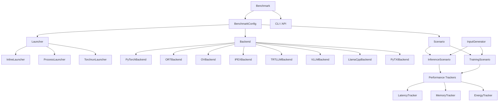
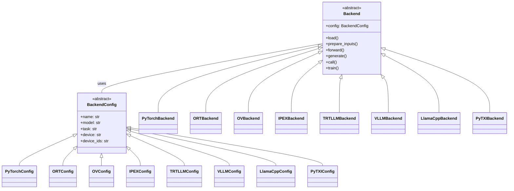
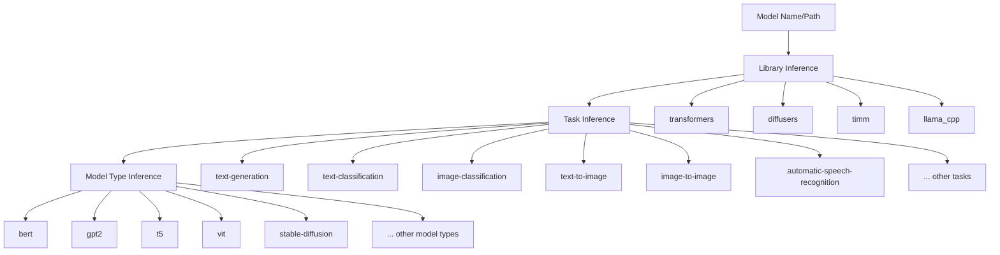
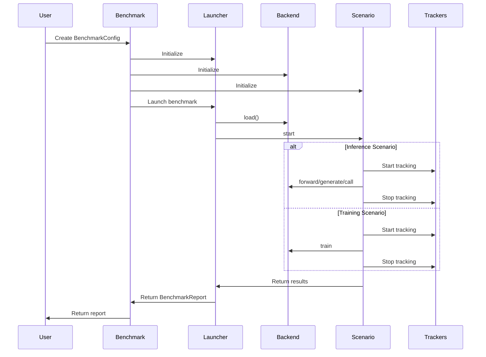

<!-- source: DeepWiki mcp.deepwiki.com · repo huggingface/optimum-benchmark · page 1 Overview · fetched 2026-10-26 -->

# Overview

<details>
<summary>Relevant source files</summary>

The following files were used as context for generating this wiki page:

- [README.md](README.md)
- [optimum_benchmark/backends/base.py](optimum_benchmark/backends/base.py)
- [optimum_benchmark/backends/config.py](optimum_benchmark/backends/config.py)
- [optimum_benchmark/backends/transformers_utils.py](optimum_benchmark/backends/transformers_utils.py)
- [optimum_benchmark/task_utils.py](optimum_benchmark/task_utils.py)
- [optimum_benchmark/version.py](optimum_benchmark/version.py)

</details>


Optimum-Benchmark is a unified framework for evaluating the performance of machine learning models from the Hugging Face ecosystem. It provides a standardized approach to benchmark machine learning models across various hardware, frameworks, and optimization techniques, making it easier to compare performance characteristics like latency, throughput, memory usage, and energy consumption.

This page provides a high-level overview of Optimum-Benchmark, introducing its architecture, components, and workflow. For detailed information about specific components, refer to their respective pages in this wiki.

## Purpose and Scope

Optimum-Benchmark aims to address several key benchmarking needs:

1. **Hardware Evaluation**: Enabling hardware providers and users to compare performance across different hardware platforms
2. **Model Comparison**: Measuring performance metrics (latency, throughput, memory, energy) across different models
3. **Optimization Assessment**: Benchmarking hardware & backend-specific optimizations and quantization techniques

The project supports:
- Multiple ML libraries (Transformers, Diffusers, PEFT, TIMM, and Optimum)
- Various hardware targets (CPU, NVIDIA/AMD GPUs, and more)
- Different execution scenarios (inference and training)
- Distributed and non-distributed setups

Sources: [README.md:12-31]()

## System Architecture

Optimum-Benchmark follows a modular design with several key abstractions that work together to perform benchmarking tasks.

### High-Level Architecture



The main components of the system include:

1. **Benchmark**: The central entry point that orchestrates the benchmarking process
2. **BenchmarkConfig**: Configures the benchmark parameters
3. **Launchers**: Control how benchmark workloads are executed
4. **Backends**: Interface with different ML frameworks and acceleration libraries
5. **Scenarios**: Define benchmarking workflows (inference or training)
6. **Trackers**: Monitor and record performance metrics
7. **Input Generators**: Create appropriate inputs for different model types and tasks

Sources: [optimum_benchmark/backends/base.py:36-147]()

## Core Components

### Backend System

The Backend abstraction is central to Optimum-Benchmark. It provides a common interface for loading models and executing operations (inference or training) across different frameworks and acceleration libraries.



Each backend:
- Loads models from the Hugging Face Hub or local directory
- Prepares inputs in the format required by the framework
- Executes model operations (forward, generate, call, train)
- Returns outputs in a standardized format

Sources: [optimum_benchmark/backends/base.py:36-147](), [optimum_benchmark/backends/config.py:19-48]()

### Task Handling System

The framework automatically infers tasks from model architectures, enabling proper handling of different model types (text generation, image diffusion, etc.).



The task inference system identifies:
- Which library the model belongs to (Transformers, Diffusers, TIMM, LlamaCPP)
- What task the model performs (text generation, classification, etc.)
- The specific model architecture or type

This information is crucial for loading the correct model class and generating appropriate inputs for benchmarking.

Sources: [optimum_benchmark/task_utils.py:8-340]()

## Benchmark Workflow

The benchmark execution follows a standardized flow from configuration to reporting.



The workflow involves:
1. Creating a configuration that specifies the backend, scenario, and launcher
2. Initializing the components based on the configuration
3. Launching the benchmark, which loads the model and runs the appropriate operations
4. Tracking performance metrics during execution
5. Collecting results into a benchmark report

Sources: [README.md:120-163]()

## Supported Technologies

Optimum-Benchmark supports a wide range of technologies:

### Backends and Devices

| Backend | CPU | NVIDIA GPU | AMD GPU | Intel XPU | Others |
|---------|-----|------------|---------|-----------|--------|
| PyTorch | ✅ | ✅ | ✅ | ❌ | MPS |
| ONNX Runtime | ✅ | ✅ | ✅ | ❌ | - |
| OpenVINO | ✅ | ✅ | ❌ | ❌ | - |
| TensorRT-LLM | ❌ | ✅ | ❌ | ❌ | - |
| vLLM | ✅ | ✅ | ✅ | ❌ | - |
| IPEX | ✅ | ❌ | ❌ | ✅ | - |
| LlamaCpp | ✅ | ✅ | ✅ | ❌ | - |
| PyTXI | ✅ | ✅ | ❌ | ❌ | - |

### Scenarios

1. **Inference Scenario**: Benchmarks model inference (forward, call, or generate)
   - Supports latency, memory, and energy tracking
   - Configurable number of warmup runs
   - Customizable input shapes and generation parameters

2. **Training Scenario**: Benchmarks model training
   - Supports latency, memory, and energy tracking
   - Configurable number of warmup steps
   - Customizable dataset shapes and training arguments

### Launchers

1. **Process Launcher**: Runs benchmarks in isolated processes
2. **Torchrun Launcher**: Runs distributed benchmarks using `torch.distributed`
3. **Inline Launcher**: Runs benchmarks in the same process (for debugging)

Sources: [README.md:212-285]()

## Getting Started

Optimum-Benchmark can be installed via pip and used through either a Python API or a command-line interface.

### Installation

```bash
pip install optimum-benchmark
```

### Python API Example

```python
from optimum_benchmark import Benchmark, BenchmarkConfig, TorchrunConfig, InferenceConfig, PyTorchConfig

# Configure the benchmark components
launcher_config = TorchrunConfig(nproc_per_node=2)
scenario_config = InferenceConfig(latency=True, memory=True)
backend_config = PyTorchConfig(model="gpt2", device="cuda", device_ids="0,1")

# Create the benchmark configuration
benchmark_config = BenchmarkConfig(
    name="pytorch_gpt2",
    scenario=scenario_config,
    launcher=launcher_config,
    backend=backend_config,
)

# Run the benchmark
benchmark_report = Benchmark.launch(benchmark_config)

# Save or view the results
benchmark_report.save_json("benchmark_report.json")
```

Sources: [README.md:69-163]()

## Use Cases

Optimum-Benchmark is designed to support several key use cases:

1. **Hardware Comparison**: Evaluate the performance of different hardware platforms (CPUs, GPUs) on the same models
2. **Model Evaluation**: Compare the performance characteristics of different models on the same hardware
3. **Optimization Assessment**: Measure the impact of optimizations and quantization techniques on model performance
4. **Distributed Training Evaluation**: Assess the scaling efficiency of models across multiple devices

By providing a standardized benchmarking framework, Optimum-Benchmark helps users make informed decisions about hardware, models, and optimization techniques for their specific use cases.

Sources: [README.md:27-31]()

---

