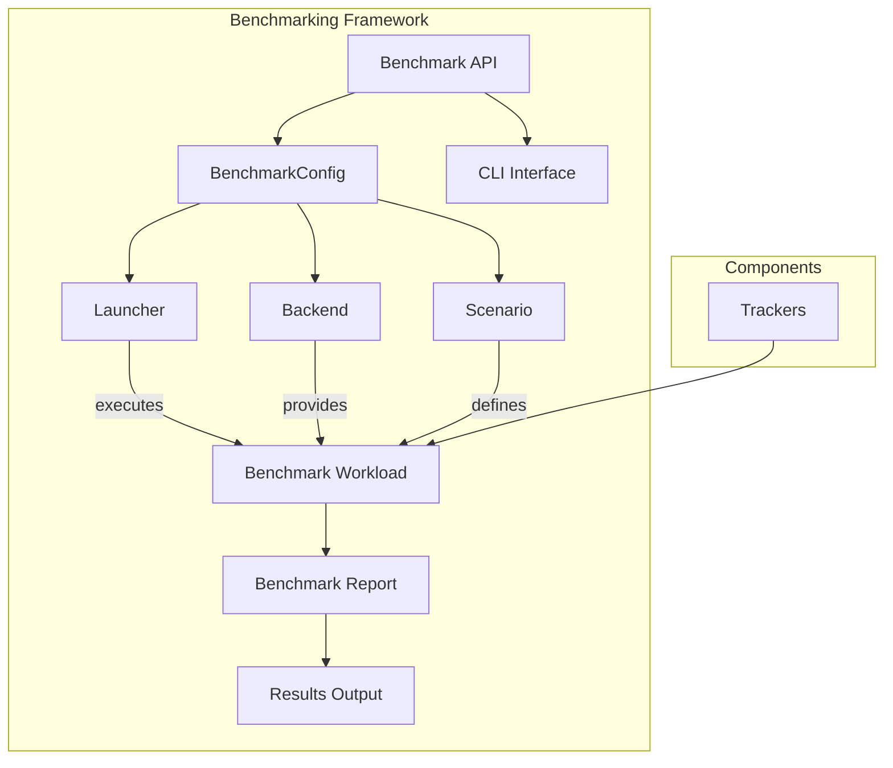
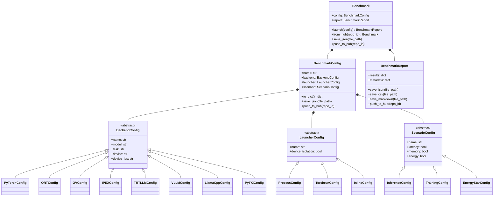
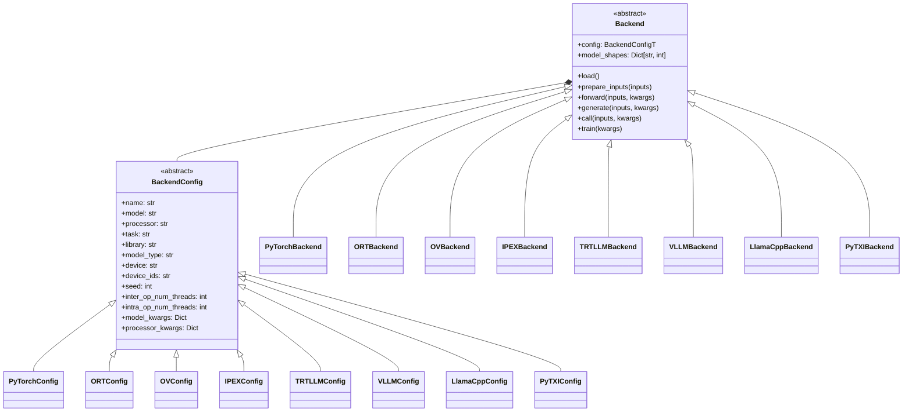
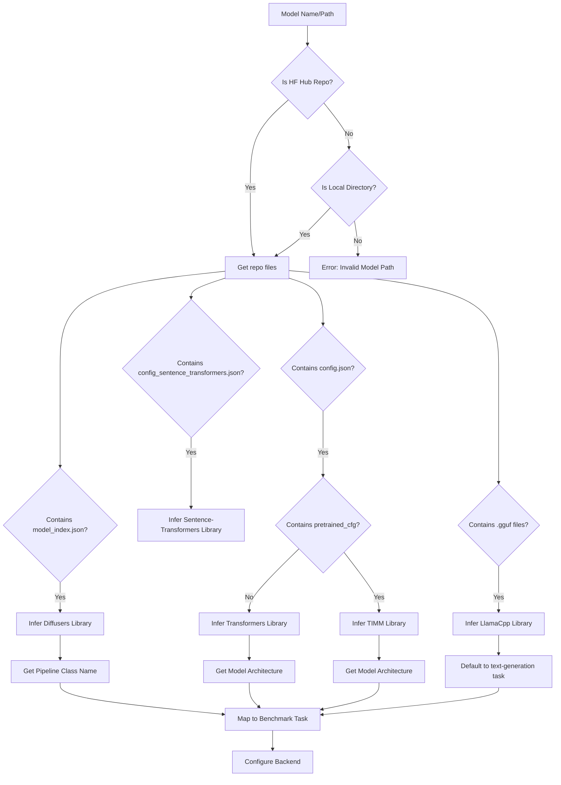
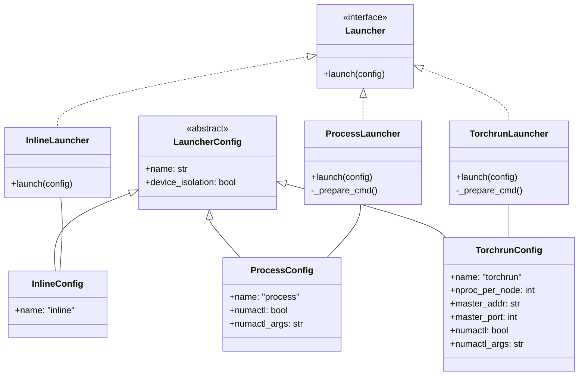
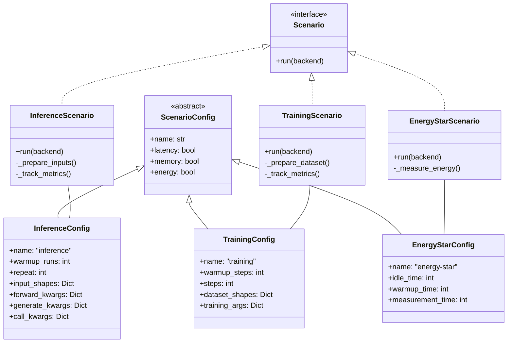
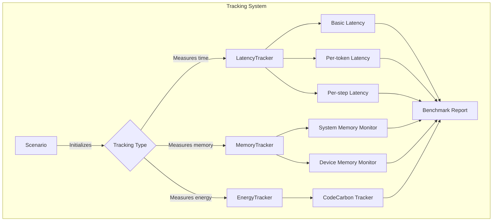
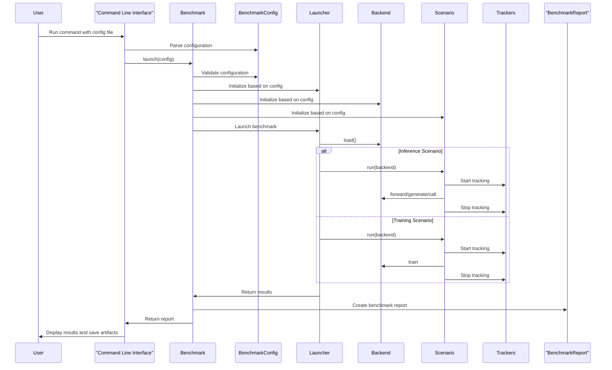
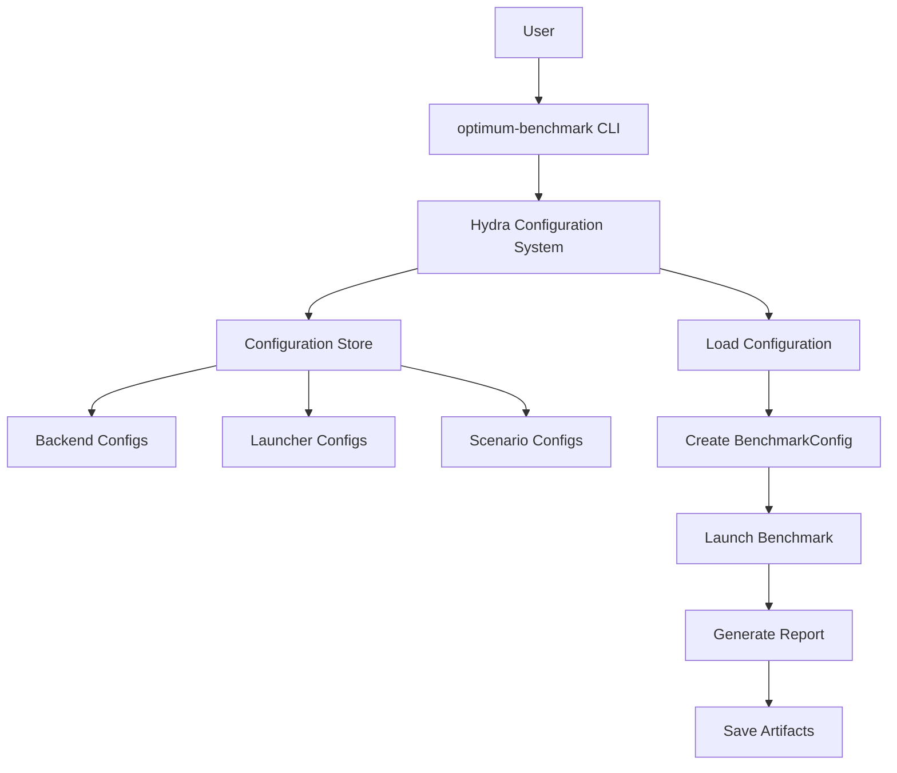
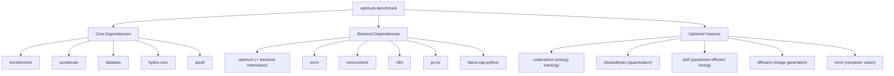

<!-- source: DeepWiki mcp.deepwiki.com · repo huggingface/optimum-benchmark · page 2 Architecture · fetched 2026-10-26 -->

# Architecture

Relevant source files

The following files were used as context for generating this wiki page:

- [.github/workflows/test_cli_cpu_ipex.yaml](.github/workflows/test_cli_cpu_ipex.yaml)
- [.github/workflows/test_cli_cpu_llama_cpp.yaml](.github/workflows/test_cli_cpu_llama_cpp.yaml)
- [.gitignore](.gitignore)
- [README.md](README.md)
- [optimum_benchmark/__init__.py](optimum_benchmark/__init__.py)
- [optimum_benchmark/backends/__init__.py](optimum_benchmark/backends/__init__.py)
- [optimum_benchmark/backends/base.py](optimum_benchmark/backends/base.py)
- [optimum_benchmark/backends/config.py](optimum_benchmark/backends/config.py)
- [optimum_benchmark/backends/transformers_utils.py](optimum_benchmark/backends/transformers_utils.py)
- [optimum_benchmark/cli.py](optimum_benchmark/cli.py)
- [optimum_benchmark/import_utils.py](optimum_benchmark/import_utils.py)
- [optimum_benchmark/task_utils.py](optimum_benchmark/task_utils.py)
- [setup.py](setup.py)

This document outlines the high-level architecture of the Optimum-Benchmark framework, detailing its core components, their relationships, and how they work together to provide a comprehensive benchmarking system for machine learning models. For a general introduction to the system, see [Overview](#1). For detailed information about specific components, refer to their respective wiki pages linked throughout this document.

## High-Level Architecture

Optimum-Benchmark is designed with a modular architecture that separates concerns between different aspects of the benchmarking process. The framework consists of four main components that work together to provide comprehensive benchmarking capabilities:

**Key Components:**

1. **Benchmark API**: The central entry point for running benchmarks programmatically.
2. **Benchmark Configuration**: Defines what and how to benchmark.
3. **Launcher**: Controls how benchmark workloads are executed.
4. **Backend**: Represents machine learning frameworks and optimizations.
5. **Scenario**: Defines benchmarking workflows (inference, training).
6. **Trackers**: Monitor and record performance metrics.

Sources: [optimum_benchmark/benchmark/base.py](), [optimum_benchmark/benchmark/config.py](), [optimum_benchmark/cli.py:1-82]()

## Core Component Relationships

The following diagram shows the detailed relationships between the core components of the system, highlighting how they interact:

Sources: [optimum_benchmark/__init__.py:1-41](), [optimum_benchmark/benchmark/base.py](), [optimum_benchmark/backends/config.py:1-129]()

## Backend Subsystem

The backend subsystem is responsible for interfacing with different machine learning frameworks and optimization libraries. It provides a unified API for loading models, preparing inputs, and executing workloads.

The backend system is designed for flexibility and extensibility, allowing easy integration of new machine learning frameworks and optimization libraries. Each backend implements the same interface but handles framework-specific details internally.

Key features of the backend system:

1. **Universal Interface**: All backends implement the same methods (`load`, `forward`, `generate`, etc.)
2. **Library Support**: Works with Transformers, Diffusers, TIMM, and LlamaCpp models
3. **Device Flexibility**: Supports CPU, NVIDIA GPUs (CUDA), AMD GPUs (ROCm), and specialized hardware
4. **Optimization Options**: Each backend can apply framework-specific optimizations

Sources: [optimum_benchmark/backends/base.py:1-147](), [optimum_benchmark/backends/config.py:1-129](), [optimum_benchmark/backends/__init__.py:1-24]()

## Task and Model Type Handling

Optimum-Benchmark has a sophisticated system for inferring tasks and model types from model names or directories, allowing it to automatically configure the appropriate benchmarking environment.

Sources: [optimum_benchmark/task_utils.py:1-340](), [optimum_benchmark/backends/config.py:1-129]()

## Launcher Subsystem

The launcher subsystem is responsible for executing benchmark workloads. It provides different strategies for running benchmarks, from simple in-process execution to distributed training across multiple devices.

Each launcher provides a different execution strategy:

1. **InlineLauncher**: Executes the benchmark in the same process (mainly for debugging)
2. **ProcessLauncher**: Runs the benchmark in a separate process for isolation
3. **TorchrunLauncher**: Uses PyTorch's distributed execution tools for multi-GPU benchmarking

Sources: [optimum_benchmark/launchers/__init__.py](), [optimum_benchmark/__init__.py:16-16](), [optimum_benchmark/cli.py:51-54]()

## Scenario Subsystem

The scenario subsystem defines different benchmarking workflows, configuring what aspects of model performance to measure and how.

Each scenario type focuses on different aspects of model performance:

1. **InferenceScenario**: Measures the performance of model inference (forward pass, generation)
2. **TrainingScenario**: Evaluates model training performance
3. **EnergyStarScenario**: Focuses on energy efficiency metrics

Sources: [optimum_benchmark/__init__.py:17-17](), [optimum_benchmark/cli.py:47-50]()

## Performance Tracking System

The performance tracking system is responsible for measuring and recording various performance metrics during benchmark execution.

Key features of the tracking system:

1. **Latency Tracking**: Measures execution time with specialized trackers for token generation and training steps
2. **Memory Tracking**: Monitors RAM and device (GPU/TPU) memory usage
3. **Energy Tracking**: Records energy consumption using CodeCarbon

Sources: [README.md:245-247](), [README.md:252-255]()

## Benchmark Execution Flow

The following sequence diagram illustrates the flow of execution when running a benchmark:

Sources: [optimum_benchmark/cli.py:56-82](), [README.md:120-163]()

## CLI and Configuration System

Optimum-Benchmark provides a command-line interface built on Hydra, allowing for flexible configuration and execution of benchmarks.

The CLI enables users to:

1. Run benchmarks with predefined configurations
2. Override configuration parameters from the command line
3. Perform parameter sweeps for comparative benchmarking
4. Save and share benchmark results

Sources: [optimum_benchmark/cli.py:1-82](), [README.md:164-209]()

## System Requirements and Dependencies

Optimum-Benchmark has a modular dependency system, only loading necessary libraries based on the backends and features being used.

The setup system automatically detects available hardware and suggests appropriate dependencies to install:

1. Detects NVIDIA GPUs and installs NVIDIA utilities
2. Detects AMD GPUs and installs AMD utilities
3. Provides extras for specific backends (e.g., `pip install optimum-benchmark[vllm]`)

Sources: [setup.py:1-123](), [import_utils.py:1-277]()

## Summary

The architecture of Optimum-Benchmark is designed to be:

1. **Modular**: Components can be swapped or extended independently
2. **Extensible**: New backends, scenarios, and trackers can be added easily
3. **Flexible**: Supports various hardware, frameworks, and benchmarking scenarios
4. **Comprehensive**: Measures multiple aspects of performance (speed, memory, energy)

This design allows Optimum-Benchmark to support a wide range of machine learning models, frameworks, and hardware, making it a versatile tool for performance evaluation and optimization.

---

