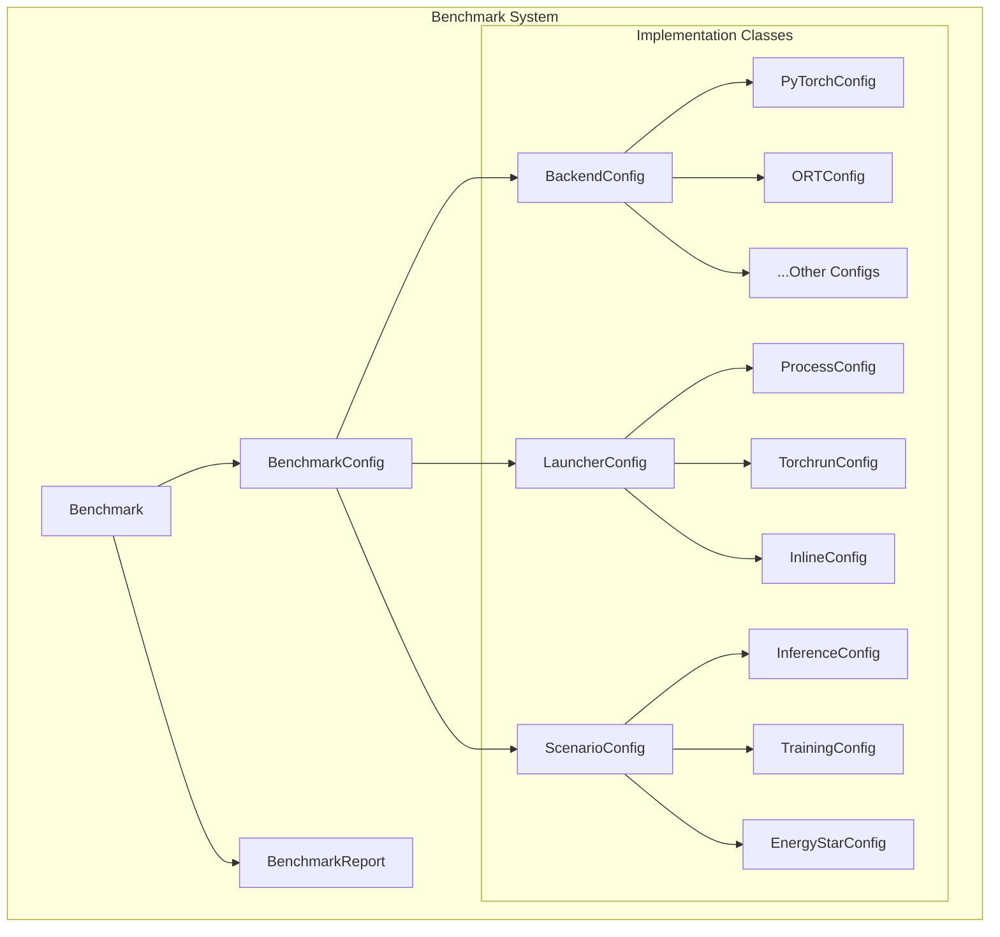
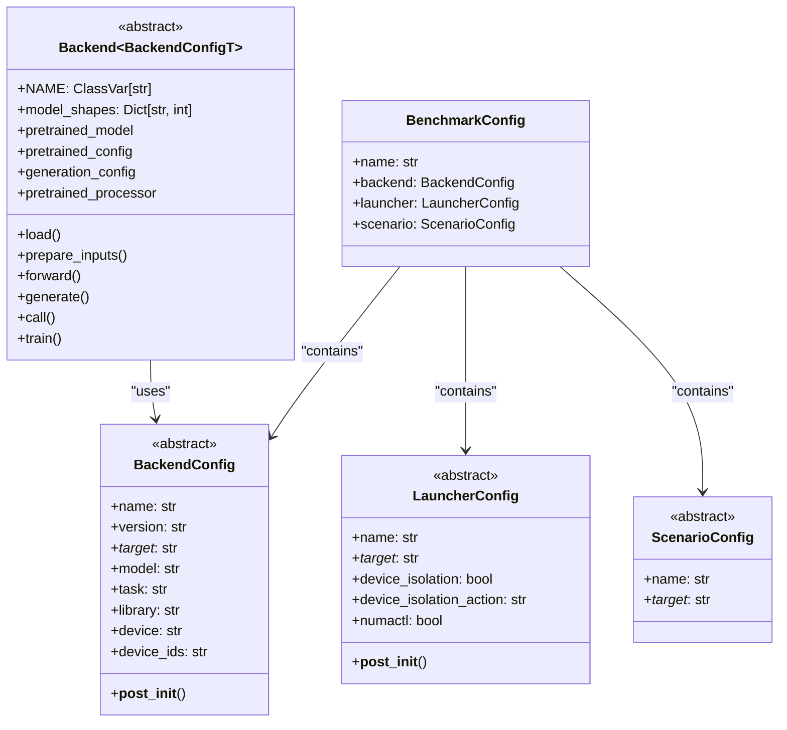
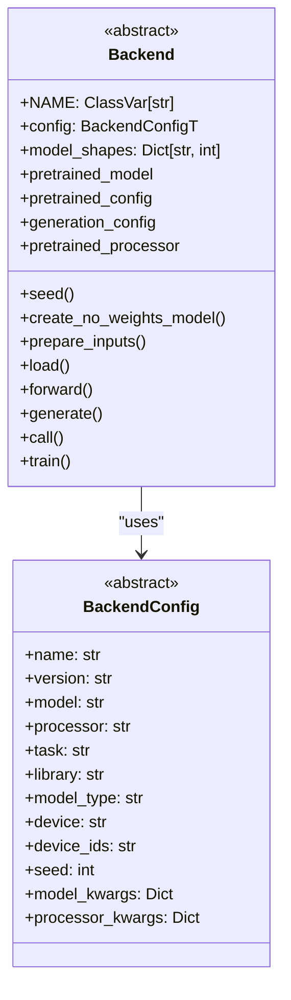
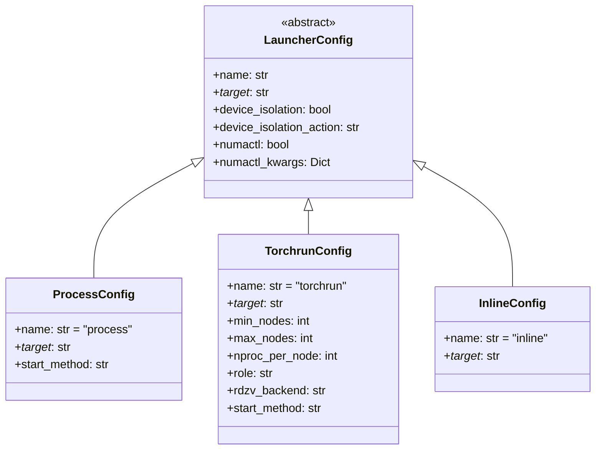
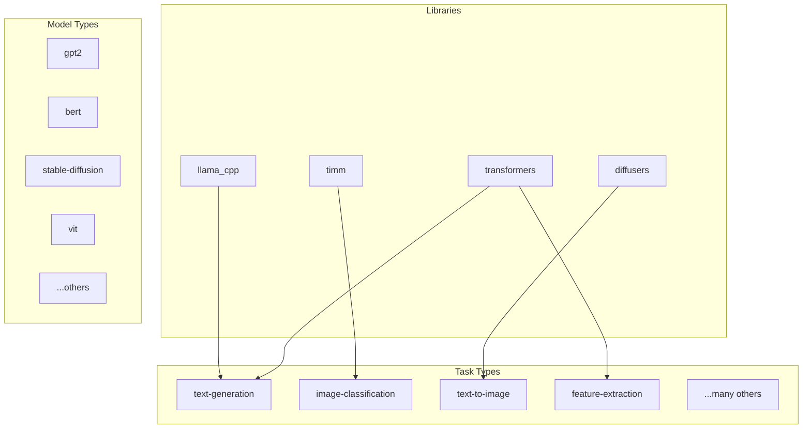
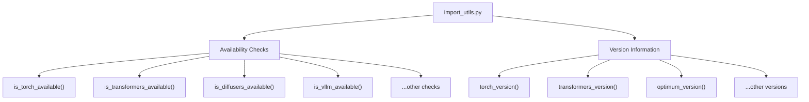
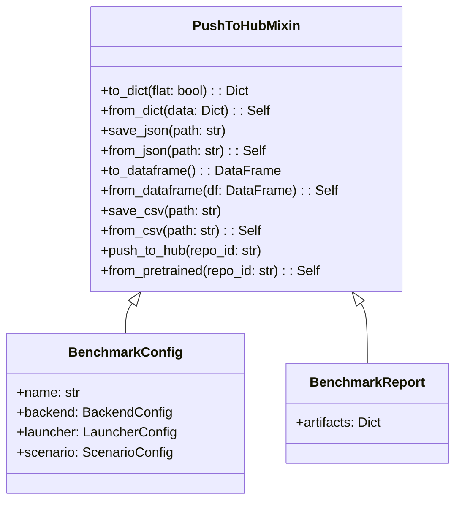
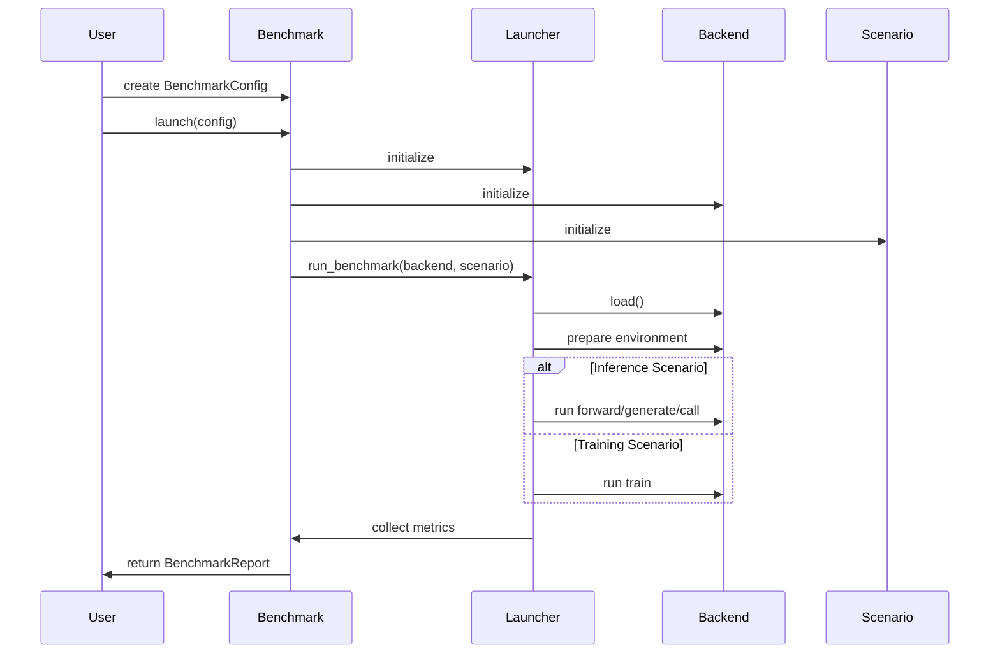

<!-- source: DeepWiki mcp.deepwiki.com · repo huggingface/optimum-benchmark · page 2.1 Core Components · fetched 2026-10-26 -->

# Core Components

<details>
<summary>Relevant source files</summary>

The following files were used as context for generating this wiki page:

- [.github/workflows/test_cli_cpu_ipex.yaml](.github/workflows/test_cli_cpu_ipex.yaml)
- [.github/workflows/test_cli_cpu_llama_cpp.yaml](.github/workflows/test_cli_cpu_llama_cpp.yaml)
- [.gitignore](.gitignore)
- [README.md](README.md)
- [optimum_benchmark/__init__.py](optimum_benchmark/__init__.py)
- [optimum_benchmark/backends/__init__.py](optimum_benchmark/backends/__init__.py)
- [optimum_benchmark/backends/base.py](optimum_benchmark/backends/base.py)
- [optimum_benchmark/backends/config.py](optimum_benchmark/backends/config.py)
- [optimum_benchmark/backends/transformers_utils.py](optimum_benchmark/backends/transformers_utils.py)
- [optimum_benchmark/cli.py](optimum_benchmark/cli.py)
- [optimum_benchmark/hub_utils.py](optimum_benchmark/hub_utils.py)
- [optimum_benchmark/import_utils.py](optimum_benchmark/import_utils.py)
- [optimum_benchmark/launchers/config.py](optimum_benchmark/launchers/config.py)
- [optimum_benchmark/launchers/inline/config.py](optimum_benchmark/launchers/inline/config.py)
- [optimum_benchmark/launchers/process/config.py](optimum_benchmark/launchers/process/config.py)
- [optimum_benchmark/launchers/torchrun/config.py](optimum_benchmark/launchers/torchrun/config.py)
- [optimum_benchmark/task_utils.py](optimum_benchmark/task_utils.py)
- [setup.py](setup.py)

</details>


This page documents the main abstractions and classes that form the foundation of the Optimum-Benchmark system. These core components provide the structure upon which the entire benchmarking framework is built, enabling the flexibility to benchmark various models across different hardware and optimization backends.

For information about how to configure specific components, see [Configuration System](#2.2). For details about specific backend implementations, see [Backends](#3).

## Component Architecture Overview

Optimum-Benchmark follows a modular design with three main component types that work together to create a flexible benchmarking system:



The system consists of:

1. **Backend**: Provides an abstraction over different ML frameworks and optimizations
2. **Launcher**: Controls how benchmarks are executed (in-process, isolated process, distributed)
3. **Scenario**: Defines the benchmarking workflow (inference, training, energy measurement)
4. **Configuration**: Ties together the above components with specific settings

Sources: [optimum_benchmark/__init__.py:1-41](), [optimum_benchmark/backends/__init__.py:1-24](), [optimum_benchmark/cli.py:1-82]()

## Core Classes and Abstractions

The system is built around several abstract base classes that define the interfaces for each component type:



Sources: [optimum_benchmark/backends/base.py:36-147](), [optimum_benchmark/backends/config.py:19-129](), [optimum_benchmark/launchers/config.py:11-45](), [optimum_benchmark/cli.py:33-54]()

### Backend System

The `Backend` class is the foundation of the model execution abstraction. It provides a unified interface to different ML frameworks:



Key responsibilities of the `Backend` class:
- Load models with appropriate settings
- Prepare inputs in the format required by the framework
- Execute model operations (forward, generate, etc.)
- Handle model training when applicable

The `Backend` abstraction handles differences in model interfaces across frameworks like PyTorch, ONNX Runtime, OpenVINO, etc., providing consistent methods regardless of the underlying implementation.

Sources: [optimum_benchmark/backends/base.py:36-147](), [optimum_benchmark/backends/config.py:19-129]()

### Launcher System

The launcher system controls how benchmark workloads are executed:



The three main launcher types are:
- **InlineLauncher**: Runs benchmarks in the same process (for debugging)
- **ProcessLauncher**: Runs benchmarks in isolated processes 
- **TorchrunLauncher**: Runs benchmarks in distributed settings using PyTorch's distributed capabilities

Each launcher ensures benchmarks execute in consistent and isolated environments to produce reliable results.

Sources: [optimum_benchmark/launchers/config.py:11-45](), [optimum_benchmark/launchers/process/config.py:1-18](), [optimum_benchmark/launchers/torchrun/config.py:1-54](), [optimum_benchmark/launchers/inline/config.py:1-23]()

### Supported Libraries and Tasks

The system provides extensive integration with various ML libraries and task types:



The task utilities system handles automatic inference of:
- Library type (transformers, diffusers, timm, llama_cpp)
- Task type (text-generation, image-classification, etc.) 
- Model type (architecture specific information)

Sources: [optimum_benchmark/task_utils.py:1-341](), [optimum_benchmark/backends/config.py:61-90]()

## Import and Dependency Management

Optimum-Benchmark handles dependencies flexibly through its import utilities system:



This system ensures:
- Optional dependencies are properly handled
- Clear error messages when required dependencies are missing
- Version information is available for reporting 

These utilities allow the codebase to adapt to different installation configurations and handle missing dependencies gracefully.

Sources: [optimum_benchmark/import_utils.py:1-259](), [setup.py:63-90]()

## Integration with Hugging Face Ecosystem

The core components provide integration with the Hugging Face ecosystem:



Key integration features:
- Loading models from the Hugging Face Hub
- Pushing benchmark results to the Hub
- Serialization and deserialization of configurations and reports
- Repository management and file operations

This integration allows for easy sharing and comparison of benchmark results across the community.

Sources: [optimum_benchmark/hub_utils.py:1-161](), [optimum_benchmark/task_utils.py:146-196]()

## System Entry Points

The system provides two main entry points:

1. **CLI Interface**: Based on Hydra for configuration management
```python
# Command line usage
optimum-benchmark --config-dir examples/ --config-name cuda_pytorch_bert
```

2. **Python API**: For programmatic usage
```python
from optimum_benchmark import Benchmark, BenchmarkConfig, PyTorchConfig, ProcessConfig, InferenceConfig

benchmark_config = BenchmarkConfig(
    name="pytorch_benchmark",
    backend=PyTorchConfig(model="gpt2", device="cuda"),
    launcher=ProcessConfig(),
    scenario=InferenceConfig(latency=True, memory=True)
)
report = Benchmark.launch(benchmark_config)
```

Sources: [optimum_benchmark/cli.py:57-82](), [README.md:120-163]()

## Component Relationships and Flow

The core components interact in a specific sequence when running a benchmark:



This flow ensures that:
1. Components are properly initialized with their configurations
2. The execution environment is prepared by the launcher
3. The appropriate backend methods are called based on the scenario
4. Metrics are collected and returned in a structured report

Sources: [optimum_benchmark/backends/base.py:36-147](), [optimum_benchmark/cli.py:57-82](), [README.md:120-163]()

## Core Components Summary

The core components of Optimum-Benchmark establish a flexible and extensible system for benchmarking ML models with key features:

| Component | Primary Role | Key Classes |
|-----------|--------------|-------------|
| Backend | Framework abstraction | `Backend`, `BackendConfig` |
| Launcher | Execution control | `LauncherConfig`, `ProcessConfig`, `TorchrunConfig` |
| Scenario | Benchmark workflow | `ScenarioConfig`, `InferenceConfig`, `TrainingConfig` |
| Configuration | Component integration | `BenchmarkConfig` |
| Utilities | Cross-cutting concerns | `import_utils`, `task_utils`, `hub_utils` |

This modular design allows for:
- Supporting multiple ML frameworks through a consistent interface
- Running benchmarks in various execution environments
- Measuring different aspects of model performance
- Easy extension to new frameworks, hardware, and metrics

Sources: [optimum_benchmark/__init__.py:1-41](), [optimum_benchmark/cli.py:33-54](), [README.md:12-41]()

---

