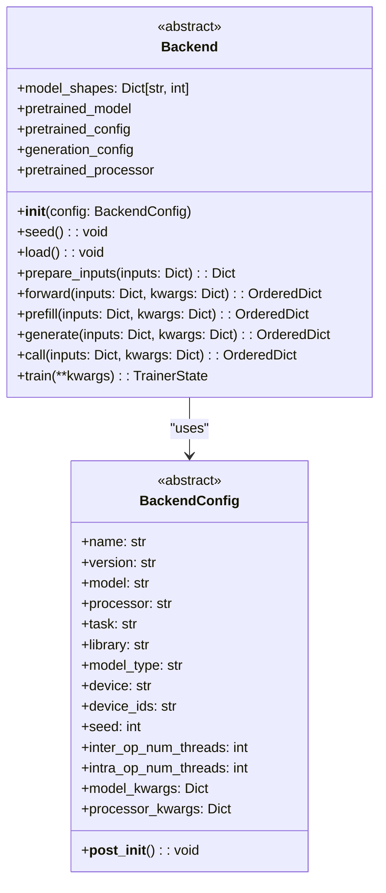
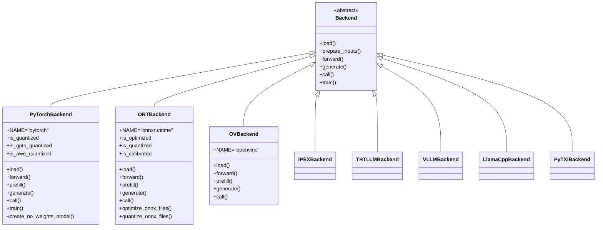
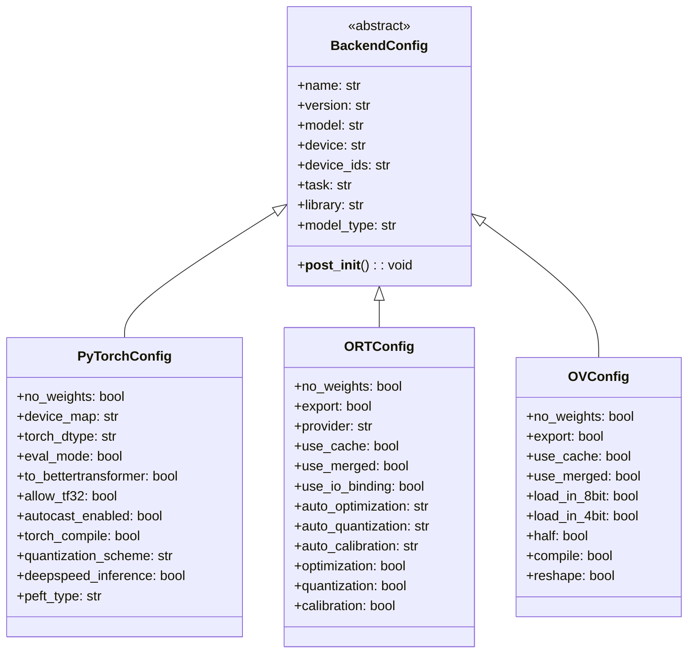
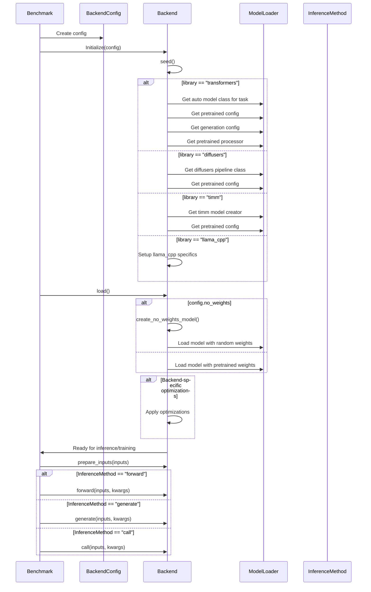
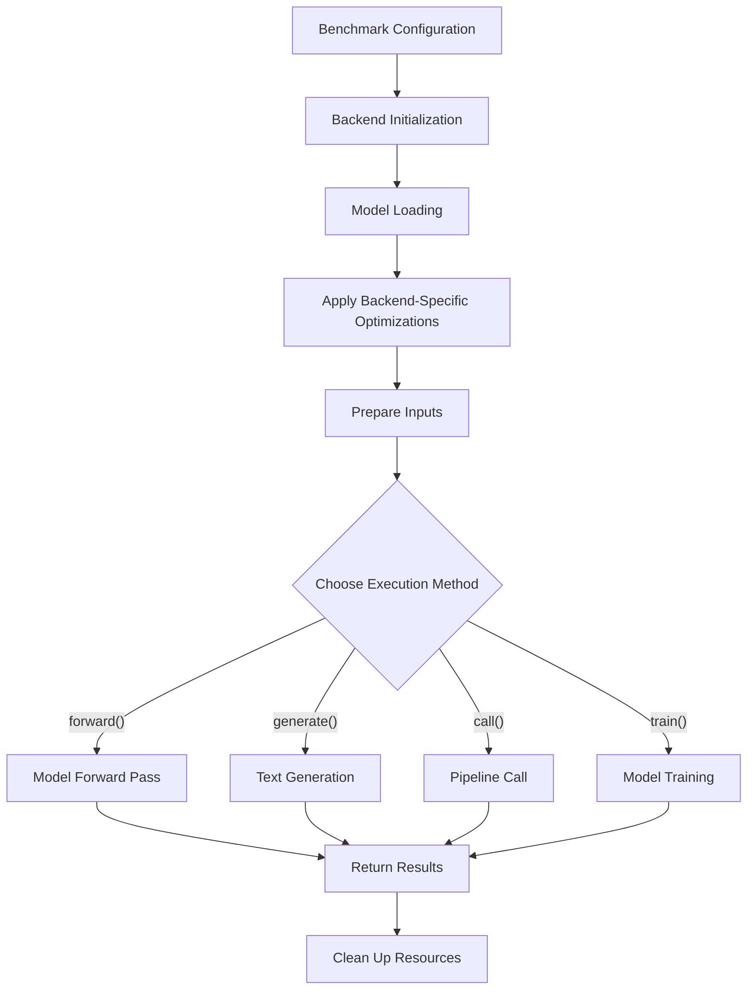
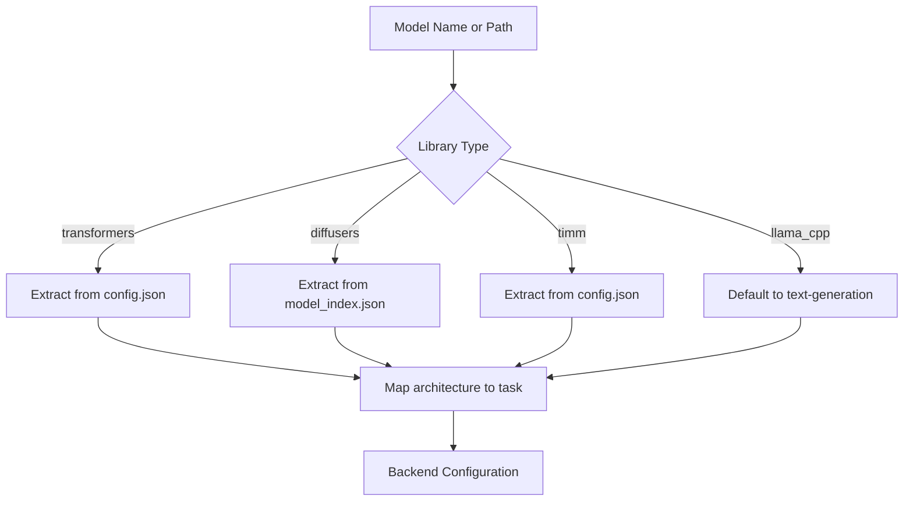

<!-- source: DeepWiki mcp.deepwiki.com · repo huggingface/optimum-benchmark · page 3 Backends · fetched 2026-10-26 -->

# Backends

Relevant source files

The following files were used as context for generating this wiki page:

- [README.md](README.md)
- [optimum_benchmark/backends/base.py](optimum_benchmark/backends/base.py)
- [optimum_benchmark/backends/config.py](optimum_benchmark/backends/config.py)
- [optimum_benchmark/backends/onnxruntime/backend.py](optimum_benchmark/backends/onnxruntime/backend.py)
- [optimum_benchmark/backends/onnxruntime/config.py](optimum_benchmark/backends/onnxruntime/config.py)
- [optimum_benchmark/backends/onnxruntime/utils.py](optimum_benchmark/backends/onnxruntime/utils.py)
- [optimum_benchmark/backends/openvino/backend.py](optimum_benchmark/backends/openvino/backend.py)
- [optimum_benchmark/backends/openvino/config.py](optimum_benchmark/backends/openvino/config.py)
- [optimum_benchmark/backends/openvino/utils.py](optimum_benchmark/backends/openvino/utils.py)
- [optimum_benchmark/backends/pytorch/backend.py](optimum_benchmark/backends/pytorch/backend.py)
- [optimum_benchmark/backends/pytorch/config.py](optimum_benchmark/backends/pytorch/config.py)
- [optimum_benchmark/backends/transformers_utils.py](optimum_benchmark/backends/transformers_utils.py)
- [optimum_benchmark/task_utils.py](optimum_benchmark/task_utils.py)
- [tests/configs/_diffusers_.yaml](tests/configs/_diffusers_.yaml)

The Backends system in Optimum-Benchmark provides a unified interface for running machine learning models across various execution engines. This page documents the core Backend abstraction, common interfaces for inference and training, and the architecture supporting multiple hardware devices and optimization techniques.

For information about specific backend implementations such as PyTorch, ONNX Runtime, or OpenVINO, see the corresponding subpages ([PyTorch Backend](#3.1), [ONNX Runtime Backend](#3.2), etc.).

## Core Backend Architecture

The Backend system is designed around a common interface that enables benchmarking models with different execution engines while maintaining a consistent API. Each backend implementation inherits from a base class that defines the standard methods for loading models and executing inference or training operations.

### Backend Abstract Base Class

The central component of the Backends system is the abstract `Backend` class, which defines the interface that all backend implementations must implement.

Sources: [optimum_benchmark/backends/base.py:36-148](), [optimum_benchmark/backends/config.py:18-129]()

### Backend Implementations

Optimum-Benchmark supports multiple backend implementations to run models with different execution engines.

Sources: [optimum_benchmark/backends/pytorch/backend.py:63-486](), [optimum_benchmark/backends/onnxruntime/backend.py:43-319](), [optimum_benchmark/backends/openvino/backend.py:21-128](), [README.md:267-285]()

## Backend Configuration System

Each backend implementation has its own configuration class that inherits from `BackendConfig`, providing type safety and setting specific parameters needed for that backend.

Sources: [optimum_benchmark/backends/config.py:18-129](), [optimum_benchmark/backends/pytorch/config.py:17-89](), [optimum_benchmark/backends/onnxruntime/config.py:28-106](), [optimum_benchmark/backends/openvino/config.py:8-42]()

## Backend Loading and Initialization Flow

The backend loading process follows a consistent flow, with customizations for each implementation.

Sources: [optimum_benchmark/backends/base.py:36-148](), [optimum_benchmark/backends/pytorch/backend.py:99-295](), [optimum_benchmark/backends/onnxruntime/backend.py:64-108](), [optimum_benchmark/backends/openvino/backend.py:36-77]()

## Common Backend Features

All backend implementations share common features and functionality, while adding backend-specific optimizations.

### Model Loading

Backends provide a unified interface for loading models from both the Hugging Face Hub and local directories:

1. **Regular Loading**: Loads models with their pre-trained weights
2. **No-Weights Loading**: Creates models with random weights for benchmarking architecture performance
3. **Library Support**: Handles models from transformers, diffusers, timm, and llama_cpp

### Inference Methods

All backends implement standardized inference methods:

| Method | Purpose |
|--------|---------|
| `forward()` | Standard model forward pass (used for most models) |
| `generate()` | Text generation for language models |
| `prefill()` | Initial token generation for language models |
| `call()` | Pipeline calls (mainly for diffusers models) |

### Device Management

Backends handle device placement, with support for:

1. CPU execution
2. CUDA GPU execution (with device selection)
3. ROCm GPU execution (AMD GPUs)
4. Various specialized accelerators depending on backend

### Optimization Features

Depending on the backend, various optimization techniques are available:

| Backend | Key Optimizations |
|---------|------------------|
| PyTorch | Quantization (GPTQ, AWQ), DeepSpeed, torch.compile, BetterTransformer, PEFT |
| ONNX Runtime | Provider selection, optimization levels, quantization, I/O binding |
| OpenVINO | Half-precision, model reshaping, compilation |
| IPEX | Intel optimizations for PyTorch |
| TensorRT-LLM | NVIDIA GPU optimizations for LLMs |
| vLLM | Paged attention mechanism |
| LlamaCpp | GGUF format, various precisions |

Sources: [optimum_benchmark/backends/base.py:104-146](), [optimum_benchmark/backends/pytorch/backend.py:169-235](), [optimum_benchmark/backends/onnxruntime/backend.py:174-204](), [optimum_benchmark/backends/openvino/backend.py:49-59](), [README.md:267-285]()

## Backend Execution Flow

When a benchmark is run, the backend executes in a specific sequence:

Sources: [optimum_benchmark/backends/base.py:109-147](), [optimum_benchmark/backends/pytorch/backend.py:432-483](), [optimum_benchmark/backends/onnxruntime/backend.py:304-318](), [optimum_benchmark/backends/openvino/backend.py:117-127]()

## Backend Implementation Details

Each backend implements specific functionality to handle the unique aspects of its underlying execution engine.

### Task and Model Type Inference

The backend system automatically infers the appropriate task and model type from the model name or path if not explicitly specified in the configuration:

Sources: [optimum_benchmark/task_utils.py:132-290](), [optimum_benchmark/backends/config.py:65-90]()

### PyTorch Backend Specifics

The PyTorch backend supports a wide range of optimization techniques:

1. **TF32 Precision**: Enables tensor float 32 for faster matrix multiplications on NVIDIA GPUs
2. **Quantization**: Supports GPTQ and AWQ quantization for reduced memory footprint
3. **BetterTransformer**: Transforms models to use optimized kernels
4. **Torch.compile**: Applies compiler optimizations to model execution
5. **DeepSpeed Integration**: Enables distributed inference

Sources: [optimum_benchmark/backends/pytorch/backend.py:69-96](), [optimum_benchmark/backends/pytorch/backend.py:169-235]()

### ONNX Runtime Backend Specifics

The ONNX Runtime backend focuses on cross-platform optimizations:

1. **Model Export**: Converts models to ONNX format
2. **Execution Providers**: Supports various hardware backends (CPU, CUDA, TensorRT, etc.)
3. **Graph Optimization**: Applies optimization levels (O1-O4)
4. **Quantization**: Supports static and dynamic quantization

Sources: [optimum_benchmark/backends/onnxruntime/backend.py:64-108](), [optimum_benchmark/backends/onnxruntime/backend.py:174-284]()

### OpenVINO Backend Specifics

The OpenVINO backend provides Intel-specific optimizations:

1. **Half-precision**: Converts models to FP16 for faster execution
2. **Model Reshaping**: Optimizes models for specific input shapes
3. **Compilation**: Compiles models for optimal performance on Intel hardware

Sources: [optimum_benchmark/backends/openvino/backend.py:36-77](), [optimum_benchmark/backends/openvino/backend.py:49-59]()

## Task Support by Backend

Different backends support various ML tasks, with task-specific model classes:

| Task | PyTorch | ONNX Runtime | OpenVINO |
|------|---------|--------------|-----------|
| Text Generation | ✓ | ✓ | ✓ |
| Text Classification | ✓ | ✓ | ✓ |
| Text2Text Generation | ✓ | ✓ | ✓ |
| Image Classification | ✓ | ✓ | ✓ |
| Text-to-Image | ✓ | ✓ | ✓ |
| Image-to-Image | ✓ | ✓ | ✓ |
| Feature Extraction | ✓ | ✓ | ✓ |
| Inpainting | ✓ | ✓ | ✓ |
| Question Answering | ✓ | ✓ | ✓ |

Sources: [optimum_benchmark/task_utils.py:9-125](), [optimum_benchmark/backends/onnxruntime/utils.py:6-14](), [optimum_benchmark/backends/openvino/utils.py:1-17]()

## Extending the Backend System

To add a new backend to the system, developers need to:

1. Create a new backend configuration class inheriting from `BackendConfig`
2. Implement a backend class inheriting from `Backend`
3. Implement the required methods (`load()`, `forward()`, etc.)
4. Register the backend in the appropriate utility modules

This modular design allows the system to evolve and support new execution engines as they become available.

Sources: [optimum_benchmark/backends/base.py:36-147](), [README.md:312-322]()

---

