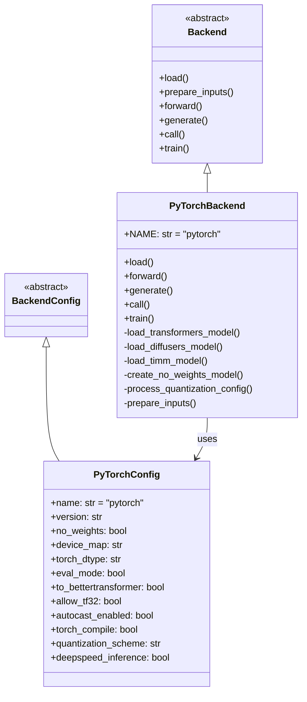
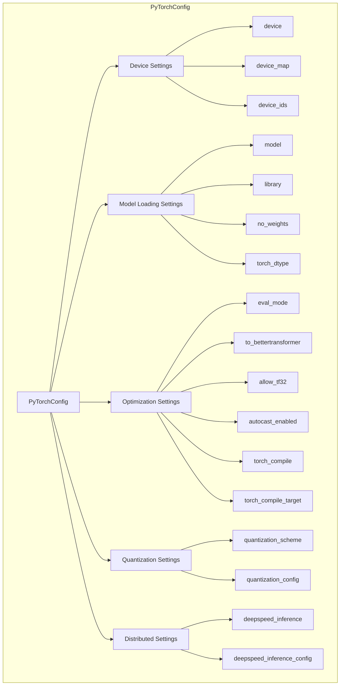
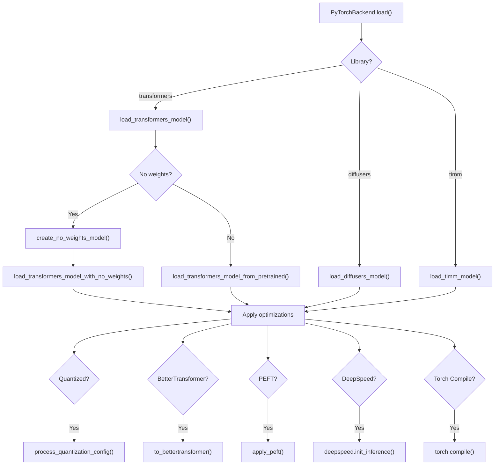
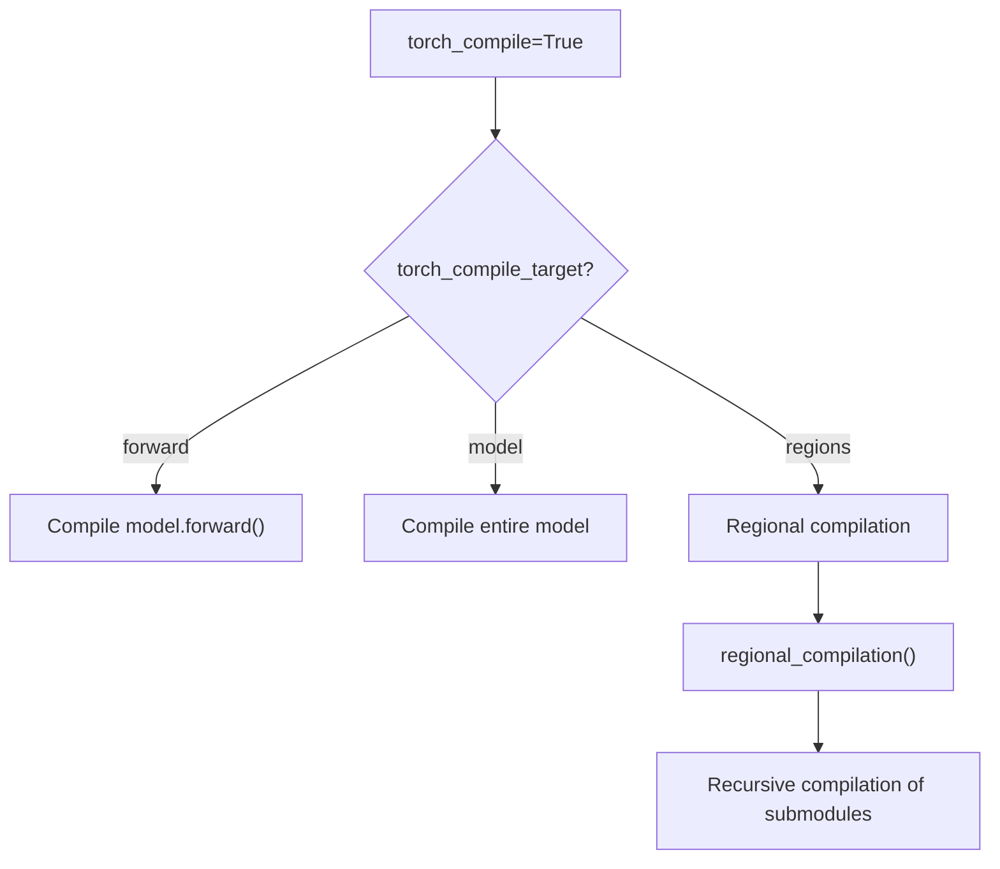
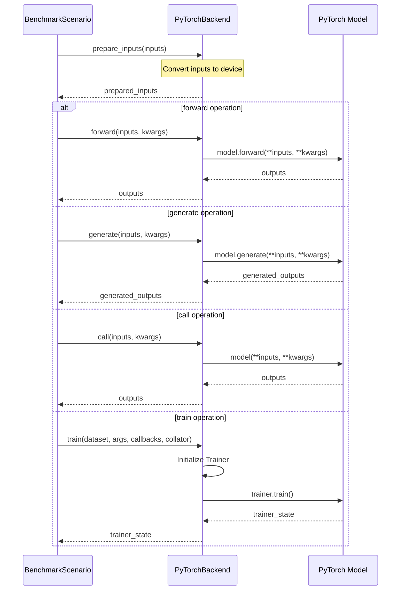

<!-- source: DeepWiki mcp.deepwiki.com · repo huggingface/optimum-benchmark · page 3.1 PyTorch Backend · fetched 2026-10-26 -->

# PyTorch Backend

<details>
<summary>Relevant source files</summary>

The following files were used as context for generating this wiki page:

- [optimum_benchmark/backends/onnxruntime/backend.py](optimum_benchmark/backends/onnxruntime/backend.py)
- [optimum_benchmark/backends/onnxruntime/config.py](optimum_benchmark/backends/onnxruntime/config.py)
- [optimum_benchmark/backends/onnxruntime/utils.py](optimum_benchmark/backends/onnxruntime/utils.py)
- [optimum_benchmark/backends/openvino/backend.py](optimum_benchmark/backends/openvino/backend.py)
- [optimum_benchmark/backends/openvino/config.py](optimum_benchmark/backends/openvino/config.py)
- [optimum_benchmark/backends/openvino/utils.py](optimum_benchmark/backends/openvino/utils.py)
- [optimum_benchmark/backends/pytorch/backend.py](optimum_benchmark/backends/pytorch/backend.py)
- [optimum_benchmark/backends/pytorch/config.py](optimum_benchmark/backends/pytorch/config.py)
- [tests/configs/_diffusers_.yaml](tests/configs/_diffusers_.yaml)

</details>


## Purpose and Scope

This document details the PyTorch backend implementation in Optimum-Benchmark, which serves as the default execution engine for running benchmarks with native PyTorch models. The PyTorch backend provides a foundation for measuring the performance of models running on the core PyTorch framework, as well as access to various PyTorch-specific optimizations like torch.compile, mixed precision, and quantization.

For information about other execution backends, see [Backends](#3) and their specific implementations such as [ONNX Runtime Backend](#3.2), [OpenVINO Backend](#3.3), and others.

## Overview

The PyTorch backend implements the standard Backend interface while providing PyTorch-specific functionality for model loading, optimization, and execution. It enables benchmarking of models from various libraries including Transformers, Diffusers, and TIMM.



Sources:
- [optimum_benchmark/backends/pytorch/backend.py:63-486]()
- [optimum_benchmark/backends/pytorch/config.py:17-88]()

## Key Components

### Configuration

The PyTorchBackend is configured using the PyTorchConfig class, which provides various settings to control model loading, device placement, and optimization techniques.



Sources:
- [optimum_benchmark/backends/pytorch/config.py:17-88]()

### Model Loading Process

The backend supports loading models from different libraries (Transformers, Diffusers, TIMM) with various optimizations applied during or after loading.



Sources:
- [optimum_benchmark/backends/pytorch/backend.py:99-296]()

## Features and Capabilities

### Thread and Hardware Configuration

The PyTorch backend allows configuration of threading and hardware-specific settings to optimize performance:

- **Thread Control**: Set `inter_op_num_threads` and `intra_op_num_threads`
- **TF32 Support**: Enable TF32 precision on supporting NVIDIA GPUs
- **Mixed Precision**: Configure automatic mixed precision using `autocast_enabled` and `autocast_dtype`

Sources:
- [optimum_benchmark/backends/pytorch/backend.py:66-97]()

### Model Loading Options

Models can be loaded in different ways depending on the use case:

1. **Standard loading**: Load models with pretrained weights
2. **No weights loading**: Create models with random initialization for faster loading
3. **Device mapping**: Control where model components are placed using `device_map`
4. **Dtype configuration**: Set model precision using `torch_dtype`

Sources:
- [optimum_benchmark/backends/pytorch/backend.py:115-140]()
- [optimum_benchmark/backends/pytorch/backend.py:170-235]()

### Quantization Support

The backend supports various quantization schemes:

| Quantization Type | Description | Requirements |
|------------------|-------------|------------|
| GPTQ | Post-training quantization for large language models | exllamav2_kernels |
| AWQ | Activation-aware weight quantization | exlv2_ext |
| BitsAndBytes | INT8/INT4 quantization | bitsandbytes library |

The quantization configuration is handled through the `quantization_scheme` and `quantization_config` parameters.

Sources:
- [optimum_benchmark/backends/pytorch/backend.py:326-357]()
- [optimum_benchmark/backends/pytorch/backend.py:360-396]()

### Torch Compile

The backend provides multiple strategies for using torch.compile:

1. **Forward**: Compile only the forward method using `torch_compile_target="forward"`
2. **Model**: Compile the entire model using `torch_compile_target="model"`
3. **Regions**: Perform regional compilation, compiling specific submodules using `torch_compile_target="regions"`



Sources:
- [optimum_benchmark/backends/pytorch/backend.py:216-234]()
- [optimum_benchmark/backends/pytorch/backend.py:32-60]()

### DeepSpeed Integration

For large model inference, the backend supports DeepSpeed:

- Enable with `deepspeed_inference=True`
- Configure using `deepspeed_inference_config`
- DeepSpeed is applied after model loading but before torch.compile

Sources:
- [optimum_benchmark/backends/pytorch/backend.py:209-214]()

### PEFT (Parameter-Efficient Fine-Tuning)

The backend supports applying PEFT adapters to models:

- Enable with `peft_type` set to the desired PEFT method
- Configure using `peft_config`

Sources:
- [optimum_benchmark/backends/pytorch/backend.py:205-207]()

## Execution Interface

The PyTorch backend implements the standard Backend interface methods with PyTorch-specific optimizations:



All inference methods use `@torch.inference_mode()` for improved performance.

Sources:
- [optimum_benchmark/backends/pytorch/backend.py:432-485]()

## Comparison with Other Backends

The PyTorch backend serves as the baseline for comparing with optimized backends. Here's how it compares to other backends in the system:

| Feature | PyTorch | ONNX Runtime | OpenVINO |
|---------|---------|--------------|-----------|
| Primary use | Default execution, baseline measurement | Optimized inference, cross-platform | Intel CPU/GPU optimization |
| Quantization | GPTQ, AWQ, BnB | Dynamic/Static via ORTQuantizer | INT8/INT4 via OpenVINO |
| Compilation | torch.compile | Session optimization | Model compilation |
| Model Types | Transformers, Diffusers, TIMM | Exported ONNX models | Exported IR models |
| Platform Focus | CUDA, CPU | Cross-platform | Intel CPU/GPU |

Sources:
- [optimum_benchmark/backends/pytorch/backend.py:63-486]()
- [optimum_benchmark/backends/onnxruntime/backend.py:43-318]()
- [optimum_benchmark/backends/openvino/backend.py:21-127]()

## Configuration Examples

### Basic PyTorch Configuration

```yaml
backend:
  name: pytorch
  device: cuda
  device_ids: [0]
  library: transformers
  model: gpt2
  torch_dtype: float16
  eval_mode: true
```

### PyTorch with Quantization

```yaml
backend:
  name: pytorch
  device: cuda
  device_ids: [0]
  library: transformers
  model: TheBloke/Llama-2-7B-GPTQ
  quantization_config:
    quant_method: gptq
    bits: 4
    group_size: 128
    exllama_config:
      version: 2
```

### PyTorch with Torch Compile

```yaml
backend:
  name: pytorch
  device: cuda
  device_ids: [0]
  library: transformers
  model: gpt2
  torch_dtype: float16
  torch_compile: true
  torch_compile_target: model
  torch_compile_config:
    mode: reduce-overhead
```

### PyTorch with DeepSpeed

```yaml
backend:
  name: pytorch
  device: cuda
  device_ids: [0, 1, 2, 3]
  library: transformers
  model: bigscience/bloom
  deepspeed_inference: true
  deepspeed_inference_config:
    replace_with_kernel_inject: true
```

Sources:
- [optimum_benchmark/backends/pytorch/config.py:17-88]()

---

