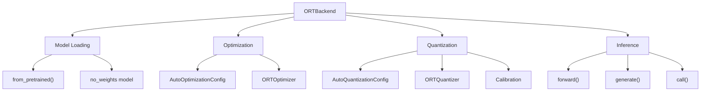
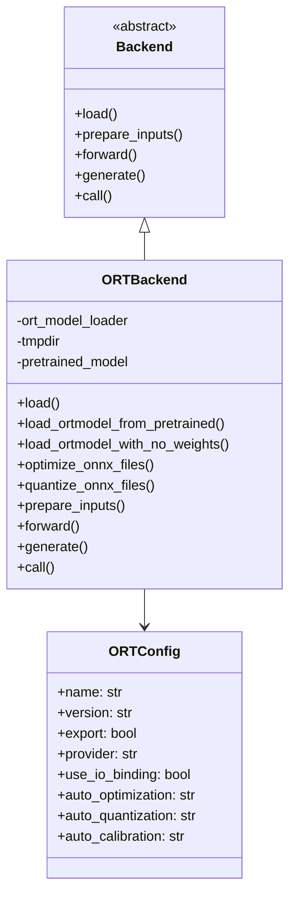
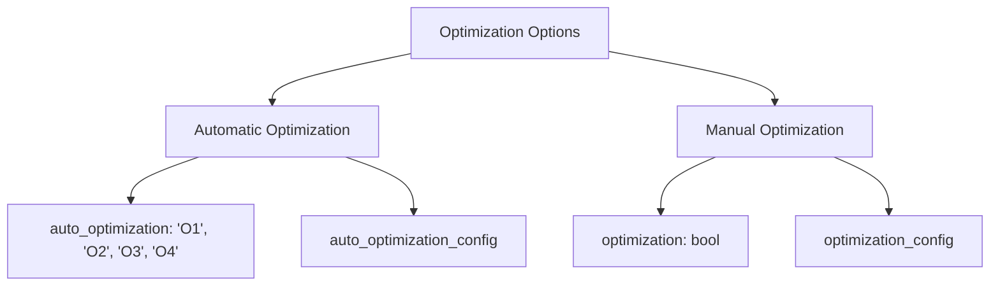
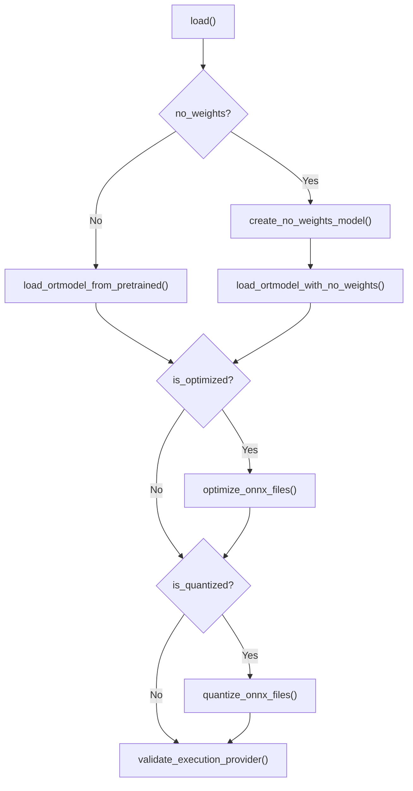
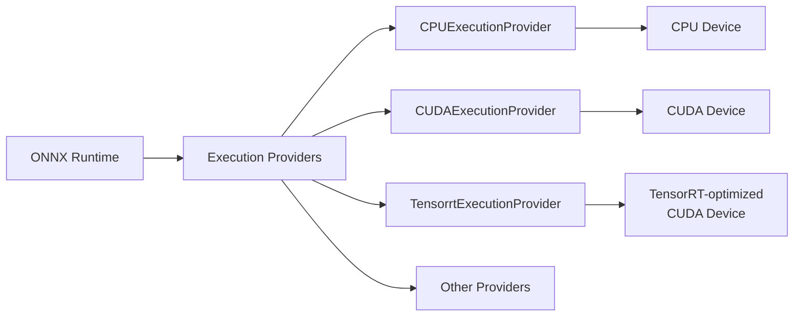

<!-- source: DeepWiki mcp.deepwiki.com · repo huggingface/optimum-benchmark · page 3.2 ONNX Runtime Backend · fetched 2026-10-26 -->

# ONNX Runtime Backend

<details>
<summary>Relevant source files</summary>

The following files were used as context for generating this wiki page:

- [optimum_benchmark/backends/onnxruntime/backend.py](optimum_benchmark/backends/onnxruntime/backend.py)
- [optimum_benchmark/backends/onnxruntime/config.py](optimum_benchmark/backends/onnxruntime/config.py)
- [optimum_benchmark/backends/onnxruntime/utils.py](optimum_benchmark/backends/onnxruntime/utils.py)
- [optimum_benchmark/backends/openvino/backend.py](optimum_benchmark/backends/openvino/backend.py)
- [optimum_benchmark/backends/openvino/config.py](optimum_benchmark/backends/openvino/config.py)
- [optimum_benchmark/backends/openvino/utils.py](optimum_benchmark/backends/openvino/utils.py)
- [optimum_benchmark/backends/pytorch/backend.py](optimum_benchmark/backends/pytorch/backend.py)
- [optimum_benchmark/backends/pytorch/config.py](optimum_benchmark/backends/pytorch/config.py)
- [tests/configs/_diffusers_.yaml](tests/configs/_diffusers_.yaml)

</details>


This document details the ONNX Runtime Backend within the optimum-benchmark framework, which enables performance benchmarking of machine learning models using ONNX Runtime as the inference engine. This backend leverages the optimizations available in ONNX Runtime to provide efficient model execution with options for further performance improvements through optimization and quantization techniques.

For information on the parent Backend abstraction, see [Backends](#3).
For information on other optimized backends like OpenVINO, see [OpenVINO Backend](#3.3).

## Overview

The ONNX Runtime Backend (`ORTBackend`) provides a standardized interface for running benchmarks using ONNX Runtime, Microsoft's high-performance inference engine. This backend handles the conversion of Hugging Face models to ONNX format, optimization of those models, and execution using various execution providers (CPU, CUDA, etc.).



Sources: [optimum_benchmark/backends/onnxruntime/backend.py:43-127](), [optimum_benchmark/backends/onnxruntime/config.py:30-109]()

## Backend Architecture

The ONNX Runtime Backend integrates with the overall benchmark system by implementing the common Backend interface. It provides specialized implementations for model loading, input preparation, and execution that leverage ONNX Runtime's features.



Sources: [optimum_benchmark/backends/onnxruntime/backend.py:43-54](), [optimum_benchmark/backends/onnxruntime/config.py:30-42]()

## Configuration Options

The ONNX Runtime Backend is configured through the `ORTConfig` class, which provides numerous options to control how models are loaded, optimized, and executed.

### Core Configuration

| Option | Type | Description |
|--------|------|-------------|
| `export` | bool | Whether to export the model to ONNX format |
| `provider` | str | The execution provider to use (e.g., "CPUExecutionProvider", "CUDAExecutionProvider") |
| `use_cache` | bool | Whether to use KV cache for text generation |
| `use_merged` | bool | Whether to use a merged model |
| `torch_dtype` | str | The torch data type to use for conversion |
| `use_io_binding` | bool | Whether to use IO binding for faster data transfer |
| `session_options` | dict | Options for the ONNX Runtime session |
| `provider_options` | dict | Provider-specific options |

Sources: [optimum_benchmark/backends/onnxruntime/config.py:38-46](), [optimum_benchmark/backends/onnxruntime/backend.py:134-161]()

### Optimization Options

The backend supports both automatic and manual optimization through ONNX Runtime's optimization capabilities:



Sources: [optimum_benchmark/backends/onnxruntime/config.py:48-62](), [optimum_benchmark/backends/onnxruntime/backend.py:175-204]()

### Quantization and Calibration Options

The backend supports quantization to reduce model size and improve inference speed:

| Quantization Type | Options | Description |
|-------------------|---------|-------------|
| Automatic | `auto_quantization`: "arm64", "avx2", "avx512", "avx512_vnni", "tensorrt" | Predefined quantization strategies |
| Manual | `quantization`: bool, `quantization_config`: dict | Custom quantization configuration |
| Calibration | `auto_calibration`: "minmax", "entropy", "l2norm", "percentiles" | Methods for calibrating quantization |

Sources: [optimum_benchmark/backends/onnxruntime/config.py:52-70](), [optimum_benchmark/backends/onnxruntime/backend.py:205-284]()

## Backend Implementation

### Model Loading Process

The ONNX Runtime Backend has a sophisticated model loading process that supports various scenarios:



Sources: [optimum_benchmark/backends/onnxruntime/backend.py:64-102]()

### Optimization Process

When optimization is enabled, the backend uses `ORTOptimizer` to improve model performance:

1. Create an optimization configuration (automatic or manual)
2. Initialize the optimizer with the model and file names
3. Apply optimization based on the configuration
4. Save the optimized model to a temporary directory

Sources: [optimum_benchmark/backends/onnxruntime/backend.py:175-204]()

### Quantization Process

The quantization process involves several steps:

1. Generate a quantization configuration
2. For static quantization, create a calibration dataset and configuration
3. For each ONNX file in the model:
   - Initialize an `ORTQuantizer`
   - For static quantization, fit the calibration tensors range
   - Apply quantization with the configuration
4. Save the quantized model to a temporary directory

Sources: [optimum_benchmark/backends/onnxruntime/backend.py:205-284]()

## Task and Model Support

The ONNX Runtime Backend supports various tasks through specialized model classes from the Optimum library:

### Supported Tasks and Models

The backend uses a mapping from task types to appropriate ONNX Runtime model classes:

```python
TASKS_TO_ORTMODELS = {
    "fill-mask": "optimum.onnxruntime.ORTModelForMaskedLM",
    "text-generation": "optimum.onnxruntime.ORTModelForCausalLM",
    "text2text-generation": "optimum.onnxruntime.ORTModelForSeq2SeqLM",
    # and many more
}

TASKS_TO_ORTPIPELINES = {
    "inpainting": "optimum.onnxruntime.ORTPipelineForInpainting",
    "text-to-image": "optimum.onnxruntime.ORTPipelineForText2Image",
    "image-to-image": "optimum.onnxruntime.ORTPipelineForImage2Image",
}
```

Sources: [optimum_benchmark/backends/onnxruntime/utils.py:6-14]()

## Inference Methods

The backend provides several methods for running inference:

| Method | Description |
|--------|-------------|
| `forward()` | Executes the model's forward pass |
| `prefill()` | Executes the model's generate method for token prefill |
| `generate()` | Executes the model's generate method for text generation |
| `call()` | Executes the model directly using the `__call__` method |

All these methods run within a PyTorch inference mode context to ensure no gradient computation.

Sources: [optimum_benchmark/backends/onnxruntime/backend.py:304-318]()

## Input Preparation

The backend prepares inputs for inference through the `prepare_inputs` method:

1. If distributed training is active, the inputs are split between processes
2. Tensors are moved to the appropriate device
3. Input keys not required by the model are removed

Sources: [optimum_benchmark/backends/onnxruntime/backend.py:289-302]()

## Execution Providers

ONNX Runtime supports multiple execution providers for running models on different hardware:



The ORTBackend maps devices to appropriate execution providers:

```python
DEVICE_PROVIDER_MAP = {
    "cpu": "CPUExecutionProvider",
    "cuda": "CUDAExecutionProvider"
}
```

Sources: [optimum_benchmark/backends/onnxruntime/config.py:26-26](), [optimum_benchmark/backends/onnxruntime/config.py:81-82]()

## Key Implementation Details

### IO Binding

The backend can use IO binding to optimize data transfer between CPU and GPU:

```python
IO_BINDING_LIBRARIES = ["transformers", "timm"]
IO_BINDING_PROVIDERS = ["CPUExecutionProvider", "CUDAExecutionProvider"]
```

IO binding is automatically enabled when using a supported provider and library, but can be manually controlled through the `use_io_binding` configuration option.

Sources: [optimum_benchmark/backends/onnxruntime/config.py:24-25](), [optimum_benchmark/backends/onnxruntime/config.py:84-85]()

### Configuration Validation

The `ORTConfig` class performs various validations to ensure the configuration is valid:

- Checks that the device is supported (CPU or CUDA)
- Ensures consistent configuration between static quantization and calibration
- Sets default provider based on the selected device

Sources: [optimum_benchmark/backends/onnxruntime/config.py:72-109]()

## Conclusion

The ONNX Runtime Backend provides a powerful way to benchmark models using Microsoft's ONNX Runtime inference engine. It supports various optimization techniques including graph optimization and quantization, making it suitable for performance-critical scenarios. The backend's modular design allows it to be extended with new features and optimizations as they become available in ONNX Runtime.

---

