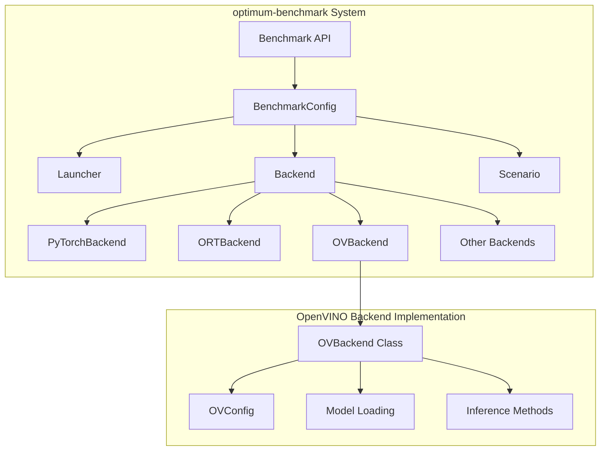
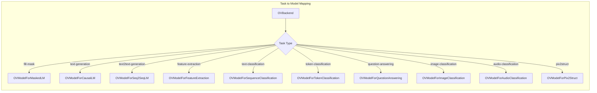
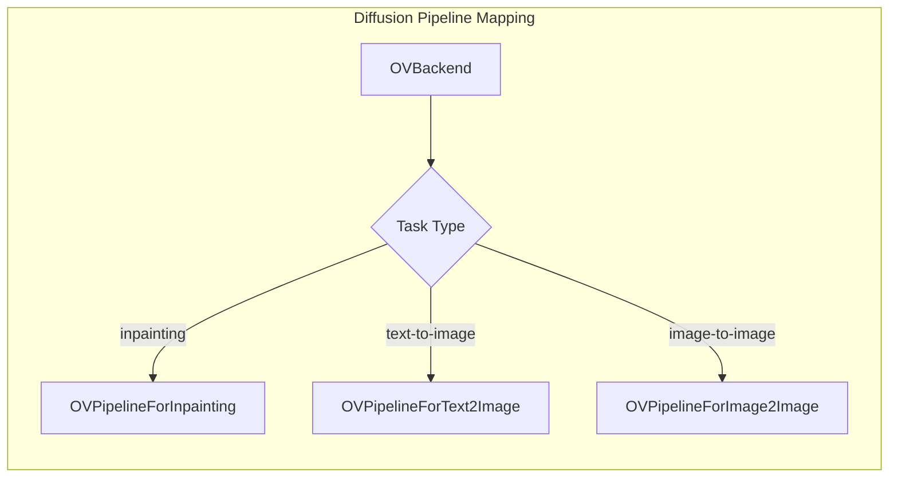
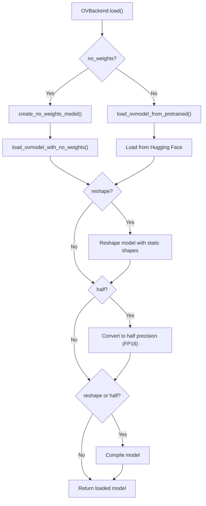
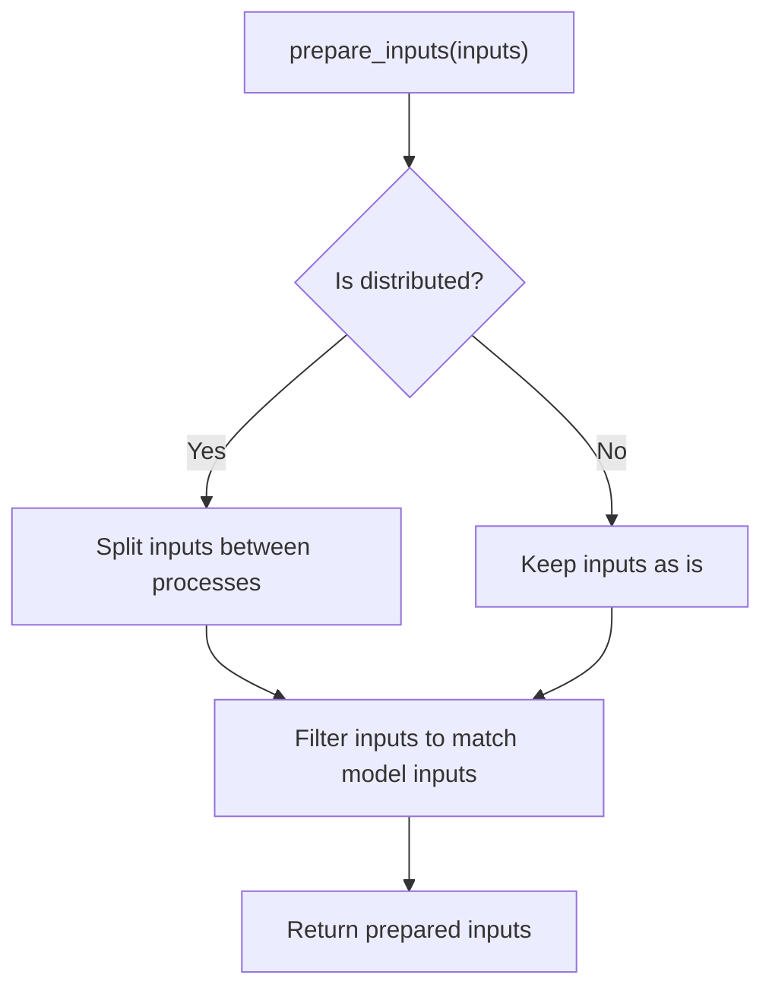
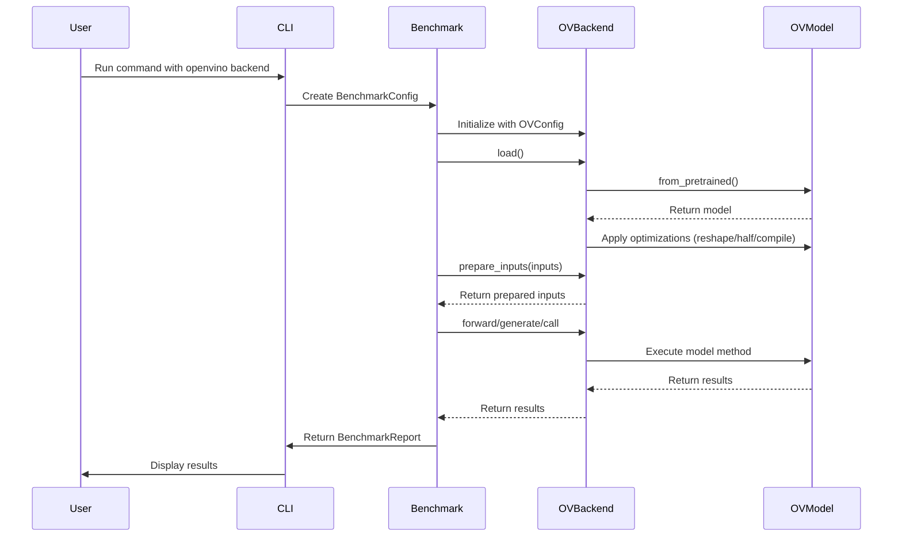

<!-- source: DeepWiki mcp.deepwiki.com · repo huggingface/optimum-benchmark · page 3.3 OpenVINO Backend · fetched 2026-10-26 -->

# OpenVINO Backend

<details>
<summary>Relevant source files</summary>

The following files were used as context for generating this wiki page:

- [optimum_benchmark/backends/onnxruntime/backend.py](optimum_benchmark/backends/onnxruntime/backend.py)
- [optimum_benchmark/backends/onnxruntime/config.py](optimum_benchmark/backends/onnxruntime/config.py)
- [optimum_benchmark/backends/onnxruntime/utils.py](optimum_benchmark/backends/onnxruntime/utils.py)
- [optimum_benchmark/backends/openvino/backend.py](optimum_benchmark/backends/openvino/backend.py)
- [optimum_benchmark/backends/openvino/config.py](optimum_benchmark/backends/openvino/config.py)
- [optimum_benchmark/backends/openvino/utils.py](optimum_benchmark/backends/openvino/utils.py)
- [optimum_benchmark/backends/pytorch/backend.py](optimum_benchmark/backends/pytorch/backend.py)
- [optimum_benchmark/backends/pytorch/config.py](optimum_benchmark/backends/pytorch/config.py)
- [tests/configs/_diffusers_.yaml](tests/configs/_diffusers_.yaml)

</details>


This document provides technical documentation for the OpenVINO Backend implementation in the optimum-benchmark framework. It covers the architecture, configuration options, and capabilities of the OpenVINO backend for running benchmarks on Intel hardware.

For information about other backends, see [Backends](#3) and for specific information about the ONNX Runtime backend, which has some similarities, see [ONNX Runtime Backend](#3.2).

## Overview

The OpenVINO Backend enables optimum-benchmark to execute models using Intel's OpenVINO framework, which is optimized for Intel CPUs and GPUs. It provides a standard interface that integrates with the benchmarking system while leveraging OpenVINO-specific optimizations for improved performance on Intel hardware.



Sources: [optimum_benchmark/backends/openvino/backend.py:21-49](), [optimum_benchmark/backends/openvino/config.py:8-12]()

## Architecture

The OpenVINO Backend follows the same interface contract as other backends in the system. It extends the abstract `Backend` base class and implements methods for loading models and performing inference.

```mermaid
classDiagram
    class "Backend~T~" {
        <<abstract>>
        +load()
        +prepare_inputs()
        +forward()
        +generate()
        +call()
    }

    class "OVBackend" {
        -ovmodel_class
        -pretrained_model
        -tmpdir
        +load()
        +load_ovmodel_from_pretrained()
        +load_ovmodel_with_no_weights()
        +prepare_inputs()
        +forward()
        +generate()
        +prefill()
        +call()
    }

    class "OVConfig" {
        +name: str = "openvino"
        +version: Optional[str]
        +no_weights: bool
        +export: Optional[bool]
        +use_cache: Optional[bool]
        +use_merged: Optional[bool]
        +load_in_8bit: Optional[bool]
        +load_in_4bit: Optional[bool]
        +ov_config: Dict[str, Any]
        +half: bool
        +compile: bool
        +reshape: bool
        +reshape_kwargs: Dict[str, int]
    }

    "Backend~T~" <|-- "OVBackend"
    "OVBackend" --> "OVConfig"
```

Sources: [optimum_benchmark/backends/openvino/backend.py:21-27](), [optimum_benchmark/backends/openvino/config.py:8-29]()

## Configuration Options

The OpenVINO Backend is configured via the `OVConfig` class, which extends the `BackendConfig` base class. It provides multiple options for controlling how models are loaded, optimized, and executed.

| Option | Type | Default | Description |
|--------|------|---------|-------------|
| `name` | str | "openvino" | Name identifier for the backend |
| `no_weights` | bool | False | Whether to load models without pretrained weights |
| `export` | Optional[bool] | None | Whether to export the model to OpenVINO IR format |
| `use_cache` | Optional[bool] | None | Whether to use KV-cache for text generation models |
| `use_merged` | Optional[bool] | None | Whether to use a merged model instead of separate components |
| `load_in_8bit` | Optional[bool] | None | Whether to load the model in 8-bit quantized format |
| `load_in_4bit` | Optional[bool] | None | Whether to load the model in 4-bit quantized format |
| `ov_config` | Dict[str, Any] | {} | OpenVINO-specific configuration options |
| `half` | bool | False | Whether to convert model to half precision (FP16) |
| `compile` | bool | False | Whether to compile the model after loading |
| `reshape` | bool | False | Whether to reshape the model with static shapes |
| `reshape_kwargs` | Dict[str, int] | {} | Parameters for reshaping (e.g., sequence_length) |

Sources: [optimum_benchmark/backends/openvino/config.py:8-29]()

## Supported Model Types

The OpenVINO Backend supports a range of model types from Hugging Face, including both transformer models and diffusion models. It automatically selects the appropriate OpenVINO model class based on the task specified in the configuration.

### Transformer Models



### Diffusion Pipeline Models



Sources: [optimum_benchmark/backends/openvino/utils.py:1-17](), [optimum_benchmark/backends/openvino/backend.py:27-34]()

## Model Loading Process

The OpenVINO Backend handles model loading through a multi-step process that includes optional optimizations:



Sources: [optimum_benchmark/backends/openvino/backend.py:36-61]()

## Inference Methods

The OpenVINO Backend implements several inference methods that conform to the common backend interface:

| Method | Description |
|--------|-------------|
| `forward` | Standard model forward pass |
| `generate` | Text generation for language models |
| `prefill` | Initial token generation for LLMs |
| `call` | Generic model invocation (similar to model.__call__) |

These methods use the underlying OpenVINO model's corresponding methods and handle input preparation.

Sources: [optimum_benchmark/backends/openvino/backend.py:117-127]()

## Input Preparation

The `prepare_inputs` method handles preprocessing of inputs before they are passed to the model:



This ensures that inputs are properly distributed in multi-GPU scenarios and that only the inputs expected by the model are passed to it.

Sources: [optimum_benchmark/backends/openvino/backend.py:102-115]()

## Device Support

The OpenVINO Backend supports both CPU and GPU (Intel iGPU/dGPU) devices. The device is specified in the configuration and validated during initialization.

```python
# Example configuration validation
if self.device not in ["cpu", "gpu"]:
    raise ValueError(f"OVBackend only supports CPU devices, got {self.device}")
```

Note that the OpenVINO Backend uses a different device naming convention than some other backends:
- `cpu` - Intel CPU execution
- `gpu` - Intel integrated or discrete GPU execution

Sources: [optimum_benchmark/backends/openvino/config.py:33-35]()

## Optimization Features

The OpenVINO Backend supports several performance optimization techniques:

1. **Model Quantization**: Load models in 8-bit or 4-bit precision
2. **Half Precision**: Convert models to FP16 precision 
3. **Static Shapes**: Reshape models with static input dimensions for better performance
4. **Compilation**: Compile models for optimized execution
5. **OpenVINO-specific Config**: Pass custom configuration options directly to OpenVINO

These optimizations can be enabled via the corresponding configuration options.

Sources: [optimum_benchmark/backends/openvino/config.py:18-28](), [optimum_benchmark/backends/openvino/backend.py:49-59]()

## Usage with Benchmark System

The OpenVINO Backend integrates with the overall benchmark system, allowing it to be used alongside other backends for performance comparisons.



Sources: [optimum_benchmark/backends/openvino/backend.py:21-127]()

## Limitations

The OpenVINO Backend has some specific limitations:

1. **Device Support**: Only supports Intel CPUs and GPUs (not NVIDIA or AMD)
2. **Thread Control**: Does not directly support `intra_op_num_threads` and `inter_op_num_threads` parameters (must use `ov_config` instead)
3. **Task Support**: Supports a specific set of tasks defined in the task mapping dictionaries

These limitations should be considered when selecting a backend for benchmarking.

Sources: [optimum_benchmark/backends/openvino/config.py:37-41]()

## Comparison with Other Backends

The OpenVINO Backend shares similarities with the ONNX Runtime Backend, as both work with optimized runtime environments and provide similar interfaces. The main differences are:

| Feature | OpenVINO Backend | ONNX Runtime Backend |
|---------|-----------------|---------------------|
| Target Hardware | Intel CPUs and GPUs | CPUs and NVIDIA GPUs |
| Quantization | 4-bit and 8-bit options | Various quantization schemes |
| Optimization | FP16, static shapes, compilation | Optimization levels, graph optimizations |
| Runtime | OpenVINO runtime | ONNX Runtime |

Understanding these differences can help in selecting the appropriate backend for specific benchmarking needs.

Sources: [optimum_benchmark/backends/openvino/config.py:8-42](), [optimum_benchmark/backends/onnxruntime/config.py:29-105]()

---

