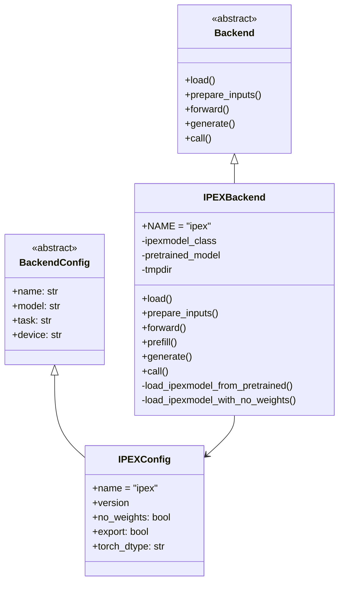
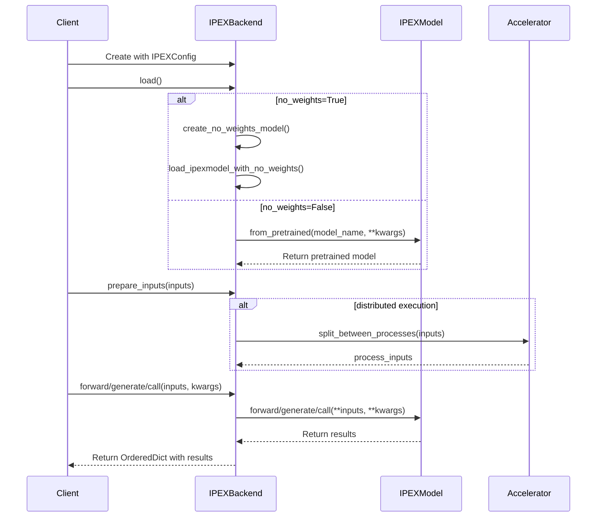
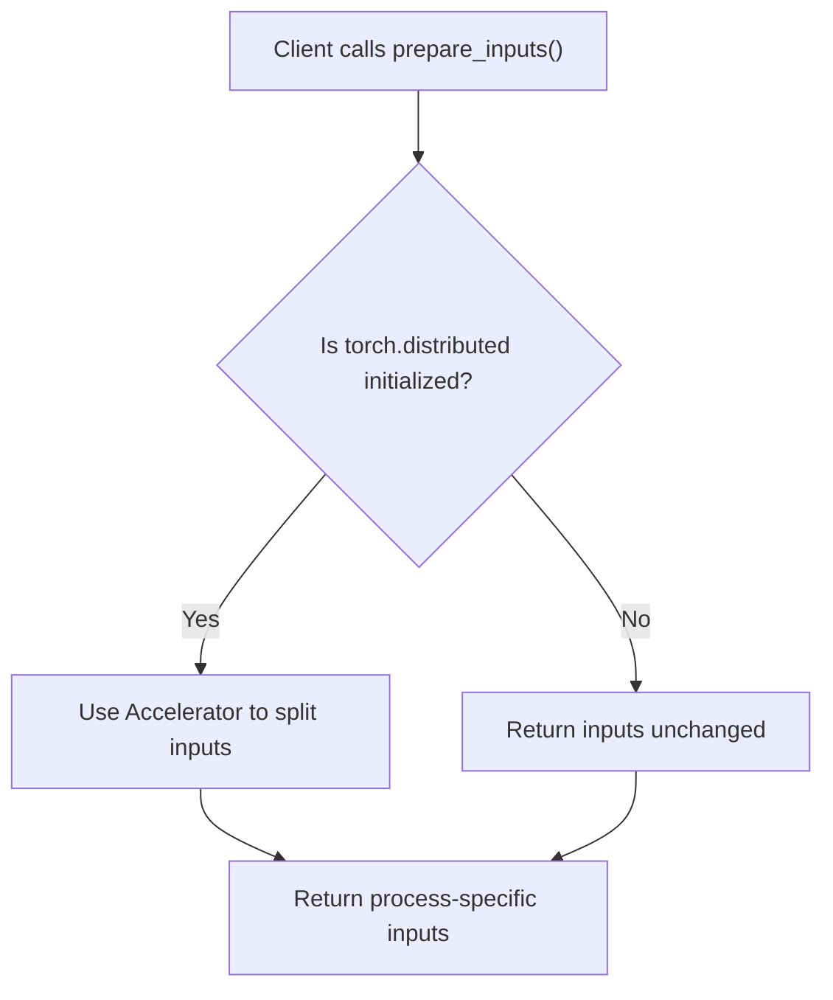
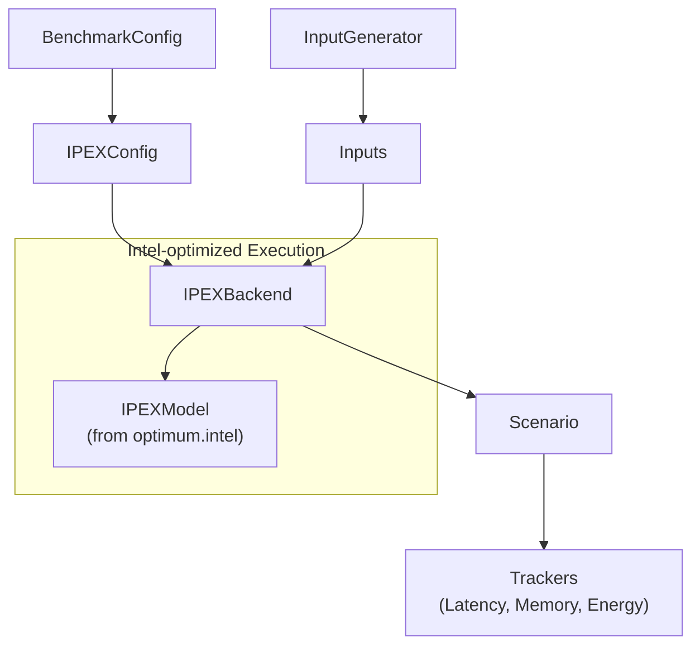

<!-- source: DeepWiki mcp.deepwiki.com · repo huggingface/optimum-benchmark · page 3.4 IPEX Backend · fetched 2026-10-26 -->

# IPEX Backend

<details>
<summary>Relevant source files</summary>

The following files were used as context for generating this wiki page:

- [optimum_benchmark/backends/ipex/__init__.py](optimum_benchmark/backends/ipex/__init__.py)
- [optimum_benchmark/backends/ipex/backend.py](optimum_benchmark/backends/ipex/backend.py)
- [optimum_benchmark/backends/ipex/config.py](optimum_benchmark/backends/ipex/config.py)
- [optimum_benchmark/backends/ipex/utils.py](optimum_benchmark/backends/ipex/utils.py)

</details>


This page documents the Intel Extension for PyTorch (IPEX) Backend in the optimum-benchmark framework. The IPEX Backend enables benchmarking of models using Intel-specific optimizations that enhance performance on Intel hardware. This page focuses specifically on the implementation details and configuration options for the IPEX Backend. For information about other backends, please refer to the [Backends](#3) main page.

## Overview

The Intel Extension for PyTorch (IPEX) is a library that extends PyTorch with optimizations for Intel CPUs and GPUs. The IPEX Backend in optimum-benchmark leverages these optimizations to enable efficient benchmarking of models on Intel hardware. It provides integration with the `optimum.intel` library to support various machine learning tasks.



Sources: [optimum_benchmark/backends/ipex/backend.py:21-96](), [optimum_benchmark/backends/ipex/config.py:10-37]()

## Implementation Details

The `IPEXBackend` class inherits from the abstract `Backend` class and implements its methods to support Intel-optimized model execution. The implementation includes:

1. Model loading mechanism for both pretrained and no-weights scenarios
2. Support for distributed inference using Accelerator
3. Implementation of core model execution methods (forward, generate, call)



Sources: [optimum_benchmark/backends/ipex/backend.py:33-96]()

### Key Methods

The `IPEXBackend` implements several key methods:

1. `load()`: Initializes the model based on configuration
2. `prepare_inputs()`: Prepares inputs, handling distributed scenarios if needed
3. `forward()`: Executes the model's forward pass
4. `generate()`: Executes text generation
5. `prefill()`: Similar to generate but potentially optimized differently
6. `call()`: General method for model execution

The backend dynamically determines the appropriate `IPEXModel` class based on the task specified in the configuration.

Sources: [optimum_benchmark/backends/ipex/backend.py:33-96]()

## Configuration

The `IPEXConfig` class extends the abstract `BackendConfig` class and provides IPEX-specific configuration options:

| Parameter | Type | Description |
|-----------|------|-------------|
| `name` | str | Backend name, fixed as "ipex" |
| `version` | str | IPEX version being used |
| `no_weights` | bool | Whether to create a model without pretrained weights |
| `export` | bool | Whether to export the model during initialization |
| `torch_dtype` | str | PyTorch data type (bfloat16, float16, float32, auto) |

The configuration enforces that:
- The device must be either "cpu" or "gpu"
- The torch_dtype, if specified, must be one of the supported types

```python
# Example IPEXConfig
config = IPEXConfig(
    model="distilbert-base-uncased",
    task="text-classification",
    device="cpu",
    torch_dtype="bfloat16",
    export=True
)
```

Sources: [optimum_benchmark/backends/ipex/config.py:10-37]()

## Supported Tasks

The IPEX Backend supports a variety of tasks through specialized model classes from the `optimum.intel` library:

| Task | Model Class |
|------|-------------|
| fill-mask | IPEXModelForMaskedLM |
| text-generation | IPEXModelForCausalLM |
| feature-extraction | IPEXModel |
| text-classification | IPEXModelForSequenceClassification |
| token-classification | IPEXModelForTokenClassification |
| question-answering | IPEXModelForQuestionAnswering |
| image-classification | IPEXModelForImageClassification |
| audio-classification | IPEXModelForAudioClassification |

The backend uses these task-to-model mappings to dynamically load the appropriate model class during initialization.

Sources: [optimum_benchmark/backends/ipex/utils.py:1-10]()

## Device Support

The IPEX Backend is designed specifically for Intel hardware:

- **CPU**: Optimized for Intel CPUs, leveraging IPEX's CPU-specific optimizations
- **GPU**: Also supports Intel GPUs

The backend automatically validates that the device specified in the configuration is appropriate for IPEX.

Sources: [optimum_benchmark/backends/ipex/config.py:26-28]()

## Distributed Execution

The IPEX Backend supports distributed execution when PyTorch distributed is initialized. When operating in a distributed setting, the `prepare_inputs` method uses the Accelerator from the Hugging Face Accelerate library to split inputs between processes:



Sources: [optimum_benchmark/backends/ipex/backend.py:76-84]()

## Data Type Support

The IPEX Backend supports various numerical precision options through the `torch_dtype` configuration parameter:

- `bfloat16`: BFloat16 precision (good for Intel CPUs with native BF16 support)
- `float16`: Half precision (FP16)
- `float32`: Full precision (FP32)
- `auto`: Automatically determine the appropriate precision

The chosen data type affects both performance and accuracy, with lower precision typically offering better performance at the cost of reduced numerical precision.

Sources: [optimum_benchmark/backends/ipex/config.py:7-7](), [optimum_benchmark/backends/ipex/backend.py:70-71]()

## Usage in the Benchmarking Framework

To use the IPEX Backend in the benchmarking framework, you need to specify it in your benchmark configuration:

```yaml
backend:
  _target_: optimum_benchmark.backends.ipex.backend.IPEXBackend
  name: ipex
  model: distilbert-base-uncased
  task: text-classification
  device: cpu
  torch_dtype: bfloat16
  export: true
```

The benchmark system will then use this configuration to instantiate the IPEX Backend and execute the benchmarking scenario using Intel-optimized model execution.

Sources: [optimum_benchmark/backends/ipex/config.py:14-14]()

## Limitations and Considerations

When using the IPEX Backend, consider the following:

1. It is specifically designed for Intel hardware (CPUs and GPUs)
2. Not all tasks are supported - the backend raises a `NotImplementedError` for unsupported tasks
3. The `torch_dtype` parameter cannot be specified in both `model_kwargs` and the main configuration
4. Temporary directories are created and cleaned up during model loading

Sources: [optimum_benchmark/backends/ipex/backend.py:27-31](), [optimum_benchmark/backends/ipex/config.py:30-34]()

## Relationship with Other Components

The IPEX Backend interacts with several other components in the optimum-benchmark system:



Sources: [optimum_benchmark/backends/ipex/backend.py:76-96]()

The IPEX Backend leverages the common benchmarking infrastructure while providing Intel-specific optimizations through the IPEX library. It seamlessly integrates with various benchmarking scenarios to provide performance metrics for models running on Intel hardware.

---

