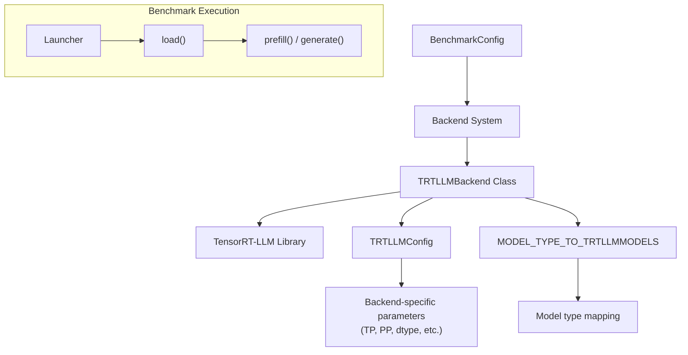
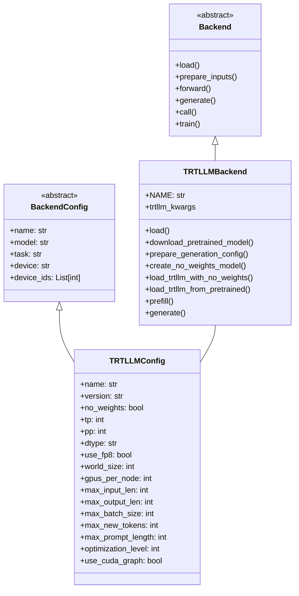
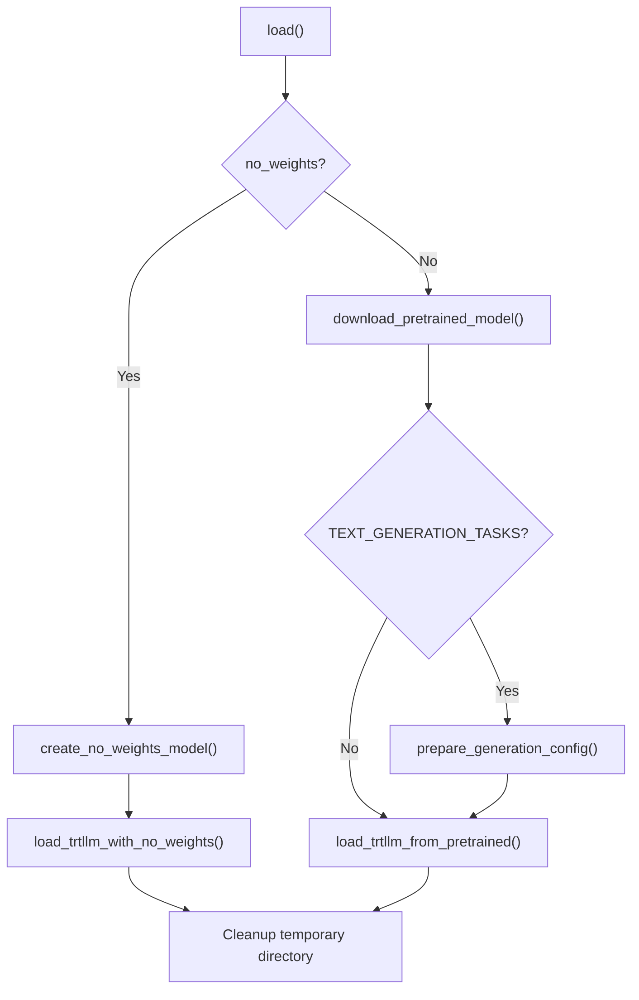
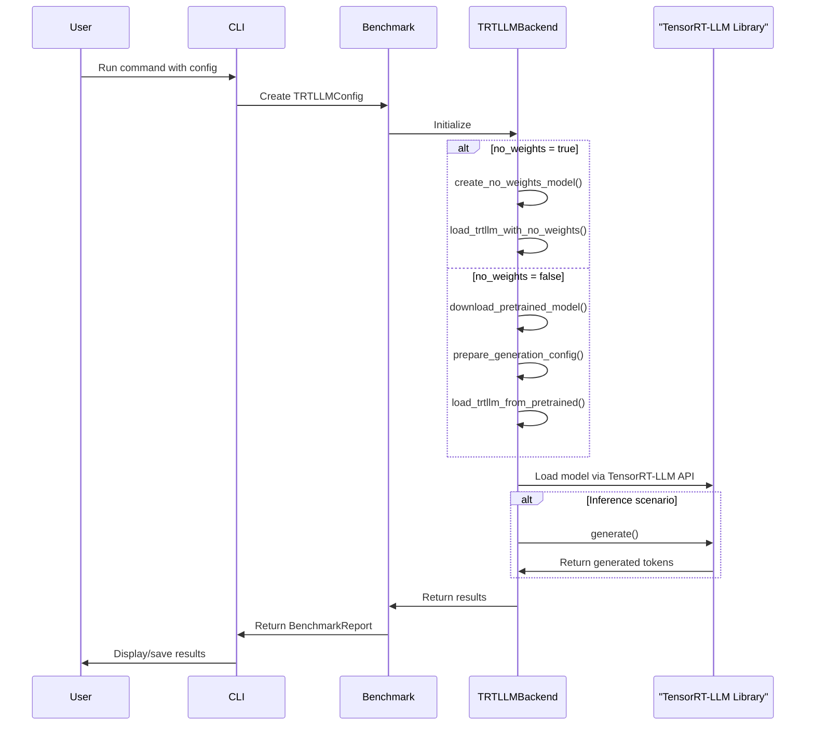

<!-- source: DeepWiki mcp.deepwiki.com · repo huggingface/optimum-benchmark · page 3.5 TensorRT-LLM Backend · fetched 2026-10-26 -->

# TensorRT-LLM Backend

<details>
<summary>Relevant source files</summary>

The following files were used as context for generating this wiki page:

- [examples/cpu_ipex_bert.yaml](examples/cpu_ipex_bert.yaml)
- [examples/cpu_ipex_llama.yaml](examples/cpu_ipex_llama.yaml)
- [examples/cpu_openvino_8bit_bert.yaml](examples/cpu_openvino_8bit_bert.yaml)
- [examples/cpu_openvino_diffusion.yaml](examples/cpu_openvino_diffusion.yaml)
- [examples/cuda_tgi_llama.yaml](examples/cuda_tgi_llama.yaml)
- [examples/cuda_trt_llama.yaml](examples/cuda_trt_llama.yaml)
- [examples/cuda_vllm_llama.yaml](examples/cuda_vllm_llama.yaml)
- [examples/mps_pytorch_bert.yaml](examples/mps_pytorch_bert.yaml)
- [optimum_benchmark/backends/tensorrt_llm/backend.py](optimum_benchmark/backends/tensorrt_llm/backend.py)
- [optimum_benchmark/backends/tensorrt_llm/config.py](optimum_benchmark/backends/tensorrt_llm/config.py)
- [optimum_benchmark/backends/tensorrt_llm/utils.py](optimum_benchmark/backends/tensorrt_llm/utils.py)

</details>


## Purpose and Scope

This document details the TensorRT-LLM backend implementation in the optimum-benchmark framework. The TensorRT-LLM backend enables benchmarking of large language models (LLMs) using NVIDIA's TensorRT-LLM optimization library, which provides high-performance, GPU-accelerated inference for transformer-based models. This backend is specifically designed for CUDA devices and offers tensor parallelism and pipeline parallelism capabilities for distributing model execution across multiple GPUs.

For information about other backends for LLM acceleration, see [VLLM and PyTXI Backends](#3.6).

## Architecture Overview

The TensorRT-LLM backend integrates with the overall benchmarking system as follows:



Sources: [optimum_benchmark/backends/tensorrt_llm/backend.py:18-169](), [optimum_benchmark/backends/tensorrt_llm/config.py:10-51](), [optimum_benchmark/backends/tensorrt_llm/utils.py:1-2]()

## Backend Components

The TensorRT-LLM backend consists of the following key components:



Sources: [optimum_benchmark/backends/tensorrt_llm/backend.py:18-169](), [optimum_benchmark/backends/tensorrt_llm/config.py:10-51]()

## Configuration Options

The `TRTLLMConfig` class provides numerous configuration options specific to TensorRT-LLM:

| Parameter | Type | Description |
|-----------|------|-------------|
| `no_weights` | bool | If True, creates a model without actual weights for benchmarking |
| `tp` | int | Tensor parallelism degree |
| `pp` | int | Pipeline parallelism degree |
| `dtype` | str | Data type for model execution (float16, bfloat16, float32) |
| `use_fp8` | bool | Whether to use FP8 precision |
| `world_size` | int | Total number of GPUs |
| `gpus_per_node` | int | Number of GPUs per node |
| `max_input_len` | int | Maximum input sequence length |
| `max_output_len` | int | Maximum output sequence length |
| `max_batch_size` | int | Maximum batch size |
| `max_new_tokens` | int | Maximum number of new tokens to generate |
| `max_prompt_length` | int | Maximum prompt length |
| `optimization_level` | int | TensorRT optimization level |
| `use_cuda_graph` | bool | Whether to use CUDA graphs for optimization |

Sources: [optimum_benchmark/backends/tensorrt_llm/config.py:10-51](), [optimum_benchmark/backends/tensorrt_llm/backend.py:107-150]()

## Implementation Details

### Model Loading Process

The TensorRT-LLM backend follows a specific flow for loading models:



Sources: [optimum_benchmark/backends/tensorrt_llm/backend.py:30-49]()

### No-Weights Model Creation

For benchmarking purposes, the backend supports creating a "no weights" model, which follows these steps:

1. Create a temporary directory
2. Create a minimal state dictionary
3. Save it as a safetensors file
4. Save the pretrained configuration and processor
5. Load a model with fast weights initialization
6. Save the model to the temporary directory
7. Configure generation parameters if applicable

Sources: [optimum_benchmark/backends/tensorrt_llm/backend.py:65-94]()

### Model Type Support

Currently, the TensorRT-LLM backend only supports certain model architectures:

```python
MODEL_TYPE_TO_TRTLLMMODELS = {"llama": "optimum.nvidia.models.llama.LlamaForCausalLM"}
```

Sources: [optimum_benchmark/backends/tensorrt_llm/utils.py:1-2]()

### Text Generation Implementation

The backend implements two key methods for text generation:

1. `prefill()`: Processes the initial input tokens
2. `generate()`: Generates new tokens based on the input

Both methods delegate to the TensorRT-LLM model's `generate()` method with appropriate parameters.

Sources: [optimum_benchmark/backends/tensorrt_llm/backend.py:152-168]()

## Required Environment

The TensorRT-LLM backend has specific requirements:

1. It only works on CUDA devices
2. It requires the TensorRT-LLM library to be installed
3. It supports specific data types: float16, bfloat16, and float32
4. For distributed execution, world_size must equal pp × tp (pipeline parallelism × tensor parallelism)

Sources: [optimum_benchmark/backends/tensorrt_llm/config.py:33-51]()

## Example Configuration

Here's an example configuration for benchmarking a LLaMA model with TensorRT-LLM:

```yaml
defaults:
  - benchmark
  - backend: tensorrt-llm
  - scenario: inference
  - launcher: process
  - _base_
  - _self_

name: cuda_trt_llama

launcher:
  device_isolation: true
  device_isolation_action: warn

backend:
  device: cuda
  device_ids: 0
  no_weights: true
  max_batch_size: 4
  max_new_tokens: 32
  max_prompt_length: 64
  model: TinyLlama/TinyLlama-1.1B-Chat-v1.0

scenario:
  input_shapes:
    batch_size: 1
    sequence_length: 64

  generate_kwargs:
    max_new_tokens: 32
    min_new_tokens: 32
```

Sources: [examples/cuda_trt_llama.yaml:1-32]()

## Benchmarking Workflow

The typical workflow when using the TensorRT-LLM backend for benchmarking involves:



Sources: [optimum_benchmark/backends/tensorrt_llm/backend.py:30-49](), [optimum_benchmark/backends/tensorrt_llm/backend.py:152-168]()

## Limitations and Considerations

When using the TensorRT-LLM backend, consider the following:

1. Only supports LLaMA architecture models currently
2. Requires CUDA devices; not compatible with CPU or other device types
3. For proper operation of tensor and pipeline parallelism, world_size must equal pp × tp
4. When using tensor or pipeline parallelism, the gpus_per_node should equal world_size
5. The backend creates temporary directories during model loading which are cleaned up afterward

Sources: [optimum_benchmark/backends/tensorrt_llm/config.py:33-51](), [optimum_benchmark/backends/tensorrt_llm/backend.py:30-49](), [optimum_benchmark/backends/tensorrt_llm/utils.py:1-2]()

---

