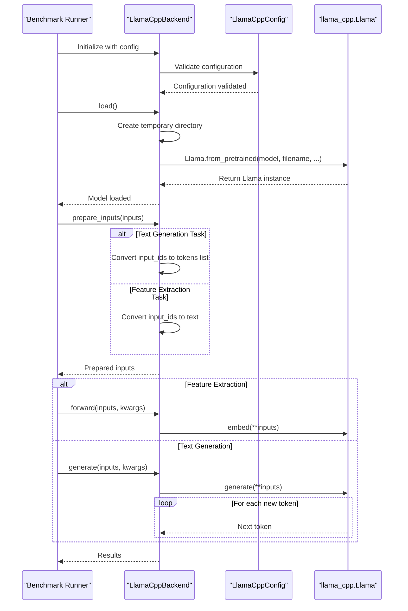
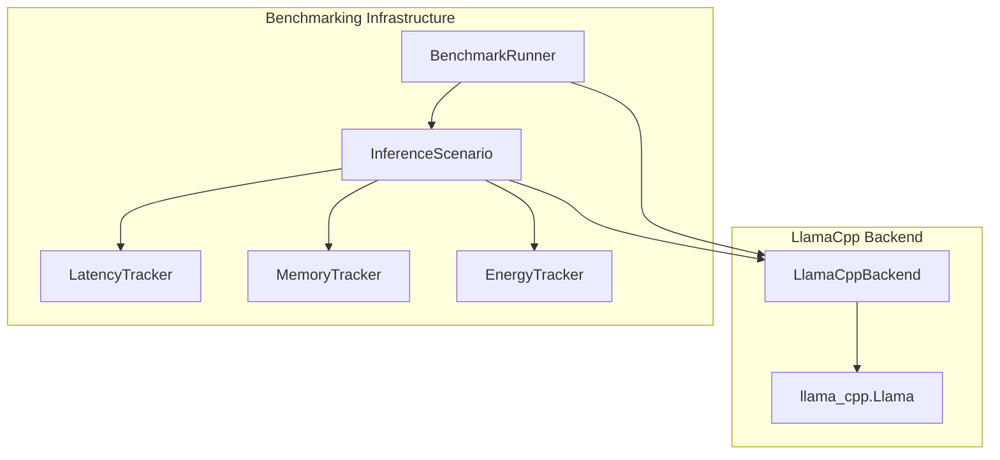

<!-- source: DeepWiki mcp.deepwiki.com · repo huggingface/optimum-benchmark · page 3.7 LlamaCpp Backend · fetched 2026-10-26 -->

# LlamaCpp Backend

<details>
<summary>Relevant source files</summary>

The following files were used as context for generating this wiki page:

- [optimum_benchmark/backends/diffusers_utils.py](optimum_benchmark/backends/diffusers_utils.py)
- [optimum_benchmark/backends/llama_cpp/backend.py](optimum_benchmark/backends/llama_cpp/backend.py)
- [optimum_benchmark/backends/llama_cpp/config.py](optimum_benchmark/backends/llama_cpp/config.py)
- [optimum_benchmark/trackers/__init__.py](optimum_benchmark/trackers/__init__.py)
- [tests/configs/_gguf_.yaml](tests/configs/_gguf_.yaml)

</details>


## Introduction

The LlamaCpp Backend is a component of the Optimum-Benchmark system that enables benchmarking of GGUF (GPT-Generated Unified Format) models using the llama-cpp-python library. This backend is specifically designed for running inference benchmarks on quantized Large Language Models (LLMs) in GGUF format, providing an efficient way to evaluate the performance of these models in resource-constrained environments.

This document covers the implementation, configuration, and usage of the LlamaCpp Backend within the Optimum-Benchmark framework. For information about other backends like PyTorch or VLLM, see their respective documentation pages ([PyTorch Backend](#3.1) and [VLLM and PyTXI Backends](#3.6)).

Sources: [optimum_benchmark/backends/llama_cpp/backend.py:1-66](), [optimum_benchmark/backends/llama_cpp/config.py:1-30]()

## Architecture Overview

The LlamaCpp Backend follows the standard backend architecture of the Optimum-Benchmark system, implementing the required interface methods while providing specialized functionality for working with GGUF models.

```mermaid
classDiagram
    class Backend {
        <<abstract>>
        +load()
        +prepare_inputs()
        +forward()
        +generate()
    }
    
    class BackendConfig {
        <<abstract>>
        +name: str
        +model: str
        +task: str
        +device: str
    }
    
    class LlamaCppBackend {
        +NAME: str = "llama_cpp"
        +pretrained_model: Llama
        +load()
        +load_model_from_pretrained()
        +llama_cpp_kwargs
        +prepare_inputs()
        +forward()
        +prefill()
        +generate()
    }
    
    class LlamaCppConfig {
        +name: str = "llama_cpp"
        +version: str
        +no_weights: bool
        +filename: str
    }
    
    Backend <|-- LlamaCppBackend
    BackendConfig <|-- LlamaCppConfig
    LlamaCppBackend --> LlamaCppConfig
    LlamaCppBackend --> "llama_cpp.Llama"
```

Sources: [optimum_benchmark/backends/llama_cpp/backend.py:10-15](), [optimum_benchmark/backends/llama_cpp/config.py:8-29]()

## Key Components

### LlamaCppBackend Class

The `LlamaCppBackend` class implements the core functionality for loading and running GGUF models:

- Inherits from the abstract `Backend` class
- Uses the `Llama` class from llama-cpp-python to load and run models
- Supports text generation and feature extraction tasks
- Provides methods for model loading, input preparation, and inference

The backend uses a temporary directory during model loading and manages the lifecycle of the GGUF model objects.

Sources: [optimum_benchmark/backends/llama_cpp/backend.py:10-66]()

### LlamaCppConfig Class

The `LlamaCppConfig` class defines the configuration parameters specific to the LlamaCpp backend:

- Inherits from the abstract `BackendConfig` class
- Specifies the default backend name as "llama_cpp"
- Includes configuration options like `filename` for specifying the GGUF file
- Validates that only supported tasks ("feature-extraction" and "text-generation") are used

Sources: [optimum_benchmark/backends/llama_cpp/config.py:8-29]()

## Workflow

The LlamaCpp Backend follows a specific workflow for loading and running models:



Sources: [optimum_benchmark/backends/llama_cpp/backend.py:18-65]()

## Supported Tasks and Features

The LlamaCpp Backend currently supports two main tasks:

1. **Text Generation** (`text-generation`): Generates text from a given prompt using the loaded GGUF model
2. **Feature Extraction** (`feature-extraction`): Extracts embeddings from input text using the model

The backend has specific limitations and requirements:

- Only supports batch size 1 for text generation
- Requires a valid GGUF file, specified through the `filename` parameter
- Does not support the `no_weights` benchmarking option available in some other backends

Sources: [optimum_benchmark/backends/llama_cpp/backend.py:44-65](), [optimum_benchmark/backends/llama_cpp/config.py:25-29]()

## Integration with the Benchmarking System

The LlamaCpp Backend integrates with the broader Optimum-Benchmark system for comprehensive performance evaluation:



The backend works with:

- **Trackers**: LatencyTracker, MemoryTracker, and EnergyTracker to measure performance metrics
- **Scenarios**: Primarily the InferenceScenario for benchmarking inference tasks
- **Launchers**: Can be used with different launchers like InlineLauncher or ProcessLauncher

Sources: [optimum_benchmark/backends/llama_cpp/backend.py:1-66](), [optimum_benchmark/trackers/__init__.py:1-26]()

## Configuration and Usage

### Required Configuration Parameters

| Parameter | Description | Example |
|-----------|-------------|---------|
| `backend.name` | Must be set to "llama_cpp" | "llama_cpp" |
| `backend.model` | HF repo or local path containing GGUF model | "mradermacher/DistilGPT2-TinyStories-GGUF" |
| `backend.task` | Task to benchmark (text-generation or feature-extraction) | "text-generation" |
| `backend.filename` | Specific GGUF file to load from the model repo/path | "DistilGPT2-TinyStories.Q4_K_S.gguf" |

### Example Configuration (YAML)

```yaml
backend:
  name: llama_cpp
  model: mradermacher/DistilGPT2-TinyStories-GGUF
  task: text-generation
  filename: DistilGPT2-TinyStories.Q4_K_S.gguf
```

Sources: [tests/configs/_gguf_.yaml:1-8]()

## Implementation Details

### Model Loading

The LlamaCpp Backend loads models using the `Llama.from_pretrained` method from the llama-cpp-python library:

```python
self.pretrained_model = Llama.from_pretrained(
    self.config.model,
    **self.llama_cpp_kwargs,
)
```

The `llama_cpp_kwargs` property provides configuration options:

```python
@property
def llama_cpp_kwargs(self) -> Dict[str, Any]:
    return {
        "embedding": self.config.task == "feature-extraction",
        "filename": self.config.filename,
        "verbose": False,
        "echo": False,
    }
```

Sources: [optimum_benchmark/backends/llama_cpp/backend.py:25-42]()

### Input Preparation

The backend prepares inputs differently based on the task:

- For **text generation**: Converts tensor input_ids to a list of token IDs
- For **feature extraction**: Converts input_ids to text strings using the model's detokenizer

Sources: [optimum_benchmark/backends/llama_cpp/backend.py:44-52]()

### Inference Methods

The backend implements different methods for different inference types:

- `forward()`: Used for feature extraction (embeddings)
- `prefill()` and `generate()`: Used for text generation, with token-by-token generation

Sources: [optimum_benchmark/backends/llama_cpp/backend.py:54-65]()

## Limitations and Considerations

When using the LlamaCpp Backend, be aware of these limitations:

1. Currently only supports single-sample inference (batch size of 1) for text generation
2. Requires a valid GGUF model and file specification
3. Limited to CPU inference (no GPU acceleration through this backend)
4. Only supports text generation and feature extraction tasks

Sources: [optimum_benchmark/backends/llama_cpp/backend.py:46-48](), [optimum_benchmark/backends/llama_cpp/config.py:25-29]()

## Conclusion

The LlamaCpp Backend provides a way to benchmark GGUF models within the Optimum-Benchmark framework. It leverages the llama-cpp-python library to load and run these models efficiently for text generation and feature extraction tasks, allowing for performance evaluation in terms of latency, memory usage, and energy consumption.

Sources: [optimum_benchmark/backends/llama_cpp/backend.py:1-66](), [optimum_benchmark/backends/llama_cpp/config.py:1-30]()

---

