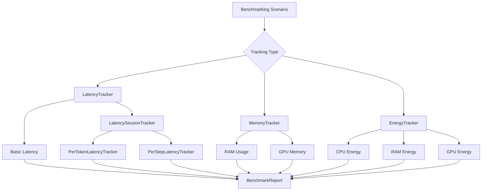
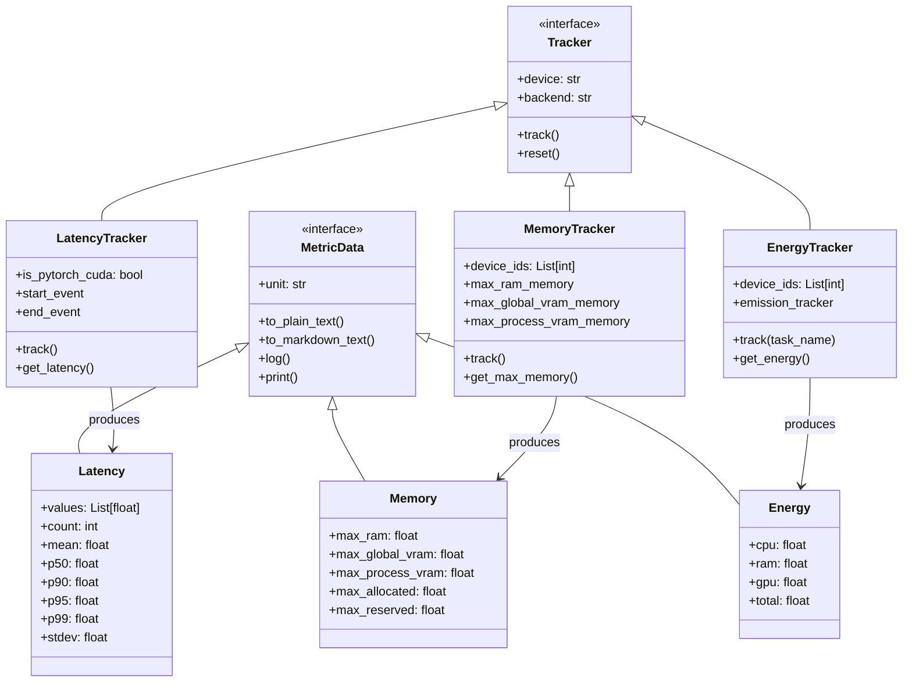
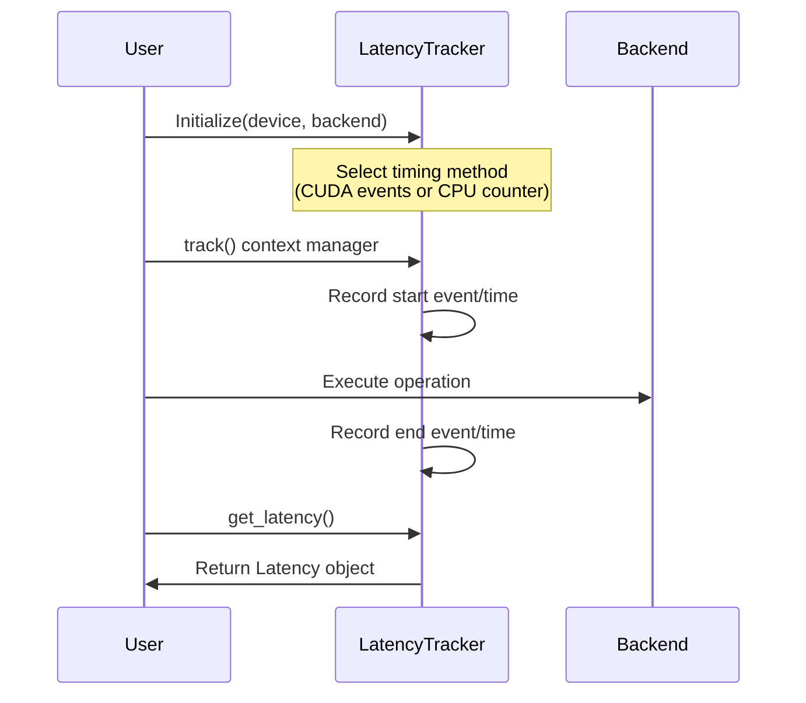
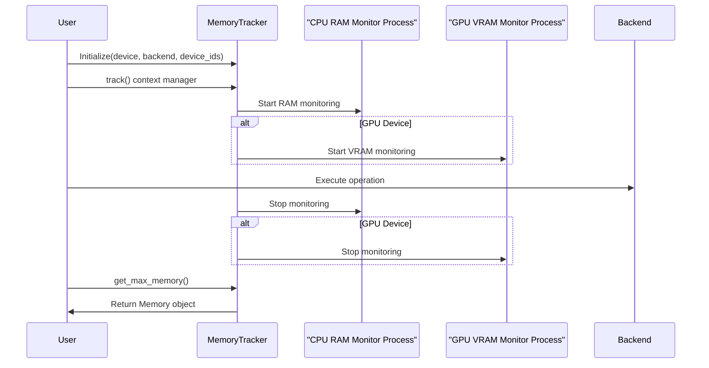
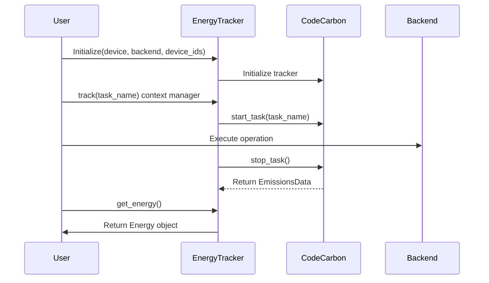
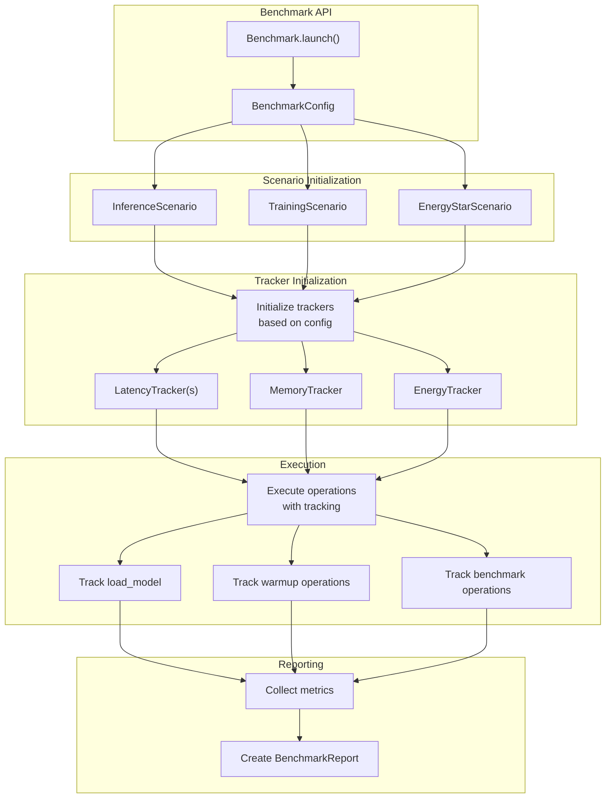

<!-- source: DeepWiki mcp.deepwiki.com · repo huggingface/optimum-benchmark · page 4 Performance Tracking · fetched 2026-10-26 -->

# Performance Tracking

<details>
<summary>Relevant source files</summary>

The following files were used as context for generating this wiki page:

- [optimum_benchmark/scenarios/energy_star/scenario.py](optimum_benchmark/scenarios/energy_star/scenario.py)
- [optimum_benchmark/scenarios/inference/scenario.py](optimum_benchmark/scenarios/inference/scenario.py)
- [optimum_benchmark/scenarios/training/scenario.py](optimum_benchmark/scenarios/training/scenario.py)
- [optimum_benchmark/trackers/energy.py](optimum_benchmark/trackers/energy.py)
- [optimum_benchmark/trackers/latency.py](optimum_benchmark/trackers/latency.py)
- [optimum_benchmark/trackers/memory.py](optimum_benchmark/trackers/memory.py)
- [tests/configs/_inference_.yaml](tests/configs/_inference_.yaml)
- [tests/test_api.py](tests/test_api.py)

</details>


The Performance Tracking system in optimum-benchmark provides comprehensive monitoring and measurement of key performance metrics during model inference and training. It offers standardized ways to track latency, memory usage, and energy consumption across different hardware, backends, and scenarios.

For information about specific benchmarking scenarios that use these tracking capabilities, see [Benchmarking Scenarios](#5).

## System Overview

The performance tracking system consists of three main tracker components:



Each tracker is designed to:
- Work with all supported backends (PyTorch, ONNX Runtime, TensorRT-LLM, etc.)
- Support various devices (CPU, NVIDIA GPUs, AMD GPUs)
- Provide detailed metrics in standardized formats
- Integrate seamlessly with benchmarking scenarios

Sources: [optimum_benchmark/trackers/latency.py:1-167](), [optimum_benchmark/trackers/memory.py:1-126](), [optimum_benchmark/trackers/energy.py:1-150]()

## Tracker Architecture

The performance tracking components follow a consistent architecture with data classes for metrics and tracker classes that handle the measurement process:



Sources: [optimum_benchmark/trackers/latency.py:22-120](), [optimum_benchmark/trackers/memory.py:44-124](), [optimum_benchmark/trackers/energy.py:32-147]()

## Latency Tracking

The latency tracking system provides multiple options for tracking execution time, each designed for different use cases:

### Basic Latency Tracking

The most straightforward approach uses `LatencyTracker`, which measures the time taken by a single operation:



The `LatencyTracker` class selects the appropriate timing method based on the device and backend:
- For PyTorch on CUDA devices: Uses CUDA events for accurate GPU timing
- For other configurations: Uses CPU performance counter

Sources: [optimum_benchmark/trackers/latency.py:168-208]()

### Session-Based Tracking

For benchmarks requiring multiple iterations of an operation, the `LatencySessionTracker` provides a session context:

```python
tracker = LatencySessionTracker(device="cuda", backend="pytorch")

with tracker.session():
    while tracker.count() < required_iterations:
        with tracker.track():
            model.forward(inputs)

latency = tracker.get_latency()  # Returns statistics over all iterations
```

This approach is used for standard inference and enables monitoring the number of iterations and elapsed time during the benchmark.

Sources: [optimum_benchmark/trackers/latency.py:211-286](), [tests/test_api.py:164-191]()

### Specialized Tracking

For more complex benchmarking scenarios, specialized trackers are available:

1. **Per-Token Tracking** (`PerTokenLatencySessionTrackerLogitsProcessor`):
   - Designed for text generation models
   - Tracks prefill, decode, and per-token latencies
   - Implemented as a LogitsProcessor for seamless integration with generation pipelines

2. **Per-Step Tracking** (`PerStepLatencySessionTrackerPipelineCallback`):
   - Designed for diffusion models
   - Tracks step-by-step latency for diffusion processes
   - Implemented as a Pipeline callback for integration with diffusion pipelines

3. **Training Step Tracking** (`StepLatencyTrackerTrainerCallback`):
   - Designed for training scenarios
   - Tracks per-step latency during training
   - Implemented as a Trainer callback for integration with Hugging Face Trainer

Sources: [optimum_benchmark/trackers/latency.py:289-650](), [optimum_benchmark/scenarios/inference/scenario.py:60-104]()

## Memory Tracking

The memory tracking system monitors RAM and GPU memory usage during operations using `MemoryTracker`:



The memory tracker records:
- For all devices: Process RAM usage
- For GPU devices:
  - Global GPU memory usage (device-level)
  - Process-specific GPU memory (when available)
- For PyTorch CUDA: Additional PyTorch-specific memory metrics (allocated/reserved)

The tracking is implemented using:
- `psutil` for RAM monitoring
- `pynvml` for NVIDIA GPU monitoring
- `amdsmi` and `pyrsmi` for AMD GPU monitoring
- PyTorch's memory stats API for framework-specific metrics

Sources: [optimum_benchmark/trackers/memory.py:126-270](), [optimum_benchmark/trackers/memory.py:273-414](), [tests/test_api.py:194-246]()

## Energy Tracking

The energy tracking system measures power consumption and calculates energy usage using the `EnergyTracker` class:



The energy tracking:
- Uses the `codecarbon` library to measure power consumption
- Records CPU, RAM, and GPU energy usage
- Calculates efficiency metrics (throughput per energy unit)
- Supports both online and offline tracking modes
- Saves detailed emissions data to JSON files

Sources: [optimum_benchmark/trackers/energy.py:150-260](), [optimum_benchmark/scenarios/inference/scenario.py:374-451]()

## Integration with Benchmarking Scenarios

Trackers are integrated into benchmarking scenarios to provide comprehensive performance metrics:



### Inference Scenario Integration

In inference scenarios, tracking is used to measure:
- Model loading performance
- First run (cold start) latency
- Per-operation latency (forward, generate, call)
- Task-specific metrics (per-token latency, per-step latency)
- Memory usage during operations
- Energy consumption and efficiency

Sources: [optimum_benchmark/scenarios/inference/scenario.py:60-168](), [optimum_benchmark/scenarios/inference/scenario.py:231-451]()

### Training Scenario Integration

In training scenarios, tracking is used to measure:
- Overall training performance
- Warmup vs. steady-state performance
- Per-step latency, memory, and energy consumption
- Throughput in samples per second
- Energy efficiency in samples per kWh

Sources: [optimum_benchmark/scenarios/training/scenario.py:18-92]()

### Energy Star Scenario Integration

In energy star scenarios, tracking is used to measure:
- Dataset loading and preprocessing efficiency
- Model loading performance
- End-to-end inference energy efficiency
- Task-specific energy metrics (prefill, decode, call)

Sources: [optimum_benchmark/scenarios/energy_star/scenario.py:56-129](), [optimum_benchmark/scenarios/energy_star/scenario.py:226-352]()

## Output Formats and Reporting

All tracking metrics can be presented in multiple formats:

### Plain Text Output

```
+ count: 100
+ total: 1.234567 (s)
+ mean: 0.012346 (s)
+ p50: 0.012000 (s)
+ p90: 0.013500 (s)
+ p95: 0.014000 (s)
+ p99: 0.015000 (s)
+ stdev: 0.001000 (s)
+ stdev_: 8.10 (%)
```

### Markdown Table Output

| metric | value     | unit |
| :----- | --------: | ---: |
| count  |       100 |    - |
| mean   |  0.012346 |    s |
| p50    |  0.012000 |    s |
| p90    |  0.013500 |    s |
| stdev  |  0.001000 |    s |
| stdev_ |      8.10 |    % |

### Metrics Data Classes

The metrics are stored in standardized data classes:

| Metric Class | Description | Key Fields |
| ------------ | ----------- | ---------- |
| `Latency` | Time measurements | `values`, `mean`, `p50`, `p90`, `p95`, `p99`, `stdev` |
| `Throughput` | Processing rate | `value`, `unit` |
| `Memory` | Memory usage | `max_ram`, `max_global_vram`, `max_process_vram`, `max_allocated` |
| `Energy` | Energy consumption | `cpu`, `ram`, `gpu`, `total` |
| `Efficiency` | Energy efficiency | `value`, `unit` |

Sources: [optimum_benchmark/trackers/latency.py:22-120](), [optimum_benchmark/trackers/latency.py:123-165](), [optimum_benchmark/trackers/memory.py:44-124](), [optimum_benchmark/trackers/energy.py:32-104](), [optimum_benchmark/trackers/energy.py:106-147]()

## Usage Examples

### Basic Latency Tracking

```python
from optimum_benchmark.trackers import LatencySessionTracker

# Initialize tracker
tracker = LatencySessionTracker(device="cuda", backend="pytorch")

# Use session-based tracking
with tracker.session():
    while tracker.count() < 10:  # Run 10 iterations
        with tracker.track():
            model(inputs)  # Operation to time

# Get results
latency = tracker.get_latency()
latency.print()  # Print formatted results
```

### Memory Tracking

```python
from optimum_benchmark.trackers import MemoryTracker

# Initialize tracker
tracker = MemoryTracker(
    device="cuda", 
    backend="pytorch",
    device_ids=[0, 1]  # For multi-GPU setups
)

# Track memory usage
with tracker.track():
    model(inputs)

# Get results
memory = tracker.get_max_memory()
memory.log()  # Log results
```

### Energy Tracking

```python
from optimum_benchmark.trackers import EnergyTracker

# Initialize tracker
tracker = EnergyTracker(
    device="cuda",
    backend="pytorch",
    device_ids=[0]
)

# Track energy consumption
with tracker.track(task_name="inference"):
    for _ in range(10):
        model(inputs)

# Get results
energy = tracker.get_energy()
energy.print()  # Print formatted results
```

Sources: [tests/test_api.py:164-246]()

## Configuration

Tracking is configured through the scenario configurations:

```yaml
scenario:
  # Enable/disable different tracking types
  memory: true
  latency: true
  energy: true  # May not be available on all systems
  
  # Configure benchmarking parameters
  duration: 30        # Minimum benchmark duration in seconds
  iterations: 10      # Minimum number of iterations
  warmup_runs: 5      # Number of warmup runs before measurement
```

Sources: [tests/configs/_inference_.yaml:1-22]()

---

