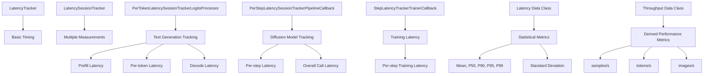
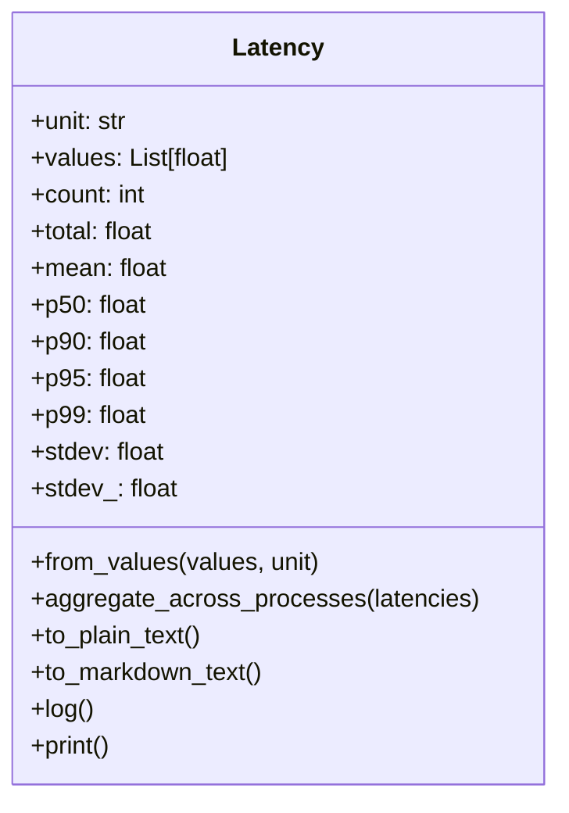
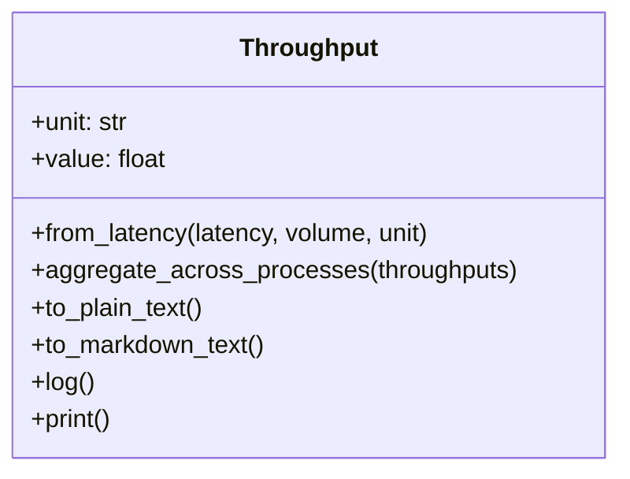
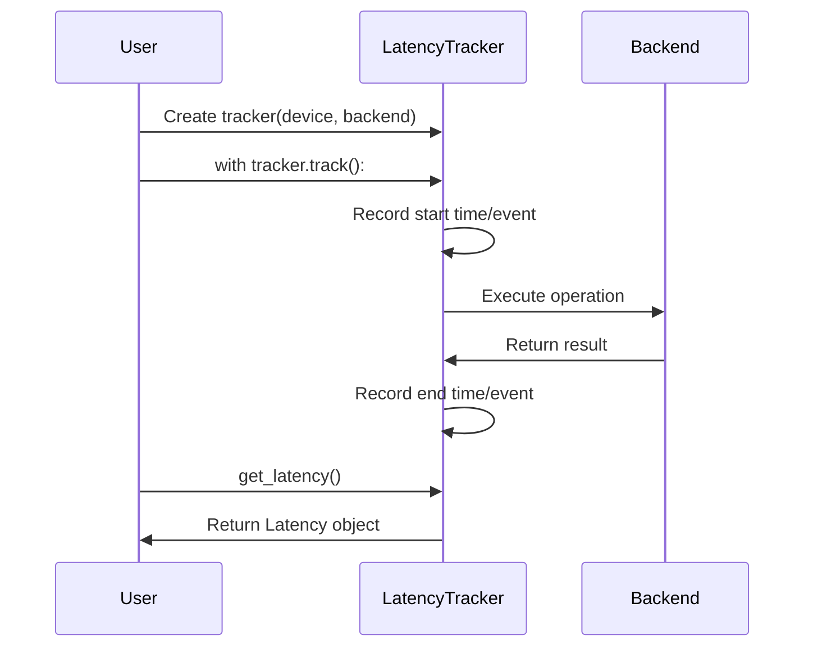
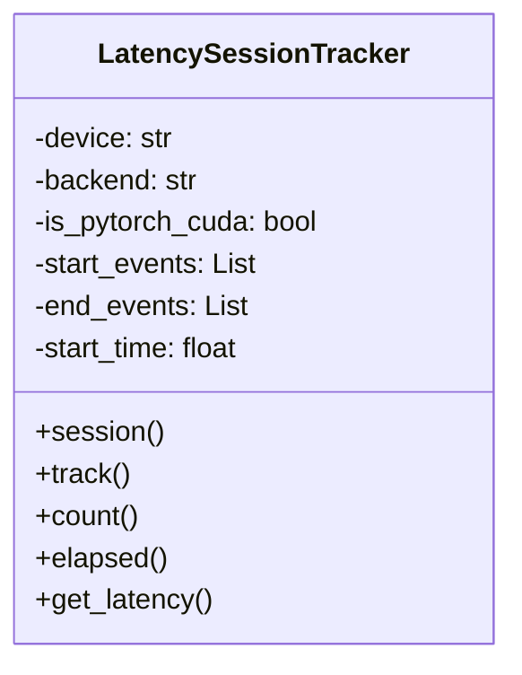
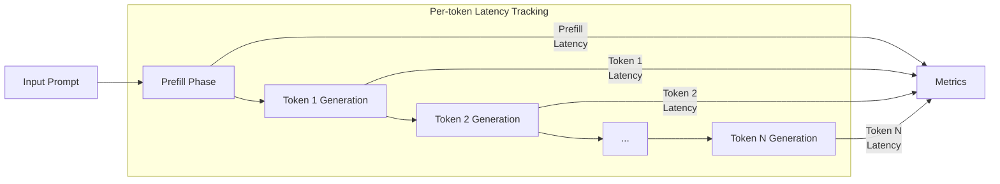
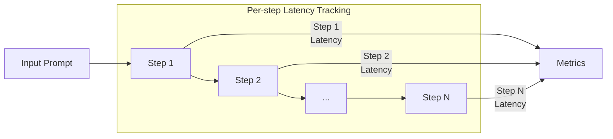
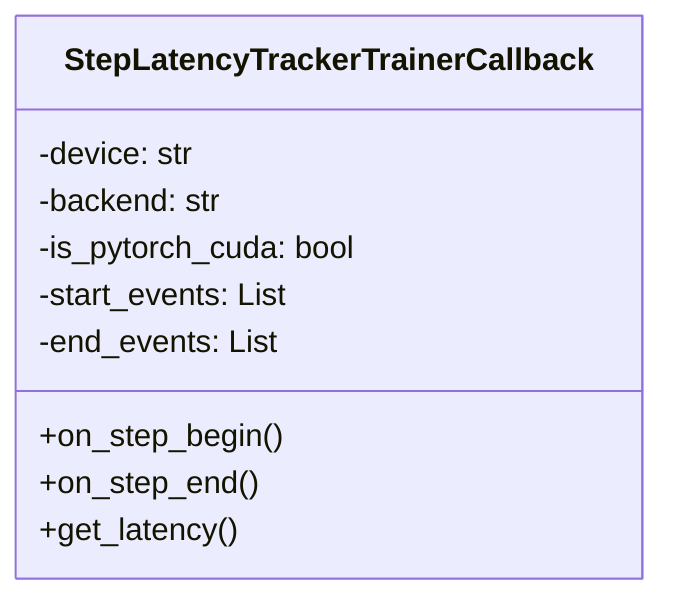
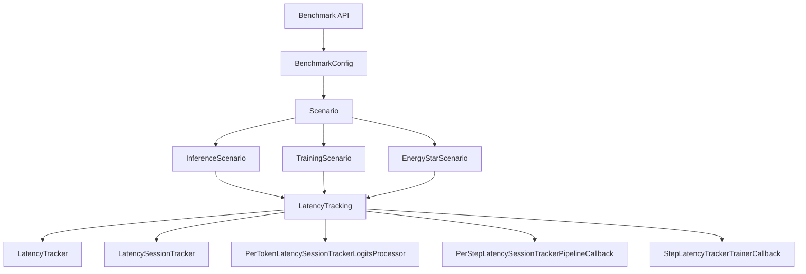

<!-- source: DeepWiki mcp.deepwiki.com · repo huggingface/optimum-benchmark · page 4.1 Latency Tracking · fetched 2026-10-26 -->

# Latency Tracking

<details>
<summary>Relevant source files</summary>

The following files were used as context for generating this wiki page:

- [optimum_benchmark/scenarios/energy_star/scenario.py](optimum_benchmark/scenarios/energy_star/scenario.py)
- [optimum_benchmark/scenarios/inference/scenario.py](optimum_benchmark/scenarios/inference/scenario.py)
- [optimum_benchmark/scenarios/training/scenario.py](optimum_benchmark/scenarios/training/scenario.py)
- [optimum_benchmark/trackers/energy.py](optimum_benchmark/trackers/energy.py)
- [optimum_benchmark/trackers/latency.py](optimum_benchmark/trackers/latency.py)
- [optimum_benchmark/trackers/memory.py](optimum_benchmark/trackers/memory.py)
- [tests/configs/_inference_.yaml](tests/configs/_inference_.yaml)
- [tests/test_api.py](tests/test_api.py)

</details>


This document explains the latency tracking system in Optimum-Benchmark, which measures the execution time of various operations across different machine learning model types, backends, and hardware. For information on memory tracking, see [Memory Tracking](#4.2), and for energy consumption tracking, see [Energy Tracking](#4.3).

## Overview

The latency tracking system in Optimum-Benchmark provides precise timing measurements for model operations, supporting both CPU and GPU executions. It offers specialized tracking capabilities for different model architectures and operations, such as per-token latency for text generation models and per-step latency for diffusion models.



Sources: [optimum_benchmark/trackers/latency.py:1-650]()

## Core Data Classes

At the heart of the latency tracking system are two primary data classes that store and analyze timing information:

### Latency Class

The `Latency` class stores timing measurements and calculates key statistics:



The `Latency` class provides:
- Storage of individual measurement values
- Statistical processing (mean, percentiles, standard deviation)
- Reporting methods for various output formats
- Mathematical operations for combining measurements

Sources: [optimum_benchmark/trackers/latency.py:22-120]()

### Throughput Class

The `Throughput` class represents performance in terms of processing rate:



The `Throughput` class:
- Calculates processing rates from latency measurements
- Supports different units (samples/s, tokens/s, images/s)
- Provides reporting methods similar to the Latency class

Sources: [optimum_benchmark/trackers/latency.py:123-165]()

## Basic Latency Tracking

The most basic tracker is the `LatencyTracker`, which measures the duration of a single operation:



The `LatencyTracker` automatically selects the appropriate timing mechanism based on the device:
- For CUDA devices with PyTorch, it uses CUDA events for precise GPU timing
- For CPU or other backends, it uses the CPU performance counter

Sources: [optimum_benchmark/trackers/latency.py:168-208]()

## Session-Based Latency Tracking

The `LatencySessionTracker` extends the basic tracker to measure multiple operations in a session:



This tracker is designed for scenarios where:
- Multiple operations need to be timed within a single benchmark run
- Statistics across multiple runs are required
- Time constraints or iteration counts control the benchmarking process

Example usage pattern:
```python
tracker = LatencySessionTracker(device="cuda", backend="pytorch")
with tracker.session():
    while tracker.elapsed() < duration or tracker.count() < iterations:
        with tracker.track():
            model.forward(inputs)
latency = tracker.get_latency()
```

Sources: [optimum_benchmark/trackers/latency.py:211-286](), [tests/test_api.py:166-191]()

## Specialized Latency Trackers

The system provides specialized trackers for different model architectures:

### Text Generation Latency Tracking

The `PerTokenLatencySessionTrackerLogitsProcessor` tracks latency for each token in text generation:



This tracker:
- Integrates with text generation models as a `LogitsProcessor`
- Separates prefill (initial processing) and decode (token generation) phases
- Tracks individual token generation times
- Produces detailed metrics about token generation performance

Sources: [optimum_benchmark/trackers/latency.py:289-470](), [optimum_benchmark/scenarios/inference/scenario.py:96-101]()

### Diffusion Model Latency Tracking

The `PerStepLatencySessionTrackerPipelineCallback` measures per-step latency in diffusion models:



This tracker:
- Integrates with diffusion pipelines as a callback
- Records the latency of individual denoising steps
- Captures the overall call latency as well as step-level metrics
- Handles interaction with the device-specific timing mechanisms

Sources: [optimum_benchmark/trackers/latency.py:473-595](), [optimum_benchmark/scenarios/inference/scenario.py:102-107]()

### Training Latency Tracking

The `StepLatencyTrackerTrainerCallback` integrates with the Transformers `Trainer` class to measure training step latency:



This tracker:
- Implements the `TrainerCallback` interface
- Records the start and end of each training step
- Aggregates latency statistics across training steps

Sources: [optimum_benchmark/trackers/latency.py:598-650](), [optimum_benchmark/scenarios/training/scenario.py:42-76]()

## Hardware-Specific Timing

The latency tracking system adapts its timing method based on the hardware platform:

| Platform | Timing Mechanism | Resolution | Notes |
|----------|------------------|------------|-------|
| CPU | `time.perf_counter()` | Microseconds | High-resolution CPU timer |
| CUDA GPU with PyTorch | `torch.cuda.Event` | Nanoseconds | Requires explicit synchronization |
| Other GPU backends | `time.perf_counter()` | Microseconds | Falls back to CPU timing |

PyTorch CUDA events provide more accurate GPU timing as they:
- Operate directly on the GPU
- Synchronize with the GPU execution stream
- Eliminate latency introduced by CPU-GPU communication

Sources: [optimum_benchmark/trackers/latency.py:172-180](), [optimum_benchmark/trackers/latency.py:184-195]()

## Integration with Benchmarking Scenarios

The latency tracking system integrates with the different benchmarking scenarios in Optimum-Benchmark:



### Inference Scenario Integration

In the `InferenceScenario`, latency tracking is used to measure:
- Model loading time
- Forward pass latency
- Text generation (prefill and decode phases)
- Diffusion model steps

The scenario detects the appropriate tracker based on the model task and configures it accordingly.

Sources: [optimum_benchmark/scenarios/inference/scenario.py:91-106](), [optimum_benchmark/scenarios/inference/scenario.py:230-371]()

### Training Scenario Integration

The `TrainingScenario` uses the `StepLatencyTrackerTrainerCallback` to:
- Measure per-step training time
- Track warmup vs. regular training steps
- Calculate throughput in samples processed per second

Sources: [optimum_benchmark/scenarios/training/scenario.py:42-76]()

### Energy Star Scenario Integration

The `EnergyStarScenario` uses latency tracking alongside energy tracking to:
- Measure latency across a dataset
- Calculate energy efficiency metrics
- Track processing time for different phases (dataset loading, preprocessing, inference)

Sources: [optimum_benchmark/scenarios/energy_star/scenario.py:85-90](), [optimum_benchmark/scenarios/energy_star/scenario.py:226-324]()

## Practical Usage

Here's how to use the latency tracking system in practice:

### Basic Tracking

```python
tracker = LatencyTracker(device="cuda", backend="pytorch")
with tracker.track():
    model.forward(inputs)
latency = tracker.get_latency()
latency.log()  # Print detailed statistics
```

### Session-Based Tracking

```python
tracker = LatencySessionTracker(device="cuda", backend="pytorch")
with tracker.session():
    while tracker.elapsed() < duration or tracker.count() < iterations:
        with tracker.track():
            model.forward(inputs)
latency = tracker.get_latency()
throughput = Throughput.from_latency(latency, batch_size, unit="samples/s")
```

### Text Generation Tracking

```python
tracker = PerTokenLatencySessionTrackerLogitsProcessor(device="cuda", backend="pytorch")
generate_kwargs = {"logits_processor": LogitsProcessorList([tracker])}

with tracker.session():
    while tracker.count() < iterations:
        with tracker.track():
            model.generate(inputs, **generate_kwargs)

prefill_latency = tracker.get_prefill_latency()
per_token_latency = tracker.get_per_token_latency()
decode_latency = tracker.get_decode_latency()
```

## Configuration

Latency tracking can be enabled through the scenario configuration. For example, in an inference scenario:

```yaml
scenario:
  latency: true    # Enable latency tracking
  duration: 10     # Run for 10 seconds
  iterations: 5    # Run at least 5 iterations
  warmup_runs: 2   # Perform 2 warmup runs before measurement
```

Sources: [tests/configs/_inference_.yaml:1-22]()

## Conclusion

The latency tracking system in Optimum-Benchmark provides a comprehensive solution for measuring performance across different model types, backends, and hardware. By using the appropriate trackers and integration points, users can obtain detailed insights into their model's execution time characteristics.

For more information about the complete benchmarking system, refer to the [Overview](#1) and [Architecture](#2) pages.

---

