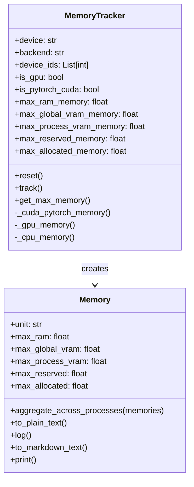
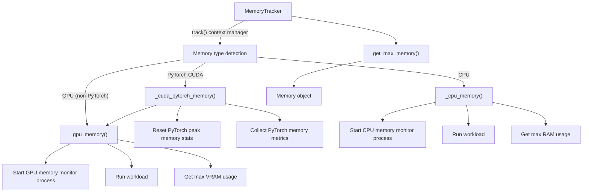
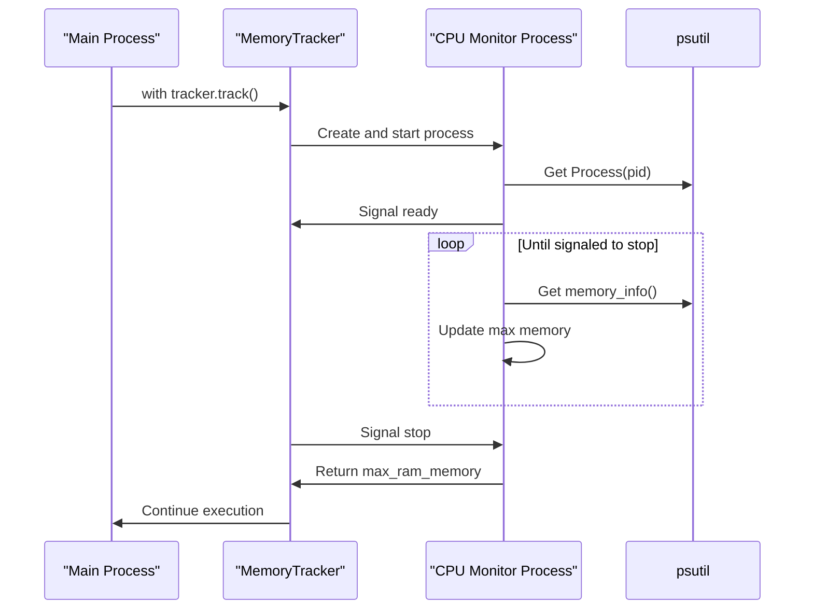
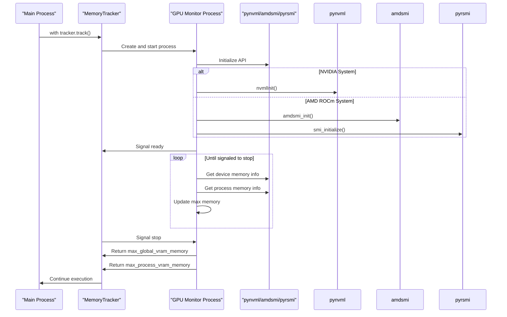
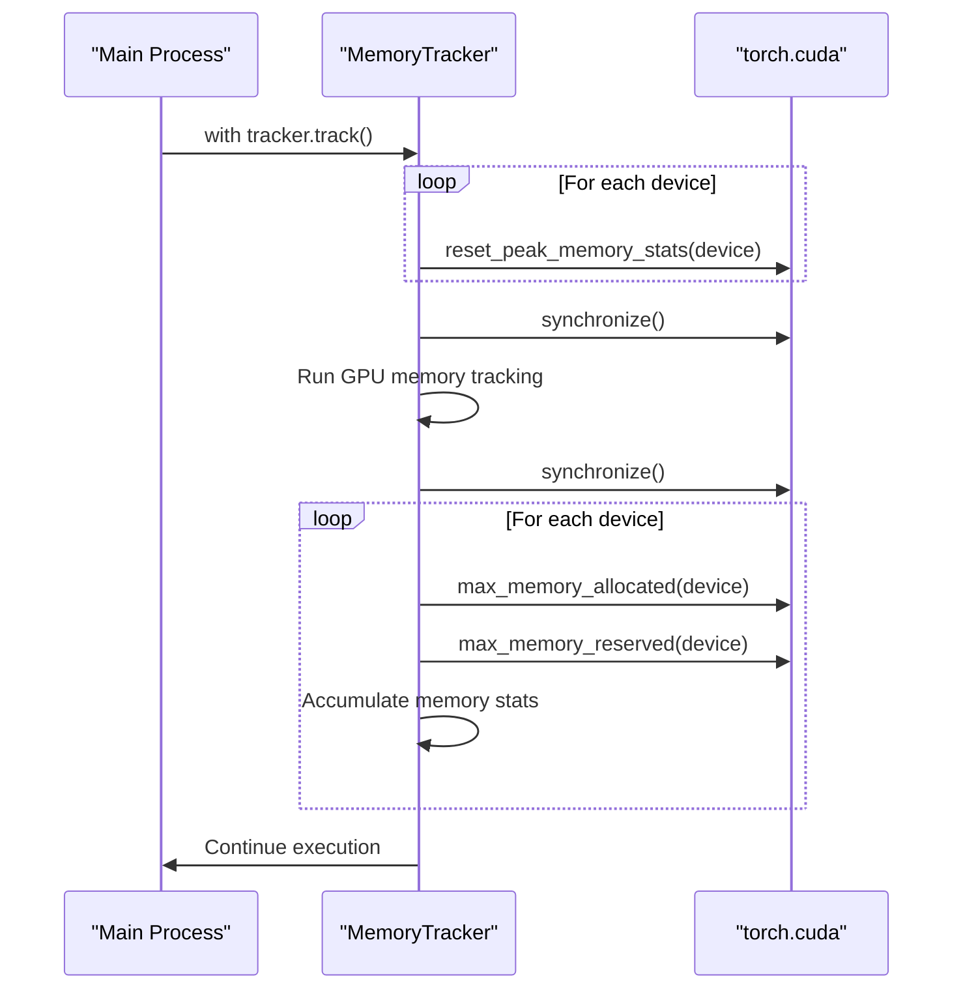
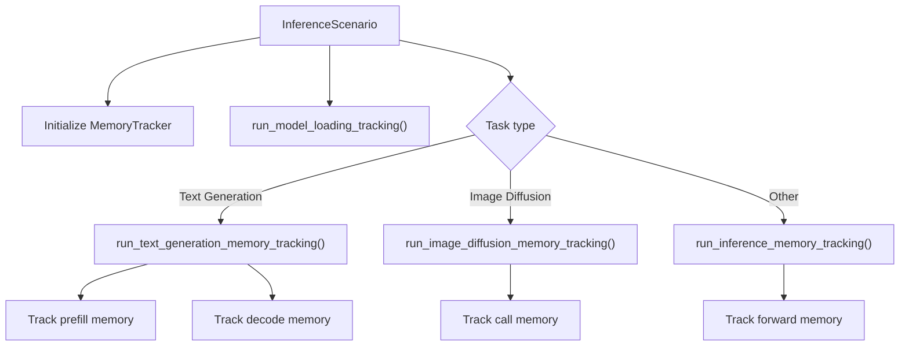
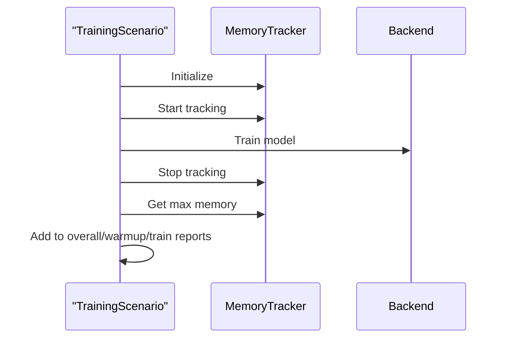
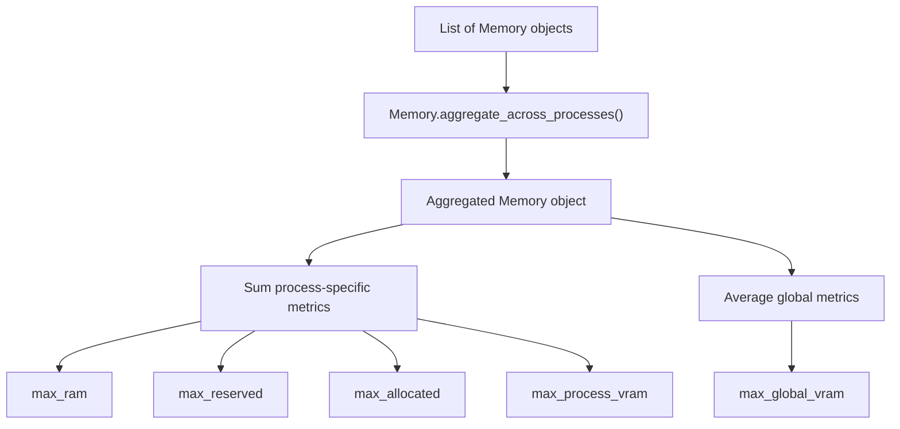

<!-- source: DeepWiki mcp.deepwiki.com · repo huggingface/optimum-benchmark · page 4.2 Memory Tracking · fetched 2026-10-26 -->

# Memory Tracking

<details>
<summary>Relevant source files</summary>

The following files were used as context for generating this wiki page:

- [optimum_benchmark/scenarios/energy_star/scenario.py](optimum_benchmark/scenarios/energy_star/scenario.py)
- [optimum_benchmark/scenarios/inference/scenario.py](optimum_benchmark/scenarios/inference/scenario.py)
- [optimum_benchmark/scenarios/training/scenario.py](optimum_benchmark/scenarios/training/scenario.py)
- [optimum_benchmark/trackers/energy.py](optimum_benchmark/trackers/energy.py)
- [optimum_benchmark/trackers/latency.py](optimum_benchmark/trackers/latency.py)
- [optimum_benchmark/trackers/memory.py](optimum_benchmark/trackers/memory.py)
- [tests/configs/_inference_.yaml](tests/configs/_inference_.yaml)
- [tests/test_api.py](tests/test_api.py)

</details>


## Purpose and Scope

This document describes the memory tracking system within optimum-benchmark, which monitors and reports RAM and GPU memory usage during benchmarking. The memory tracking functionality enables precise measurement of memory consumption across different hardware, backends, and operational phases. For information about latency tracking, see [Latency Tracking](#4.1), and for information about energy consumption measurement, see [Energy Tracking](#4.3).

## Memory Tracking Architecture

The memory tracking system consists of two main components: a `Memory` dataclass that represents memory metrics, and a `MemoryTracker` class that handles the actual monitoring of memory resources.



Sources: [optimum_benchmark/trackers/memory.py:44-124](), [optimum_benchmark/trackers/memory.py:126-270]()

## How Memory Tracking Works

The memory tracking system uses a multi-process approach to continuously monitor memory usage without affecting the performance of the benchmarking process itself.



Sources: [optimum_benchmark/trackers/memory.py:175-258]()

### CPU Memory Tracking

CPU memory tracking uses `psutil` to monitor the RAM usage of the benchmark process and its child processes. This tracking happens in a separate process that polls memory usage at regular intervals.



Sources: [optimum_benchmark/trackers/memory.py:273-290]()

### GPU Memory Tracking

GPU memory tracking varies by vendor:

1. **NVIDIA GPUs**: Uses the `pynvml` library to track both global VRAM usage and process-specific VRAM usage
2. **AMD GPUs**: Uses `amdsmi` and `pyrsmi` to track VRAM usage on ROCm systems



Sources: [optimum_benchmark/trackers/memory.py:293-414]()

### PyTorch CUDA Memory Tracking

When using PyTorch with CUDA devices, additional memory metrics are tracked using PyTorch's built-in memory management functions:



Sources: [optimum_benchmark/trackers/memory.py:184-206]()

## Tracked Memory Metrics

The memory tracking system captures multiple memory metrics:

| Metric | Description | Applicability |
|--------|-------------|--------------|
| `max_ram` | Maximum RAM usage by process and children | All platforms |
| `max_global_vram` | Maximum total VRAM usage on GPU devices | GPU platforms |
| `max_process_vram` | Maximum VRAM usage specific to monitored process | GPU platforms |
| `max_reserved` | Maximum memory reserved by PyTorch on CUDA devices | PyTorch CUDA |
| `max_allocated` | Maximum memory allocated by PyTorch for tensors | PyTorch CUDA |

Sources: [optimum_benchmark/trackers/memory.py:263-270]()

## Integration with Benchmarking Scenarios

Memory tracking is integrated into various benchmarking scenarios:

### Inference Scenario

In the inference scenario, memory tracking is applied to various operations including model loading, forward pass, text generation (prefill and decode phases), and image diffusion.



Sources: [optimum_benchmark/scenarios/inference/scenario.py:110-116](), [optimum_benchmark/scenarios/inference/scenario.py:231-260]()

### Training Scenario

In the training scenario, memory tracking covers the entire training process:



Sources: [optimum_benchmark/scenarios/training/scenario.py:47-52](), [optimum_benchmark/scenarios/training/scenario.py:79-83]()

## Using the Memory Tracker

The `MemoryTracker` class provides a simple context manager interface for monitoring memory usage:

```python
memory_tracker = MemoryTracker(
    device="cuda",            # or "cpu"
    backend="pytorch",        # or other backend names
    device_ids=[0, 1]         # optional list of GPU device IDs
)

with memory_tracker.track():
    # Run operations to be monitored
    model.forward(inputs)

# Get memory usage statistics
memory_metrics = memory_tracker.get_max_memory()
memory_metrics.log()  # Print to console
```

Sources: [optimum_benchmark/trackers/memory.py:175-182](), [tests/test_api.py:194-245]()

## Multi-Process Aggregation

When running distributed benchmarks, the `Memory` class provides a method to aggregate metrics across multiple processes:



Sources: [optimum_benchmark/trackers/memory.py:54-85]()

## Platform-Specific Considerations

### NVIDIA GPU Memory Tracking

For NVIDIA GPUs, memory tracking requires the `pynvml` library to access NVIDIA Management Library functions. The tracking captures both global VRAM usage across all processes and process-specific usage.

Sources: [optimum_benchmark/trackers/memory.py:302-341]()

### AMD ROCm Memory Tracking

For AMD GPUs with ROCm, the system uses two libraries:
- `amdsmi` for process-specific memory usage
- `pyrsmi` for global device memory information

Sources: [optimum_benchmark/trackers/memory.py:343-405]()

### PyTorch CUDA Memory Management

When using PyTorch with CUDA, the tracker captures two key metrics:
- **Allocated Memory**: Memory actively used by tensors
- **Reserved Memory**: Memory reserved by PyTorch's allocator (includes allocated memory plus overhead)

The difference between reserved and allocated memory can indicate memory fragmentation or caching by PyTorch's memory allocator.

Sources: [optimum_benchmark/trackers/memory.py:184-206]()

## Summary

The memory tracking system in optimum-benchmark provides comprehensive monitoring of memory usage across different hardware platforms and backends. By tracking both CPU and GPU memory metrics, it enables users to analyze the memory efficiency of models and identify potential bottlenecks or optimization opportunities. The system is deeply integrated with the benchmarking scenarios, ensuring consistent memory measurement throughout the benchmark lifecycle.

---

