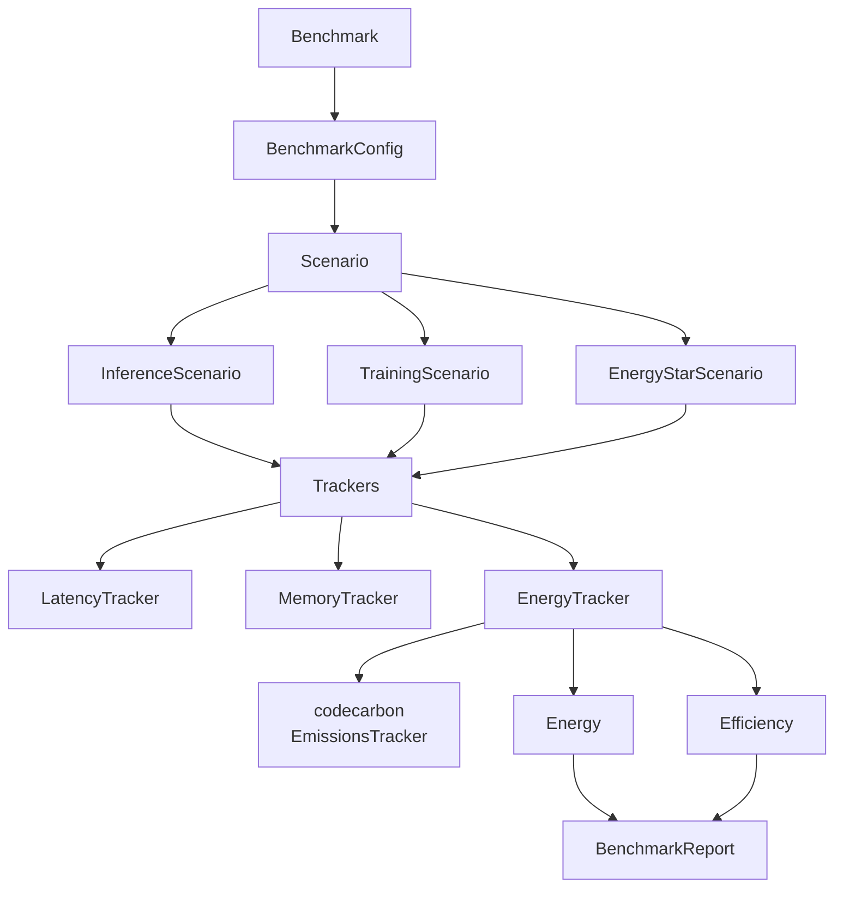
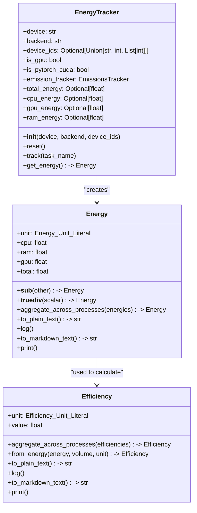
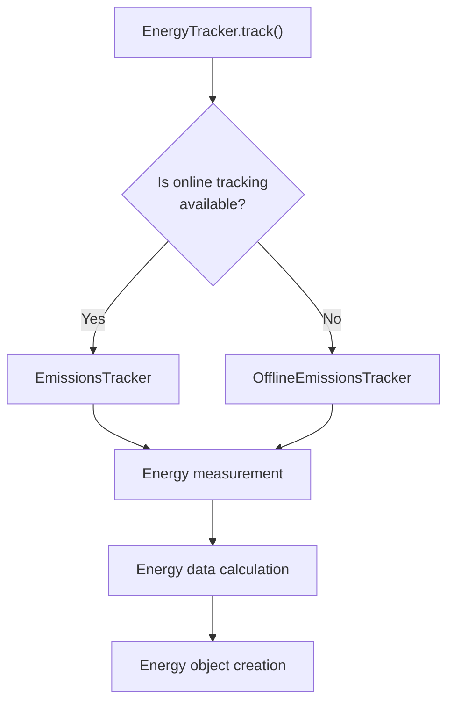
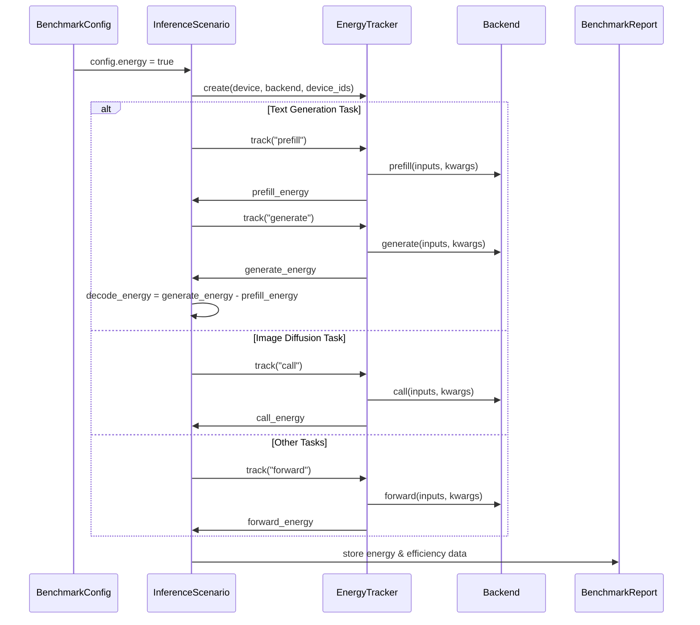
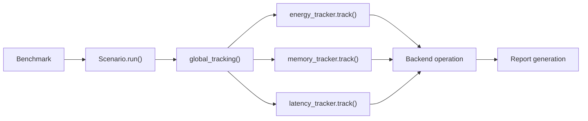

<!-- source: DeepWiki mcp.deepwiki.com · repo huggingface/optimum-benchmark · page 4.3 Energy Tracking · fetched 2026-10-26 -->

# Energy Tracking

<details>
<summary>Relevant source files</summary>

The following files were used as context for generating this wiki page:

- [optimum_benchmark/scenarios/energy_star/scenario.py](optimum_benchmark/scenarios/energy_star/scenario.py)
- [optimum_benchmark/scenarios/inference/scenario.py](optimum_benchmark/scenarios/inference/scenario.py)
- [optimum_benchmark/scenarios/training/scenario.py](optimum_benchmark/scenarios/training/scenario.py)
- [optimum_benchmark/trackers/energy.py](optimum_benchmark/trackers/energy.py)
- [optimum_benchmark/trackers/latency.py](optimum_benchmark/trackers/latency.py)
- [optimum_benchmark/trackers/memory.py](optimum_benchmark/trackers/memory.py)
- [tests/configs/_inference_.yaml](tests/configs/_inference_.yaml)
- [tests/test_api.py](tests/test_api.py)

</details>


This page documents the energy consumption tracking capabilities in optimum-benchmark, explaining how the system measures, records, and reports the energy used by machine learning models during benchmarking. For information about other performance metrics like latency tracking, see [Latency Tracking](#4.1) or [Memory Tracking](#4.2).

## Purpose and Scope

The energy tracking system enables benchmarking of model energy consumption across different hardware configurations, model architectures, and optimization techniques. This is increasingly important for:

1. Evaluating the environmental impact of ML workloads
2. Comparing the energy efficiency of different backends and optimizations
3. Making informed decisions about deployment configurations
4. Supporting energy-aware hardware selection for inference and training

## Architecture Overview

Energy tracking is implemented as one of the three main tracking systems in optimum-benchmark (alongside latency and memory tracking). It integrates with the benchmark scenarios to measure energy consumption during different operations.



Sources: [optimum_benchmark/trackers/energy.py:1-261](), [optimum_benchmark/scenarios/inference/scenario.py:117-123](), [optimum_benchmark/scenarios/training/scenario.py:52-56](), [optimum_benchmark/scenarios/energy_star/scenario.py:98-104]()

## Core Components

### Energy Tracker

The `EnergyTracker` class is the central component responsible for measuring energy consumption during workload execution. It wraps the codecarbon library to track energy usage across different hardware components.



Sources: [optimum_benchmark/trackers/energy.py:150-261](), [optimum_benchmark/trackers/energy.py:32-104](), [optimum_benchmark/trackers/energy.py:106-148]()

### Data Model

The energy tracking system uses two main data classes:

1. **Energy**: Represents energy consumption with breakdown by hardware component
2. **Efficiency**: Represents the efficiency of operations in terms of work done per unit of energy

#### Energy Class

`Energy` stores energy measurements with the following properties:

| Property | Type | Description |
|----------|------|-------------|
| unit | str | Energy unit (typically "kWh") |
| cpu | float | Energy consumed by CPU |
| ram | float | Energy consumed by RAM |
| gpu | float | Energy consumed by GPU(s) |
| total | float | Total energy consumption |

#### Efficiency Class

`Efficiency` stores efficiency metrics with these properties:

| Property | Type | Description |
|----------|------|-------------|
| unit | str | Efficiency unit (e.g., "samples/kWh", "tokens/kWh") |
| value | float | Efficiency value (work done per energy unit) |

Sources: [optimum_benchmark/trackers/energy.py:32-104](), [optimum_benchmark/trackers/energy.py:106-148]()

## Implementation Details

### Codecarbon Integration

Energy tracking is implemented through integration with the codecarbon library, which measures energy consumption at the machine level. The energy tracking system uses:

- **EmissionsTracker**: For online measurements when possible
- **OfflineEmissionsTracker**: As a fallback when online measurements aren't available



Sources: [optimum_benchmark/trackers/energy.py:176-253]()

### Energy Measurement Process

The energy tracking process follows these steps:

1. The tracker is initialized with device and backend information
2. A context manager (`track()`) starts tracking at the beginning of a workload
3. The workload is executed
4. The context manager ends tracking and retrieves energy consumption data
5. The data is stored in an `Energy` object
6. Optionally, an `Efficiency` object is created to represent work done per energy unit

Sources: [optimum_benchmark/trackers/energy.py:232-254]()

## Integration with Benchmark Scenarios

The energy tracking system is integrated with all three benchmark scenarios. Each scenario has specific patterns of energy tracking:

### Inference Scenario

In inference scenarios, energy tracking is used to measure:

- Model loading energy consumption
- Energy used during forward passes
- Energy used during text generation (prefill and decode phases separately)
- Energy used during image generation



Sources: [optimum_benchmark/scenarios/inference/scenario.py:374-451]()

### Training Scenario

In training scenarios, energy tracking captures the energy used during the entire training process:

1. The energy tracker is initialized
2. The entire training process is wrapped in the energy tracking context
3. Both overall energy consumption and efficiency (samples/kWh) are recorded

Sources: [optimum_benchmark/scenarios/training/scenario.py:52-90]()

### Energy Star Scenario

The Energy Star scenario is specifically designed for comprehensive energy benchmarking, tracking:

1. Energy used during dataset loading and preprocessing
2. Energy used for model loading
3. Task-specific energy consumption (forward, generate, or call operations)
4. Energy efficiency across the entire pipeline

Sources: [optimum_benchmark/scenarios/energy_star/scenario.py:98-313]()

## Configuration

### Enabling Energy Tracking

Energy tracking can be enabled through the benchmark configuration system:

```yaml
scenario:
  energy: true  # Enable energy tracking
```

For GPU benchmarks, you'll need to specify device IDs:

```yaml
backend:
  device: "cuda"
  device_ids: [0]  # Or multiple GPUs: [0, 1, 2]
```

Sources: [tests/configs/_inference_.yaml:1-22](), [tests/test_api.py:77-87]()

### Hardware Support

Energy tracking is supported on:

- CPU-only systems
- NVIDIA GPU systems
- AMD GPU systems (with some limitations)

Note that energy tracking is not available on all platforms. The system will fall back gracefully if energy tracking isn't supported.

Sources: [optimum_benchmark/trackers/energy.py:150-203]()

## Technical Considerations

### Measurement Accuracy

Energy tracking is performed at the machine level, which has important implications:

- The measurements represent the energy consumption of the entire system, not just the ML workload
- For accurate measurements, benchmarks should be run on dedicated machines with minimal background activity
- When comparing energy consumption across different configurations, ensure the testing environment remains consistent

### Device Isolation and Energy Attribution

Energy tracking does not provide perfect attribution of energy to specific processes or devices:

- CPU and RAM energy is measured at the machine level
- GPU energy is tracked for the specified devices, but may include some system-level overhead

### Integration with Other Trackers

Energy tracking is designed to work alongside latency and memory tracking:



When multiple trackers are active, they all wrap the same workload, enabling comprehensive performance analysis.

Sources: [optimum_benchmark/scenarios/inference/scenario.py:175-194]()

## Common Usage Patterns

### Basic Usage

Energy tracking is typically enabled in benchmark configurations:

```python
scenario_config = InferenceConfig(
    memory=True,
    latency=True,
    energy=True,  # Enable energy tracking
    duration=60,  # Benchmark for 60 seconds
    iterations=10  # Or at least 10 iterations
)
```

### Analyzing Energy Efficiency

Energy efficiency metrics help compare different backends or optimization techniques:

```python
# In the benchmark report
efficiency = report.generate.efficiency  # For text generation
efficiency = report.forward.efficiency   # For inference tasks
efficiency = report.call.efficiency      # For diffusion models

# Example output: "5.2 samples/kWh" or "1203.7 tokens/kWh" 
```

## Conclusion

The energy tracking system provides a valuable tool for measuring and optimizing the energy consumption of machine learning models. By integrating with the codecarbon library and providing standardized reporting, it enables meaningful comparisons of energy efficiency across different hardware configurations, model architectures, and optimization techniques.

Sources: [optimum_benchmark/trackers/energy.py:1-261]()

---

