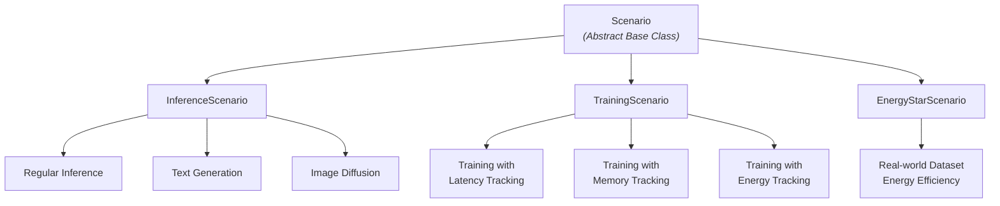
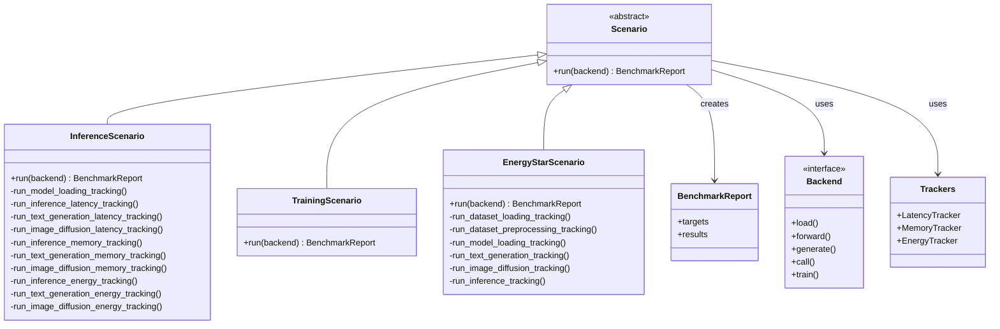
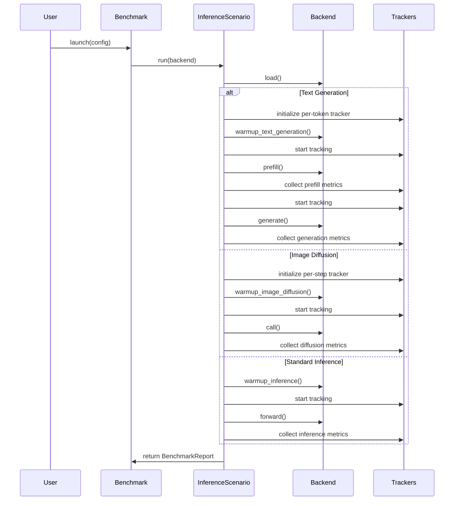
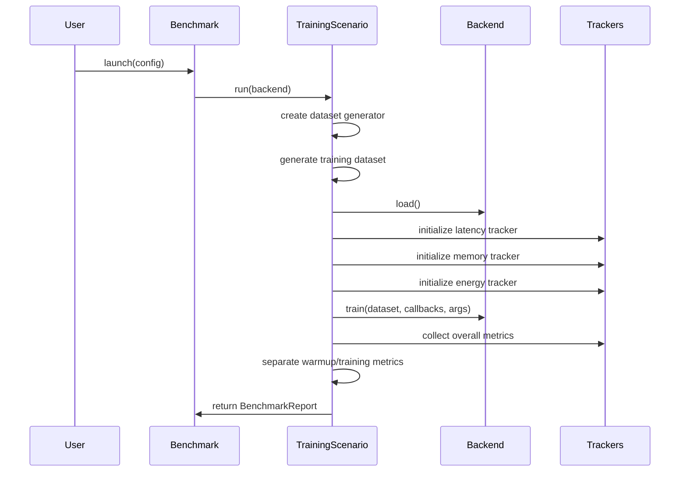
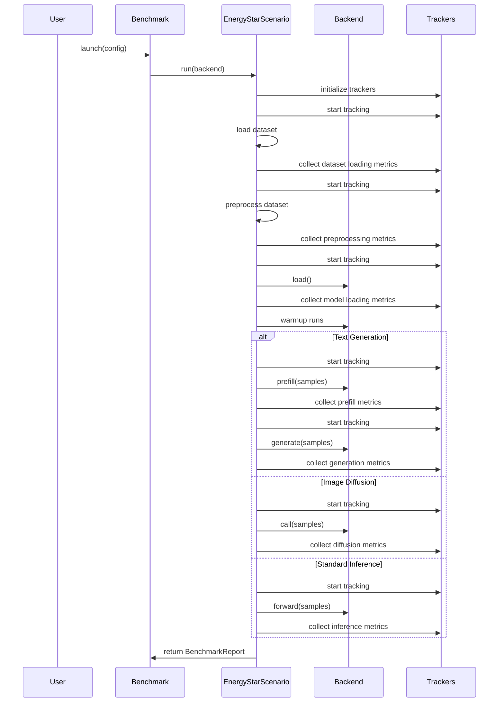
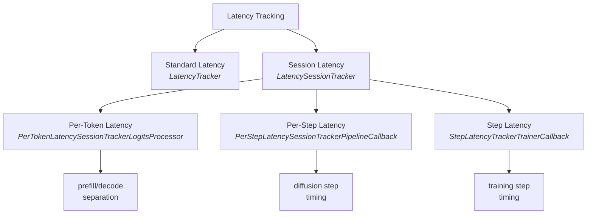

<!-- source: DeepWiki mcp.deepwiki.com · repo huggingface/optimum-benchmark · page 5 Benchmarking Scenarios · fetched 2026-10-26 -->

# Benchmarking Scenarios

<details>
<summary>Relevant source files</summary>

The following files were used as context for generating this wiki page:

- [optimum_benchmark/scenarios/energy_star/scenario.py](optimum_benchmark/scenarios/energy_star/scenario.py)
- [optimum_benchmark/scenarios/inference/scenario.py](optimum_benchmark/scenarios/inference/scenario.py)
- [optimum_benchmark/scenarios/training/scenario.py](optimum_benchmark/scenarios/training/scenario.py)
- [optimum_benchmark/trackers/energy.py](optimum_benchmark/trackers/energy.py)
- [optimum_benchmark/trackers/latency.py](optimum_benchmark/trackers/latency.py)
- [optimum_benchmark/trackers/memory.py](optimum_benchmark/trackers/memory.py)
- [tests/configs/_inference_.yaml](tests/configs/_inference_.yaml)
- [tests/test_api.py](tests/test_api.py)

</details>


This page describes the benchmarking scenarios supported by Optimum-Benchmark, which define the different workflows for evaluating model performance. For information about tracking specific metrics like latency or memory usage, see [Performance Tracking](#4).

## Overview

Benchmarking scenarios in Optimum-Benchmark are responsible for orchestrating the benchmarking process, including:

1. Coordinating with backends to execute model operations
2. Setting up trackers to collect performance metrics
3. Generating appropriate inputs for benchmarking
4. Running the benchmark with specified parameters
5. Collecting and reporting results

The framework provides three specialized scenario implementations, each designed for different use cases:



Sources:
- [optimum_benchmark/scenarios/inference/scenario.py:61-67]()
- [optimum_benchmark/scenarios/training/scenario.py:18-24]()
- [optimum_benchmark/scenarios/energy_star/scenario.py:56-62]()

## Scenario Architecture

All benchmarking scenarios share a common architecture and interface but implement different workflows. Each scenario:

1. Accepts a specialized configuration object
2. Works with a backend to execute model operations
3. Uses trackers to collect performance metrics
4. Generates a benchmark report with results



Sources:
- [optimum_benchmark/scenarios/inference/scenario.py:67-173]()
- [optimum_benchmark/scenarios/training/scenario.py:24-92]()
- [optimum_benchmark/scenarios/energy_star/scenario.py:62-130]()

## InferenceScenario

The `InferenceScenario` focuses on benchmarking model inference performance, including forward passes, text generation, and image diffusion. It's the most commonly used scenario for evaluating deployed models.

### Key Features

- Supports standard forward passes for classification and other tasks
- Provides specialized tracking for text generation (prefill and decode phases)
- Offers per-token latency tracking for text generation
- Includes step-by-step tracking for image diffusion models
- Measures throughput in samples/second or tokens/second

### Workflow



### Configuration

The `InferenceConfig` allows customization of:

- Duration and number of iterations for the benchmark
- Number of warmup runs to perform
- Input shapes (batch size, sequence length, etc.)
- Task-specific parameters:
  - `generate_kwargs` for text generation
  - `call_kwargs` for image diffusion
  - `forward_kwargs` for standard inference
- Which metrics to track (latency, memory, energy)

Sources:
- [optimum_benchmark/scenarios/inference/scenario.py:61-479]()
- [tests/configs/_inference_.yaml:1-22]()

## TrainingScenario

The `TrainingScenario` is designed to benchmark model training performance, providing insights into training speed, memory usage, and energy consumption.

### Key Features

- Benchmarks the training process from end to end
- Tracks per-step latency for training batches
- Measures throughput in samples/second
- Separates metrics for warmup steps and training steps
- Works with synthetic datasets for reproducible benchmarks

### Workflow



### Configuration

The `TrainingConfig` allows customization of:

- Number of warmup steps and maximum steps to run
- Training arguments (batch size, learning rate, etc.)
- Dataset shapes (size, sequence length, etc.)
- Which metrics to track (latency, memory, energy)

Sources:
- [optimum_benchmark/scenarios/training/scenario.py:18-116]()
- [optimum_benchmark/trackers/latency.py:598-650]()

## EnergyStarScenario

The `EnergyStarScenario` is specialized for measuring energy efficiency of models on real-world datasets, making it suitable for comparing the environmental impact of different models and optimizations.

### Key Features

- Works with standard datasets from Hugging Face Hub
- Measures energy consumption across the entire ML pipeline
- Includes dataset loading and preprocessing in the benchmark
- Reports energy efficiency metrics (samples/kWh, tokens/kWh)
- Provides insights for sustainable ML deployment

### Workflow



### Configuration

The `EnergyStarConfig` allows customization of:

- Dataset name, configuration, and split
- Number of samples to process from the dataset
- Input shapes and task-specific parameters
- Number of warmup runs
- Which metrics to track (latency, memory, energy)

Sources:
- [optimum_benchmark/scenarios/energy_star/scenario.py:56-352]()
- [optimum_benchmark/trackers/energy.py:150-260]()

## Performance Tracking in Scenarios

All scenarios leverage a common set of trackers to measure performance metrics, with specialized tracking methods for different tasks.

### Latency Tracking



Each scenario uses the appropriate latency tracker:
- `InferenceScenario` uses `LatencySessionTracker` for general inference and specialized trackers for text generation and image diffusion
- `TrainingScenario` uses `StepLatencyTrackerTrainerCallback` for training steps
- `EnergyStarScenario` uses `LatencyTracker` for overall operation timing

Sources:
- [optimum_benchmark/trackers/latency.py:168-230]() 
- [optimum_benchmark/trackers/latency.py:289-470]()
- [optimum_benchmark/trackers/latency.py:598-650]()

### Memory Tracking

The `MemoryTracker` is used by all scenarios to monitor:
- RAM usage for CPU operations
- VRAM usage for GPU operations (using different methods for NVIDIA and AMD)
- Allocated and reserved memory for PyTorch operations

The memory tracking uses separate monitoring processes to avoid interference with the benchmarked workload.

Sources:
- [optimum_benchmark/trackers/memory.py:126-270]()

### Energy Tracking

The `EnergyTracker` measures:
- CPU energy consumption
- RAM energy consumption
- GPU energy consumption (if applicable)
- Total energy consumption

Energy tracking is particularly important for the `EnergyStarScenario` but is available in all scenarios when the `energy` configuration option is enabled.

Sources:
- [optimum_benchmark/trackers/energy.py:150-260]()

## Using Benchmarking Scenarios

To use a benchmarking scenario, you need to:

1. Create a configuration object for the desired scenario
2. Initialize a backend for the model you want to benchmark
3. Run the benchmark with the Benchmark API

Example configuration for an inference benchmark:

```yaml
scenario:
  _target_: InferenceConfig
  memory: true
  latency: true
  energy: true
  
  duration: 30
  iterations: 10
  warmup_runs: 5
  
  input_shapes:
    batch_size: 8
    sequence_length: 512
  
  generate_kwargs:
    max_new_tokens: 100
    min_new_tokens: 100
```

Sources:
- [tests/test_api.py:63-87]()
- [tests/configs/_inference_.yaml:1-22]()

The scenarios handle all the details of running the benchmark, coordinating with backends and trackers, and producing a comprehensive benchmark report with performance metrics.

Sources:
- [tests/test_api.py:107-113]()

---

