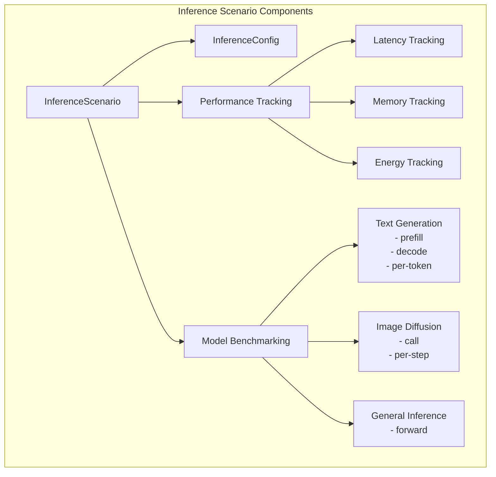
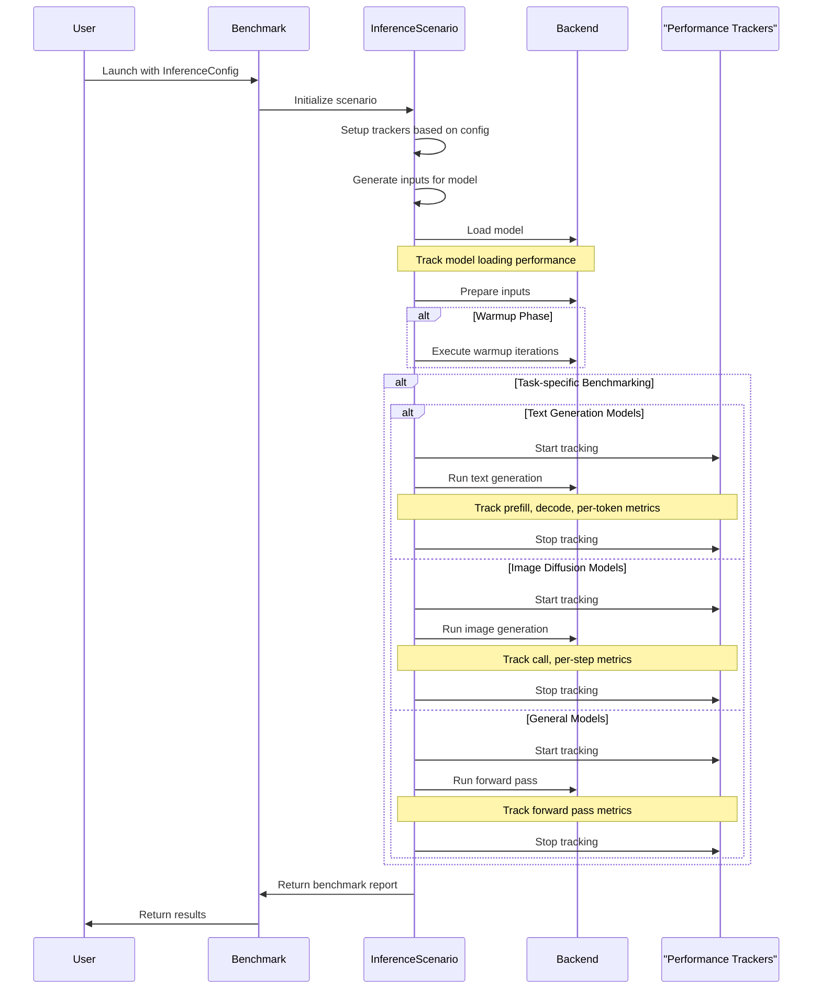
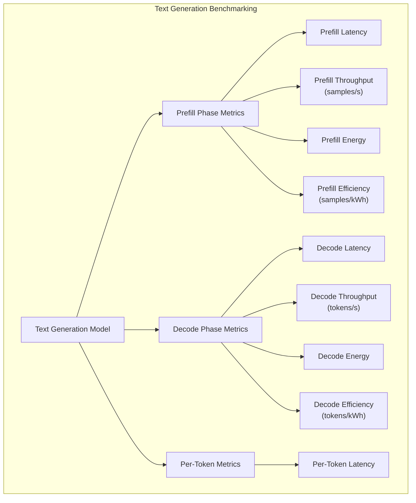
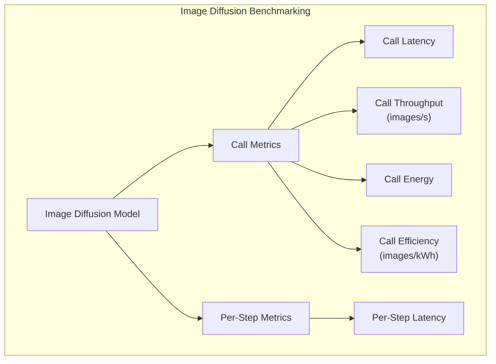
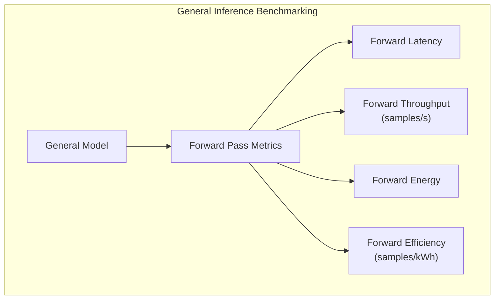
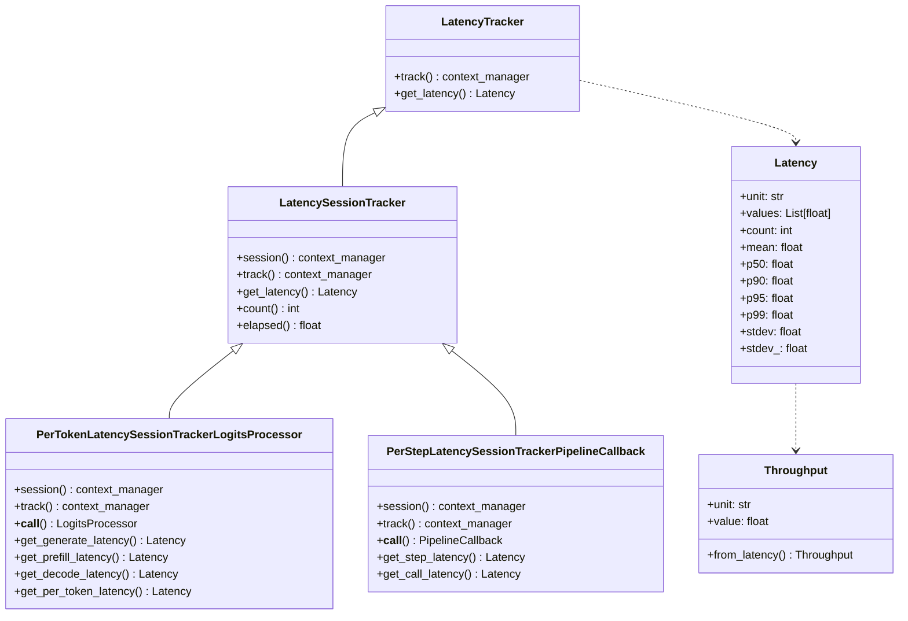
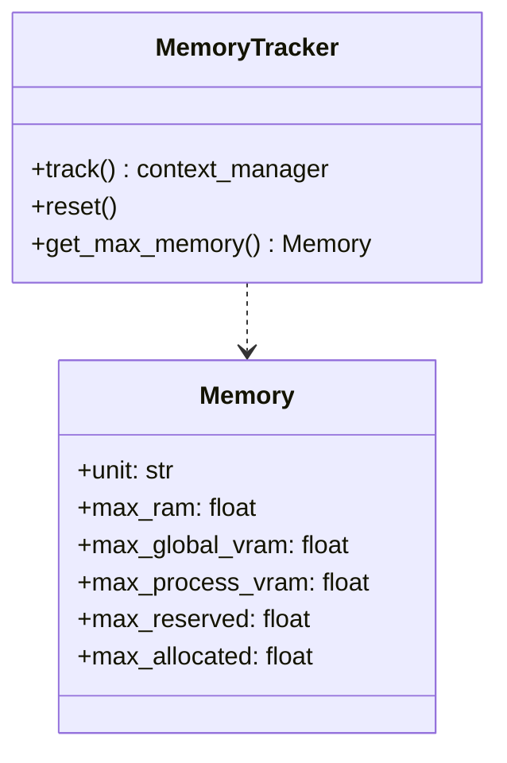
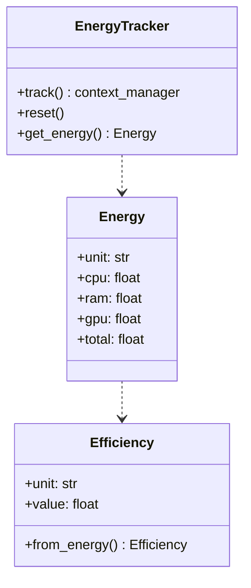
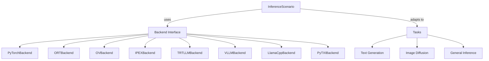
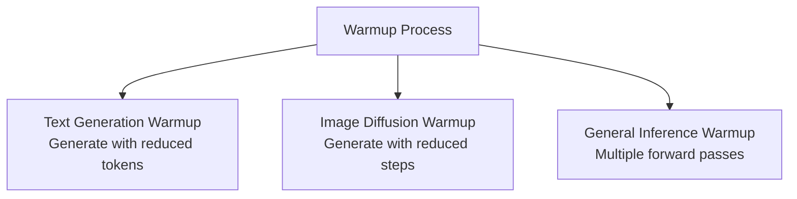

<!-- source: DeepWiki mcp.deepwiki.com · repo huggingface/optimum-benchmark · page 5.1 Inference Scenario · fetched 2026-10-26 -->

# Inference Scenario

<details>
<summary>Relevant source files</summary>

The following files were used as context for generating this wiki page:

- [optimum_benchmark/scenarios/energy_star/scenario.py](optimum_benchmark/scenarios/energy_star/scenario.py)
- [optimum_benchmark/scenarios/inference/scenario.py](optimum_benchmark/scenarios/inference/scenario.py)
- [optimum_benchmark/scenarios/training/scenario.py](optimum_benchmark/scenarios/training/scenario.py)
- [optimum_benchmark/trackers/energy.py](optimum_benchmark/trackers/energy.py)
- [optimum_benchmark/trackers/latency.py](optimum_benchmark/trackers/latency.py)
- [optimum_benchmark/trackers/memory.py](optimum_benchmark/trackers/memory.py)
- [tests/configs/_inference_.yaml](tests/configs/_inference_.yaml)
- [tests/test_api.py](tests/test_api.py)

</details>


This document details the Inference Scenario benchmarking component in optimum-benchmark, which measures model performance during inference operations. For training benchmarking, see [Training Scenario](#5.2). For energy efficiency benchmarking, see [Energy Star Scenario](#5.3).

## Purpose and Overview

The Inference Scenario is designed to provide comprehensive performance metrics for ML models during inference across various hardware and backend configurations. It supports different model types (text, image, etc.) and captures multiple performance aspects including latency, memory usage, and energy consumption.



Sources: [optimum_benchmark/scenarios/inference/scenario.py:61-173]()

## Configuration Options

The InferenceScenario is configured through the `InferenceConfig` class, which provides extensive options to control the benchmark behavior:

| Parameter | Type | Description |
|-----------|------|-------------|
| `latency` | bool | Enable latency tracking |
| `memory` | bool | Enable memory tracking |
| `energy` | bool | Enable energy consumption tracking |
| `duration` | int | Minimum duration for benchmarking (seconds) |
| `iterations` | int | Minimum number of iterations to run |
| `warmup_runs` | int | Number of warm-up iterations before measuring |
| `input_shapes` | dict | Model input dimensions (batch_size, sequence_length, etc.) |
| `generate_kwargs` | dict | Parameters for text generation (max_new_tokens, etc.) |
| `forward_kwargs` | dict | Parameters for model forward passes |
| `call_kwargs` | dict | Parameters for pipeline calls (e.g., diffusion steps) |

Example configuration from tests:

```yaml
scenario:
  memory: true
  latency: true
  duration: 1
  iterations: 1
  warmup_runs: 1
  input_shapes:
    batch_size: 1
    sequence_length: 16
  generate_kwargs:
    max_new_tokens: 16
    min_new_tokens: 16
  call_kwargs:
    num_inference_steps: 4
```

Sources: [tests/configs/_inference_.yaml:1-22](), [optimum_benchmark/scenarios/inference/scenario.py:65-67]()

## Benchmark Execution Flow

The InferenceScenario orchestrates a comprehensive benchmarking flow that adapts to different model types:



Sources: [optimum_benchmark/scenarios/inference/scenario.py:67-173]()

## Model Type Handling

The InferenceScenario implements specialized benchmarking for different types of models:

### Text Generation Models

For text generation models (like LLMs), the scenario:
1. Measures prefill phase (processing the input prompt)
2. Measures decode phase (generating new tokens)
3. Optionally tracks per-token latency for supported backends
4. Calculates throughput in tokens/second and samples/second
5. Measures token generation efficiency (tokens/kWh)



Sources: [optimum_benchmark/scenarios/inference/scenario.py:147-151](), [optimum_benchmark/scenarios/inference/scenario.py:231-245](), [optimum_benchmark/scenarios/inference/scenario.py:374-411]()

### Image Diffusion Models

For diffusion models (like Stable Diffusion), the scenario:
1. Measures overall pipeline call performance
2. Tracks per-step latency in the diffusion process
3. Calculates throughput in images/second
4. Measures image generation efficiency (images/kWh)



Sources: [optimum_benchmark/scenarios/inference/scenario.py:152-154](), [optimum_benchmark/scenarios/inference/scenario.py:246-252](), [optimum_benchmark/scenarios/inference/scenario.py:413-431]()

### General Inference Models

For standard models (classification, etc.), the scenario:
1. Measures forward pass performance
2. Calculates throughput in samples/second
3. Measures inference efficiency (samples/kWh)



Sources: [optimum_benchmark/scenarios/inference/scenario.py:155-165](), [optimum_benchmark/scenarios/inference/scenario.py:253-260](), [optimum_benchmark/scenarios/inference/scenario.py:433-451]()

## Performance Tracking System

The Inference Scenario leverages specialized tracker classes to monitor different performance aspects:

### Latency Tracking

Latency tracking measures execution time with different granularity levels:



Sources: [optimum_benchmark/trackers/latency.py:168-208](), [optimum_benchmark/trackers/latency.py:211-286](), [optimum_benchmark/trackers/latency.py:289-470](), [optimum_benchmark/trackers/latency.py:473-595]()

### Memory Tracking

Memory tracking monitors RAM and GPU memory consumption:



Sources: [optimum_benchmark/trackers/memory.py:126-271](), [optimum_benchmark/trackers/memory.py:44-124]()

### Energy Tracking

Energy tracking measures power consumption and calculates efficiency:



Sources: [optimum_benchmark/trackers/energy.py:150-260](), [optimum_benchmark/trackers/energy.py:32-104](), [optimum_benchmark/trackers/energy.py:107-147]()

## Integration with Backends

The Inference Scenario is designed to work with all backend implementations:



Key backend integrations include:
1. Task-specific API calls (`generate()`, `call()`, `forward()`)
2. Specialized tracking for PyTorch-CUDA (using CUDA events)
3. Special handling for token-by-token tracking with supported backends
4. Support for diffusion callback tracking with pipeline models

Sources: [optimum_benchmark/scenarios/inference/scenario.py:68-76](), [optimum_benchmark/scenarios/inference/scenario.py:135-145]()

## Warmup Mechanism

The scenario implements task-specific warmup mechanisms to ensure measurements reflect steady-state performance:



Text generation models warmup with shorter generation lengths, while diffusion models warmup with fewer diffusion steps. This helps stabilize the model performance before taking measurements.

Sources: [optimum_benchmark/scenarios/inference/scenario.py:202-228]()

## Common Usage Patterns

The Inference Scenario is typically used through the Benchmark API:

```python
# Create inference configuration
inference_config = InferenceConfig(
    latency=True,
    memory=True,
    energy=True,
    duration=5,
    iterations=3,
    warmup_runs=2,
    input_shapes={"batch_size": 1, "sequence_length": 128},
    generate_kwargs={"max_new_tokens": 50, "min_new_tokens": 50}
)

# Configure backend (example: PyTorch)
backend_config = PyTorchConfig(
    model="gpt2",
    task="text-generation",
    device="cuda"
)

# Create benchmark configuration
benchmark_config = BenchmarkConfig(
    name="gpt2-text-generation",
    scenario=inference_config,
    backend=backend_config
)

# Run benchmark
report = Benchmark.launch(benchmark_config)
```

Sources: [tests/test_api.py:76-87](), [tests/test_api.py:91-107]()

## Benchmark Report Structure

The Inference Scenario generates a structured benchmark report with metrics for each tracked stage:

For text generation models:
- `load_model`: Model loading metrics
- `first_generate`: Cold-start generation metrics
- `generate`: Text generation metrics (complete process)
- `prefill`: Prefill phase metrics
- `decode`: Decode phase metrics
- `per_token`: Token-by-token metrics (if available)

For image diffusion models:
- `load_model`: Model loading metrics
- `first_call`: Cold-start pipeline call metrics
- `call`: Pipeline call metrics
- `per_step`: Step-by-step diffusion metrics

For general inference models:
- `load_model`: Model loading metrics
- `first_forward`: Cold-start forward pass metrics
- `forward`: Forward pass metrics

Each section contains available latency, throughput, memory, energy, and efficiency metrics.

Sources: [optimum_benchmark/scenarios/inference/scenario.py:89-89]()

---

