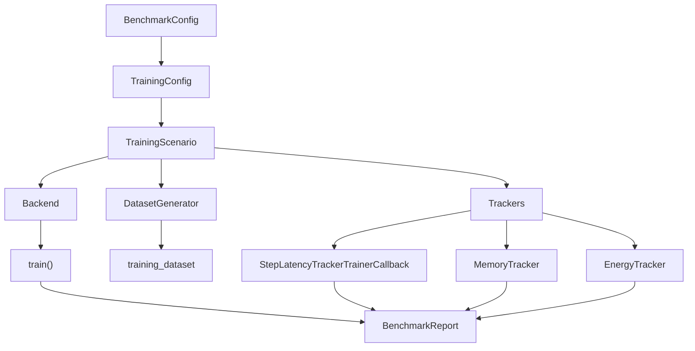
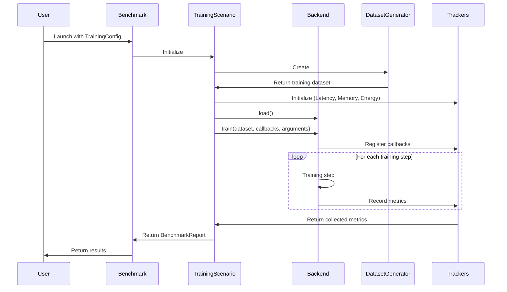
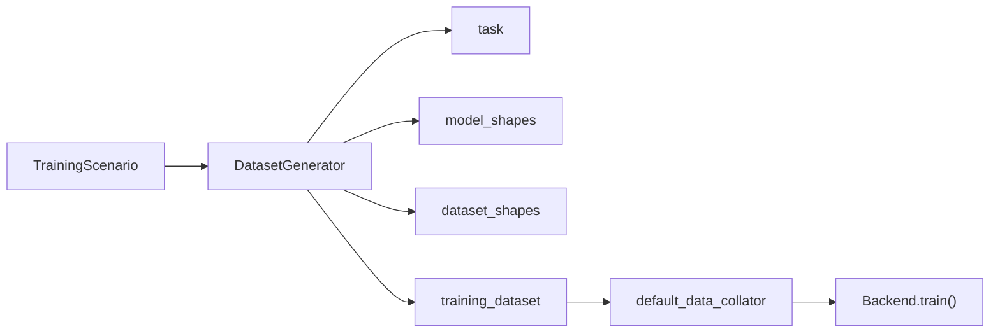
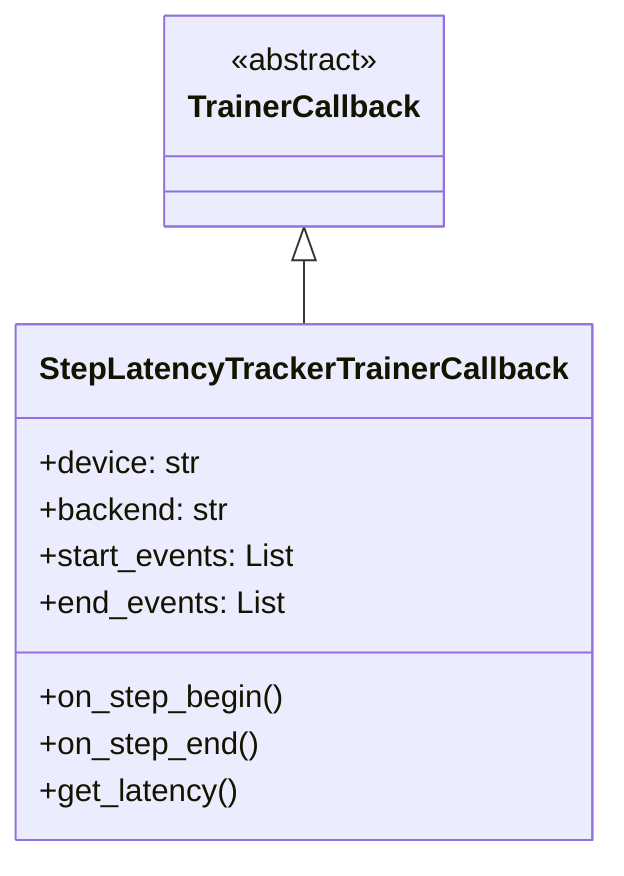
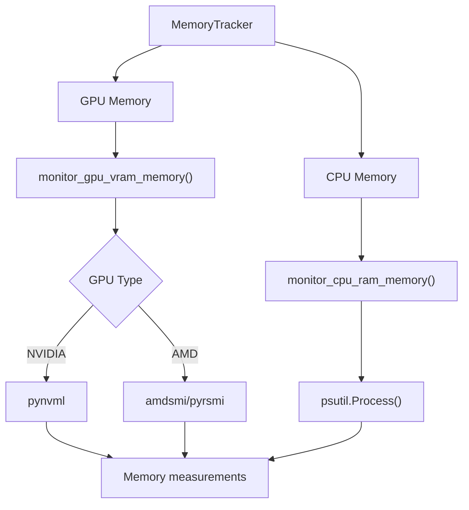
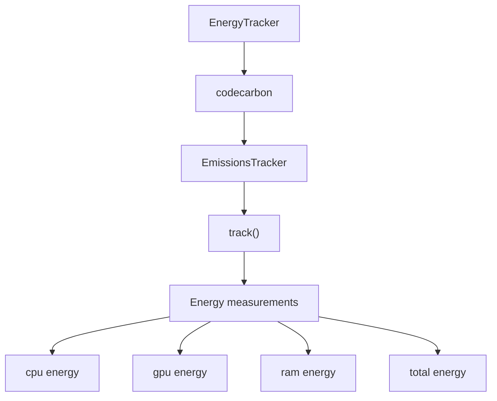

<!-- source: DeepWiki mcp.deepwiki.com · repo huggingface/optimum-benchmark · page 5.2 Training Scenario · fetched 2026-10-26 -->

# Training Scenario

<details>
<summary>Relevant source files</summary>

The following files were used as context for generating this wiki page:

- [optimum_benchmark/scenarios/energy_star/scenario.py](optimum_benchmark/scenarios/energy_star/scenario.py)
- [optimum_benchmark/scenarios/inference/scenario.py](optimum_benchmark/scenarios/inference/scenario.py)
- [optimum_benchmark/scenarios/training/scenario.py](optimum_benchmark/scenarios/training/scenario.py)
- [optimum_benchmark/trackers/energy.py](optimum_benchmark/trackers/energy.py)
- [optimum_benchmark/trackers/latency.py](optimum_benchmark/trackers/latency.py)
- [optimum_benchmark/trackers/memory.py](optimum_benchmark/trackers/memory.py)
- [tests/configs/_inference_.yaml](tests/configs/_inference_.yaml)
- [tests/test_api.py](tests/test_api.py)

</details>


The Training Scenario module provides a comprehensive framework for benchmarking machine learning model training performance across different hardware and backend configurations. It measures key metrics such as latency, memory usage, and energy consumption during the training process to help users make informed decisions about hardware and software optimizations for training workloads.

For information about inference benchmarking, see [Inference Scenario](#5.1).

## Overview

The Training Scenario integrates with the broader optimum-benchmark architecture to provide standardized training performance evaluation. It specifically focuses on measuring performance metrics during the training phase of machine learning models, tracking both the warmup phase and the main training phase separately.



Sources: [optimum_benchmark/scenarios/training/scenario.py:18-117]()

## Components and Execution Flow

The Training Scenario orchestrates several key components to perform a complete training benchmark:



Sources: [optimum_benchmark/scenarios/training/scenario.py:24-92]()

### Dataset Generation

Training benchmarks require datasets to train on. The scenario uses `DatasetGenerator` to create a synthetic dataset appropriate for the task and model being benchmarked.



Sources: [optimum_benchmark/scenarios/training/scenario.py:25-31]()

## Metrics Tracking

The Training Scenario collects three primary types of metrics:

1. **Latency**: Measures the time taken for each training step
2. **Memory**: Monitors RAM and GPU memory usage
3. **Energy**: Tracks energy consumption across CPU, RAM, and GPU

### Latency Tracking

Latency tracking is implemented using a specialized `StepLatencyTrackerTrainerCallback` that hooks into the HuggingFace Trainer's step events:



The callback records timing events at the beginning and end of each training step, allowing precise measurement of per-step latency.

Sources: [optimum_benchmark/trackers/latency.py:598-650]()

### Memory Tracking

Memory tracking monitors both CPU and GPU memory usage during training:



For PyTorch CUDA backends, additional metrics are collected using PyTorch's memory tracking APIs.

Sources: [optimum_benchmark/trackers/memory.py:126-270]()

### Energy Tracking

Energy tracking measures power consumption across different hardware components:



Energy is reported in kilowatt-hours (kWh) and efficiency is calculated as samples processed per kWh.

Sources: [optimum_benchmark/trackers/energy.py:150-260]()

## Configuration Options

The `TrainingConfig` class allows customization of various benchmark parameters:

| Parameter | Description | Default |
|-----------|-------------|---------|
| `latency` | Enable latency tracking | `True` |
| `memory` | Enable memory tracking | `True` |
| `energy` | Enable energy tracking | `True` |
| `warmup_steps` | Number of initial steps to consider as warmup | `2` |
| `max_steps` | Total number of training steps to run | `5` |
| `dataset_shapes` | Size parameters for generated dataset | - |
| `training_arguments` | Arguments passed to trainer | - |

Example configuration from test code:

```
scenario_config = TrainingConfig(
    memory=True,
    latency=True,
    energy=True,
    warmup_steps=2,
    max_steps=5,
)
```

Sources: [tests/test_api.py:68-74]()

## Benchmark Reports

The Training Scenario produces a structured report with metrics for three measurement categories:

1. **overall**: Metrics for the entire training run (warmup + training)
2. **warmup**: Metrics for just the warmup steps
3. **train**: Metrics for the actual training steps (excluding warmup)

For each category, the following metrics are reported when enabled:

- **Latency**: Mean, min, max, percentiles (p50, p90, p95, p99)
- **Throughput**: Samples processed per second
- **Memory**: RAM and GPU memory usage
- **Energy**: Energy consumption in kWh
- **Efficiency**: Samples processed per kWh

Sources: [optimum_benchmark/scenarios/training/scenario.py:34-92]()

## Volume Calculations

The Training Scenario calculates three "volume" metrics, which represent the number of samples processed:

```python
@property
def overall_volume(self) -> int:
    return (
        self.config.max_steps
        * self.config.training_arguments["per_device_train_batch_size"]
        * self.config.training_arguments["gradient_accumulation_steps"]
    )

@property
def warmup_volume(self) -> int:
    return (
        self.config.warmup_steps
        * self.config.training_arguments["per_device_train_batch_size"]
        * self.config.training_arguments["gradient_accumulation_steps"]
    )

@property
def train_volume(self) -> int:
    return (
        (self.config.max_steps - self.config.warmup_steps)
        * self.config.training_arguments["per_device_train_batch_size"]
        * self.config.training_arguments["gradient_accumulation_steps"]
    )
```

These volume calculations are used to compute throughput and efficiency metrics.

Sources: [optimum_benchmark/scenarios/training/scenario.py:94-116]()

## Usage Example

Here's how to configure and run a training benchmark:

```python
from optimum_benchmark import Benchmark, BenchmarkConfig, TrainingConfig, ProcessConfig, PyTorchConfig

# Configure the training scenario
training_config = TrainingConfig(
    memory=True,
    latency=True,
    energy=True,
    warmup_steps=2,
    max_steps=10,
    training_arguments={
        "per_device_train_batch_size": 8,
        "gradient_accumulation_steps": 1,
        "learning_rate": 5e-5,
        "weight_decay": 0.01,
    }
)

# Configure the backend
backend_config = PyTorchConfig(
    device="cuda",
    device_ids="0",
    model="bert-base-uncased",
    task="text-classification"
)

# Configure the launcher
launcher_config = ProcessConfig(device_isolation=True)

# Create the benchmark configuration
benchmark_config = BenchmarkConfig(
    name="training_benchmark",
    scenario=training_config,
    launcher=launcher_config,
    backend=backend_config,
    print_report=True,
    log_report=True
)

# Launch the benchmark
benchmark_report = Benchmark.launch(benchmark_config)
```

Sources: [tests/test_api.py:38-110]()

## Limitations and Compatibility

- Training benchmarks are currently only supported with transformers library models
- Not all backend implementations support training (e.g., ONNX Runtime, TensorRT-LLM)
- Energy tracking may not be supported on all platforms (e.g., ROCm systems)

Sources: [tests/test_api.py:42-43]()

---

