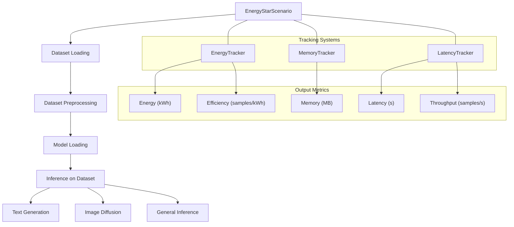
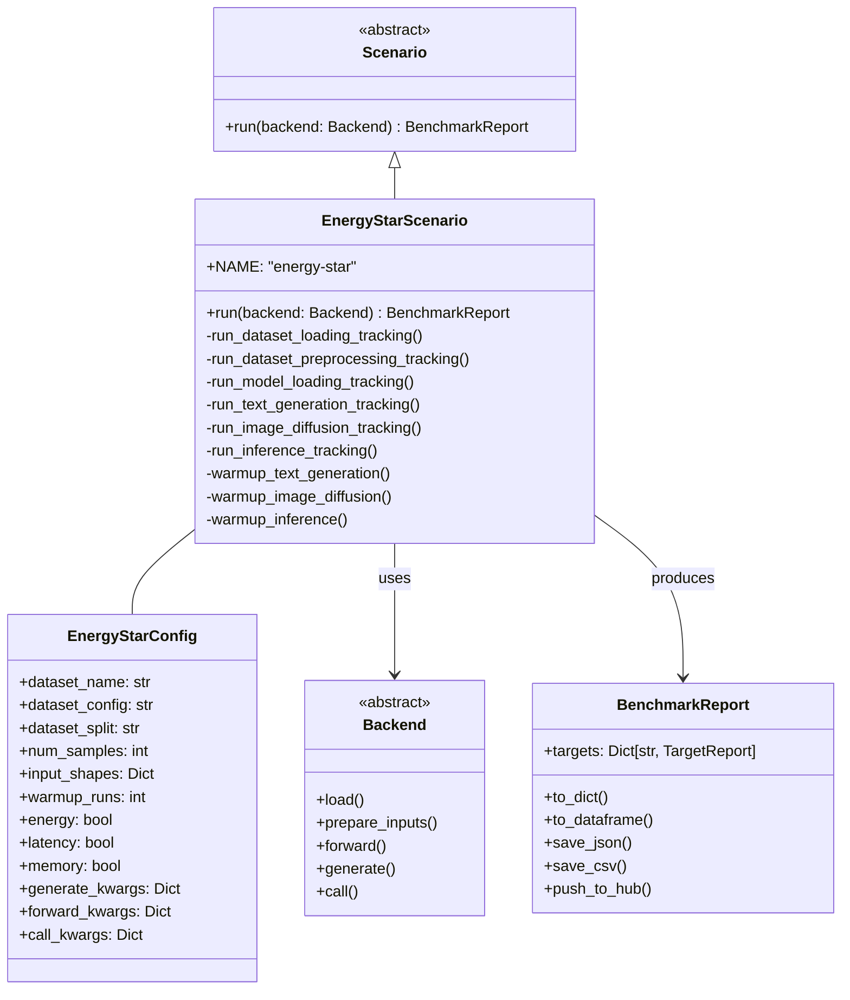
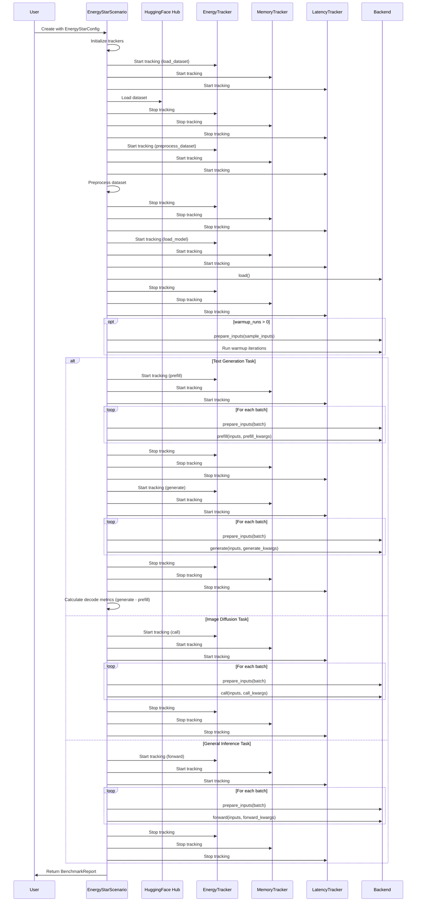

<!-- source: DeepWiki mcp.deepwiki.com · repo huggingface/optimum-benchmark · page 5.3 Energy Star Scenario · fetched 2026-10-26 -->

# Energy Star Scenario

<details>
<summary>Relevant source files</summary>

The following files were used as context for generating this wiki page:

- [optimum_benchmark/scenarios/energy_star/scenario.py](optimum_benchmark/scenarios/energy_star/scenario.py)
- [optimum_benchmark/scenarios/inference/scenario.py](optimum_benchmark/scenarios/inference/scenario.py)
- [optimum_benchmark/scenarios/training/scenario.py](optimum_benchmark/scenarios/training/scenario.py)
- [optimum_benchmark/trackers/energy.py](optimum_benchmark/trackers/energy.py)
- [optimum_benchmark/trackers/latency.py](optimum_benchmark/trackers/latency.py)
- [optimum_benchmark/trackers/memory.py](optimum_benchmark/trackers/memory.py)
- [tests/configs/_inference_.yaml](tests/configs/_inference_.yaml)
- [tests/test_api.py](tests/test_api.py)

</details>


The Energy Star Scenario is a specialized benchmarking approach designed to evaluate energy efficiency and resource consumption of machine learning models when processing complete datasets. Unlike the standard [Inference Scenario](#5.1) which focuses on isolated performance measurements, the Energy Star Scenario provides a holistic view of a model's energy footprint throughout the entire inference pipeline, including dataset loading, preprocessing, model loading, and inference across a dataset.

## Overview



Sources: 
- [optimum_benchmark/scenarios/energy_star/scenario.py:56-352]()
- [optimum_benchmark/trackers/energy.py:150-260]()
- [optimum_benchmark/trackers/memory.py:126-270]()

## Architecture

The Energy Star Scenario fits into the overall benchmarking framework as one of three available scenarios, alongside Inference and Training. It's specifically designed for measuring real-world energy consumption patterns.



Sources:
- [optimum_benchmark/scenarios/energy_star/scenario.py:56-62]()
- [optimum_benchmark/scenarios/base.py]()

## Execution Flow

The Energy Star Scenario follows a specific workflow to measure the end-to-end energy consumption:



Sources:
- [optimum_benchmark/scenarios/energy_star/scenario.py:62-131]()
- [optimum_benchmark/scenarios/energy_star/scenario.py:226-324]()

## Tracking Mechanisms

The Energy Star Scenario relies on three primary tracking mechanisms:

### Energy Tracking

Energy tracking is performed using the `EnergyTracker` class, which utilizes the codecarbon library to measure energy consumption across different hardware components:

| Component | Measurement |
|-----------|-------------|
| CPU       | Energy used by processor |
| RAM       | Energy used by system memory |
| GPU       | Energy used by graphics processor |
| Total     | Combined energy consumption |

The energy is reported in kilowatt-hours (kWh), and the system calculates efficiency metrics such as samples/kWh to measure how many processing units can be completed per unit of energy.

### Memory Tracking

Memory usage is tracked using the `MemoryTracker` class, which monitors:

| Memory Type | Description |
|-------------|-------------|
| RAM         | System memory usage |
| Global VRAM | Total GPU memory usage (if applicable) |
| Process VRAM | GPU memory used by the process (if applicable) |
| Reserved Memory | Memory reserved by the framework (PyTorch) |
| Allocated Memory | Memory actively allocated (PyTorch) |

Memory metrics are reported in megabytes (MB).

### Latency Tracking

Timing performance is measured using the `LatencyTracker` class, which records execution time for each operation. From these measurements, throughput metrics are calculated to show processing speed.

Sources:
- [optimum_benchmark/trackers/energy.py:150-260]()
- [optimum_benchmark/trackers/memory.py:126-270]()
- [optimum_benchmark/trackers/latency.py:168-208]()

## Task-Specific Metrics

The Energy Star Scenario reports different metrics based on the task being benchmarked:

### Text Generation Metrics

For text generation tasks, the following stages are measured separately:

1. **Prefill Stage** (processing the input prompt):
   - Latency (s)
   - Memory (MB)
   - Energy (kWh)
   - Throughput (samples/s)
   - Efficiency (samples/kWh)

2. **Decode Stage** (generating the output tokens):
   - Latency (s)
   - Memory (MB)
   - Energy (kWh)
   - Throughput (tokens/s)
   - Efficiency (tokens/kWh)

### Image Diffusion Metrics

For image diffusion tasks:

- Latency (s)
- Memory (MB)
- Energy (kWh)
- Throughput (images/s)
- Efficiency (images/kWh)

### General Inference Metrics

For other inference tasks:

- Latency (s)
- Memory (MB)
- Energy (kWh)
- Throughput (samples/s)
- Efficiency (samples/kWh)

Sources:
- [optimum_benchmark/scenarios/energy_star/scenario.py:43-53]()
- [optimum_benchmark/scenarios/energy_star/scenario.py:226-324]()

## Configuration Options

The Energy Star Scenario is highly configurable through the `EnergyStarConfig` class:

### Dataset Configuration

```python
# Dataset configuration
dataset_name = "glue"            # HuggingFace dataset name
dataset_config = "mrpc"          # Dataset configuration
dataset_split = "validation"     # Dataset split to use
num_samples = 100                # Number of samples to process
```

### Tracking Options

```python
# Which metrics to track
energy = True                    # Track energy consumption
latency = True                   # Track latency and throughput
memory = True                    # Track memory usage
```

### Model Configuration

```python
# Task-specific parameters
input_shapes = {
    "batch_size": 8,             # Batch size for processing
    "sequence_length": 128       # For text processing tasks
}

# Text generation parameters
generate_kwargs = {
    "max_new_tokens": 100,       # Maximum tokens to generate
    "min_new_tokens": 100,       # Minimum tokens to generate
    "num_beams": 1,              # Beam search size
    "do_sample": False           # Whether to sample or greedy decode
}

# Image diffusion parameters
call_kwargs = {
    "num_inference_steps": 30,   # Number of diffusion steps
    "num_images_per_prompt": 1   # Images to generate per prompt
}
```

Sources:
- [optimum_benchmark/scenarios/energy_star/scenario.py:16-40]()
- [tests/configs/_inference_.yaml:1-22]()

## Integration with Backends

The Energy Star Scenario is designed to work with all available backends in the Optimum Benchmark framework, including:

- PyTorch
- ONNX Runtime
- OpenVINO
- IPEX
- TensorRT-LLM
- vLLM
- LlamaCpp
- PyTXI

The backend implementation determines how the model is loaded and executed, while the Energy Star Scenario focuses on how to measure and report the energy efficiency metrics.

## Use Cases

The Energy Star Scenario is particularly useful for:

1. **Green AI Research**: Evaluating and comparing the environmental impact of different models and optimization techniques
2. **Infrastructure Planning**: Estimating energy costs for running inference at scale
3. **Model Selection**: Choosing the most energy-efficient model for deployment
4. **Optimization Verification**: Measuring the energy savings from model optimizations
5. **Regulatory Compliance**: Documenting energy efficiency for compliance with environmental standards

## Example Workflow

A typical usage of the Energy Star Scenario involves:

1. Selecting an appropriate dataset that represents real-world usage
2. Configuring the scenario with the desired tracking options
3. Running the benchmark with a specific backend implementation
4. Analyzing the energy, memory, and latency metrics to evaluate efficiency
5. Comparing results with different model optimizations or hardware configurations

Sources:
- [optimum_benchmark/scenarios/energy_star/scenario.py:56-131]()

---

