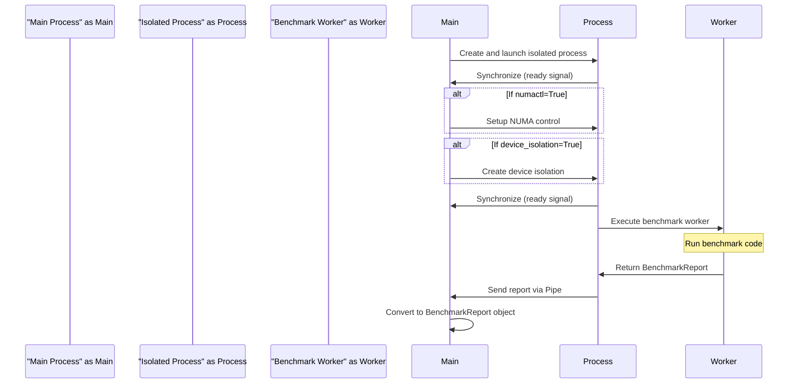
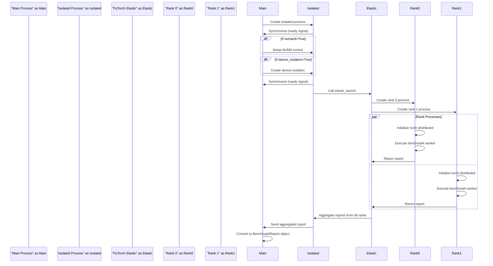
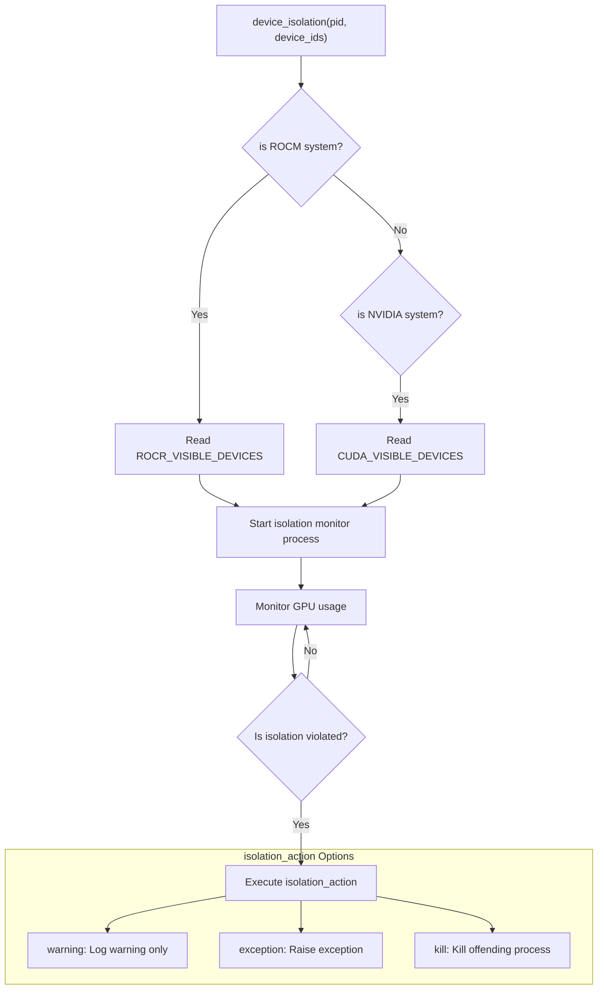
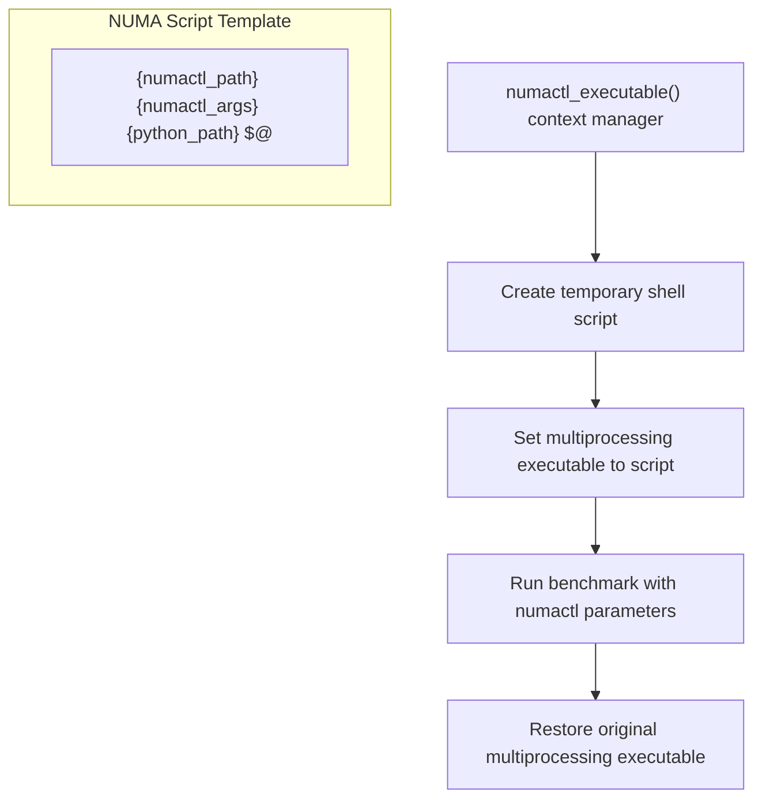

<!-- source: DeepWiki mcp.deepwiki.com · repo huggingface/optimum-benchmark · page 6 Launcher System · fetched 2026-10-26 -->

# Launcher System

<details>
<summary>Relevant source files</summary>

The following files were used as context for generating this wiki page:

- [.github/workflows/test_cli_misc.yaml](.github/workflows/test_cli_misc.yaml)
- [optimum_benchmark/launchers/base.py](optimum_benchmark/launchers/base.py)
- [optimum_benchmark/launchers/inline/launcher.py](optimum_benchmark/launchers/inline/launcher.py)
- [optimum_benchmark/launchers/process/launcher.py](optimum_benchmark/launchers/process/launcher.py)
- [optimum_benchmark/launchers/torchrun/launcher.py](optimum_benchmark/launchers/torchrun/launcher.py)
- [tests/test_cli.py](tests/test_cli.py)

</details>


The Launcher System in optimum-benchmark provides the infrastructure for executing benchmark workloads in different environments and configurations. It controls how and where benchmark code runs - from simple in-process execution to isolated processes and distributed multi-node setups. This system ensures benchmarks can be executed consistently across different hardware configurations while providing isolation capabilities for accurate measurements.

For information about benchmark scenarios that run within these launchers, see [Benchmarking Scenarios](#5).

## Architecture Overview

The Launcher System follows an object-oriented design with a base abstract class and specialized implementations:

```mermaid
classDiagram
    class "Launcher[LauncherConfigT]" {
        <<abstract>>
        +NAME: ClassVar[str]
        +config: LauncherConfigT
        +logger
        +launch(worker, worker_args): BenchmarkReport
        +device_isolation(pid, device_ids)
        +numactl_executable()
    }
    
    class "InlineLauncher" {
        +NAME = "inline"
        +launch(worker, worker_args): BenchmarkReport
    }
    
    class "ProcessLauncher" {
        +NAME = "process"
        +launch(worker, worker_args): BenchmarkReport
    }
    
    class "TorchrunLauncher" {
        +NAME = "torchrun"
        +launch_config: LaunchConfig
        +launch(worker, worker_args): BenchmarkReport
    }
    
    "Launcher[LauncherConfigT]" <|-- "InlineLauncher"
    "Launcher[LauncherConfigT]" <|-- "ProcessLauncher"
    "Launcher[LauncherConfigT]" <|-- "TorchrunLauncher"
```

Sources: [optimum_benchmark/launchers/base.py:26-96](), [optimum_benchmark/launchers/inline/launcher.py:8-19](), [optimum_benchmark/launchers/process/launcher.py:18-77](), [optimum_benchmark/launchers/torchrun/launcher.py:20-104]()

Each launcher implements the abstract `launch()` method with behavior specific to its execution model. All launchers take a worker function and its arguments, execute the worker in their respective environment, and return a `BenchmarkReport`.

## Launcher Types and Capabilities

| Launcher Type | Purpose | Isolation | Distributed | Use Cases |
|---------------|---------|-----------|-------------|-----------|
| InlineLauncher | Executes benchmark in the same process | None | No | Debugging, development |
| ProcessLauncher | Executes benchmark in an isolated process | Process | No | Single-device benchmarks, accurate measurement |
| TorchrunLauncher | Executes benchmark across distributed processes | Process | Yes | Multi-GPU, multi-node benchmarks |

Sources: [optimum_benchmark/launchers/inline/launcher.py](), [optimum_benchmark/launchers/process/launcher.py](), [optimum_benchmark/launchers/torchrun/launcher.py]()

### InlineLauncher

The simplest launcher that runs the benchmark worker directly in the current process. It offers no isolation guarantees and is primarily intended for debugging rather than for collecting accurate benchmark metrics.

```python
# Simplified implementation
def launch(self, worker, worker_args):
    self.logger.warning("The inline launcher is only recommended for debugging purposes")
    report = worker(*worker_args)
    return report
```

Sources: [optimum_benchmark/launchers/inline/launcher.py:14-19]()

### ProcessLauncher

Executes benchmarks in isolated processes to provide accurate measurements by eliminating interference from other Python code. It uses multiprocessing's `Pipe` for communication between the main process and the isolated benchmark process.

### TorchrunLauncher

Leverages PyTorch's distributed capabilities to run benchmarks across multiple GPUs or nodes. It's the most sophisticated launcher, supporting distributed training scenarios and large model inference with tensor parallelism.

## Execution Flow

### ProcessLauncher Execution Flow



Sources: [optimum_benchmark/launchers/process/launcher.py:28-76](), [optimum_benchmark/launchers/process/launcher.py:79-113]()

### TorchrunLauncher Execution Flow



Sources: [optimum_benchmark/launchers/torchrun/launcher.py:46-104](), [optimum_benchmark/launchers/torchrun/launcher.py:107-143](), [optimum_benchmark/launchers/torchrun/launcher.py:146-177]()

## Advanced Features

### Device Isolation

All launchers support device isolation to ensure the benchmark has exclusive access to GPU resources. This prevents interference from other processes that might try to use the GPU during benchmarking.



Sources: [optimum_benchmark/launchers/base.py:39-61]()

### NUMA Control

For benchmarks on CPU systems with NUMA architecture, the launcher system supports `numactl` to optimize CPU core and memory allocation, leading to more consistent and often better performance.



Sources: [optimum_benchmark/launchers/base.py:63-92]()

## Configuration Options

Each launcher type has its own configuration class that allows customizing its behavior:

### Common Configuration Options

| Option | Description | Default | Used By |
|--------|-------------|---------|---------|
| `start_method` | Python multiprocessing start method (`fork`, `spawn`, `forkserver`) | `spawn` | ProcessLauncher, TorchrunLauncher |
| `numactl` | Whether to use NUMA control | `False` | ProcessLauncher, TorchrunLauncher |
| `numactl_kwargs` | Arguments to pass to numactl (e.g., `cpunodebind`, `membind`) | `{}` | ProcessLauncher, TorchrunLauncher |
| `device_isolation` | Whether to isolate GPU devices | `False` | ProcessLauncher, TorchrunLauncher |
| `device_isolation_action` | Action on isolation violation (`warning`, `exception`, `kill`) | `warning` | ProcessLauncher, TorchrunLauncher |

### TorchrunLauncher-specific Options

| Option | Description | Default |
|--------|-------------|---------|
| `nproc_per_node` | Number of processes per node | `1` |
| `min_nodes` | Minimum number of nodes | `1` |
| `max_nodes` | Maximum number of nodes | `1` |
| `rdzv_backend` | Rendezvous backend | `c10d` |
| `rdzv_endpoint` | Rendezvous endpoint | `localhost:29500` |
| `rdzv_id` | Rendezvous ID | (random) |
| `role` | Process role | `default` |

Sources: [optimum_benchmark/launchers/torchrun/launcher.py:30-44]()

## Usage Examples

Launchers are typically selected via configuration in the CLI:

```bash
# Using ProcessLauncher
optimum-benchmark --config-name <config> launcher=process

# Using TorchrunLauncher with 2 GPUs
optimum-benchmark --config-name <config> launcher=torchrun launcher.nproc_per_node=2

# Using ProcessLauncher with NUMA control
optimum-benchmark --config-name <config> launcher=process launcher.numactl=True
```

Sources: [tests/test_cli.py:54-76](), [tests/test_cli.py:106-129]()

## Platform Compatibility

| Launcher | Linux | macOS | Windows | Notes |
|----------|-------|-------|---------|-------|
| InlineLauncher | ✓ | ✓ | ✓ | Fully supported on all platforms |
| ProcessLauncher | ✓ | ✓ | ✓ | NUMA control only available on Linux |
| TorchrunLauncher | ✓ | ✓ | ✗ | Not supported on Windows |

Sources: [tests/test_cli.py:54-57](), [.github/workflows/test_cli_misc.yaml:32-68]()

## Technical Implementation Details

### Process Communication

Both the `ProcessLauncher` and `TorchrunLauncher` use Python's multiprocessing `Pipe` for inter-process communication, enabling the transfer of benchmark reports from isolated processes back to the main process.

### Report Aggregation

The `TorchrunLauncher` uniquely supports aggregating benchmark reports from multiple rank processes, allowing it to produce a unified report for distributed benchmarks:

```python
# Simplified aggregation flow
reports = []
for output in response:
    if "report" in output:
        reports.append(BenchmarkReport.from_dict(output["report"]))
report = BenchmarkReport.aggregate_across_processes(reports)
```

Sources: [optimum_benchmark/launchers/torchrun/launcher.py:84-103]()

### Error Handling

All launchers implement robust error handling to ensure that exceptions in benchmark code are properly captured and propagated back to the main process:

```python
# In isolated process
try:
    report = worker(*worker_args)
except Exception:
    # Send traceback to main process
    child_connection.send({"traceback": traceback.format_exc()})
```

Sources: [optimum_benchmark/launchers/process/launcher.py:102-107](), [optimum_benchmark/launchers/torchrun/launcher.py:131-136](), [optimum_benchmark/launchers/torchrun/launcher.py:165-169]()

## Related Components

The Launcher System works closely with:

- The Benchmark API that provides the worker functions
- Backend implementations that are executed within the launcher
- The tracking system that measures performance metrics
- The scenario implementations that define the benchmark methodology

For more information on benchmark scenarios that utilize the launcher system, see [Benchmarking Scenarios](#5).

---

