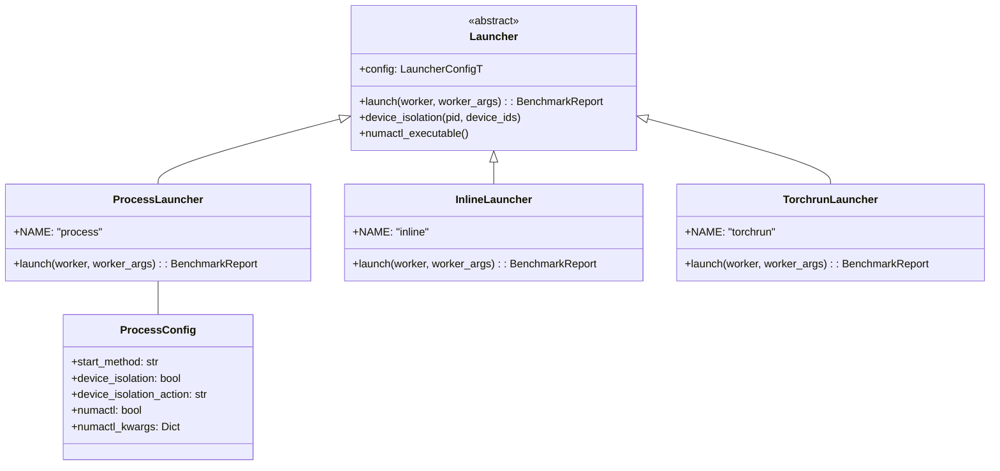
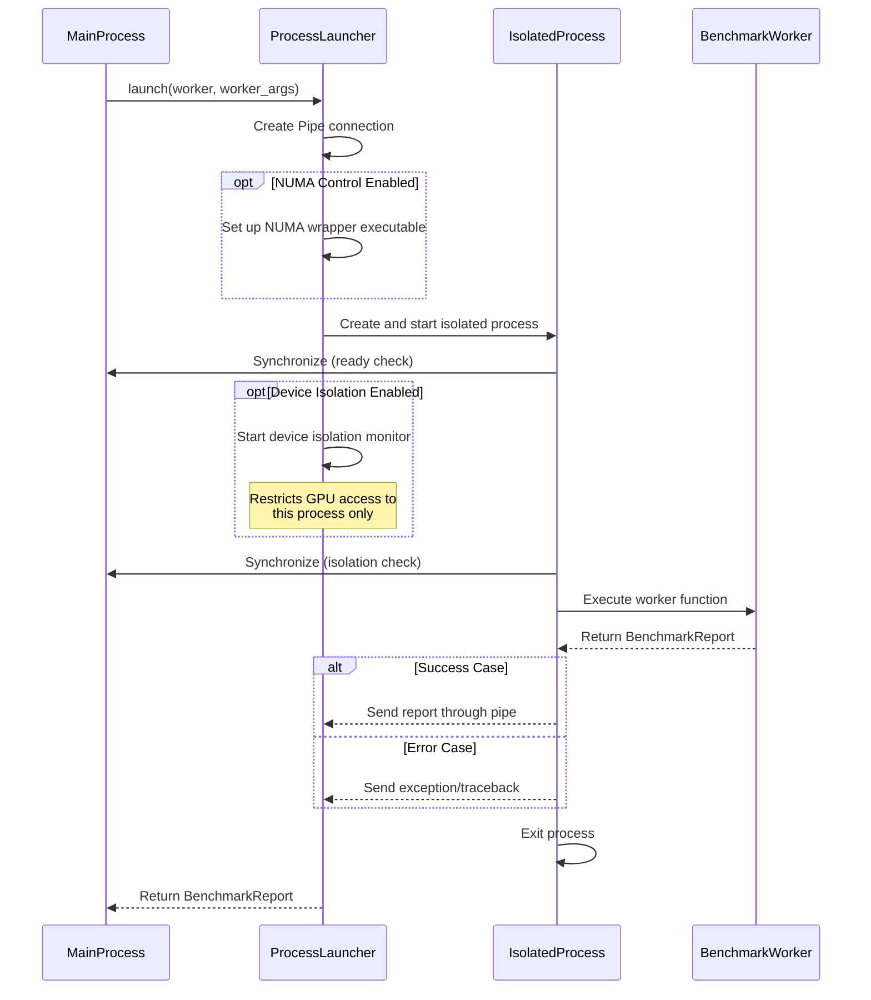
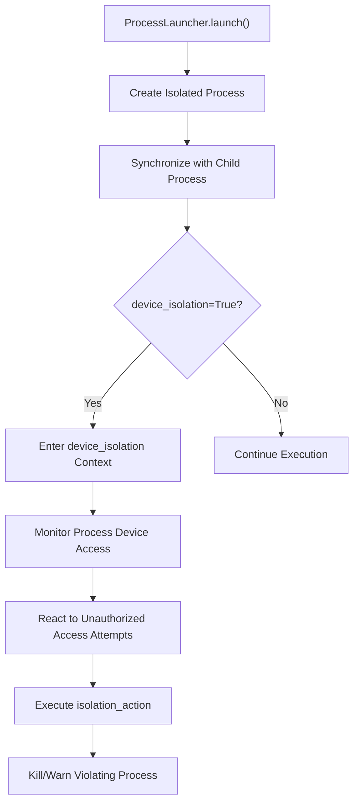

<!-- source: DeepWiki mcp.deepwiki.com · repo huggingface/optimum-benchmark · page 6.1 Process Launcher · fetched 2026-10-26 -->

# Process Launcher

<details>
<summary>Relevant source files</summary>

The following files were used as context for generating this wiki page:

- [.github/workflows/test_cli_misc.yaml](.github/workflows/test_cli_misc.yaml)
- [optimum_benchmark/launchers/base.py](optimum_benchmark/launchers/base.py)
- [optimum_benchmark/launchers/inline/launcher.py](optimum_benchmark/launchers/inline/launcher.py)
- [optimum_benchmark/launchers/process/launcher.py](optimum_benchmark/launchers/process/launcher.py)
- [optimum_benchmark/launchers/torchrun/launcher.py](optimum_benchmark/launchers/torchrun/launcher.py)
- [tests/test_cli.py](tests/test_cli.py)

</details>


The Process Launcher is a critical component of the optimum-benchmark framework responsible for executing benchmark workloads in isolated processes. This isolation ensures consistent and reliable benchmarking results by separating the benchmark execution environment from the main application. For other execution methods, see [Inline Launcher](#6.3) and [Torchrun Launcher](#6.2).

## Architecture and Position Within the System

The ProcessLauncher is one of three launcher implementations in the optimum-benchmark system, each providing different execution environments for benchmarks:



Sources: [optimum_benchmark/launchers/base.py](), [optimum_benchmark/launchers/process/launcher.py](), [optimum_benchmark/launchers/inline/launcher.py](), [optimum_benchmark/launchers/torchrun/launcher.py]()

## Process Isolation Mechanism

The Process Launcher creates a separate Python process to execute benchmarks, providing isolation from the main application. This prevents potential interference from the main process while ensuring accurate performance measurements.



Sources: [optimum_benchmark/launchers/process/launcher.py:28-76]()

## Key Features

### 1. Process Isolation

The primary benefit of the Process Launcher is that it runs benchmark workloads in isolated processes, which provides several advantages:

- Prevents resource contention with the main application
- Ensures clean memory state for each benchmark
- Allows for more accurate memory tracking
- Enables separate error handling and logging
- Prevents global state from the main application affecting benchmark results

### 2. Device Isolation

Process Launcher can enforce device isolation to ensure that only the benchmark process has access to specified GPU devices:



Sources: [optimum_benchmark/launchers/base.py:39-62](), [optimum_benchmark/launchers/process/launcher.py:46-47]()

### 3. NUMA Control

For CPU benchmarks, the Process Launcher includes NUMA (Non-Uniform Memory Access) control capabilities to bind processes to specific CPU cores/nodes:

- Creates a temporary executable wrapper around Python using `numactl`
- Allows fine-grained control over CPU affinity and memory allocation policies
- Helps produce more consistent and reproducible CPU benchmark results
- Can specify NUMA configuration through `numactl_kwargs`

Sources: [optimum_benchmark/launchers/base.py:64-92](), [optimum_benchmark/launchers/process/launcher.py:36-37]()

## Implementation Details

### Initialization

The ProcessLauncher initialization sets up the multiprocessing start method:

```python
def __init__(self, config: ProcessConfig):
    super().__init__(config)

    if get_start_method(allow_none=True) != self.config.start_method:
        self.logger.info(f"\t+ Setting multiprocessing start method to {self.config.start_method}")
        set_start_method(self.config.start_method, force=True)
```

Sources: [optimum_benchmark/launchers/process/launcher.py:18-26]()

### Launch Method

The `launch()` method is the core functionality of the ProcessLauncher:

1. Creates a bidirectional pipe for communication with the isolated process
2. Starts an isolated process running the worker function
3. Synchronizes with the child process at key points
4. Optionally applies device isolation and NUMA control
5. Waits for the process to complete and collects results
6. Handles errors and returns the benchmark report

Sources: [optimum_benchmark/launchers/process/launcher.py:28-76]()

### Worker Process Target Function

The isolated process runs a target function that:

1. Sets up logging for the isolated process
2. Synchronizes with the main process
3. Executes the worker function with the provided arguments
4. Captures any exceptions or the benchmark report
5. Sends the result back to the main process through the pipe connection
6. Exits the process cleanly

Sources: [optimum_benchmark/launchers/process/launcher.py:79-113]()

## Configuration Options

The ProcessLauncher accepts various configuration options through the `ProcessConfig` class:

| Option | Description | Default |
|--------|-------------|---------|
| `start_method` | Multiprocessing start method ('spawn', 'fork', 'forkserver') | 'spawn' |
| `device_isolation` | Whether to enable device isolation | `False` |
| `device_isolation_action` | Action to take on isolation violation ('warn', 'kill') | 'warn' |
| `numactl` | Whether to enable NUMA control | `False` |
| `numactl_kwargs` | NUMA control parameters (e.g., 'cpunodebind', 'membind') | `{}` |

Sources: [optimum_benchmark/launchers/process/launcher.py](), [optimum_benchmark/launchers/base.py]()

## Usage and Examples

Process Launcher is typically selected in the benchmark configuration when isolated execution is desired. It can be explicitly specified in CLI commands:

```bash
optimum-benchmark --config-name my_config launcher=process
```

Or with specific launcher options:

```bash
optimum-benchmark --config-name my_config launcher=process launcher.device_isolation=True
```

Tests demonstrate usage of different launcher types, including Process Launcher:

```python
@pytest.mark.parametrize("launcher", ["inline", "process", "torchrun"])
def test_cli_exit_code_0(launcher):
    args_0 = [
        "optimum-benchmark",
        "--config-dir",
        TEST_CONFIG_DIR,
        "--config-name",
        "_base_",
        "name=test",
        "launcher=" + launcher,
        # additional args...
    ]
```

Sources: [tests/test_cli.py:54-77]()

## NUMA Control Testing

The Process Launcher's NUMA control capabilities are tested on Linux systems:

```python
@pytest.mark.parametrize("launcher", ["process", "torchrun"])
def test_cli_numactl(launcher):
    if sys.platform != "linux":
        pytest.skip("numactl is only supported on Linux")

    args = [
        "optimum-benchmark",
        "--config-dir",
        TEST_CONFIG_DIR,
        "--config-name",
        "_base_",
        "name=test",
        "launcher=" + launcher,
        "launcher.numactl=True",
        # additional args...
    ]
```

Sources: [tests/test_cli.py:106-129](), [.github/workflows/test_cli_misc.yaml:52-55]()

## Comparison with Other Launchers

| Launcher | Purpose | Use Case |
|----------|---------|----------|
| Process Launcher | Executes benchmarks in isolated processes | Standard benchmarking with reliable process isolation |
| Inline Launcher | Executes benchmarks in the same process | Debugging and development purposes |
| Torchrun Launcher | Executes benchmarks in distributed mode | Multi-GPU and distributed benchmarking |

The Process Launcher provides a good balance between isolation and simplicity, making it suitable for most benchmarking scenarios where process isolation is important but distributed execution is not needed.

Sources: [optimum_benchmark/launchers/process/launcher.py](), [optimum_benchmark/launchers/inline/launcher.py](), [optimum_benchmark/launchers/torchrun/launcher.py]()

---

