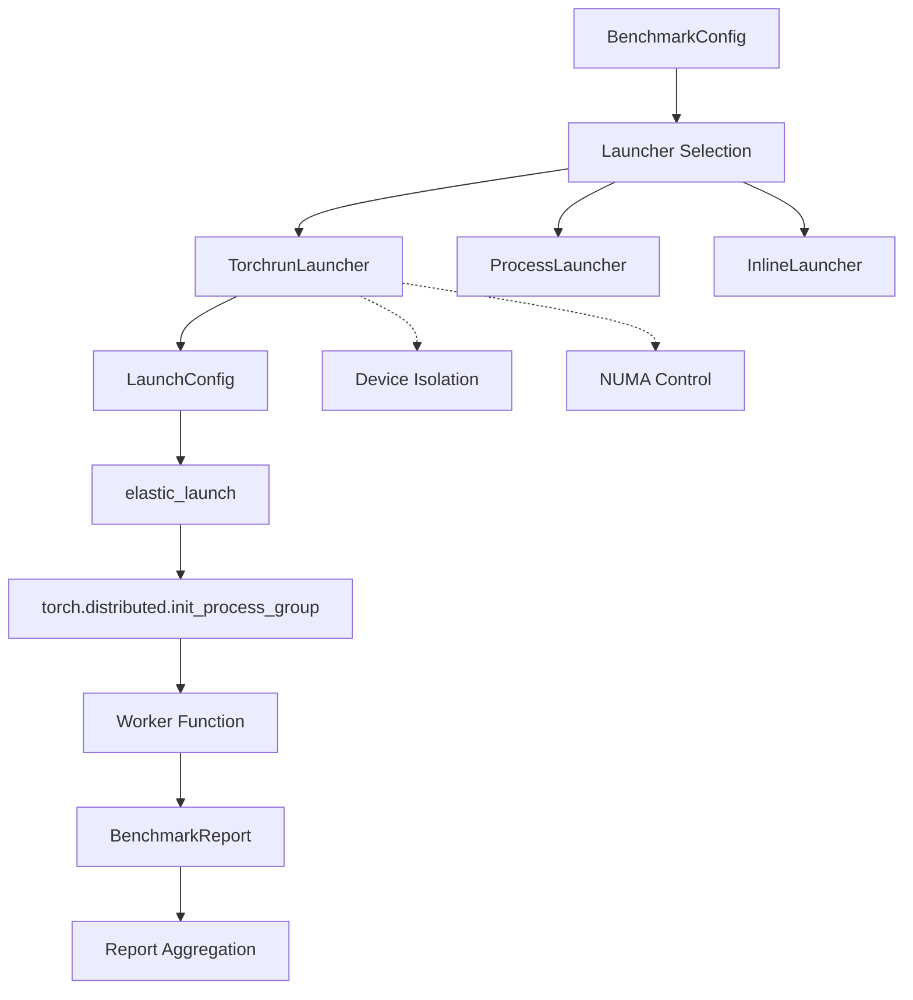
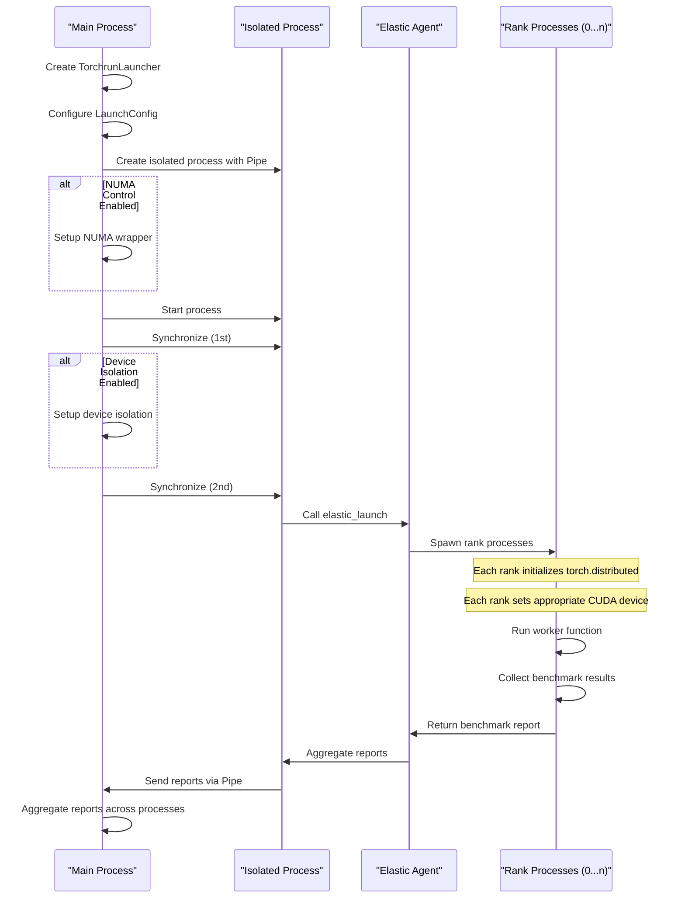

<!-- source: DeepWiki mcp.deepwiki.com · repo huggingface/optimum-benchmark · page 6.2 Torchrun Launcher · fetched 2026-10-26 -->

# Torchrun Launcher

<details>
<summary>Relevant source files</summary>

The following files were used as context for generating this wiki page:

- [.github/workflows/test_cli_misc.yaml](.github/workflows/test_cli_misc.yaml)
- [optimum_benchmark/launchers/base.py](optimum_benchmark/launchers/base.py)
- [optimum_benchmark/launchers/inline/launcher.py](optimum_benchmark/launchers/inline/launcher.py)
- [optimum_benchmark/launchers/process/launcher.py](optimum_benchmark/launchers/process/launcher.py)
- [optimum_benchmark/launchers/torchrun/launcher.py](optimum_benchmark/launchers/torchrun/launcher.py)
- [tests/test_cli.py](tests/test_cli.py)

</details>


The Torchrun Launcher is a specialized launcher component in the optimum-benchmark framework that enables distributed benchmarking using PyTorch's distributed training capabilities. It leverages `torch.distributed` and PyTorch's Elastic Launch API to run benchmarks across multiple processes and potentially multiple nodes, making it ideal for benchmarking workloads that benefit from distributed execution, such as large language models.

For information about other launcher options, see [Process Launcher](#6.1) or [Inline Launcher](#6.3).

## Overview

The Torchrun Launcher is built on PyTorch's distributed training infrastructure, specifically using the `elastic_launch` function from `torch.distributed.launcher.api`. This provides a robust mechanism for launching distributed workloads with features like fault tolerance, dynamic scaling, and rendezvous coordination.



Sources: [optimum_benchmark/launchers/torchrun/launcher.py:20-45](), [optimum_benchmark/launchers/base.py:26-37]()

## Architecture and Process Flow

The TorchrunLauncher follows a multi-level process hierarchy to isolate and distribute benchmark workloads:

1. **Main Process**: The original process that initializes the launcher
2. **Isolated Process**: A separate process that runs the elastic launcher
3. **Rank Processes**: Individual worker processes spawned by the elastic launcher



Sources: [optimum_benchmark/launchers/torchrun/launcher.py:46-104](), [optimum_benchmark/launchers/torchrun/launcher.py:107-143](), [optimum_benchmark/launchers/torchrun/launcher.py:146-177]()

## Implementation Details

### Launcher Initialization

The TorchrunLauncher is initialized with a `TorchrunConfig` that specifies how the distributed environment should be set up. This includes parameters for the rendezvous mechanism, process counts, and other distributed training options.

Key components of the initialization include:

1. Setting the multiprocessing start method
2. Creating a PyTorch `LaunchConfig` with distributed parameters
3. Preparing the environment for process isolation

Sources: [optimum_benchmark/launchers/torchrun/launcher.py:20-45]()

### Launch Process

The `launch` method is the main entry point for executing benchmark workloads. It:

1. Creates a communication pipe between the main process and the isolated process
2. Starts an isolated process that will run the elastic launcher
3. Sets up device isolation and NUMA control if configured
4. Synchronizes with the isolated process at key points
5. Collects and aggregates benchmark reports from all worker processes

Sources: [optimum_benchmark/launchers/torchrun/launcher.py:46-104]()

### Isolated Process and Worker Functions

The isolated process serves as an intermediary that:

1. Runs in a separate process from the main application
2. Sets up logging for the isolated environment
3. Calls PyTorch's elastic launcher to spawn distributed worker processes
4. Collects outputs from all worker processes and communicates them back to the main process

Each worker process (rank):

1. Initializes its distributed environment
2. Sets the appropriate CUDA device if available
3. Runs the actual benchmark workload
4. Returns a benchmark report to the isolated process

Sources: [optimum_benchmark/launchers/torchrun/launcher.py:107-143](), [optimum_benchmark/launchers/torchrun/launcher.py:146-177]()

## Configuration Options

The TorchrunLauncher supports various configuration options to customize the distributed environment:

| Parameter | Description | Default |
|-----------|-------------|---------|
| `min_nodes` | Minimum number of nodes required | 1 |
| `max_nodes` | Maximum number of nodes allowed | 1 |
| `nproc_per_node` | Number of processes per node | Auto |
| `rdzv_id` | Rendezvous ID | Generated |
| `rdzv_endpoint` | Rendezvous endpoint | "localhost:29500" |
| `rdzv_backend` | Rendezvous backend | "c10d" |
| `rdzv_timeout` | Rendezvous timeout in seconds | 900 |
| `start_method` | Multiprocessing start method | "spawn" |
| `numactl` | Whether to use NUMA control | False |
| `device_isolation` | Whether to isolate devices | False |
| `device_isolation_action` | Action to take when isolation is violated | "log" |

Sources: [optimum_benchmark/launchers/torchrun/launcher.py:30-44](), [optimum_benchmark/launchers/base.py:39-62]()

## Device Isolation and NUMA Control

### Device Isolation

The TorchrunLauncher can enforce device isolation, ensuring that only the benchmark processes access the specified GPU devices. This is particularly useful for obtaining consistent benchmark results by preventing interference from other processes.

When enabled, a monitoring process checks that only the benchmark processes and their children access the specified GPU devices. If a violation is detected, the configured action is taken (logging, warning, or killing the violating process).

Sources: [optimum_benchmark/launchers/base.py:39-62]()

### NUMA Control

For CPU-intensive benchmarks, the launcher supports NUMA (Non-Uniform Memory Access) control via the `numactl` utility. This can improve performance by controlling CPU affinity and memory allocation policies.

When enabled, the launcher creates a wrapper script that uses `numactl` to launch Python processes with specific NUMA configurations.

Sources: [optimum_benchmark/launchers/base.py:63-92]()

## Report Aggregation

One key feature of the TorchrunLauncher is its ability to aggregate benchmark reports from multiple distributed processes. After all rank processes complete their benchmarks, the reports are:

1. Collected by the isolated process
2. Sent back to the main process
3. Aggregated into a single consolidated report using `BenchmarkReport.aggregate_across_processes`

This aggregation provides a unified view of the benchmark results across all distributed workers, including statistics like mean, median, and percentiles of performance metrics.

Sources: [optimum_benchmark/launchers/torchrun/launcher.py:95-104]()

## Error Handling

The TorchrunLauncher includes robust error handling to capture and report issues at different levels:

1. **Isolated Process Errors**: If the isolated process encounters an error, it sends a traceback to the main process
2. **Rank Process Errors**: If any rank process fails, its traceback is captured and forwarded to the main process
3. **Process Exit Codes**: The launcher checks process exit codes and raises appropriate exceptions

This comprehensive error handling ensures that benchmark failures can be quickly diagnosed and addressed.

Sources: [optimum_benchmark/launchers/torchrun/launcher.py:76-100](), [optimum_benchmark/launchers/torchrun/launcher.py:132-136](), [optimum_benchmark/launchers/torchrun/launcher.py:167-169]()

## Platform Compatibility

The TorchrunLauncher is designed to work on most Unix-like systems, including Linux and macOS. However, it has some platform-specific considerations:

- **Windows**: The TorchrunLauncher is not supported on Windows platforms
- **Linux**: Full support, including NUMA control and device isolation
- **macOS**: Basic support without NUMA control

Sources: [tests/test_cli.py:56-57]()

## Usage Examples

The TorchrunLauncher can be used through the command-line interface or programmatically:

### CLI Usage

```bash
optimum-benchmark --config-name my_config launcher=torchrun
```

Additional parameters can be specified to customize the launcher:

```bash
optimum-benchmark --config-name my_config \
  launcher=torchrun \
  launcher.nproc_per_node=4 \
  launcher.numactl=True
```

### Common Use Cases

1. **Multi-GPU Benchmarking**: Distribute a benchmark across multiple GPUs on a single node
2. **Distributed Training Evaluation**: Evaluate model training across multiple processes or nodes
3. **Scaling Studies**: Assess performance scaling with different numbers of processes

Sources: [tests/test_cli.py:54-83](), [tests/test_cli.py:106-129]()

## Summary

The TorchrunLauncher provides a powerful mechanism for running distributed benchmarks using PyTorch's distributed training infrastructure. With features like device isolation, NUMA control, and comprehensive error handling, it enables accurate and reliable performance measurements of distributed workloads.

When to use the TorchrunLauncher:
- When benchmarking multi-GPU or distributed workloads
- When evaluating models that benefit from data parallelism
- When assessing scaling behavior of training or inference

When not to use the TorchrunLauncher:
- On Windows platforms (not supported)
- For simple single-process benchmarks (the [Process Launcher](#6.1) may be more appropriate)
- For debugging purposes (the [Inline Launcher](#6.3) is recommended instead)

---

