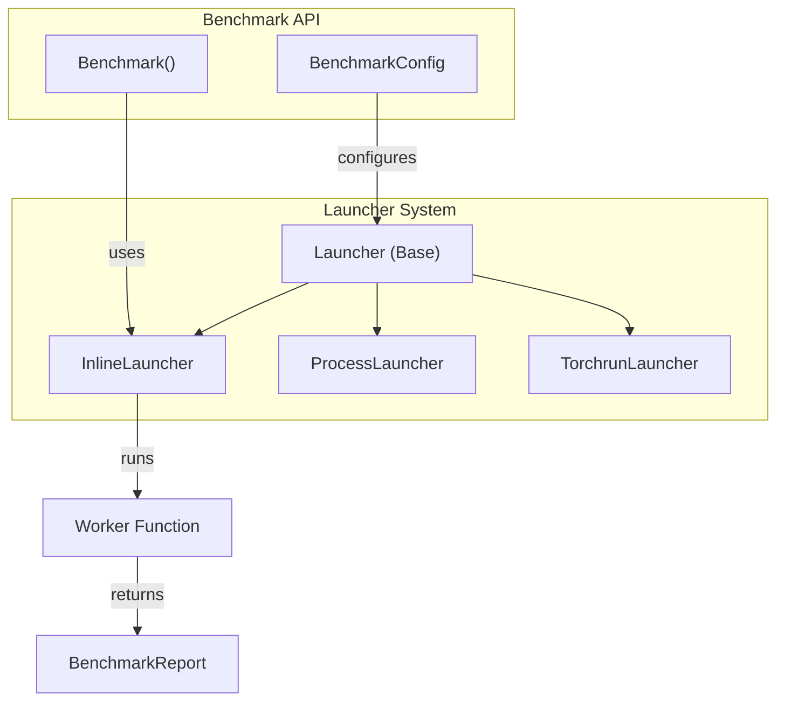
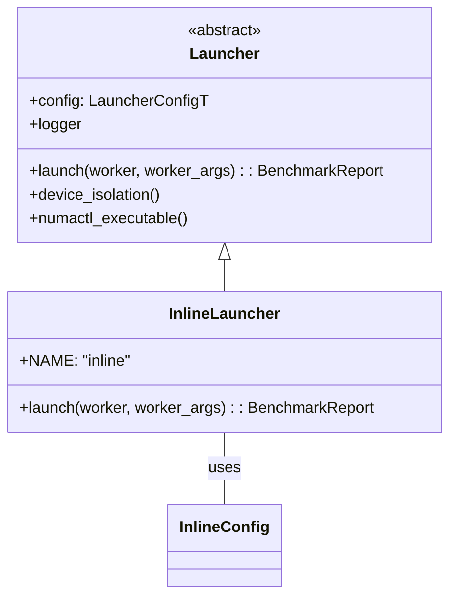
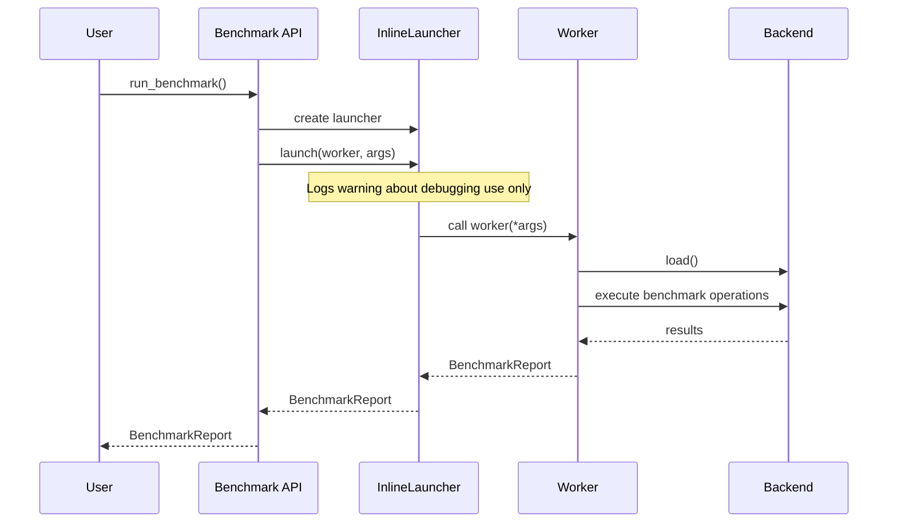

<!-- source: DeepWiki mcp.deepwiki.com · repo huggingface/optimum-benchmark · page 6.3 Inline Launcher · fetched 2026-10-26 -->

# Inline Launcher

<details>
<summary>Relevant source files</summary>

The following files were used as context for generating this wiki page:

- [.github/workflows/test_cli_misc.yaml](.github/workflows/test_cli_misc.yaml)
- [optimum_benchmark/launchers/base.py](optimum_benchmark/launchers/base.py)
- [optimum_benchmark/launchers/inline/launcher.py](optimum_benchmark/launchers/inline/launcher.py)
- [optimum_benchmark/launchers/process/launcher.py](optimum_benchmark/launchers/process/launcher.py)
- [optimum_benchmark/launchers/torchrun/launcher.py](optimum_benchmark/launchers/torchrun/launcher.py)
- [tests/test_cli.py](tests/test_cli.py)

</details>


The Inline Launcher is the simplest implementation of the launcher system in optimum-benchmark. It executes benchmarks directly within the same process, providing a straightforward execution path primarily intended for debugging purposes rather than for production benchmarking.

For information about other launchers, see [Process Launcher](#6.1) and [Torchrun Launcher](#6.2). For general information about the launcher system, see [Launcher System](#6).

## Purpose and Functionality

The Inline Launcher runs benchmarks directly within the caller's process, without any process isolation or distributed execution capabilities. This direct execution approach offers:

- **Simplified debugging** - Easier to trace errors and inspect variables
- **Quick testing** - No overhead from process creation or communication
- **Direct access** - Direct access to all objects and memory in the benchmark

However, the Inline Launcher lacks the isolation properties that make the other launchers more suitable for accurate benchmarking.



Sources: [optimum_benchmark/launchers/inline/launcher.py:1-20](), [optimum_benchmark/launchers/base.py:26-36]()

## Implementation Details

The InlineLauncher is the simplest of all launchers in the optimum-benchmark system, consisting of just a few lines of code. Unlike the other launchers, it doesn't create any additional processes, doesn't handle inter-process communication, and doesn't provide isolation mechanisms.



Sources: [optimum_benchmark/launchers/inline/launcher.py:1-20](), [optimum_benchmark/launchers/base.py:26-36]()

### Core Implementation

The `launch` method of InlineLauncher is straightforward:

1. It logs a warning that the launcher is only recommended for debugging purposes
2. It directly calls the worker function with the provided arguments
3. It returns the resulting BenchmarkReport

The simplicity of this implementation contrasts with the more complex ProcessLauncher and TorchrunLauncher, which handle process creation, inter-process communication, device isolation, and error handling.

Sources: [optimum_benchmark/launchers/inline/launcher.py:14-19]()

## Comparison with Other Launchers

The Inline Launcher differs significantly from the other launchers in several aspects:

| Feature | Inline Launcher | Process Launcher | Torchrun Launcher |
|---------|----------------|------------------|-------------------|
| Execution environment | Same process | Separate process | Distributed processes |
| Process isolation | None | Full | Full |
| NUMA support | No | Yes | Yes |
| Device isolation | No | Yes | Yes |
| Error propagation | Direct | Through pipe | Through pipe |
| Multiprocessing | No | Single process | Multiple processes |
| Distributed execution | No | No | Yes |
| Main use case | Debugging | Single-node benchmarking | Multi-node/GPU benchmarking |

Sources: [optimum_benchmark/launchers/inline/launcher.py:1-20](), [optimum_benchmark/launchers/process/launcher.py:1-114](), [optimum_benchmark/launchers/torchrun/launcher.py:1-178]()

## Execution Flow

The execution flow when using the Inline Launcher is much simpler than with other launchers:



Sources: [optimum_benchmark/launchers/inline/launcher.py:14-19]()

## Usage Examples

The Inline Launcher is typically used in a configuration file or via the CLI by specifying `"launcher=inline"`:

```yaml
# Example configuration
name: debug_benchmark
launcher: inline  # Use inline launcher for debugging
backend:
  name: pytorch
  model: facebook/opt-125m
  task: text-generation
  device: cpu
```

In code, it can be used as follows:

```python
from optimum_benchmark import run_benchmark
from optimum_benchmark.launchers.inline.config import InlineConfig

# Create benchmark configuration with inline launcher
benchmark_config = {
    "name": "debug_benchmark",
    "launcher": "inline",
    "backend": {
        "name": "pytorch",
        "model": "facebook/opt-125m",
        "task": "text-generation",
        "device": "cpu"
    }
}

# Run benchmark
report = run_benchmark(benchmark_config)
```

Sources: [tests/test_cli.py:54-77]()

## Best Practices and Recommendations

When using the Inline Launcher, keep the following recommendations in mind:

1. **Use for debugging only**: The inline launcher is primarily designed for debugging and should not be used for actual performance benchmarking as it lacks process isolation.

2. **No resource isolation**: Since benchmarks run in the same process, there's no isolation of resources (memory, CPU, etc.), which can lead to interference and inaccurate measurements.

3. **Easier troubleshooting**: The inline launcher is ideal for troubleshooting issues with benchmarks, as you can easily add debug prints or set breakpoints in your code.

4. **Testing scenarios**: It's useful for testing benchmark configurations before running them with more robust launchers.

5. **No device isolation**: Unlike other launchers, the inline launcher doesn't support device isolation, which is important for accurate GPU benchmarking.

Sources: [optimum_benchmark/launchers/inline/launcher.py:15](), [optimum_benchmark/launchers/base.py:39-62]()

## Summary

The Inline Launcher provides a simple way to run benchmarks for debugging purposes. While it lacks the isolation features of the other launchers that make them suitable for accurate benchmarking, it offers simplicity and ease of use that can be valuable during development and testing.

It's important to remember that performance measurements obtained using the Inline Launcher may not be accurate due to the lack of process isolation, so it should only be used for debugging and testing purposes.

---

