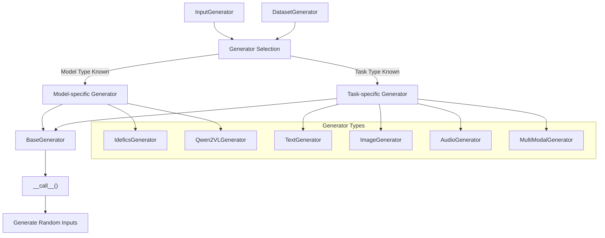
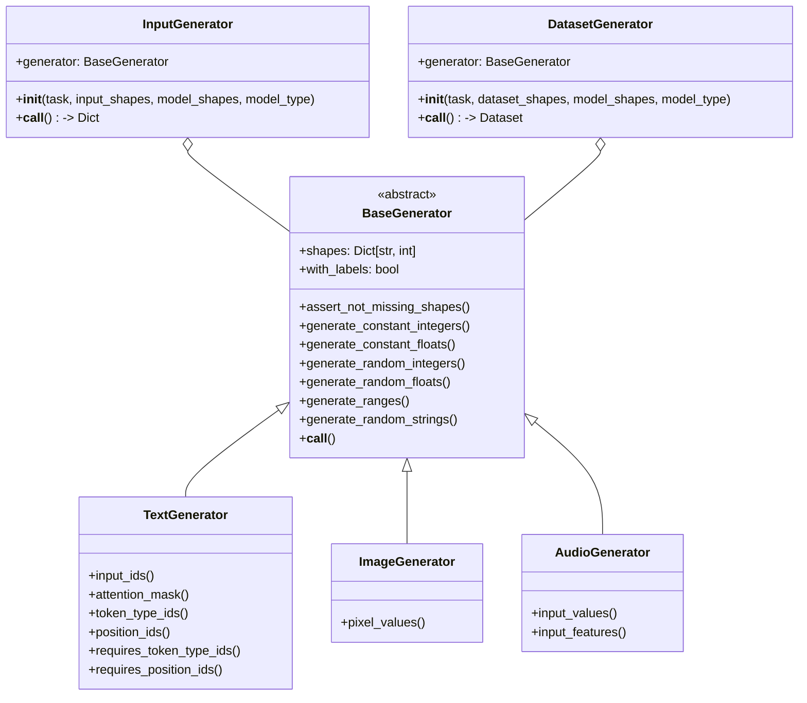
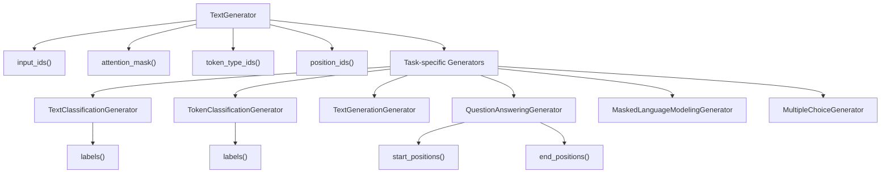
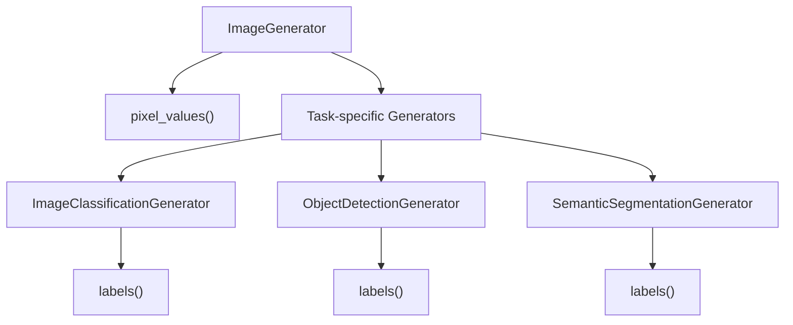
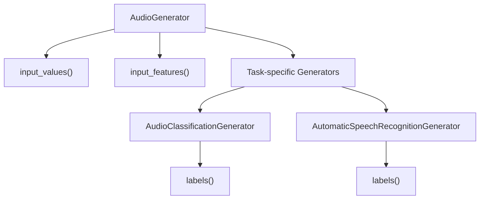
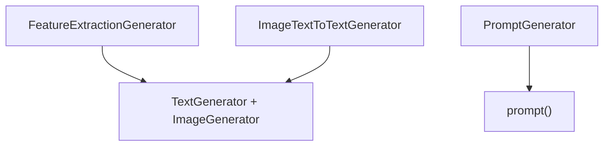
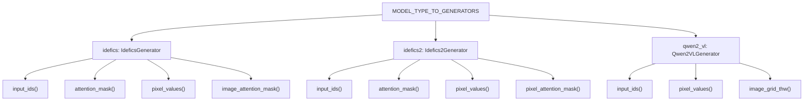
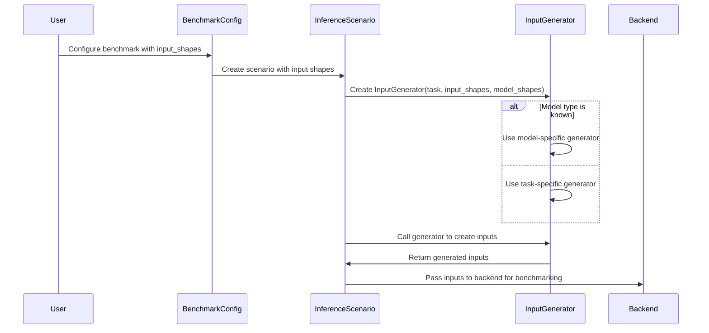

<!-- source: DeepWiki mcp.deepwiki.com · repo huggingface/optimum-benchmark · page 7 Input Generation · fetched 2026-10-26 -->

# Input Generation

<details>
<summary>Relevant source files</summary>

The following files were used as context for generating this wiki page:

- [optimum_benchmark/backends/timm_utils.py](optimum_benchmark/backends/timm_utils.py)
- [optimum_benchmark/generators/base.py](optimum_benchmark/generators/base.py)
- [optimum_benchmark/generators/dataset_generator.py](optimum_benchmark/generators/dataset_generator.py)
- [optimum_benchmark/generators/input_generator.py](optimum_benchmark/generators/input_generator.py)
- [optimum_benchmark/generators/model_generator.py](optimum_benchmark/generators/model_generator.py)
- [optimum_benchmark/generators/task_generator.py](optimum_benchmark/generators/task_generator.py)
- [optimum_benchmark/scenarios/inference/config.py](optimum_benchmark/scenarios/inference/config.py)

</details>


The Input Generation system in Optimum-Benchmark is responsible for creating synthetic inputs for models during benchmarking. Its purpose is to generate appropriate inputs based on a model's architecture, task type, and expected input shapes, allowing for consistent and reproducible benchmarking across different model types and backends.

## System Overview

The Input Generation system uses a hierarchical approach to generate inputs for various model types and tasks. It provides entry points for both single inference inputs and training datasets.



Sources: [optimum_benchmark/generators/input_generator.py:1-37](), [optimum_benchmark/generators/base.py:1-53](), [optimum_benchmark/generators/task_generator.py:1-53](), [optimum_benchmark/generators/model_generator.py:1-53]()

## Key Components

### 1. Generator Architecture

The Input Generation system is built around several key components that work together to create appropriate inputs for different types of models and tasks.



Sources: [optimum_benchmark/generators/base.py:12-53](), [optimum_benchmark/generators/input_generator.py:8-37](), [optimum_benchmark/generators/dataset_generator.py:10-42](), [optimum_benchmark/generators/task_generator.py:12-53]()

### 2. Entry Points

The system provides two main entry points for generating inputs:

1. **InputGenerator**: Generates inputs for a single inference run
2. **DatasetGenerator**: Generates a complete dataset for training benchmarks

Both entry points follow a similar pattern of selecting an appropriate generator based on the model type or task and then using it to create the required inputs.

#### InputGenerator

```python
def __init__(
    self,
    task: str,
    input_shapes: Dict[str, int],
    model_shapes: Dict[str, int],
    model_type: Optional[str] = None,
) -> None:
    # input_shapes take precedence over model_shapes
    all_shapes = {**model_shapes, **input_shapes}

    if model_type in MODEL_TYPE_TO_GENERATORS:
        self.generator = MODEL_TYPE_TO_GENERATORS[model_type](shapes=all_shapes, with_labels=False)
    elif task in TASKS_TO_GENERATORS:
        self.generator = TASKS_TO_GENERATORS[task](shapes=all_shapes, with_labels=False)
    else:
        raise NotImplementedError(
            f"Task {task} is not supported for input generation. "
            f"Available tasks: {list(TASKS_TO_GENERATORS.keys())}. "
            f"Available model types: {list(MODEL_TYPE_TO_GENERATORS.keys())}. "
            "If you want to add support for this task or model type, "
            "please submit a PR or a feature request to optimum-benchmark."
        )
```

Sources: [optimum_benchmark/generators/input_generator.py:8-37]()

### 3. Base Generator

All generators inherit from `BaseGenerator`, which provides utility methods for generating various types of inputs.

```python
class BaseGenerator(ABC):
    def __init__(self, shapes: Dict[str, int], with_labels: bool):
        self.shapes = shapes
        self.with_labels = with_labels

    def assert_not_missing_shapes(self, required_shapes: List[str]):
        # Ensure all required shapes are provided
        
    @staticmethod
    def generate_constant_integers(value: int, shape: Tuple[int]):
        return torch.full(shape, value, dtype=torch.int64)
        
    # Other utility methods for generating different types of inputs
    
    def __call__(self):
        raise NotImplementedError("Generator must implement __call__ method")
```

Sources: [optimum_benchmark/generators/base.py:12-53]()

## Task-Specific Generators

The Input Generation system includes specialized generators for different tasks, each designed to create inputs in the appropriate format.

### 1. Text Generators

Text generators create inputs like `input_ids`, `attention_mask`, `token_type_ids`, etc. for text-based models.



Sources: [optimum_benchmark/generators/task_generator.py:12-230]()

### 2. Image Generators

Image generators create `pixel_values` for vision models.



Sources: [optimum_benchmark/generators/task_generator.py:57-344]()

### 3. Audio Generators

Audio generators create inputs for speech and audio models.



Sources: [optimum_benchmark/generators/task_generator.py:73-382]()

### 4. Multi-Modal Generators

Multi-modal generators combine text, image, or audio inputs for models that work with multiple modalities.



Sources: [optimum_benchmark/generators/task_generator.py:385-429]()

## Model-Specific Generators

For models with unique input requirements, specialized generators are provided. These are particularly important for multi-modal models with complex architecture-specific input formats.



Sources: [optimum_benchmark/generators/model_generator.py:12-259]()

## Input Shape Management

The Input Generation system manages input shapes through a combination of:

1. Default shapes provided by the scenario configuration
2. Model-specific shapes extracted from model configurations
3. User-provided shapes that override the defaults

For inference scenarios, input shapes are configured through the `input_shapes` parameter in the scenario configuration.

```python
@dataclass
class InferenceConfig(ScenarioConfig):
    # ...
    input_shapes: Dict[str, Any] = field(
        default_factory=dict,
        metadata={"help": "Input shapes for the model. Missing keys will be filled with default values."},
    )
    # ...
    
    def __post_init__(self):
        # ...
        self.input_shapes = {**INPUT_SHAPES, **self.input_shapes}
        # ...
```

Sources: [optimum_benchmark/scenarios/inference/config.py:15-105]()

## Task-to-Generator Mapping

The system uses a dictionary to map task names to their corresponding generator classes:

```python
TASKS_TO_GENERATORS = {
    # transformers models tasks
    "feature-extraction": FeatureExtractionGenerator,
    "text-classification": TextClassificationGenerator,
    "token-classification": TokenClassificationGenerator,
    "text-generation": TextGenerationGenerator,
    "text2text-generation": Text2TextGenerationGenerator,
    "question-answering": QuestionAnsweringGenerator,
    "fill-mask": MaskedLanguageModelingGenerator,
    "multiple-choice": MultipleChoiceGenerator,
    "image-classification": ImageClassificationGenerator,
    "object-detection": ObjectDetectionGenerator,
    "semantic-segmentation": SemanticSegmentationGenerator,
    "image-text-to-text": ImageTextToTextGenerator,
    # diffusers pipelines tasks
    "text-to-image": PromptGenerator,
}
```

Sources: [optimum_benchmark/generators/task_generator.py:432-448]()

## Usage Example

Here's a simplified workflow showing how the input generation system is used within the benchmarking process:



Sources: [optimum_benchmark/generators/input_generator.py:1-37](), [optimum_benchmark/scenarios/inference/config.py:15-105]()

## Related Systems

For information about:
- Task-specific benchmarking scenarios, see [Benchmarking Scenarios](#5)
- Backends that use these inputs, see [Backends](#3)
- Dataset generation for training benchmarks, see [Training Scenario](#5.2)

---

