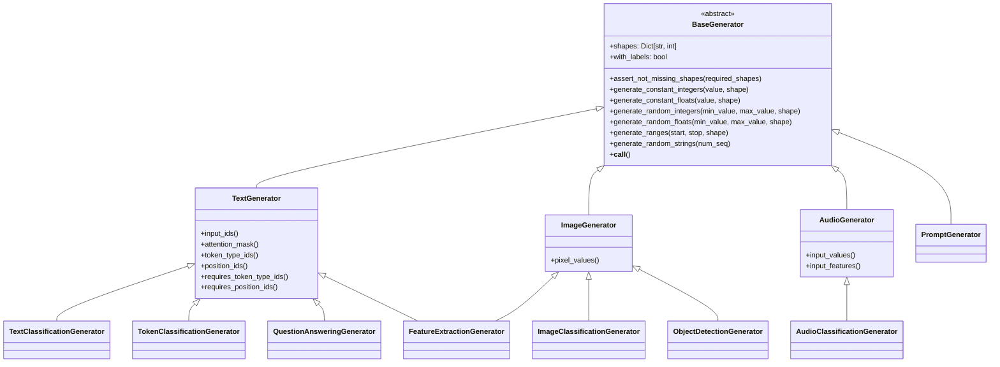
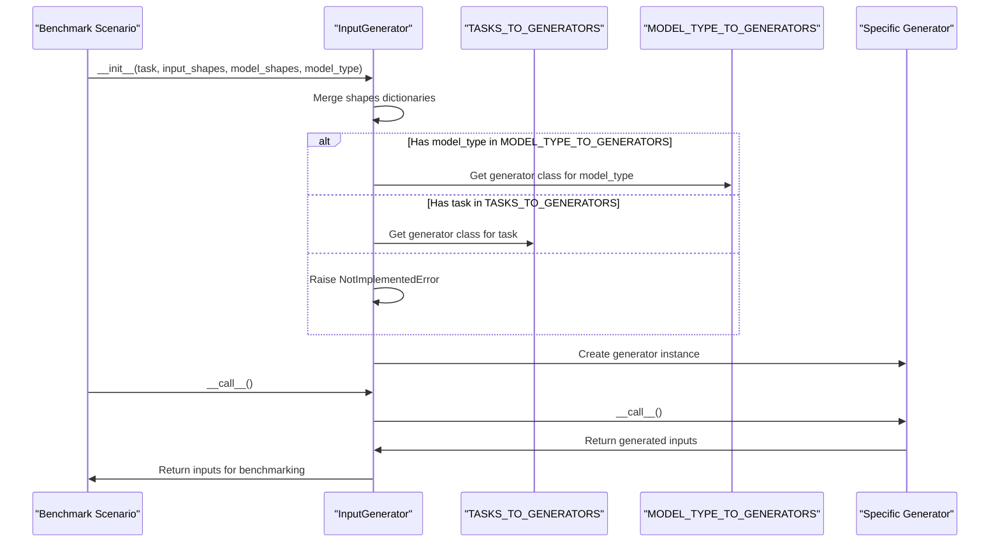

<!-- source: DeepWiki mcp.deepwiki.com · repo huggingface/optimum-benchmark · page 7.1 Task-specific Generators · fetched 2026-10-26 -->

# Task-specific Generators

<details>
<summary>Relevant source files</summary>

The following files were used as context for generating this wiki page:

- [optimum_benchmark/backends/timm_utils.py](optimum_benchmark/backends/timm_utils.py)
- [optimum_benchmark/generators/base.py](optimum_benchmark/generators/base.py)
- [optimum_benchmark/generators/dataset_generator.py](optimum_benchmark/generators/dataset_generator.py)
- [optimum_benchmark/generators/input_generator.py](optimum_benchmark/generators/input_generator.py)
- [optimum_benchmark/generators/model_generator.py](optimum_benchmark/generators/model_generator.py)
- [optimum_benchmark/generators/task_generator.py](optimum_benchmark/generators/task_generator.py)
- [optimum_benchmark/scenarios/inference/config.py](optimum_benchmark/scenarios/inference/config.py)

</details>


## Purpose and Overview

Task-specific Generators provide a mechanism for generating synthetic inputs for different machine learning tasks during benchmarking. These generators create appropriate tensor shapes and values based on the task (e.g., text classification, image generation) and model requirements. They are a critical component in the Optimum-Benchmark framework, enabling automated testing across diverse model types without requiring real datasets.

For model-specific generators tailored to specific architectures like IDEFICS or Qwen2-VL, see [Model-specific Generators](#7.2).

```mermaid
graph TD
    A["InputGenerator"] --> B["Task-specific Generators"]
    A --> C["Model-specific Generators"]
    
    B --> D["TextGenerator"]
    B --> E["ImageGenerator"]
    B --> F["AudioGenerator"]
    B --> G["PromptGenerator"]
    B --> H["FeatureExtractionGenerator"]
    
    D --> D1["TextClassificationGenerator"]
    D --> D2["TokenClassificationGenerator"]
    D --> D3["TextGenerationGenerator"]
    D --> D4["Text2TextGenerationGenerator"]
    D --> D5["QuestionAnsweringGenerator"]
    D --> D6["MaskedLanguageModelingGenerator"]
    D --> D7["MultipleChoiceGenerator"]
    
    E --> E1["ImageClassificationGenerator"]
    E --> E2["ObjectDetectionGenerator"]
    E --> E3["SemanticSegmentationGenerator"]
    
    F --> F1["AudioClassificationGenerator"]
    F --> F2["AutomaticSpeechRecognitionGenerator"]
    
    B --> I["ImageTextToTextGenerator"]
    
    subgraph "InputGenerator Usage"
        J["Benchmarking Scenario"] --> K["InputGenerator"]
        K --> L["Generate Synthetic Inputs"]
        L --> M["Backend Execution"]
    end
```



Sources:
[optimum_benchmark/generators/task_generator.py:1-449]()
[optimum_benchmark/generators/input_generator.py:1-37]()

## Base Generator Architecture

All task-specific generators inherit from the `BaseGenerator` abstract base class, which provides common functionality for generating random tensors and validating required shape parameters.



Sources:
[optimum_benchmark/generators/base.py:1-53]()
[optimum_benchmark/generators/task_generator.py:3-49]()

## Core Task Generator Types

The benchmark framework provides base generators for major modality types:

### TextGenerator

Handles inputs for text-based models, generating:

- `input_ids`: Token IDs representing text
- `attention_mask`: Mask indicating which tokens to attend to (all 1s by default)
- `token_type_ids`: Optional segment IDs for models like BERT
- `position_ids`: Optional position embeddings

Required shapes: `batch_size`, `sequence_length`
Optional shapes: `vocab_size`, `type_vocab_size`, `max_position_embeddings`

Sources:
[optimum_benchmark/generators/task_generator.py:12-55]()

### ImageGenerator

Handles inputs for vision models, generating:

- `pixel_values`: Tensor of pixel values scaled between 0 and 1

Required shapes: `batch_size`, `num_channels`, `height`, `width`

Sources:
[optimum_benchmark/generators/task_generator.py:57-70]()

### AudioGenerator

Handles inputs for audio models, generating:

- `input_values`: Raw audio waveform values (-1 to 1)
- `input_features`: Processed audio features

Required shapes: `batch_size`, `sequence_length` (for `input_values`)
or `batch_size`, `feature_size`, `nb_max_frames` (for `input_features`)

Sources:
[optimum_benchmark/generators/task_generator.py:73-97]()

### PromptGenerator

Generates text prompts for diffusion models and other prompt-based models:

- `prompt`: List of random text strings

Required shapes: `batch_size`

Sources:
[optimum_benchmark/generators/task_generator.py:385-395]()

## Task-Specific Generator Classes

The framework provides dedicated generators for common ML tasks:

### Text Task Generators

| Generator Class | Inputs | Labels | Required Shapes |
|-----------------|--------|--------|-----------------|
| TextClassificationGenerator | `input_ids`, `attention_mask`, `token_type_ids` (optional), `position_ids` (optional) | Integer class labels | `batch_size`, `sequence_length` |
| TokenClassificationGenerator | Same as TextClassification | Token-level class labels | `batch_size`, `sequence_length` |
| TextGenerationGenerator | `input_ids`, `attention_mask` | Same as input_ids | `batch_size`, `sequence_length` |
| Text2TextGenerationGenerator | `input_ids`, `attention_mask` | Same as input_ids | `batch_size`, `sequence_length` |
| QuestionAnsweringGenerator | `input_ids`, `attention_mask`, `token_type_ids` | `start_positions`, `end_positions` | `batch_size`, `sequence_length` |
| MaskedLanguageModelingGenerator | `input_ids`, `attention_mask`, `token_type_ids` (optional), `position_ids` (optional) | Same as input_ids | `batch_size`, `sequence_length` |
| MultipleChoiceGenerator | 3D versions of text inputs with choice dimension | Integer choice index | `batch_size`, `num_choices`, `sequence_length` |

Sources:
[optimum_benchmark/generators/task_generator.py:100-278]()

### Image Task Generators

| Generator Class | Inputs | Labels | Required Shapes |
|-----------------|--------|--------|-----------------|
| ImageClassificationGenerator | `pixel_values` | Integer class labels | `batch_size`, `num_channels`, `height`, `width` |
| ObjectDetectionGenerator | `pixel_values` | List of dicts with `class_labels` and `boxes` | `batch_size`, `num_channels`, `height`, `width`, `num_queries` |
| SemanticSegmentationGenerator | `pixel_values` | Pixel-level class labels | `batch_size`, `num_channels`, `height`, `width` |

Sources:
[optimum_benchmark/generators/task_generator.py:281-344]()

### Audio Task Generators

| Generator Class | Inputs | Labels | Required Shapes |
|-----------------|--------|--------|-----------------|
| AudioClassificationGenerator | `input_values` | Integer class labels | `batch_size`, `sequence_length` |
| AutomaticSpeechRecognitionGenerator | `input_values` | Token IDs | `batch_size`, `sequence_length`, `vocab_size` |

Sources:
[optimum_benchmark/generators/task_generator.py:347-383]()

### Multimodal Task Generators

| Generator Class | Inputs | Labels | Required Shapes |
|-----------------|--------|--------|-----------------|
| FeatureExtractionGenerator | Text and/or image inputs | None | Text and/or image shapes |
| ImageTextToTextGenerator | `input_ids`, `attention_mask`, `pixel_values` | Same as input_ids | Text and image shapes |

Sources:
[optimum_benchmark/generators/task_generator.py:398-430]()

## Task-to-Generator Mapping

The `TASKS_TO_GENERATORS` dictionary maps task identifiers to the appropriate generator classes:

```mermaid
graph TD
    A["TASKS_TO_GENERATORS Dictionary"]
    
    A --> B1["text-classification: TextClassificationGenerator"]
    A --> B2["token-classification: TokenClassificationGenerator"]
    A --> B3["text-generation: TextGenerationGenerator"]
    A --> B4["text2text-generation: Text2TextGenerationGenerator"]
    A --> B5["question-answering: QuestionAnsweringGenerator"]
    A --> B6["fill-mask: MaskedLanguageModelingGenerator"]
    A --> B7["multiple-choice: MultipleChoiceGenerator"]
    
    A --> C1["image-classification: ImageClassificationGenerator"]
    A --> C2["object-detection: ObjectDetectionGenerator"]
    A --> C3["semantic-segmentation: SemanticSegmentationGenerator"]
    
    A --> D1["feature-extraction: FeatureExtractionGenerator"]
    A --> D2["image-text-to-text: ImageTextToTextGenerator"]
    
    A --> E1["text-to-image: PromptGenerator"]
```



Sources:
[optimum_benchmark/generators/task_generator.py:432-448]()

## Input Generation System

The `InputGenerator` class serves as the entry point for using task-specific generators in benchmarking scenarios:



When creating an `InputGenerator`:

1. It takes a task name, input shapes, model shapes, and optional model type
2. Model-specific generators take precedence over task-specific ones
3. Input shapes take precedence over model shapes
4. The `__call__` method generates appropriate inputs for the task

Sources:
[optimum_benchmark/generators/input_generator.py:1-37]()
[optimum_benchmark/generators/dataset_generator.py:1-42]()

## Dataset Generation

The framework also provides a similar `DatasetGenerator` class that creates entire Hugging Face Datasets for training scenarios:

- Takes the same parameters as `InputGenerator`
- Returns a PyTorch-formatted `Dataset` object
- Always includes labels (using `with_labels=True`)

The key difference from `InputGenerator`:
- `InputGenerator` creates single examples for inference
- `DatasetGenerator` creates dataset batches for training

Sources:
[optimum_benchmark/generators/dataset_generator.py:1-42]()

## Extending the System

To add a new task-specific generator:

1. Create a new class that inherits from an appropriate base generator
2. Implement the required methods (e.g., `input_ids()`, `labels()`)
3. Implement the `__call__()` method to return all inputs as a dictionary
4. Add the new generator to the `TASKS_TO_GENERATORS` dictionary

For example, adding a new text-based task would follow this pattern:

```python
class NewTaskGenerator(TextGenerator):
    def labels(self):
        # Implement label generation
        pass
    
    def __call__(self):
        dummy = {}
        # Add inputs to the dictionary
        return dummy

# Add to mapping
TASKS_TO_GENERATORS["new-task"] = NewTaskGenerator
```

---

