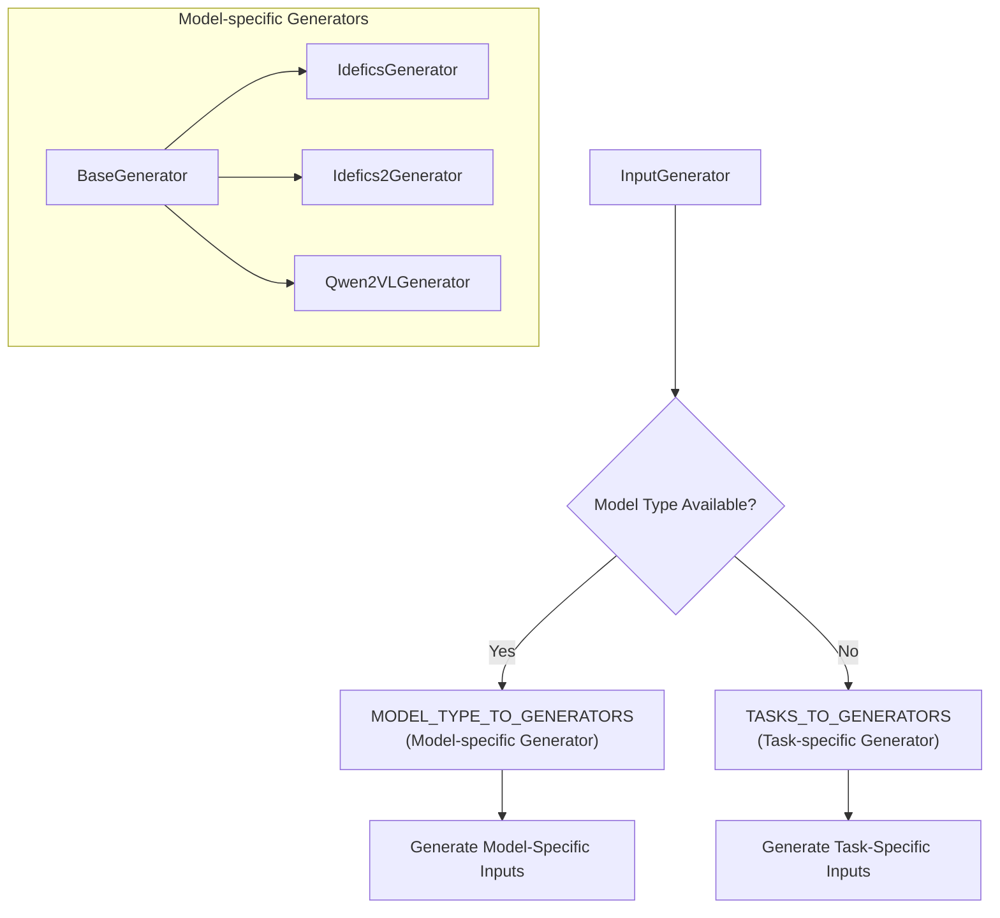
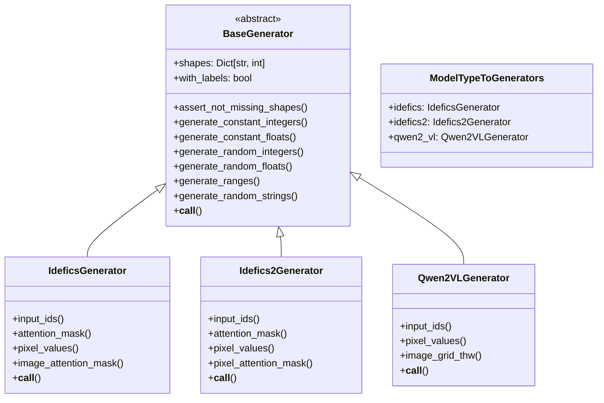
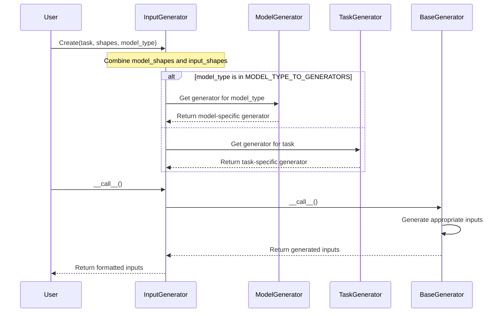
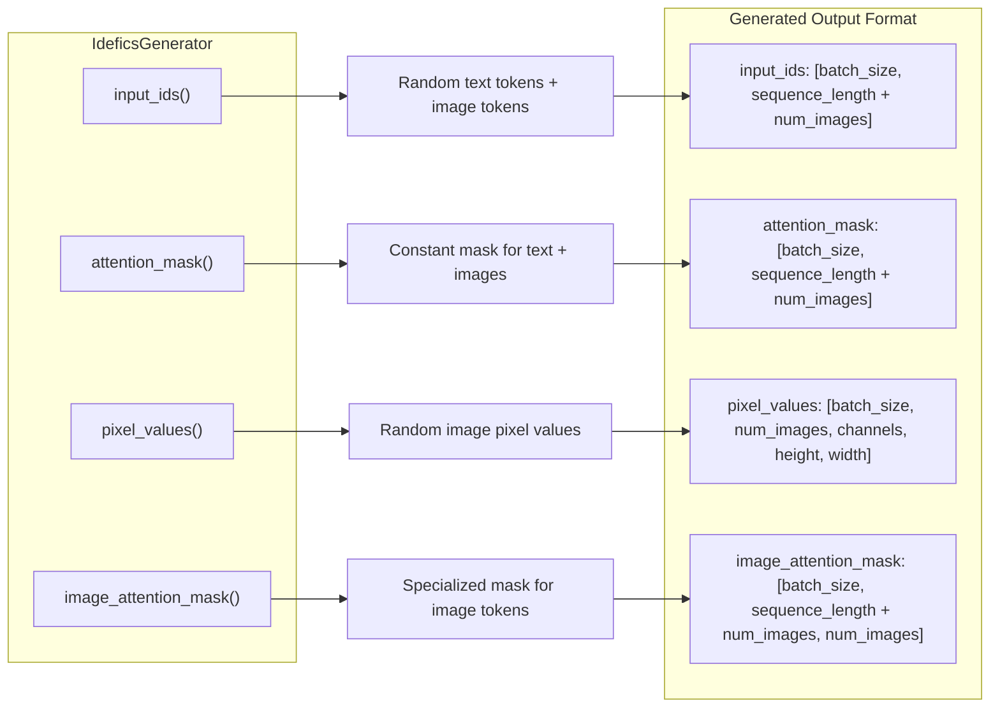
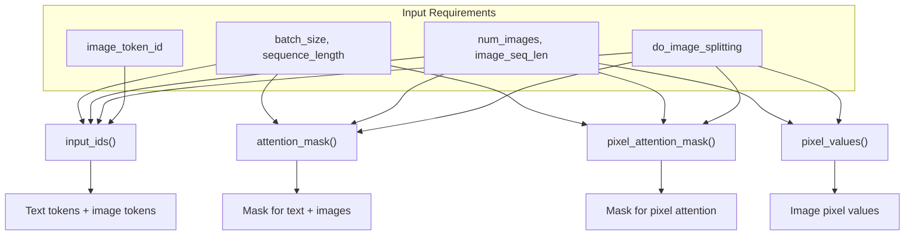
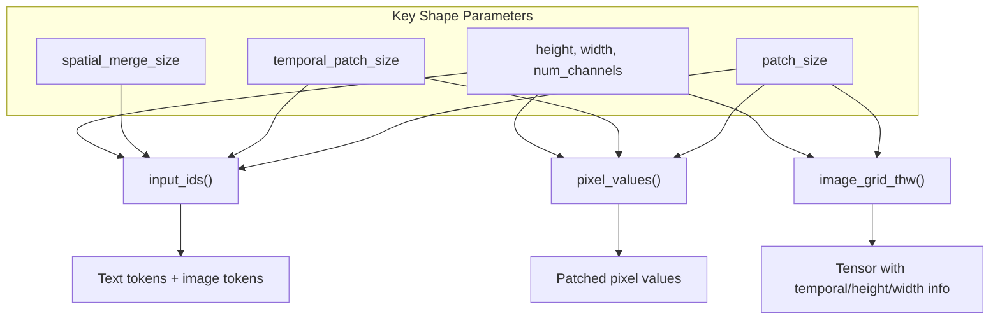

<!-- source: DeepWiki mcp.deepwiki.com · repo huggingface/optimum-benchmark · page 7.2 Model-specific Generators · fetched 2026-10-26 -->

# Model-specific Generators

<details>
<summary>Relevant source files</summary>

The following files were used as context for generating this wiki page:

- [optimum_benchmark/backends/timm_utils.py](optimum_benchmark/backends/timm_utils.py)
- [optimum_benchmark/generators/base.py](optimum_benchmark/generators/base.py)
- [optimum_benchmark/generators/dataset_generator.py](optimum_benchmark/generators/dataset_generator.py)
- [optimum_benchmark/generators/input_generator.py](optimum_benchmark/generators/input_generator.py)
- [optimum_benchmark/generators/model_generator.py](optimum_benchmark/generators/model_generator.py)
- [optimum_benchmark/generators/task_generator.py](optimum_benchmark/generators/task_generator.py)
- [optimum_benchmark/scenarios/inference/config.py](optimum_benchmark/scenarios/inference/config.py)

</details>


## Purpose and Scope

Model-specific generators are specialized components within the optimum-benchmark system that create appropriate input data for benchmarking models with unique architectures. Unlike task-specific generators (covered in [Task-specific Generators](#7.1)), which create inputs based on the NLP/CV task type, model-specific generators are tailored to the specific requirements of certain model architectures that have unique input processing needs.

These generators handle complex multimodal models and other architectures that require specialized input formats that don't fit neatly into the standard task categories.

## Overview



Sources: [optimum_benchmark/generators/input_generator.py:11-36](), [optimum_benchmark/generators/model_generator.py:255-259]()

## Architecture and Components

Model-specific generators extend the `BaseGenerator` class, which provides common utilities for generating random data. Each model-specific generator implements specialized methods to create the unique input formats required by its target architecture.



Sources: [optimum_benchmark/generators/base.py:12-52](), [optimum_benchmark/generators/model_generator.py:12-259]()

## Input Generation Flow

The input generation process prioritizes model-specific generators over task-specific ones when a supported model type is specified:



Sources: [optimum_benchmark/generators/input_generator.py:11-36]()

## Supported Model Types

Currently, the system supports the following model-specific generators:

| Model Type | Generator Class | Description |
|------------|-----------------|-------------|
| `idefics` | `IdeficsGenerator` | Generates inputs for the IDEFICS multimodal model which combines text and image inputs |
| `idefics2` | `Idefics2Generator` | Specialized for IDEFICS 2 with support for image splitting and more complex attention patterns |
| `qwen2_vl` | `Qwen2VLGenerator` | Supports Qwen2 VL with its unique patching and grid-based vision-language approach |

Sources: [optimum_benchmark/generators/model_generator.py:255-259]()

## IdeficsGenerator

The `IdeficsGenerator` creates appropriate inputs for the IDEFICS multimodal model, which combines text and image processing:



The generator creates inputs with the following key shapes:
- `input_ids`: Concatenates text tokens with special image tokens
- `pixel_values`: Contains the actual image data
- `attention_mask`: Masks for text and image tokens
- `image_attention_mask`: Specialized attention mask for the visual component

Sources: [optimum_benchmark/generators/model_generator.py:12-78]()

## Idefics2Generator

The `Idefics2Generator` extends the functionality of the original IDEFICS generator with support for image splitting and more complex token patterns:



Key differences from the original IDEFICS generator:
- Support for image splitting (when `do_image_splitting=True`, the image is split into 5 parts)
- Uses a `pixel_attention_mask` instead of `image_attention_mask`
- More complex handling of image sequence lengths

Sources: [optimum_benchmark/generators/model_generator.py:81-165]()

## Qwen2VLGenerator

The `Qwen2VLGenerator` is specialized for the Qwen2 VL (Vision-Language) model architecture, which uses a unique patching approach:



Unique aspects of the Qwen2VL generator:
- Uses patching with configurable `patch_size`, `temporal_patch_size`, and `spatial_merge_size`
- Generates an `image_grid_thw` tensor that describes the temporal, height, and width dimensions of the image grid
- Complex calculation of token counts based on patching parameters

Sources: [optimum_benchmark/generators/model_generator.py:168-252]()

## Integration with Input Generation System

The model-specific generators are integrated into the overall input generation system through the `InputGenerator` class, which selects an appropriate generator based on the provided model type or task:

```python
def __init__(
    self,
    task: str,
    input_shapes: Dict[str, int],
    model_shapes: Dict[str, int],
    model_type: Optional[str] = None,
) -> None:
    # input_shapes take precedence over model_shapes
    all_shapes = {**model_shapes, **input_shapes}

    if model_type in MODEL_TYPE_TO_GENERATORS:
        self.generator = MODEL_TYPE_TO_GENERATORS[model_type](shapes=all_shapes, with_labels=False)
    elif task in TASKS_TO_GENERATORS:
        self.generator = TASKS_TO_GENERATORS[task](shapes=all_shapes, with_labels=False)
    else:
        raise NotImplementedError(
            f"Task {task} is not supported for input generation. "
            f"Available tasks: {list(TASKS_TO_GENERATORS.keys())}. "
            f"Available model types: {list(MODEL_TYPE_TO_GENERATORS.keys())}. "
            "If you want to add support for this task or model type, "
            "please submit a PR or a feature request to optimum-benchmark."
        )
```

This prioritization allows the system to use specialized generators for models with unique input requirements while falling back to task-specific generators for more standard model architectures.

Sources: [optimum_benchmark/generators/input_generator.py:11-36]()

## Dataset Generation

In addition to generating inputs for benchmarking inference, model-specific generators are also used in the `DatasetGenerator` class for creating training datasets:

```python
def __init__(
    self,
    task: str,
    dataset_shapes: Dict[str, int],
    model_shapes: Dict[str, int],
    model_type: Optional[str] = None,
) -> None:
    # dataset_shapes take precedence over model_shapes
    all_shapes = {**model_shapes, **dataset_shapes}
    all_shapes["batch_size"] = all_shapes.pop("dataset_size", None)

    if model_type in MODEL_TYPE_TO_GENERATORS:
        self.generator = MODEL_TYPE_TO_GENERATORS[model_type](shapes=all_shapes, with_labels=True)
    elif task in TASKS_TO_GENERATORS:
        self.generator = TASKS_TO_GENERATORS[task](shapes=all_shapes, with_labels=True)
    else:
        raise NotImplementedError(
            f"Task {task} is not supported for dataset generation. "
            f"Available tasks: {list(TASKS_TO_GENERATORS.keys())}. "
            f"Available model types: {list(MODEL_TYPE_TO_GENERATORS.keys())}. "
            "If you want to add support for this task or model type, "
            "please submit a PR or a feature request to optimum-benchmark."
        )
```

The key difference is that dataset generation sets `with_labels=True` to include ground truth labels in the generated data.

Sources: [optimum_benchmark/generators/dataset_generator.py:10-41]()

## Adding New Model-specific Generators

To add support for a new model architecture, you need to:

1. Create a new generator class that extends `BaseGenerator`
2. Implement the necessary methods to generate the required inputs
3. Add the generator to the `MODEL_TYPE_TO_GENERATORS` dictionary in `model_generator.py`

The framework is designed to be extensible, allowing for easy addition of new model types as they become available.

---

