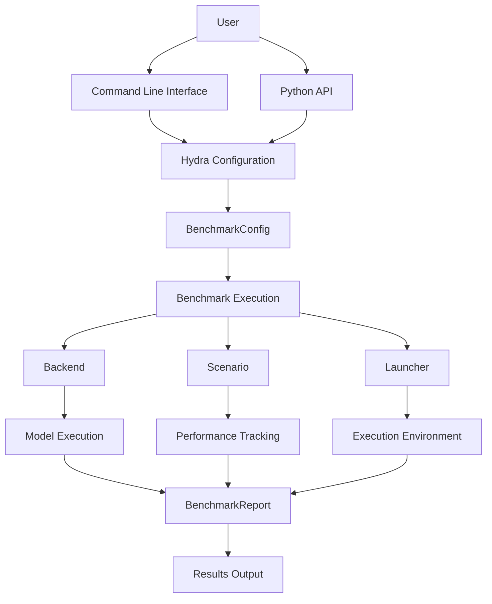
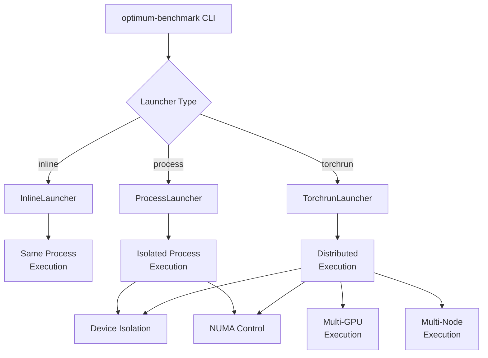
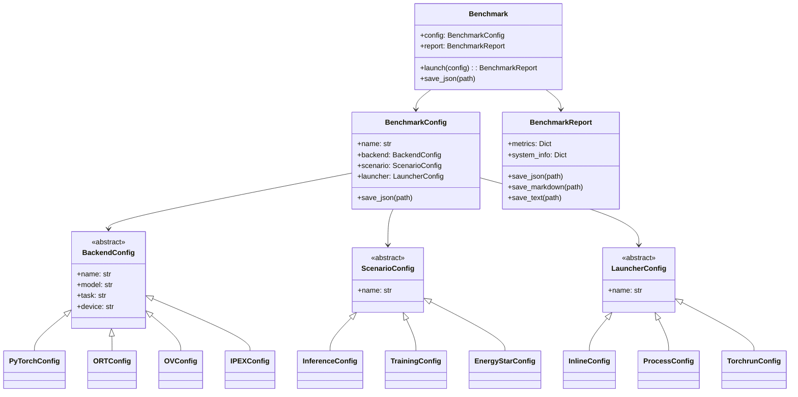
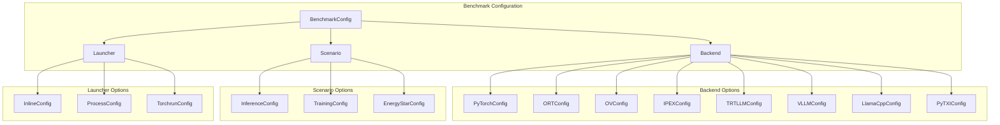

<!-- source: DeepWiki mcp.deepwiki.com · repo huggingface/optimum-benchmark · page 8 CLI and API Usage · fetched 2026-10-26 -->

# CLI and API Usage

<details>
<summary>Relevant source files</summary>

The following files were used as context for generating this wiki page:

- [.github/workflows/test_cli_cpu_ipex.yaml](.github/workflows/test_cli_cpu_ipex.yaml)
- [.github/workflows/test_cli_cpu_llama_cpp.yaml](.github/workflows/test_cli_cpu_llama_cpp.yaml)
- [.github/workflows/test_cli_misc.yaml](.github/workflows/test_cli_misc.yaml)
- [.gitignore](.gitignore)
- [optimum_benchmark/__init__.py](optimum_benchmark/__init__.py)
- [optimum_benchmark/backends/__init__.py](optimum_benchmark/backends/__init__.py)
- [optimum_benchmark/cli.py](optimum_benchmark/cli.py)
- [optimum_benchmark/import_utils.py](optimum_benchmark/import_utils.py)
- [optimum_benchmark/launchers/base.py](optimum_benchmark/launchers/base.py)
- [optimum_benchmark/launchers/inline/launcher.py](optimum_benchmark/launchers/inline/launcher.py)
- [optimum_benchmark/launchers/process/launcher.py](optimum_benchmark/launchers/process/launcher.py)
- [optimum_benchmark/launchers/torchrun/launcher.py](optimum_benchmark/launchers/torchrun/launcher.py)
- [setup.py](setup.py)
- [tests/test_cli.py](tests/test_cli.py)

</details>


This document provides a comprehensive guide for using optimum-benchmark through both its command-line interface (CLI) and Python API. It covers the basic usage patterns, configuration options, and examples for both interfaces. For information about specific backend implementations, see [Backends](#3).

## Overview

Optimum-benchmark provides two primary interfaces for executing benchmarks:

1. **Command-line interface (CLI)** - For quick benchmarking and integration with scripts
2. **Python API** - For programmatic control and integration with Python applications

Both interfaces share the same underlying configuration system based on Hydra, allowing for consistent benchmarking across different usage patterns.



Sources: [optimum_benchmark/cli.py:1-32](). [optimum_benchmark/__init__.py:1-42]()

## Command Line Interface

The CLI is installed as `optimum-benchmark` when you install the package. It provides a Hydra-based interface for configuring and running benchmarks.

### Basic Usage

The basic format for the command is:

```
optimum-benchmark --config-name CONFIG_NAME [OPTIONS]
```

Where:
- `CONFIG_NAME` is the name of a predefined configuration
- `OPTIONS` are Hydra overrides for the configuration

### Key Configuration Parameters

Key parameters that can be specified via command line:

| Parameter | Description | Example |
|-----------|-------------|---------|
| `backend` | Specifies which backend to use (PyTorch, ONNX Runtime, etc.) | `backend=pytorch` |
| `backend.model` | The model to benchmark | `backend.model=google-bert/bert-base-uncased` |
| `backend.task` | The task to benchmark | `backend.task=text-classification` |
| `backend.device` | The device to run on | `backend.device=cuda:0` |
| `scenario` | The benchmarking scenario (inference, training, etc.) | `scenario=inference` |
| `launcher` | How to launch the benchmark process | `launcher=process` |

### Example Commands

**Basic inference benchmark with PyTorch:**

```bash
optimum-benchmark --config-name _base_ \
  name=bert_inference \
  backend=pytorch \
  backend.model=google-bert/bert-base-uncased \
  backend.task=text-classification \
  backend.device=cpu \
  scenario=inference \
  +scenario.input_shapes.batch_size=1 \
  +scenario.input_shapes.sequence_length=16
```

**Distributed training with torchrun:**

```bash
optimum-benchmark --config-name _base_ \
  name=bert_training \
  backend=pytorch \
  backend.model=google-bert/bert-base-uncased \
  backend.task=text-classification \
  backend.device=cuda \
  launcher=torchrun \
  launcher.nproc_per_node=2 \
  scenario=training
```

### Launcher Options

The CLI supports three launcher types:

1. **inline** - Runs the benchmark in the same process (useful for debugging)
2. **process** - Runs the benchmark in a separate process 
3. **torchrun** - Uses PyTorch's distributed launcher for multi-GPU scenarios



Sources: [optimum_benchmark/cli.py:32-83](), [optimum_benchmark/launchers/inline/launcher.py:1-20](), [optimum_benchmark/launchers/process/launcher.py:1-114](), [optimum_benchmark/launchers/torchrun/launcher.py:1-178](), [tests/test_cli.py:1-130]()

## Python API

The Python API provides programmatic access to the benchmarking functionality. This interface is useful for integrating benchmarking into Python applications or custom workflows.

### Basic Usage

```python
from optimum_benchmark import (
    Benchmark, 
    BenchmarkConfig, 
    PyTorchConfig, 
    InferenceConfig, 
    ProcessConfig
)

# Create configurations
backend_config = PyTorchConfig(
    model="google-bert/bert-base-uncased",
    task="text-classification",
    device="cpu"
)

scenario_config = InferenceConfig(
    input_shapes={"batch_size": 1, "sequence_length": 16}
)

launcher_config = ProcessConfig()

# Create benchmark configuration
benchmark_config = BenchmarkConfig(
    name="bert_inference",
    backend=backend_config,
    scenario=scenario_config,
    launcher=launcher_config
)

# Run the benchmark
benchmark_report = Benchmark.launch(benchmark_config)

# Save the results
benchmark_report.save_json("benchmark_report.json")
benchmark_report.save_markdown("benchmark_report.md")
```

### Key Classes and Interfaces

The main components of the API include:

#### `Benchmark`

The central class for executing benchmarks. Its main methods include:

- `launch(config)` - Static method to launch a benchmark
- `save_json(path)` - Save the benchmark (config + report) to a JSON file

#### `BenchmarkConfig`

The configuration for a benchmark run. It combines:

- `BackendConfig` - Configuration for the model backend
- `ScenarioConfig` - Configuration for the benchmarking scenario
- `LauncherConfig` - Configuration for how to launch the benchmark

#### `BenchmarkReport`

Contains the results of a benchmark run. It includes methods for:

- `save_json(path)` - Save the report to a JSON file
- `save_markdown(path)` - Save the report as a Markdown file
- `save_text(path)` - Save the report as plain text



Sources: [optimum_benchmark/__init__.py:1-42]()

## Configuration Options

Optimum-benchmark uses a structured configuration system based on Hydra. Each benchmark combines three core configuration components:

### Backend Configurations

Backend configurations determine how models are loaded and executed:

| Backend | Description |
|---------|-------------|
| `pytorch` | Standard PyTorch execution |
| `onnxruntime` | ONNX Runtime inference |
| `openvino` | OpenVINO acceleration |
| `ipex` | Intel PyTorch Extensions |
| `tensorrt-llm` | NVIDIA TensorRT-LLM optimization |
| `torch-ort` | PyTorch with ONNX Runtime training |
| `vllm` | vLLM for fast LLM inference |
| `llama-cpp` | Llama.cpp for GGUF models |
| `py-txi` | PyTXI for optimized text generation |

### Scenario Configurations

Scenario configurations define the benchmarking approach and what's measured:

| Scenario | Description |
|----------|-------------|
| `inference` | Model inference performance testing |
| `training` | Model training performance testing |
| `energy-star` | Energy efficiency benchmarking |

### Launcher Configurations

Launcher configurations control how benchmarks are executed:

| Launcher | Description |
|----------|-------------|
| `inline` | Run in the same process (debugging only) |
| `process` | Run in a separate isolated process |
| `torchrun` | Run with PyTorch's distributed launcher |

#### Launcher Advanced Options

Both the `process` and `torchrun` launchers support advanced isolation options:

| Option | Description |
|--------|-------------|
| `device_isolation` | Ensure benchmark process only uses specified devices |
| `numactl` | Control NUMA node affinity for CPU benchmarks |



Sources: [optimum_benchmark/backends/__init__.py:1-24](), [optimum_benchmark/cli.py:33-54](), [optimum_benchmark/launchers/base.py:1-97]()

## Configuration Examples

### Text Generation with PyTorch

```bash
optimum-benchmark --config-name _base_ \
  name=llm_generation \
  backend=pytorch \
  backend.model=google/gemma-2b \
  backend.task=text-generation \
  backend.device=cuda \
  scenario=inference \
  scenario.tracking_mode=per_token \
  scenario.input_shapes.batch_size=1 \
  scenario.input_shapes.sequence_length=20 \
  scenario.generation_kwargs.max_new_tokens=100
```

### Image Classification with ONNX Runtime

```bash
optimum-benchmark --config-name _base_ \
  name=resnet_inference \
  backend=onnxruntime \
  backend.model=microsoft/resnet-50 \
  backend.task=image-classification \
  backend.device=cuda \
  scenario=inference \
  scenario.input_shapes.batch_size=32 \
  scenario.input_shapes.height=224 \
  scenario.input_shapes.width=224
```

### Multi-GPU Training with torchrun

```bash
optimum-benchmark --config-name _base_ \
  name=bert_distributed_training \
  backend=pytorch \
  backend.model=google-bert/bert-base-uncased \
  backend.task=text-classification \
  backend.device=cuda \
  launcher=torchrun \
  launcher.nproc_per_node=4 \
  scenario=training \
  scenario.batch_size=32 \
  scenario.num_train_epochs=2
```

### Energy Efficiency Benchmarking

```bash
optimum-benchmark --config-name _base_ \
  name=energy_benchmark \
  backend=pytorch \
  backend.model=google-bert/bert-base-uncased \
  backend.task=text-classification \
  backend.device=cpu \
  scenario=energy-star \
  scenario.input_shapes.batch_size=1 \
  scenario.input_shapes.sequence_length=128 \
  scenario.tracking.energy=true
```

Sources: [tests/test_cli.py:1-130](), [optimum_benchmark/cli.py:1-83]()

## Environment Variables

The CLI and API behavior can be modified with environment variables:

| Environment Variable | Description | Default |
|---------------------|-------------|---------|
| `LOG_LEVEL` | Sets the logging verbosity | `INFO` |
| `LOG_TO_FILE` | Whether to save logs to file | `1` (true) |
| `OVERRIDE_BENCHMARKS` | Whether to override existing benchmark results | `0` (false) |
| `CUDA_VISIBLE_DEVICES` | NVIDIA GPUs to use | System-dependent |
| `ROCR_VISIBLE_DEVICES` | AMD GPUs to use | System-dependent |
| `LOG_ALL_RANKS` | Whether to log from all distributed ranks | `0` (false) |
| `USE_CUDA` | Force CUDA support | System-dependent |
| `USE_ROCM` | Force ROCm support | System-dependent |

Sources: [setup.py:1-123](), [optimum_benchmark/cli.py:56-63](), [optimum_benchmark/launchers/torchrun/launcher.py:147-156](), [optimum_benchmark/import_utils.py:1-278]()

## Installation Options

Optimum-benchmark supports various backend-specific installations through extras:

```bash
# Basic installation
pip install optimum-benchmark

# With specific backend support
pip install optimum-benchmark[onnxruntime]
pip install optimum-benchmark[openvino]
pip install optimum-benchmark[ipex]
pip install optimum-benchmark[vllm]
pip install optimum-benchmark[llama-cpp]
pip install optimum-benchmark[tensorrt-llm]

# Multiple backends
pip install optimum-benchmark[onnxruntime,openvino,ipex]

# Optional features
pip install optimum-benchmark[codecarbon]  # For energy tracking
pip install optimum-benchmark[flash-attn]  # For FlashAttention support
```

Sources: [setup.py:63-90]()

By combining the CLI or API with the right configuration options, you can benchmark models across a wide range of hardware, frameworks, and scenarios to measure performance characteristics such as latency, throughput, memory usage, and energy consumption.

---

