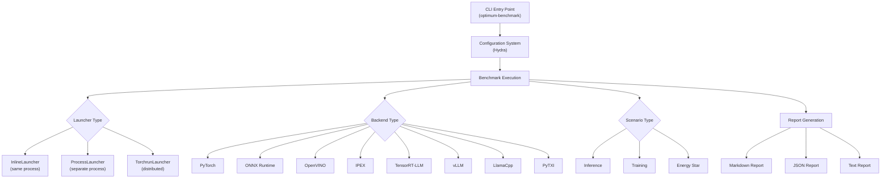
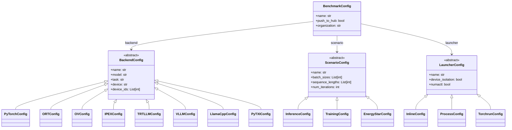
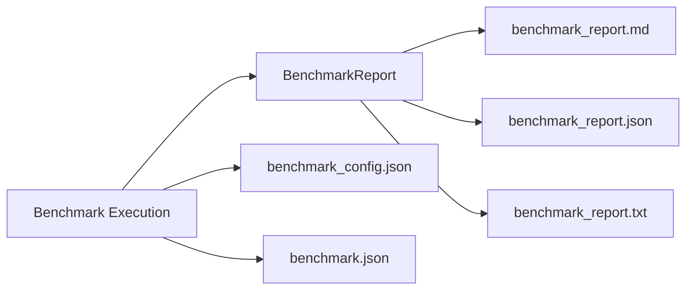
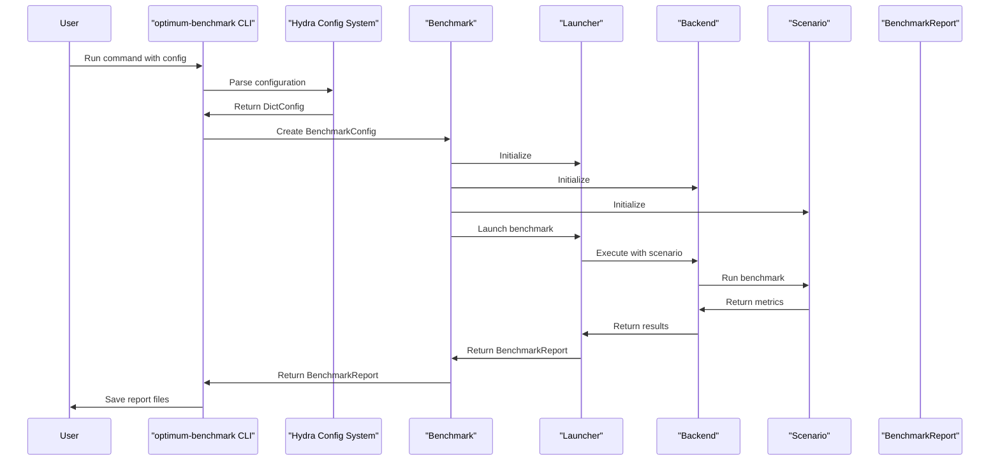

<!-- source: DeepWiki mcp.deepwiki.com · repo huggingface/optimum-benchmark · page 8.1 Command Line Interface · fetched 2026-10-26 -->

# Command Line Interface

<details>
<summary>Relevant source files</summary>

The following files were used as context for generating this wiki page:

- [.github/workflows/test_cli_cpu_ipex.yaml](.github/workflows/test_cli_cpu_ipex.yaml)
- [.github/workflows/test_cli_cpu_llama_cpp.yaml](.github/workflows/test_cli_cpu_llama_cpp.yaml)
- [.github/workflows/test_cli_misc.yaml](.github/workflows/test_cli_misc.yaml)
- [.gitignore](.gitignore)
- [optimum_benchmark/__init__.py](optimum_benchmark/__init__.py)
- [optimum_benchmark/backends/__init__.py](optimum_benchmark/backends/__init__.py)
- [optimum_benchmark/cli.py](optimum_benchmark/cli.py)
- [optimum_benchmark/import_utils.py](optimum_benchmark/import_utils.py)
- [optimum_benchmark/launchers/base.py](optimum_benchmark/launchers/base.py)
- [optimum_benchmark/launchers/inline/launcher.py](optimum_benchmark/launchers/inline/launcher.py)
- [optimum_benchmark/launchers/process/launcher.py](optimum_benchmark/launchers/process/launcher.py)
- [optimum_benchmark/launchers/torchrun/launcher.py](optimum_benchmark/launchers/torchrun/launcher.py)
- [setup.py](setup.py)
- [tests/test_cli.py](tests/test_cli.py)

</details>


This page documents the Command Line Interface (CLI) of Optimum-Benchmark, which provides a unified way to run benchmarks for machine learning models across different hardware configurations, backends, and scenarios. For programmatic usage via Python API, see [Python API](#8.2).

## Overview

The Optimum-Benchmark CLI is built on top of the [Hydra](https://hydra.cc/) configuration framework, which provides a flexible way to configure and run benchmarks. It's installed as the command `optimum-benchmark` when you install the optimum-benchmark package.



Sources: [optimum_benchmark/cli.py:1-83](), [setup.py:93-123]()

## Installation

The CLI is installed automatically when you install the optimum-benchmark package:

```bash
pip install optimum-benchmark
```

For specific backends, you need to install additional dependencies:

```bash
# For ONNX Runtime
pip install "optimum-benchmark[onnxruntime]"

# For TensorRT-LLM
pip install "optimum-benchmark[tensorrt-llm]"

# For OpenVINO
pip install "optimum-benchmark[openvino]"

# For multiple backends
pip install "optimum-benchmark[onnxruntime,openvino,ipex]"
```

Sources: [setup.py:17-123]()

## Basic Usage

The basic command structure is:

```bash
optimum-benchmark --config-name CONFIG_NAME [OPTIONS]
```

Where:
- `CONFIG_NAME` is a predefined configuration name
- `OPTIONS` are Hydra configuration overrides

You can also specify a custom configuration directory:

```bash
optimum-benchmark --config-dir /path/to/configs --config-name my_config
```

Sources: [tests/test_cli.py:26-51](), [optimum_benchmark/cli.py:57-83]()

## Configuration System

### Configuration Architecture

The configuration system uses Hydra's hierarchical structure to organize parameters:



Sources: [optimum_benchmark/cli.py:32-54](), [optimum_benchmark/__init__.py:1-41](), [optimum_benchmark/backends/__init__.py:1-24]()

### Command Line Overrides

You can override any configuration parameter using Hydra's dot notation:

```bash
optimum-benchmark --config-name base_config backend.model=bert-base-uncased backend.task=text-classification
```

To add new parameters that don't exist in the base configuration, use the `+` prefix:

```bash
optimum-benchmark --config-name base_config +scenario.input_shapes.batch_size=1
```

Sources: [tests/test_cli.py:59-74](), [tests/test_cli.py:82-100]()

## Launchers

Optimum-Benchmark provides three different launchers to run benchmarks:

### Inline Launcher

Runs the benchmark in the same process. Useful for debugging but not recommended for actual benchmarking.

```bash
optimum-benchmark --config-name base_config launcher=inline
```

Sources: [optimum_benchmark/launchers/inline/launcher.py:1-20]()

### Process Launcher

Runs the benchmark in a separate process with proper isolation. This is the recommended launcher for most benchmarks.

```bash
optimum-benchmark --config-name base_config launcher=process
```

The Process Launcher provides:
- Process isolation for more accurate measurements
- Optional NUMA control for CPU pinning
- Optional device isolation to prevent other processes from using the same GPU

Sources: [optimum_benchmark/launchers/process/launcher.py:1-114]()

### Torchrun Launcher

Runs the benchmark in a distributed environment using PyTorch's distributed training utilities. Useful for multi-GPU benchmarks.

```bash
optimum-benchmark --config-name base_config launcher=torchrun launcher.nproc_per_node=2
```

Sources: [optimum_benchmark/launchers/torchrun/launcher.py:1-178]()

## Output and Reporting

When a benchmark completes, several report files are generated:

1. `benchmark_config.json`: The configuration used for the benchmark
2. `benchmark_report.md`: A human-readable Markdown report
3. `benchmark_report.json`: A machine-readable JSON report
4. `benchmark_report.txt`: A plain text summary report
5. `benchmark.json`: The full benchmark object serialized to JSON



Sources: [optimum_benchmark/cli.py:74-82]()

## Advanced Usage

### Environment Variables

The CLI respects several environment variables:

- `LOG_LEVEL`: Controls the logging verbosity (default: "INFO")
- `LOG_TO_FILE`: Whether to save logs to a file (default: "1")
- `OVERRIDE_BENCHMARKS`: Whether to override existing benchmark results (default: "0")
- `CUDA_VISIBLE_DEVICES`: Controls which NVIDIA GPUs are visible to the process
- `ROCR_VISIBLE_DEVICES`: Controls which AMD GPUs are visible to the process
- `LOG_ALL_RANKS`: For distributed benchmarks, whether to log from all ranks (default: "0")

Sources: [optimum_benchmark/cli.py:60-63](), [tests/test_cli.py:46-48](), [optimum_benchmark/launchers/torchrun/launcher.py:147-155]()

### NUMA Control

For CPU benchmarks, you can use NUMA control to pin processes to specific CPU cores:

```bash
optimum-benchmark --config-name base_config launcher.numactl=True launcher.numactl_kwargs.cpunodebind=0
```

This is particularly useful for consistent benchmarks on multi-socket systems.

Sources: [optimum_benchmark/launchers/base.py:16-93](), [tests/test_cli.py:106-129]()

### Device Isolation

The launchers support device isolation to ensure that no other processes use the same GPU during benchmarking:

```bash
optimum-benchmark --config-name base_config launcher.device_isolation=True
```

Sources: [optimum_benchmark/launchers/base.py:39-62]()

## Common Examples

### Text Generation Benchmark

```bash
optimum-benchmark --config-name base_config \
    name=text-generation-benchmark \
    backend=pytorch \
    backend.model=gpt2 \
    backend.task=text-generation \
    backend.device=cuda \
    scenario=inference \
    +scenario.input_shapes.batch_size=1 \
    +scenario.input_shapes.sequence_length=128 \
    scenario.generation_kwargs.max_new_tokens=32
```

### Image Classification Benchmark

```bash
optimum-benchmark --config-name base_config \
    name=image-classification-benchmark \
    backend=pytorch \
    backend.model=google/vit-base-patch16-224 \
    backend.task=image-classification \
    backend.device=cuda \
    scenario=inference \
    +scenario.input_shapes.batch_size=16
```

### Multi-GPU Training Benchmark

```bash
optimum-benchmark --config-name base_config \
    name=multi-gpu-training-benchmark \
    launcher=torchrun \
    launcher.nproc_per_node=2 \
    backend=pytorch \
    backend.model=bert-base-uncased \
    backend.task=text-classification \
    backend.device=cuda \
    scenario=training \
    +scenario.input_shapes.batch_size=32 \
    +scenario.input_shapes.sequence_length=128
```

Sources: [tests/test_cli.py:1-129]()

## CLI Architecture

The following diagram shows how the CLI fits into the overall Optimum-Benchmark architecture:



Sources: [optimum_benchmark/cli.py:1-83](), [setup.py:93-123]()

## Troubleshooting

### Exit Codes

The CLI returns different exit codes based on the outcome:

- **0**: Successful execution
- **1**: Error during benchmark execution

You can determine what went wrong by examining the error messages and logs.

Sources: [tests/test_cli.py:54-103]()

### Common Issues

1. **Backend not found**: Make sure you've installed the appropriate backend dependencies using the extras in pip
2. **CUDA out of memory**: Reduce batch size or model size, or use a different launcher
3. **Performance inconsistencies**: Use process launcher with device_isolation=True for more consistent results

## Integration with CI/CD

The optimum-benchmark CLI is designed to integrate well with CI/CD systems. The repository includes several GitHub Actions workflows that demonstrate how to use the CLI in automated testing:

- Testing on different operating systems (Linux, macOS, Windows)
- Testing with different Python versions
- Testing with different backends (CPU, CUDA, ROCm)

Sources: [.github/workflows/test_cli_misc.yaml:1-69](), [.github/workflows/test_cli_cpu_ipex.yaml:1-53](), [.github/workflows/test_cli_cpu_llama_cpp.yaml:1-60]()

---

