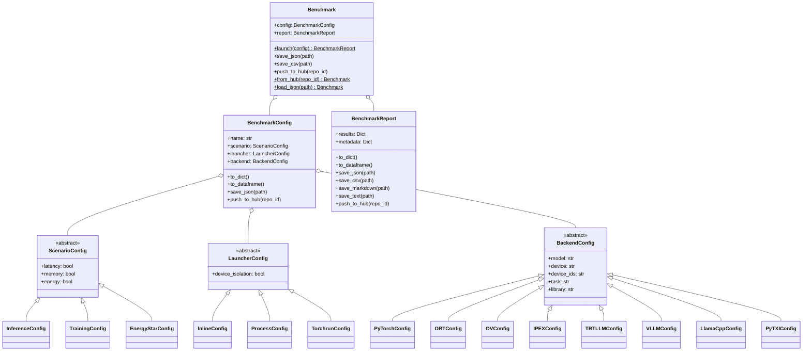
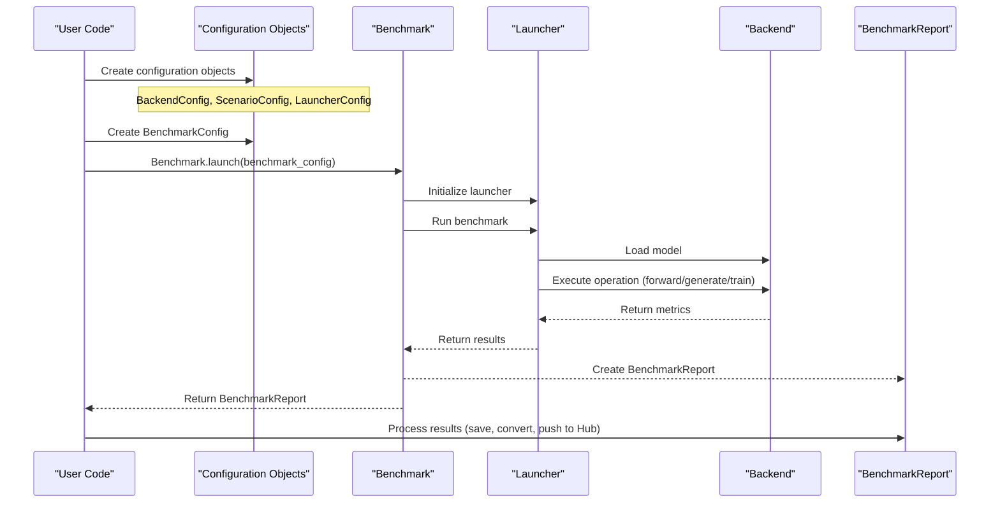
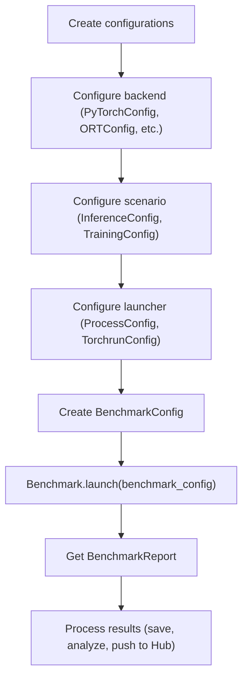
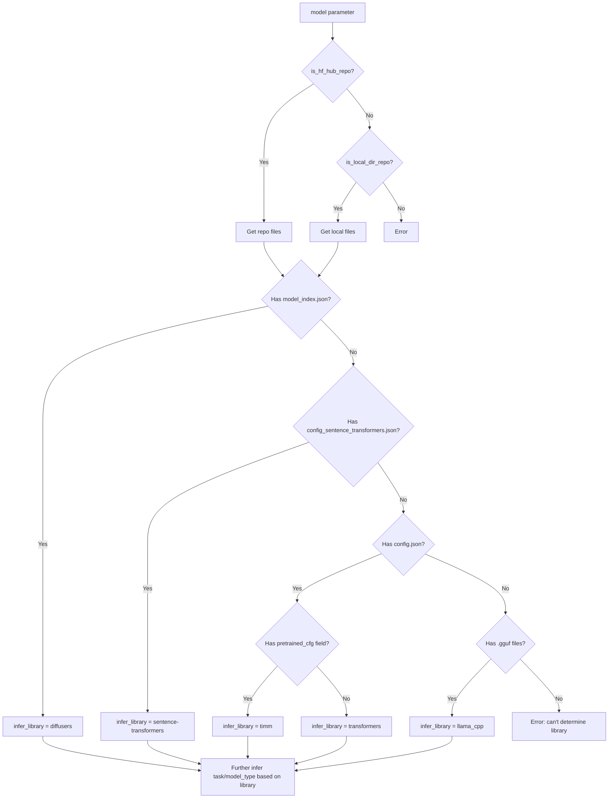
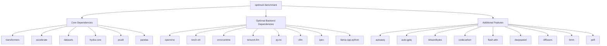

<!-- source: DeepWiki mcp.deepwiki.com · repo huggingface/optimum-benchmark · page 8.2 Python API · fetched 2026-10-26 -->

# Python API

<details>
<summary>Relevant source files</summary>

The following files were used as context for generating this wiki page:

- [.github/workflows/test_cli_cpu_ipex.yaml](.github/workflows/test_cli_cpu_ipex.yaml)
- [.github/workflows/test_cli_cpu_llama_cpp.yaml](.github/workflows/test_cli_cpu_llama_cpp.yaml)
- [.gitignore](.gitignore)
- [README.md](README.md)
- [optimum_benchmark/__init__.py](optimum_benchmark/__init__.py)
- [optimum_benchmark/backends/__init__.py](optimum_benchmark/backends/__init__.py)
- [optimum_benchmark/backends/base.py](optimum_benchmark/backends/base.py)
- [optimum_benchmark/backends/config.py](optimum_benchmark/backends/config.py)
- [optimum_benchmark/backends/transformers_utils.py](optimum_benchmark/backends/transformers_utils.py)
- [optimum_benchmark/cli.py](optimum_benchmark/cli.py)
- [optimum_benchmark/import_utils.py](optimum_benchmark/import_utils.py)
- [optimum_benchmark/task_utils.py](optimum_benchmark/task_utils.py)
- [setup.py](setup.py)

</details>


This document provides a comprehensive guide to using the Optimum-Benchmark Python API for programmatically running benchmarks of machine learning models. The API offers a flexible way to configure, execute, and analyze benchmarks while providing a consistent interface across different backends, scenarios, and launchers.

For information about using the command-line interface instead, see [Command Line Interface](#8.1).

## Core Components

The Optimum-Benchmark Python API is built around several key components that work together to provide a comprehensive benchmarking framework:



Sources: [optimum_benchmark/__init__.py:1-41](), [README.md:120-163]()

## Basic Usage

Using the Python API involves three main steps:

1. Creating configuration objects for your benchmark
2. Running the benchmark using the `Benchmark.launch()` method
3. Working with the results in the `BenchmarkReport` object

Here's a typical workflow illustrated with the key classes and methods:



Sources: [README.md:122-163](), [optimum_benchmark/cli.py:1-83]()

## Configuration System

The configuration system is the foundation of the API, allowing you to specify all aspects of your benchmark:

### BenchmarkConfig

The `BenchmarkConfig` class is the main entry point for configuring a benchmark. It combines three key configuration components:

1. **Backend** - Specifies the ML framework and hardware to use
2. **Scenario** - Defines what operation to benchmark (inference or training)
3. **Launcher** - Controls how the benchmark will be executed

This class also provides methods for serialization and sharing of configurations:

- `to_dict()` / `to_dataframe()` - Convert configuration to Python dictionaries or pandas DataFrames
- `save_json(path)` - Save configuration to a JSON file
- `push_to_hub(repo_id)` - Upload configuration to Hugging Face Hub

Sources: [optimum_benchmark/__init__.py:13-15](), [optimum_benchmark/cli.py:36-37]()

### Backend Configurations

Backend configurations specify the model to benchmark and the hardware to use:

| Backend Class | Purpose |
|---------------|---------|
| `PyTorchConfig` | Configure PyTorch-based benchmarks |
| `ORTConfig` | Configure ONNX Runtime benchmarks |
| `OVConfig` | Configure OpenVINO benchmarks |
| `IPEXConfig` | Configure Intel Extension for PyTorch benchmarks |
| `TRTLLMConfig` | Configure TensorRT-LLM benchmarks |
| `VLLMConfig` | Configure vLLM benchmarks |
| `LlamaCppConfig` | Configure LlamaCpp benchmarks |
| `PyTXIConfig` | Configure PyTXI benchmarks |

All backend configurations inherit from the abstract `BackendConfig` class and share common parameters:

- `model`: Model identifier or path (required)
- `processor`: Processor identifier or path (defaults to model value)
- `task`: Task type (auto-inferred if not specified)
- `library`: Library to use (auto-inferred if not specified)
- `device`: Device to run on (e.g., "cpu", "cuda")
- `device_ids`: Specific device IDs to use (e.g., "0,1" for multi-GPU)
- `seed`: Random seed for reproducibility
- `model_kwargs`: Additional arguments for model initialization
- `processor_kwargs`: Additional arguments for processor initialization

Sources: [optimum_benchmark/backends/config.py:19-129](), [optimum_benchmark/backends/__init__.py:1-24]()

### Scenario Configurations

Scenario configurations define what operation to benchmark and what metrics to track:

| Scenario Class | Purpose |
|----------------|---------|
| `InferenceConfig` | Configure inference benchmarks (forward/generate/call) |
| `TrainingConfig` | Configure training benchmarks |
| `EnergyStarConfig` | Configure energy efficiency benchmarks |

Common parameters across scenarios include:

- `latency`: Enable latency tracking
- `memory`: Enable memory usage tracking
- `energy`: Enable energy consumption tracking

Sources: [optimum_benchmark/__init__.py:17](), [optimum_benchmark/cli.py:47-51]()

### Launcher Configurations

Launcher configurations control how benchmarks are executed:

| Launcher Class | Purpose |
|----------------|---------|
| `InlineConfig` | Run benchmarks in the same process (for debugging) |
| `ProcessConfig` | Run benchmarks in a separate process |
| `TorchrunConfig` | Run benchmarks with PyTorch distributed (multi-GPU) |

Key parameters include:

- `device_isolation`: Ensure only the benchmark is using the specified devices
- `nproc_per_node`: Number of processes per node (for TorchrunConfig)
- `numa_config`: NUMA configuration for CPU pinning

Sources: [optimum_benchmark/__init__.py:16](), [optimum_benchmark/cli.py:52-54]()

## Running Benchmarks

The primary way to execute benchmarks is through the `Benchmark.launch()` static method:



### Example Workflow

1. Create specific configurations for backend, scenario, and launcher
2. Create a `BenchmarkConfig` that combines these configurations
3. Launch the benchmark using `Benchmark.launch()`
4. Work with the returned `BenchmarkReport`

The `Benchmark.launch()` method handles:
- Setting up the benchmark environment
- Initializing the specified backend
- Loading the model
- Executing the benchmark according to the scenario
- Collecting and aggregating metrics
- Returning a structured report

Sources: [README.md:132-143](), [optimum_benchmark/cli.py:76-77]()

## Working with Results

After running a benchmark, you'll receive a `BenchmarkReport` object that contains all measured metrics and metadata:

### BenchmarkReport Methods

The `BenchmarkReport` class provides several methods for working with benchmark results:

- Data conversion:
  - `to_dict()`: Convert results to a Python dictionary
  - `to_dataframe()`: Convert results to a pandas DataFrame

- Saving results:
  - `save_json(path)`: Save results as JSON
  - `save_csv(path)`: Save results as CSV
  - `save_markdown(path)`: Save results as Markdown
  - `save_text(path)`: Save results as plain text

- Sharing results:
  - `push_to_hub(repo_id)`: Upload results to Hugging Face Hub

Sources: [README.md:144-156](), [optimum_benchmark/cli.py:77-80]()

### Benchmark Class Integration

The `Benchmark` class can combine both configuration and results:

```python
# Create a Benchmark object with both config and report
benchmark = Benchmark(config=benchmark_config, report=benchmark_report)

# Save the complete benchmark data
benchmark.save_json("benchmark.json")

# Push to Hugging Face Hub
benchmark.push_to_hub("username/benchmark-name")

# Load a benchmark from Hub or file
loaded_benchmark = Benchmark.from_hub("username/benchmark-name")
loaded_benchmark = Benchmark.load_json("benchmark.json")
```

This approach allows for easy storage and sharing of both the benchmark configuration and its results as a single entity.

Sources: [README.md:153-162](), [optimum_benchmark/cli.py:81-82]()

## Task Handling and Model Type Inference

The API includes automatic detection of model tasks and types, which simplifies configuration:



The API automatically:

1. Determines the library (transformers, diffusers, timm, llama_cpp) based on the model structure
2. Infers the appropriate task based on model architecture
3. Identifies the model type for proper initialization

This system makes it easier to configure benchmarks without having to specify all details manually.

Sources: [optimum_benchmark/task_utils.py:186-340](), [optimum_benchmark/backends/config.py:47-90]()

## Dependency and Import Management

The Optimum-Benchmark package carefully manages optional dependencies to support a wide range of backends:



The API includes utility functions to check for available dependencies, allowing it to gracefully adapt to the user's environment:

- `is_[library]_available()`: Check if a specific library is installed
- `[library]_version()`: Get the version of an installed library
- `get_hf_libs_info()`: Get information about all installed Hugging Face libraries

These functions allow the API to provide appropriate error messages or fallbacks based on what's available in the user's environment.

Sources: [optimum_benchmark/import_utils.py:1-277](), [setup.py:17-115]()

## Complete API Example

Here's a complete example of using the Python API to benchmark a GPT-2 model on multiple GPUs:

```python
from optimum_benchmark import Benchmark, BenchmarkConfig, TorchrunConfig, InferenceConfig, PyTorchConfig
from optimum_benchmark.logging_utils import setup_logging

# Configure logging
setup_logging(level="INFO", handlers=["console"])

# Create launcher configuration for distributed execution
launcher_config = TorchrunConfig(nproc_per_node=2)

# Create scenario configuration for inference with metrics tracking
scenario_config = InferenceConfig(
    latency=True,  # Track latency metrics
    memory=True,   # Track memory usage
    energy=False   # Don't track energy consumption
)

# Create backend configuration
backend_config = PyTorchConfig(
    model="gpt2",     # Use GPT-2 model
    device="cuda",    # Run on GPU
    device_ids="0,1", # Use first two GPUs
    no_weights=True   # Use random weights (faster for testing)
)

# Create the benchmark configuration
benchmark_config = BenchmarkConfig(
    name="pytorch_gpt2_benchmark",
    scenario=scenario_config,
    launcher=launcher_config,
    backend=backend_config,
)

# Run the benchmark
benchmark_report = Benchmark.launch(benchmark_config)

# Save the results
benchmark_report.save_json("benchmark_report.json")
benchmark_report.save_csv("benchmark_report.csv")
benchmark_report.save_markdown("benchmark_report.md")

# Create a full benchmark object and save it
benchmark = Benchmark(config=benchmark_config, report=benchmark_report)
benchmark.save_json("benchmark.json")

# Optionally push to Hugging Face Hub
benchmark.push_to_hub("username/pytorch_gpt2_benchmark")
```

This example demonstrates the complete workflow from configuration to execution to result processing.

Sources: [README.md:126-163]()

## Summary

The Optimum-Benchmark Python API provides a flexible and powerful way to benchmark machine learning models across different frameworks, hardware, and scenarios. Its key features include:

1. **Unified interface** across different backends, scenarios, and launchers
2. **Automatic configuration** with sensible defaults and inference capabilities
3. **Comprehensive metrics tracking** for latency, memory, and energy
4. **Distributed benchmarking** support through different launchers
5. **Structured reporting** with multiple output formats
6. **Integration with Hugging Face Hub** for easy sharing of results

By providing both high-level abstractions and detailed configuration options, the API allows users to quickly set up benchmarks while maintaining the flexibility to customize every aspect of the benchmarking process.

---

