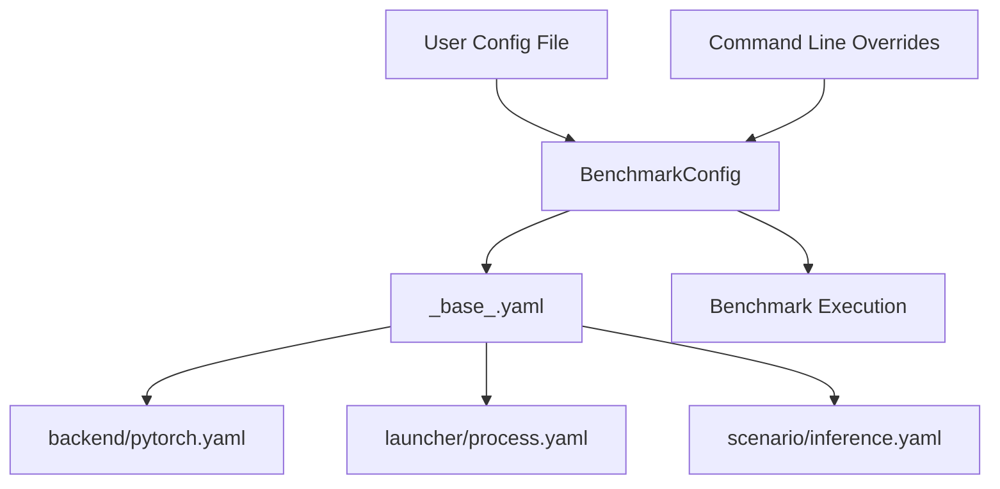

<!-- source: DeepWiki mcp.deepwiki.com · repo huggingface/optimum-benchmark · page 8.3 Configuration Examples · fetched 2026-10-26 -->

# Configuration Examples

<details>
<summary>Relevant source files</summary>

The following files were used as context for generating this wiki page:

- [tests/configs/_base_.yaml](tests/configs/_base_.yaml)
- [tests/configs/_ddp_.yaml](tests/configs/_ddp_.yaml)

</details>


This page provides practical examples of common configurations for benchmarking ML models with optimum-benchmark. For information about using the command-line interface and Python API to execute these configurations, see [Command Line Interface](#8.1) and [Python API](#8.2).

## Configuration System Overview

Optimum-benchmark uses a hierarchical configuration system powered by Hydra. Configurations can be specified through YAML files or command-line overrides. The system supports configuration inheritance, allowing you to build complex configurations from simple building blocks.

### Configuration Hierarchy



Sources: [tests/configs/_base_.yaml:1-7]()

## Base Configuration Structure

The base configuration defines defaults for the benchmarking system:

```yaml
defaults:
  - benchmark # parent schema
  - backend: pytorch # default backend
  - launcher: process # default launcher
  - scenario: inference # default scenario
  - _self_

print_report: true
log_report: true
```

This configuration sets up:
- The `pytorch` backend by default
- The `process` launcher for running benchmarks
- The `inference` scenario
- Options to print and log the benchmark reports

Sources: [tests/configs/_base_.yaml:1-10]()

## Configuration Components

Each benchmark configuration consists of several key components:

```mermaid
classDiagram
    class "BenchmarkConfig" {
        +String name
        +BackendConfig backend
        +LauncherConfig launcher
        +ScenarioConfig scenario
        +bool print_report
        +bool log_report
    }
    
    class "BackendConfig" {
        +String name
        +String model
        +String task
        +String device
        +List device_ids
    }
    
    class "LauncherConfig" {
        +String name
        +int nproc_per_node
        +String master_addr
        +int master_port
    }
    
    class "ScenarioConfig" {
        +String name
        +List batch_sizes
        +Dict input_shapes
        +int num_iterations
        +Dict options
    }
    
    "BenchmarkConfig" --> "BackendConfig"
    "BenchmarkConfig" --> "LauncherConfig"
    "BenchmarkConfig" --> "ScenarioConfig"
```

## Common Configuration Examples

### Example 1: Basic Inference with PyTorch

```yaml
# basic_pytorch_inference.yaml
defaults:
  - benchmark
  - backend: pytorch
  - launcher: process
  - scenario: inference
  - _self_

backend:
  model: facebook/opt-125m
  task: text-generation
  device: cuda:0

scenario:
  batch_sizes: [1, 2, 4, 8]
  input_shapes:
    sequence_length: 128
  num_iterations: 10
```

### Example 2: Multi-GPU Distributed Configuration

For multi-GPU benchmarking using Distributed Data Parallel (DDP):

```yaml
# ddp_config.yaml
defaults:
  - benchmark
  - override launcher: torchrun
  - _self_

launcher:
  nproc_per_node: 2

backend:
  device_ids: 0,1
  model: openai-community/gpt2
  task: text-generation

scenario:
  batch_sizes: [1, 4]
  input_shapes:
    sequence_length: 256
  num_iterations: 5
```

Sources: [tests/configs/_ddp_.yaml:1-16]()

### Example 3: ONNX Runtime Inference

```yaml
# ort_inference.yaml
defaults:
  - benchmark
  - backend: ort
  - launcher: process
  - scenario: inference
  - _self_

backend:
  model: facebook/opt-125m
  task: text-generation
  device: cuda:0
  onnx_opset: 15
  optimize_model: true
  execution_provider: CUDAExecutionProvider

scenario:
  batch_sizes: [1, 4, 16]
  input_shapes:
    sequence_length: 128
  num_iterations: 10
```

### Example 4: OpenVINO Inference on CPU

```yaml
# openvino_inference.yaml
defaults:
  - benchmark
  - backend: ov
  - launcher: process
  - scenario: inference
  - _self_

backend:
  model: facebook/opt-125m
  task: text-generation
  device: CPU
  optimize_model: true
  compression_config:
    quantization_approach: DYNAMIC_QUANTIZATION

scenario:
  batch_sizes: [1, 4, 16, 32]
  input_shapes:
    sequence_length: 128
  num_iterations: 10
```

### Example 5: TensorRT-LLM for Large Language Models

```yaml
# trtllm_config.yaml
defaults:
  - benchmark
  - backend: trtllm
  - launcher: process
  - scenario: inference
  - _self_

backend:
  model: meta-llama/Llama-2-7b-hf
  task: text-generation
  device: cuda:0
  build_config:
    max_batch_size: 8
    max_input_len: 1024
    max_output_len: 128
    use_fp16: true

scenario:
  batch_sizes: [1, 4]
  input_shapes:
    sequence_length: 512
  num_iterations: 5
  generation_config:
    max_new_tokens: 128
```

### Example 6: Training Benchmark

```yaml
# training_benchmark.yaml
defaults:
  - benchmark
  - backend: pytorch
  - launcher: process
  - scenario: training
  - _self_

backend:
  model: facebook/opt-350m
  task: text-generation
  device: cuda:0
  
scenario:
  batch_sizes: [4, 8, 16]
  input_shapes:
    sequence_length: 512
  num_iterations: 5
  warmup_iterations: 1
  training_config:
    learning_rate: 5e-5
    optimizer: adamw
    num_steps: 100
```

### Example 7: Energy Star Benchmark

```yaml
# energy_benchmark.yaml
defaults:
  - benchmark
  - backend: pytorch
  - launcher: process
  - scenario: energy-star
  - _self_

backend:
  model: facebook/opt-125m
  task: text-generation
  device: cuda:0
  
scenario:
  batch_sizes: [1]
  input_shapes:
    sequence_length: 128
  num_iterations: 3
  energy_config:
    duration: 300  # in seconds
    sampling_interval: 1  # in seconds
```

## Backend-Specific Configuration Options

### PyTorch Backend Options

```yaml
backend:
  name: pytorch
  model: facebook/opt-1.3b  # model ID or path
  task: text-generation  # ML task
  device: cuda:0  # device to use
  device_ids: [0, 1]  # for multi-device setups
  dtype: float16  # precision setting
  use_compile: true  # for torch.compile
  compile_mode: reduce-overhead  # compile mode
```

### ONNX Runtime Backend Options

```yaml
backend:
  name: ort
  model: facebook/opt-125m
  task: text-generation
  device: cuda:0
  onnx_opset: 15
  optimize_model: true
  execution_provider: CUDAExecutionProvider
  provider_options:
    device_id: 0
    cuda_mem_limit: 2147483648
```

### OpenVINO Backend Options

```yaml
backend:
  name: ov
  model: facebook/opt-125m
  task: text-generation
  device: CPU  # CPU, GPU, etc.
  optimize_model: true
  compression_config:
    quantization_approach: DYNAMIC_QUANTIZATION
  inference_config:
    num_streams: 4
    affinity: NUMA
```

### VLLM Backend Options

```yaml
backend:
  name: vllm
  model: meta-llama/Llama-2-7b-hf
  task: text-generation
  device: cuda:0
  tensor_parallel_size: 2
  max_model_len: 4096
  quantization: awq
```

### LlamaCpp Backend Options

```yaml
backend:
  name: llamacpp
  model: TheBloke/Llama-2-7B-GGUF/llama-2-7b.Q4_K_M.gguf
  task: text-generation
  device: cpu
  n_threads: 8
  n_batch: 512
  n_gpu_layers: 0  # 0 for CPU, higher for GPU offloading
```

## Launcher Configuration Options

### Process Launcher Options

```yaml
launcher:
  name: process
  timeout: 600  # seconds
  log_file: benchmark.log
```

### Torchrun Launcher Options (for distributed benchmarks)

```yaml
launcher:
  name: torchrun
  nproc_per_node: 2
  master_addr: localhost
  master_port: 29500
  timeout: 1200  # seconds
```

## Scenario Configuration Options

### Inference Scenario Options

```yaml
scenario:
  name: inference
  batch_sizes: [1, 2, 4, 8]
  input_shapes:
    sequence_length: 128
  num_iterations: 10
  warmup_iterations: 3
  repeat_inputs: true
  generation_config:  # for text generation
    max_new_tokens: 64
    do_sample: false
    temperature: 1.0
```

### Training Scenario Options

```yaml
scenario:
  name: training
  batch_sizes: [4, 8, 16]
  input_shapes:
    sequence_length: 512
  num_iterations: 5
  warmup_iterations: 1
  training_config:
    learning_rate: 5e-5
    optimizer: adamw
    num_steps: 100
    gradient_accumulation_steps: 1
```

## Command Line Configuration Overrides

You can override configuration values directly from the command line:

```bash
python -m optimum_benchmark.run backend=pytorch backend.model=facebook/opt-350m scenario.batch_sizes=[1,4,16]
```

You can also specify a configuration file and override specific values:

```bash
python -m optimum_benchmark.run --config-path=/path/to/config.yaml backend.device=cuda:1
```

## Output and Run Configuration

You can configure where and how outputs are saved:

```yaml
hydra:
  run:
    dir: runs/${name}  # Define run directory
  sweep:
    dir: sweeps/${name}  # Define sweep directory
    subdir: ${hydra.job.override_dirname}  # Subdirectory for each run in sweep
  job:
    chdir: true  # Change working directory to the job directory
    env_set:
      OVERRIDE_BENCHMARKS: 1  # Override benchmarks that have been run before
```

Sources: [tests/configs/_base_.yaml:11-27]()

## Environment Variable Configuration

For distributed benchmarks, you can configure environment variables:

```yaml
hydra:
  job:
    env_set:
      LOG_ALL_RANKS: 1  # Log output from all ranks in distributed setup
```

Sources: [tests/configs/_ddp_.yaml:12-16]()

## Configuration File Structure

The benchmark configuration system follows a specific directory structure:

```
configs/
├── _base_.yaml
├── backend/
│   ├── pytorch.yaml
│   ├── ort.yaml
│   ├── ov.yaml
│   └── ...
├── launcher/
│   ├── process.yaml
│   ├── inline.yaml
│   └── torchrun.yaml
├── scenario/
│   ├── inference.yaml
│   ├── training.yaml
│   └── energy-star.yaml
└── specialized/
    ├── _ddp_.yaml
    └── ...
```

This structure allows for modular composition of configurations, where each component (backend, launcher, scenario) is defined separately and combined as needed.

---

