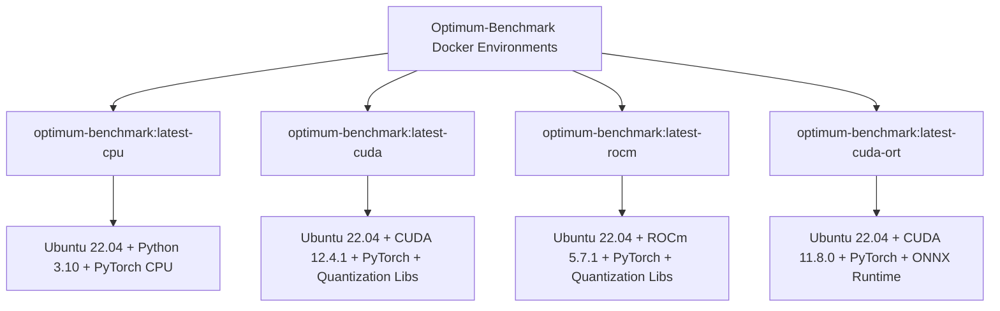
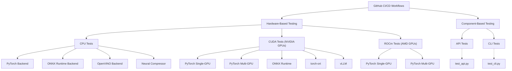
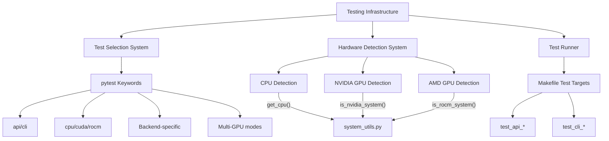

<!-- source: DeepWiki mcp.deepwiki.com · repo huggingface/optimum-benchmark · page 9 Development and Deployment · fetched 2026-10-26 -->

# Development and Deployment

<details>
<summary>Relevant source files</summary>

The following files were used as context for generating this wiki page:

- [.github/workflows/test_api_rocm.yaml](.github/workflows/test_api_rocm.yaml)
- [.github/workflows/test_cli_rocm_pytorch.yaml](.github/workflows/test_cli_rocm_pytorch.yaml)
- [Makefile](Makefile)
- [docker/cpu/Dockerfile](docker/cpu/Dockerfile)
- [docker/cuda-ort/Dockerfile](docker/cuda-ort/Dockerfile)
- [docker/cuda/Dockerfile](docker/cuda/Dockerfile)
- [docker/rocm/Dockerfile](docker/rocm/Dockerfile)
- [optimum_benchmark/system_utils.py](optimum_benchmark/system_utils.py)
- [pyproject.toml](pyproject.toml)
- [scripts/install_quantization_libs.py](scripts/install_quantization_libs.py)

</details>


This page documents the tools, environments, and processes used for developing, testing, and deploying the Optimum-Benchmark framework. It provides a comprehensive guide to setting up development environments, using Docker containers, understanding the CI/CD workflows, and working with the testing infrastructure.

## Development Environment Setup

Optimum-Benchmark supports multiple hardware platforms (CPU, NVIDIA GPUs, AMD GPUs) and various ML backends, requiring different development environments.

### Basic Installation

For basic development, you can install the package in development mode:

```bash
pip install -e .
```

This allows code changes to take effect without reinstallation. Additional dependencies can be installed based on your development needs:

```bash
# Install testing dependencies
pip install -e .[testing]

# Install with specific backend support
pip install -e .[testing,peft,timm,diffusers,onnxruntime]
```

Sources: [Makefile:16-17]()

## Docker Environments

The repository provides Docker environments for consistent development and testing across different hardware platforms.

### Available Docker Images



Sources: [docker/cpu/Dockerfile](), [docker/cuda/Dockerfile](), [docker/rocm/Dockerfile](), [docker/cuda-ort/Dockerfile]()

### Building and Running Docker Containers

The Makefile provides commands for building and running each Docker environment:

| Environment | Build Command | Run Command |
|-------------|--------------|-------------|
| CPU | `make build_cpu_image` | `make run_cpu_container` |
| CUDA (NVIDIA) | `make build_cuda_image` | `make run_cuda_container` |
| ROCm (AMD) | `make build_rocm_image` | `make run_rocm_container` |
| CUDA with ONNX Runtime | `make build_cuda_ort_image` | `make run_cuda_ort_container` |

Sources: [Makefile:21-79]()

### CPU Docker Environment

The CPU environment provides a base Ubuntu image with Python 3.10 and PyTorch CPU dependencies:

```
FROM ubuntu:22.04
```

Key features:
- Python 3.10
- PyTorch CPU version
- tcmalloc for memory optimization
- Intel OpenMP support

Sources: [docker/cpu/Dockerfile:15-43]()

### CUDA Docker Environment

The CUDA environment provides an Ubuntu image with CUDA, Python 3.10, and PyTorch GPU dependencies:

```
FROM nvidia/cuda:12.4.1-cudnn-devel-ubuntu22.04
```

Key features:
- CUDA 12.4.1 with cuDNN
- PyTorch CUDA
- Quantization libraries (AutoGPTQ and AutoAWQ) built from source

Sources: [docker/cuda/Dockerfile:15-49](), [scripts/install_quantization_libs.py:10-112]()

### ROCm Docker Environment

The ROCm environment supports AMD GPUs with PyTorch:

```
FROM rocm/dev-ubuntu-22.04:5.7.1
```

Key features:
- ROCm 5.7.1
- PyTorch ROCm
- AMD-specific optimizations
- Quantization libraries compatible with AMD GPUs

Sources: [docker/rocm/Dockerfile:15-51]()

### CUDA with ONNX Runtime Environment

This environment combines CUDA with ONNX Runtime:

```
FROM nvidia/cuda:11.8.0-cudnn8-devel-ubuntu22.04
```

Key features:
- CUDA 11.8.0 with cuDNN 8
- PyTorch CUDA
- ONNX Runtime with GPU support
- torch-ort integration

Sources: [docker/cuda-ort/Dockerfile:15-46]()

## CI/CD Workflows

The repository uses GitHub Actions for continuous integration and testing across multiple hardware configurations and backends.



Sources: [.github/workflows/test_api_rocm.yaml](), [.github/workflows/test_cli_rocm_pytorch.yaml]()

### Workflow Organization

The CI/CD system is organized along these dimensions:

1. **Hardware platform**: Tests run on CPU, CUDA (NVIDIA GPUs), and ROCm (AMD GPUs)
2. **Testing component**: Separated API and CLI testing
3. **Backend**: Tests for different ML backends (PyTorch, ONNX Runtime, OpenVINO, etc.)
4. **GPU configuration**: Single GPU vs Multi-GPU testing

### API Testing Workflows

API tests verify that the Python API functions correctly across different platforms. For example, the ROCm API test workflow:

```yaml
name: API ROCm Tests
on:
  workflow_dispatch:
  push:
    branches: [main]
  pull_request:
    branches: [main]
jobs:
  run_api_rocm_tests:
    uses: huggingface/hf-workflows/.github/workflows/optimum_benchmark_instinct_ci.yaml@testing
    with:
      machine_type: single-gpu
      install_extras: testing,timm,diffusers,codecarbon
      test_file: test_api.py
      pytest_keywords: api and cuda
```

Sources: [.github/workflows/test_api_rocm.yaml:1-39]()

### CLI Testing Workflows

CLI tests verify that the command-line interface works correctly. The ROCm CLI testing is separated into single-GPU and multi-GPU workflows:

```yaml
jobs:
  run_cli_rocm_pytorch_single_gpu_tests:
    uses: huggingface/hf-workflows/.github/workflows/optimum_benchmark_instinct_ci.yaml@testing
    with:
      machine_type: single-gpu
      install_extras: testing,diffusers,timm,peft,autoawq,auto-gptq
      test_file: test_cli.py
      pytest_keywords: cli and cuda and pytorch and not (dp or ddp or device_map or deepspeed) and not bnb
      
  run_cli_rocm_pytorch_multi_gpu_tests:
    uses: huggingface/hf-workflows/.github/workflows/optimum_benchmark_instinct_ci.yaml@testing
    with:
      machine_type: multi-gpu
      install_extras: testing,diffusers,timm,peft
      test_file: test_cli.py
      pytest_keywords: cli and cuda and pytorch and (dp or ddp or device_map)
```

Sources: [.github/workflows/test_cli_rocm_pytorch.yaml:23-57]()

## Testing Infrastructure

The testing infrastructure is designed to verify functionality across different hardware, backends, and usage scenarios.



Sources: [Makefile:123-176](), [optimum_benchmark/system_utils.py:1-243](), [pyproject.toml:12-16]()

### Hardware Detection

The framework includes utilities for detecting and utilizing different hardware:

- **CPU detection**: Identifies CPU model and capabilities
- **NVIDIA GPU detection**: Uses PyNVML to detect NVIDIA GPUs
- **AMD GPU detection**: Uses AMD SMI or PyRSMI to detect AMD GPUs

These utilities allow tests to be appropriately selected based on available hardware.

Sources: [optimum_benchmark/system_utils.py:21-243]()

### Test Selection with Pytest

Tests are filtered using pytest keywords to match the hardware environment and testing needs:

```bash
# Run API tests on CPU
pytest -s -k "api and cpu"

# Run CLI tests on NVIDIA GPU with PyTorch
pytest -s -k "cli and cuda and pytorch"

# Run CLI tests on AMD GPU for multi-GPU PyTorch
pytest -s -k "cli and cuda and pytorch and (dp or ddp or device_map or deepspeed)"
```

The Makefile provides standardized targets for common test combinations:

```bash
# API tests
make test_api_cpu
make test_api_cuda
make test_api_rocm

# CLI tests
make test_cli_cpu_pytorch
make test_cli_cuda_pytorch_single_gpu
make test_cli_rocm_pytorch_multi_gpu
```

Sources: [Makefile:123-176](), [pyproject.toml:12-16]()

## Deployment

### Package Installation

For deployment, the package can be installed with the appropriate dependencies:

```bash
# Basic installation
pip install optimum-benchmark

# Installation with specific backend support
pip install optimum-benchmark[timm,diffusers,peft,onnxruntime]
```

### Hardware-Specific Deployment

Different hardware platforms require specific setup:

1. **CPU deployment**:
   - Install CPU PyTorch: `pip install -e .[testing,peft,timm,diffusers]`

2. **NVIDIA GPU deployment**:
   - Install CUDA PyTorch and quantization libraries: `pip install -e .[testing,timm,diffusers,peft,autoawq,auto-gptq,bitsandbytes,deepspeed]`

3. **AMD GPU deployment**:
   - Install ROCm PyTorch and compatible quantization: `pip install -e .[testing,timm,diffusers,peft,autoawq,auto-gptq] "deepspeed<0.15"`

Sources: [Makefile:83-120]()

### Docker-Based Deployment

For reproducible deployment, the Docker containers provide consistent environments:

```bash
# Build CUDA container
make build_cuda_image

# Run benchmarks in container
docker run --gpus all --shm-size 64G \
  -v /path/to/models:/models \
  -v /path/to/results:/results \
  optimum-benchmark:latest-cuda \
  python -m optimum_benchmark.cli benchmark [options]
```

Sources: [Makefile:39-79]()

---

